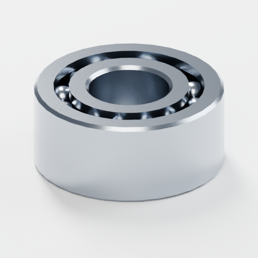
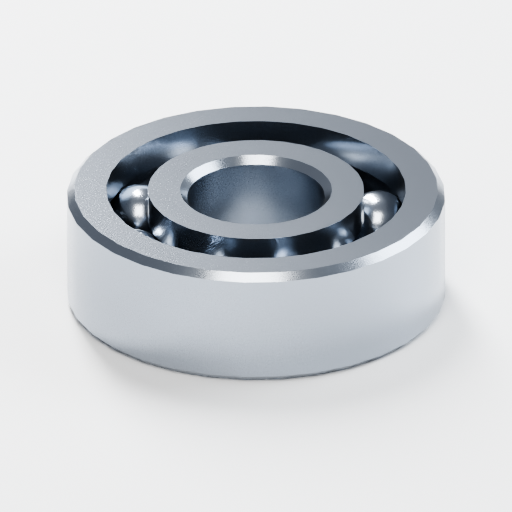
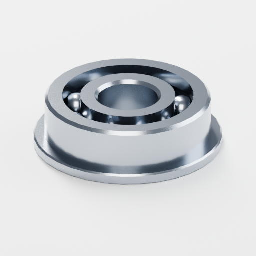

# OOMP bearings

## Summary

A catalogue of 339 metric bearings: single-row deep-groove, flanged and double-row angular-contact sizes, with nominal dimensions, source evidence, drawings, models and studio renders.

| [5204](parts/hardware_bearing_5200_series_5204_size_20_mm_id_47_mm_od_20.6_mm_depth/README.md) | [608](parts/hardware_bearing_600_series_608_size_8_mm_id_22_mm_od_7_mm_depth/README.md) | [F608](parts/hardware_bearing_f600_series_f608_size_8_mm_id_22_mm_od_7_mm_depth/README.md) |
| --- | --- | --- |
|  |  |  |

Generated open-bearing illustrations. Nominal envelopes follow the retained catalogue evidence; internal raceways and balls are illustrative.

## Details

[OOMP directory](https://github.com/oomlout/oomlout_oomp_version_5) · [Generator and maintenance guide](README_GENERATOR.md) · [Build validation](build_validation.json) · [Visual checks](validation/README.md)

Each part provides a dimensioned SVG and A4 PDF, 1:1 outline, two printable label sizes, editable OpenSCAD, full and lightweight GLB models, seven SVG views per quality, four studio renders and an editable Blender scene.

GLB files use metres and Y-up; OpenSCAD uses millimetres. STL exports are not retained. Render previews are 512 px; high-resolution images are 2048 px. Historical native SolidCraft files and their validation evidence are retained where previously generated.

Dimensions reviewed in October 2026 are preserved, including corrected flanges and double-row widths. Records distinguish manufacturer-checked dimensions from local catalogue values. No new manufacturer verification or stock check is implied by this migration.

## Parts

**[Browse by bearing series](navigation/README.md)** · [All part folders](parts/) · [Source records](parts_source/)

| Family | Parts |
| --- | --- |
| Double row angular contact | 34 |
| Flanged deep groove | 27 |
| Single row deep groove | 278 |

## Assembly

Choose a size, inspect its drawing and consult the purchased bearing specification for closure, clearance, tolerances and load ratings. These catalogue models do not establish a fit allowance or installation procedure.

[Source evidence](source_file/solidcraft/) · [Migration record](migration/README.md) · [Explicit bearing declarations](working_oomp_declarations_bearing.py)
