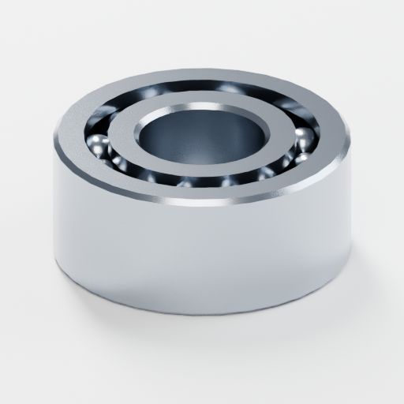
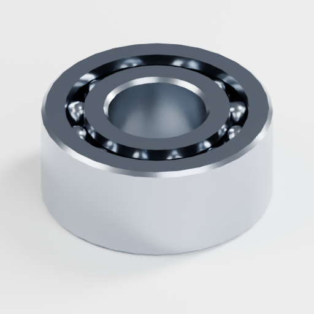
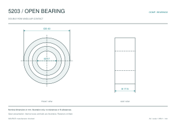

<!-- bearing-catalogue:start -->
# 5203 bearing - 17 x 40 x 17.5 mm

## Summary

Double row angular contact bearing: 17 mm bore, 40 mm outside diameter and 17.5 mm width.

| Product view | Isometric view |
| --- | --- |
|  |  |

Generated catalogue illustrations; the open internal geometry is illustrative.

## Details

**OOMP ID:** `hardware_bearing_5200_series_5203_size_17_mm_id_40_mm_od_17.5_mm_depth`

| Dimension | Nominal value |
| --- | --- |
| Bore / ID | 17 mm |
| Outside diameter / OD | 40 mm |
| Width / B | 17.5 mm |
| Catalogue contact angle | 25 degrees |

**Dimension evidence:** manufacturer checked (review retained from 2026-10-27).

Nominal presentation model. Raceways, pitch circle, chamfers and retainer geometry are illustrative; ball count/diameter are illustrative unless individually sourced. Not a manufacturer reconstruction, load-rating model or manufacturing/tolerance certification. Unspecified closure is presented open. The mesh shows open races and balls; retainers, seals and exact contact surfaces are omitted.

Contact-angle authority: **manufacturer family**. The mesh does not reconstruct the manufacturer contact surfaces.



[Printable A4 dimension sheet](working_dimension_a4.pdf) · [1:1 outline](working_svg.svg)

### Source evidence

- [https://www.nsk.com/content/dam/nsk/am/en_us/documents/bearings-americas/Bearing-and-Linear-Replacement-Guide.pdf](https://www.nsk.com/content/dam/nsk/am/en_us/documents/bearings-americas/Bearing-and-Linear-Replacement-Guide.pdf)

[Retained research and corrected dimensions](../../source_file/solidcraft/) · [Editable declaration](../../working_oomp_declarations_bearing.py)

## Parts

[Canonical part folder](.) · [Metadata](working.yaml) · [Browse this series](../../navigation/5200/README.md)

### Files

- [Editable OpenSCAD geometry](3dpr.scad)
- [Full model / GLB / metres, Y-up](three_d_model/model_full.glb)
- [Lightweight model / GLB / metres, Y-up](three_d_model/model_display.glb)
- [Editable Blender studio](three_d_model/studio.blend)
- [Product render / 2048 px](three_d_model/render_product_high.png)
- [Isometric render / 2048 px](three_d_model/render_high.png)
- [Populated model and render recipe](three_d_model/parameters.json)
- [Mesh measurements and artifact hashes](three_d_model/manifest.json)
- [Retained native CAD success manifest](solidcraft/latest_success.json)
- [76.2 x 50.8 mm label](label_bearing_3x2.pdf)
- [38.1 x 25.4 mm label](label_bearing_1_5x1.pdf)
- [Retained editable native bearing / SolidCraft](solidcraft/generations/9b19d47a03b5a848_20261027T111207Z_6dac3d1e/bearing_5203_open.solidcraft)

### Orthographic views

| Quality | Isometric | Front | Back | Left | Right | Top | Bottom |
| --- | --- | --- | --- | --- | --- | --- | --- |
| Full | [Isometric](three_d_model/full/isometric.svg) | [Front](three_d_model/full/front.svg) | [Back](three_d_model/full/back.svg) | [Left](three_d_model/full/left.svg) | [Right](three_d_model/full/right.svg) | [Top](three_d_model/full/top.svg) | [Bottom](three_d_model/full/bottom.svg) |
| Display | [Isometric](three_d_model/display/isometric.svg) | [Front](three_d_model/display/front.svg) | [Back](three_d_model/display/back.svg) | [Left](three_d_model/display/left.svg) | [Right](three_d_model/display/right.svg) | [Top](three_d_model/display/top.svg) | [Bottom](three_d_model/display/bottom.svg) |

## Assembly

No installation procedure is established for this generic size record. Select the required closure, clearance, tolerance and load rating from the actual purchased bearing specification.

<details>
<summary>Complete OOMP metadata</summary>

```yaml
depth: 17.5
id: hardware_bearing_5200_series_5203_size_17_mm_id_40_mm_od_17.5_mm_depth
od: 40.0
series: '5200'
size: '5203'
svg_details:
  svg_name: bearing_dimension
  title: 5203 / OPEN BEARING
  family: DOUBLE ROW ANGULAR CONTACT
  dimensions_mm:
    bore: 17.0
    outside: 40.0
    width: 17.5
    contact_angle_deg: 25.0
  sheet_width_mm: 297
  sheet_height_mm: 210
  ink: '#183336'
  accent: '#147d83'
  muted: '#61767a'
  paper: '#ffffff'
  race_face_fill: '#edf3f3'
  inner_race_face_outside_mm: 25.245
  outer_race_face_inside_mm: 31.755
  line_width_mm: 0.45
  font_family: Helvetica
  dimension_font_mm: 4
  title_font_mm: 9
  front_centre_mm:
  - 79
  - 103
  side_centre_mm:
  - 211
  - 103
  max_view_width_mm: 78
  max_side_width_mm: 55
  dimension_offset_mm: 12
  arrow_size_mm: 2
  note: Nominal dimensions in mm. Illustration only; no tolerances or fit allowances.
  authority: manufacturer checked
  internal_note: Open presentation; internal races and balls are illustrative. Retainers
    omitted.
  layout:
    left_margin_mm: 14
    right_margin_mm: 283
    title_y_mm: 22
    family_y_mm: 33
    family_font_mm: 3.5
    brand: OOMP / BEARINGS
    brand_font_mm: 3.5
    header_rule_y_mm: 40
    view_caption_y_mm: 173
    view_caption_font_mm: 3
    front_caption: FRONT VIEW
    side_caption: SIDE VIEW
    footer_rule_y_mm: 180
    note_y_mm: 187
    internal_note_y_mm: 194
    note_font_mm: 3.2
    source_y_mm: 202
    source_font_mm: 3
    source_prefix: 'SOURCE: '
    scale_prefix: A4 / scale
  dimension_style:
    line_width_mm: 0.25
    arrow_half_width_ratio: 0.3
    text_gap_mm: 2
    extension_mm: 2
    width_extension_mm: 3
    centre_extension_mm: 5
    dash_pattern_mm:
    - 2
    - 1
    flange_leader_offset_mm:
    - -13
    - 11
    flange_text_offset_mm:
    - -13
    - 16
    flange_font_mm: 3.5
  outline:
    ink: black
    line_width_mm: 0.1
taxonomy_1: hardware
taxonomy_10: ''
taxonomy_11: ''
taxonomy_12: ''
taxonomy_13: ''
taxonomy_14: ''
taxonomy_15: ''
taxonomy_2: bearing
taxonomy_3: 5200_series
taxonomy_4: 5203_size
taxonomy_5: 17_mm_id
taxonomy_6: 40_mm_od
taxonomy_7: 17.5_mm_depth
taxonomy_8: ''
taxonomy_9: ''
weight: '96'
width: 17.5
dimension_selection:
  policy: standard_metric_open_catalogue
  previous_id: hardware_bearing_5200_series_5203_size_17_mm_id_40_mm_od_17.4_mm_depth
  sources:
  - https://www.nsk.com/content/dam/nsk/am/en_us/documents/bearings-americas/Bearing-and-Linear-Replacement-Guide.pdf
  note: User selected standard catalogue variants on 2026-10-27; no sales ranking
    asserted.
url_chat: https://chatgpt.com/sites
run_action: true
run_oomp: true
run_oomp_populate: true
run_scad: false
generate_stl: false
taxonomy_1_upper: HARDWARE
taxonomy_1_upper_length_1: H
taxonomy_1_upper_length_2: HA
taxonomy_1_upper_length_3: HAR
taxonomy_1_upper_length_4: HARD
taxonomy_1_upper_length_5: HARDW
taxonomy_1_length_1: h
taxonomy_1_length_2: ha
taxonomy_1_length_3: har
taxonomy_1_length_4: hard
taxonomy_1_length_5: hardw
taxonomy_1_capital: Hardware
taxonomy_1_first_letter: h
taxonomy_1_first_letter_upper: H
taxonomy_2_upper: BEARING
taxonomy_2_upper_length_1: B
taxonomy_2_upper_length_2: BE
taxonomy_2_upper_length_3: BEA
taxonomy_2_upper_length_4: BEAR
taxonomy_2_upper_length_5: BEARI
taxonomy_2_length_1: b
taxonomy_2_length_2: be
taxonomy_2_length_3: bea
taxonomy_2_length_4: bear
taxonomy_2_length_5: beari
taxonomy_2_capital: Bearing
taxonomy_2_first_letter: b
taxonomy_2_first_letter_upper: B
taxonomy_3_upper: 5200_SERIES
taxonomy_3_upper_length_1: '5'
taxonomy_3_upper_length_2: '52'
taxonomy_3_upper_length_3: '520'
taxonomy_3_upper_length_4: '5200'
taxonomy_3_upper_length_5: '5200_'
taxonomy_3_length_1: '5'
taxonomy_3_length_2: '52'
taxonomy_3_length_3: '520'
taxonomy_3_length_4: '5200'
taxonomy_3_length_5: '5200_'
taxonomy_3_capital: 5200 Series
taxonomy_3_first_letter: '5'
taxonomy_3_first_letter_upper: '5'
taxonomy_4_upper: 5203_SIZE
taxonomy_4_upper_length_1: '5'
taxonomy_4_upper_length_2: '52'
taxonomy_4_upper_length_3: '520'
taxonomy_4_upper_length_4: '5203'
taxonomy_4_upper_length_5: '5203_'
taxonomy_4_length_1: '5'
taxonomy_4_length_2: '52'
taxonomy_4_length_3: '520'
taxonomy_4_length_4: '5203'
taxonomy_4_length_5: '5203_'
taxonomy_4_capital: 5203 Size
taxonomy_4_first_letter: '5'
taxonomy_4_first_letter_upper: '5'
taxonomy_5_upper: 17_MM_ID
taxonomy_5_upper_length_1: '1'
taxonomy_5_upper_length_2: '17'
taxonomy_5_upper_length_3: '17_'
taxonomy_5_upper_length_4: 17_M
taxonomy_5_upper_length_5: 17_MM
taxonomy_5_length_1: '1'
taxonomy_5_length_2: '17'
taxonomy_5_length_3: '17_'
taxonomy_5_length_4: 17_m
taxonomy_5_length_5: 17_mm
taxonomy_5_capital: 17 mm Id
taxonomy_5_first_letter: '1'
taxonomy_5_first_letter_upper: '1'
taxonomy_6_upper: 40_MM_OD
taxonomy_6_upper_length_1: '4'
taxonomy_6_upper_length_2: '40'
taxonomy_6_upper_length_3: '40_'
taxonomy_6_upper_length_4: 40_M
taxonomy_6_upper_length_5: 40_MM
taxonomy_6_length_1: '4'
taxonomy_6_length_2: '40'
taxonomy_6_length_3: '40_'
taxonomy_6_length_4: 40_m
taxonomy_6_length_5: 40_mm
taxonomy_6_capital: 40 mm Od
taxonomy_6_first_letter: '4'
taxonomy_6_first_letter_upper: '4'
taxonomy_7_upper: 17.5_MM_DEPTH
taxonomy_7_upper_length_1: '1'
taxonomy_7_upper_length_2: '17'
taxonomy_7_upper_length_3: '17.'
taxonomy_7_upper_length_4: '17.5'
taxonomy_7_upper_length_5: '17.5_'
taxonomy_7_length_1: '1'
taxonomy_7_length_2: '17'
taxonomy_7_length_3: '17.'
taxonomy_7_length_4: '17.5'
taxonomy_7_length_5: '17.5_'
taxonomy_7_capital: 17.5 mm Depth
taxonomy_7_first_letter: '1'
taxonomy_7_first_letter_upper: '1'
id_no_class: hardware_bearing_5200_series_5203_size_17_mm_id_40_mm_od_17.5_mm_depth
id_no_type: hardware_bearing_5200_series_5203_size_17_mm_id_40_mm_od_17.5_mm_depth
id_no_size: hardware_bearing_5200_series_size_17_mm_id_40_mm_od_17.5_mm_depth
oomp_key: oomp_hardware_bearing_5200_series_5203_size_17_mm_id_40_mm_od_17.5_mm_depth
link_github: https://github.com/oomlout/oomp_bearing_version_5/tree/main/parts/hardware_bearing_5200_series_5203_size_17_mm_id_40_mm_od_17.5_mm_depth
link_main: https://github.com/oomlout/oomlout_oomp_version_1_messy/tree/main/parts/hardware_bearing_5200_series_5203_size_17_mm_id_40_mm_od_17.5_mm_depth
link_redirect: https://github.com/oomlout/oomlout_oomp_version_1_messy/tree/main/parts/hardware_bearing_5200_series_5203_size_17_mm_id_40_mm_od_17.5_mm_depth
directory: parts/hardware_bearing_5200_series_5203_size_17_mm_id_40_mm_od_17.5_mm_depth
name: 5203 bearing
name_no_class: Hardware Bearing 5200 Series 5203 Size 17 Mm Id 40 Mm Od 17.5 Mm Depth
name_no_type: Hardware Bearing 5200 Series 5203 Size 17 Mm Id 40 Mm Od 17.5 Mm Depth
name_no_size: Hardware Bearing 5200 Series Size 17 Mm Id 40 Mm Od 17.5 Mm Depth
md5: 1320ffa03f1032a84567fef350a69c08
md5_5: 1320f
md5_5_upper: 1320F
md5_6: 1320ff
md5_6_upper: 1320FF
md5_6_alpha: qvb3
md5_6_alpha_upper: QVB3
md5_10: 1320ffa03f
md5_10_upper: 1320FFA03F
bip_39_full_array:
- basket
- among
- trend
- lawsuit
- add
- feature
- better
- zone
- viable
- lunch
- poem
- axis
bip_39_full_space: basket among trend lawsuit add feature better zone viable lunch
  poem axis
bip_39_full_no_space: basketamongtrendlawsuitaddfeaturebetterzoneviablelunchpoemaxis
bip_39_full_underscore: basket_among_trend_lawsuit_add_feature_better_zone_viable_lunch_poem_axis
bip_39_2_word_array:
- basket
- among
bip_39_2_word_space: basket among
bip_39_2_word_no_space: basketamong
bip_39_2_word_underscore: basket_among
bip_39_3_word_array:
- basket
- among
- trend
bip_39_3_word_space: basket among trend
bip_39_3_word_no_space: basketamongtrend
bip_39_3_word_underscore: basket_among_trend
name_space: hardware bearing 5200 series 5203 size 17 mm id 40 mm od 17.5 mm depth
name_proper: 5203 bearing
name_upper: HARDWARE BEARING 5200 SERIES 5203 SIZE 17 MM ID 40 MM OD 17.5 MM DEPTH
oomlout_ai_roboclick_1:
  file_test: ''
  actions:
  - command: text_jinja_template
    description: Bold bearing label 3x2
    file_template: C:\od\OneDrive\docs\oomp_bearing\source_file\template_jinja\label_bearing_bold\3x2.svg.j2
    file_output: label_bearing_bold_3x2.svg
    dict_data_yaml_files:
      label_source: C:\od\OneDrive\docs\oomp_bearing\parts_source\hardware_bearing_5200_series_5203_size_17_mm_id_40_mm_od_17_5_mm_depth\working.yaml
      label_manual: C:\od\OneDrive\docs\oomp_bearing\parts\hardware_bearing_5200_series_5203_size_17_mm_id_40_mm_od_17.5_mm_depth\working_manual.yaml
    convert_to_pdf: false
    convert_to_png: false
oomlout_ai_roboclick_2:
  file_test: ''
  actions:
  - command: text_jinja_template
    description: Bold bearing label 1_5x1
    file_template: C:\od\OneDrive\docs\oomp_bearing\source_file\template_jinja\label_bearing_bold\1_5x1.svg.j2
    file_output: label_bearing_bold_1_5x1.svg
    dict_data_yaml_files:
      label_source: C:\od\OneDrive\docs\oomp_bearing\parts_source\hardware_bearing_5200_series_5203_size_17_mm_id_40_mm_od_17_5_mm_depth\working.yaml
      label_manual: C:\od\OneDrive\docs\oomp_bearing\parts\hardware_bearing_5200_series_5203_size_17_mm_id_40_mm_od_17.5_mm_depth\working_manual.yaml
    convert_to_pdf: false
    convert_to_png: false
catalogue_schema: oomp_bearing_v5
oomp_id: hardware_bearing_5200_series_5203_size_17_mm_id_40_mm_od_17.5_mm_depth
family: double_row_angular_contact
dimensions_mm:
  bore: 17.0
  outside: 40.0
  width: 17.5
  contact_angle_deg: 25.0
bore: 17.0
dimension_authority: manufacturer_checked
source_checked: '2026-10-27'
sources:
- https://www.nsk.com/content/dam/nsk/am/en_us/documents/bearings-americas/Bearing-and-Linear-Replacement-Guide.pdf
model_note: Nominal presentation model. Raceways, pitch circle, chamfers and retainer
  geometry are illustrative; ball count/diameter are illustrative unless individually
  sourced. Not a manufacturer reconstruction, load-rating model or manufacturing/tolerance
  certification. Unspecified closure is presented open. The mesh shows open races
  and balls; retainers, seals and exact contact surfaces are omitted.
closure: open
three_d_model_details:
  schema_version: 1
  generator: bearing_open
  output_folder: three_d_model
  parameters:
    bore: 17.0
    outside: 40.0
    width: 17.5
    edge: 0.69
    pitch_radius: 14.25
    ball_radius: 2.625
    groove_radius: 2.75625
    inner_shoulder: 12.6225
    outer_shoulder: 15.8775
    cage_half_width: 1.44375
    cage_low: 2.49375
    cage_high: 3.01875
    window_radius: 1.26
    contact_angle_deg: 25.0
    contact_offset: 0.065625
    identity: hardware_bearing_5200_series_5203_size_17_mm_id_40_mm_od_17.5_mm_depth
    specification: 5203 / 17 x 40 x 17.5 mm
    characteristic_dimension_mm: 40.0
    characteristic_dimension_basis: maximum nominal envelope dimension
    ball_count: 24
    balls_per_row: 12
    row_count: 2
    ball_specification: illustrative
    contact_angle_authority: manufacturer_family
    row_centres_z:
    - 4.375
    - 13.125
    components:
    - name: outer_race
      shape: revolved_profile
      profile_mm:
      - - 19.31
        - 0
      - - 20.0
        - 0.69
      - - 20.0
        - 16.81
      - - 19.31
        - 17.5
      - - 15.8775
        - 17.5
      - - 15.8775
        - 16.81
      - - 15.8775
        - 15.881250000000001
      - - 15.8775
        - 15.7434375
      - - 15.8775
        - 15.605625
      - - 15.8775
        - 15.4678125
      - - 15.903749999999999
        - 15.330000000000002
      - - 16.073088012780445
        - 15.1921875
      - - 16.218356210617124
        - 15.054375
      - - 16.344568659913957
        - 14.916562500000001
      - - 16.455
        - 14.77875
      - - 16.551922578757537
        - 14.6409375
      - - 16.636982519180858
        - 14.503125
      - - 16.71140995464871
        - 14.365312500000002
      - - 16.776144851844407
        - 14.2275
      - - 16.83191635996284
        - 14.0896875
      - - 16.879294923905455
        - 13.951875000000001
      - - 16.91872758699605
        - 13.8140625
      - - 16.950562441418455
        - 13.67625
      - - 16.975065778305865
        - 13.5384375
      - - 16.992434123525122
        - 13.400625000000002
      - - 17.002802531483823
        - 13.2628125
      - - 17.00625
        - 13.125
      - - 17.002802531483823
        - 12.987187500000001
      - - 16.992434123525122
        - 12.849375
      - - 16.975065778305865
        - 12.7115625
      - - 16.950562441418455
        - 12.57375
      - - 16.91872758699605
        - 12.435937500000001
      - - 16.879294923905455
        - 12.298125
      - - 16.83191635996284
        - 12.1603125
      - - 16.776144851844407
        - 12.0225
      - - 16.71140995464871
        - 11.8846875
      - - 16.63698251918086
        - 11.746875000000001
      - - 16.551922578757537
        - 11.6090625
      - - 16.455000000000002
        - 11.471250000000001
      - - 16.344568659913957
        - 11.3334375
      - - 16.218356210617124
        - 11.195625
      - - 16.073088012780445
        - 11.0578125
      - - 15.90375
        - 10.92
      - - 15.8775
        - 10.782187500000001
      - - 15.8775
        - 10.644375
      - - 15.8775
        - 10.506562500000001
      - - 15.8775
        - 10.36875
      - - 15.8775
        - 7.13125
      - - 15.8775
        - 6.993437500000001
      - - 15.8775
        - 6.855625
      - - 15.8775
        - 6.717812500000001
      - - 15.90375
        - 6.58
      - - 16.073088012780445
        - 6.442187499999999
      - - 16.218356210617124
        - 6.304375
      - - 16.344568659913957
        - 6.1665624999999995
      - - 16.455
        - 6.0287500000000005
      - - 16.551922578757537
        - 5.8909375
      - - 16.636982519180858
        - 5.753125000000001
      - - 16.71140995464871
        - 5.6153125
      - - 16.776144851844407
        - 5.477499999999999
      - - 16.83191635996284
        - 5.3396875
      - - 16.879294923905455
        - 5.201875
      - - 16.91872758699605
        - 5.0640625
      - - 16.950562441418455
        - 4.92625
      - - 16.975065778305865
        - 4.788437500000001
      - - 16.992434123525122
        - 4.650625
      - - 17.002802531483823
        - 4.5128125
      - - 17.00625
        - 4.375
      - - 17.002802531483823
        - 4.237187499999999
      - - 16.992434123525122
        - 4.099375
      - - 16.975065778305865
        - 3.9615625
      - - 16.950562441418455
        - 3.82375
      - - 16.91872758699605
        - 3.6859375
      - - 16.879294923905455
        - 3.5481249999999998
      - - 16.83191635996284
        - 3.4103125
      - - 16.776144851844407
        - 3.2725
      - - 16.71140995464871
        - 3.1346875
      - - 16.636982519180858
        - 2.996875
      - - 16.551922578757537
        - 2.8590625000000003
      - - 16.455
        - 2.72125
      - - 16.344568659913957
        - 2.5834374999999996
      - - 16.218356210617124
        - 2.4456249999999997
      - - 16.073088012780445
        - 2.3078125
      - - 15.90375
        - 2.17
      - - 15.8775
        - 2.0321875
      - - 15.8775
        - 1.894375
      - - 15.8775
        - 1.7565624999999998
      - - 15.8775
        - 1.61875
      - - 15.8775
        - 0.69
      - - 15.8775
        - 0.0
      - - 19.31
        - 0
    - name: inner_race
      shape: revolved_profile
      profile_mm:
      - - 12.6225
        - 0.0
      - - 12.6225
        - 0.69
      - - 12.6225
        - 1.61875
      - - 12.6225
        - 1.7565624999999998
      - - 12.6225
        - 1.894375
      - - 12.6225
        - 2.0321875
      - - 12.59625
        - 2.17
      - - 12.426911987219556
        - 2.3078125
      - - 12.281643789382876
        - 2.4456249999999997
      - - 12.155431340086043
        - 2.5834374999999996
      - - 12.045
        - 2.72125
      - - 11.948077421242463
        - 2.8590625000000003
      - - 11.86301748081914
        - 2.996875
      - - 11.788590045351292
        - 3.1346875
      - - 11.723855148155593
        - 3.2725
      - - 11.668083640037162
        - 3.4103125
      - - 11.620705076094543
        - 3.5481249999999998
      - - 11.581272413003951
        - 3.6859375
      - - 11.549437558581547
        - 3.82375
      - - 11.524934221694135
        - 3.9615625
      - - 11.507565876474878
        - 4.099375
      - - 11.497197468516177
        - 4.237187499999999
      - - 11.49375
        - 4.375
      - - 11.497197468516177
        - 4.5128125
      - - 11.507565876474878
        - 4.650625
      - - 11.524934221694135
        - 4.788437500000001
      - - 11.549437558581547
        - 4.92625
      - - 11.581272413003951
        - 5.0640625
      - - 11.620705076094543
        - 5.201875
      - - 11.668083640037162
        - 5.3396875
      - - 11.723855148155593
        - 5.477499999999999
      - - 11.788590045351292
        - 5.6153125
      - - 11.863017480819142
        - 5.753125000000001
      - - 11.948077421242463
        - 5.8909375
      - - 12.045
        - 6.0287500000000005
      - - 12.155431340086043
        - 6.1665624999999995
      - - 12.281643789382876
        - 6.304375
      - - 12.426911987219555
        - 6.442187499999999
      - - 12.59625
        - 6.58
      - - 12.6225
        - 6.717812500000001
      - - 12.6225
        - 6.855625
      - - 12.6225
        - 6.993437500000001
      - - 12.6225
        - 7.13125
      - - 12.6225
        - 10.36875
      - - 12.6225
        - 10.506562500000001
      - - 12.6225
        - 10.644375
      - - 12.6225
        - 10.782187500000001
      - - 12.59625
        - 10.92
      - - 12.426911987219555
        - 11.0578125
      - - 12.281643789382876
        - 11.195625
      - - 12.155431340086043
        - 11.3334375
      - - 12.044999999999998
        - 11.471250000000001
      - - 11.948077421242463
        - 11.6090625
      - - 11.86301748081914
        - 11.746875000000001
      - - 11.788590045351292
        - 11.8846875
      - - 11.723855148155593
        - 12.0225
      - - 11.668083640037162
        - 12.1603125
      - - 11.620705076094543
        - 12.298125
      - - 11.581272413003951
        - 12.435937500000001
      - - 11.549437558581547
        - 12.57375
      - - 11.524934221694135
        - 12.7115625
      - - 11.507565876474878
        - 12.849375
      - - 11.497197468516177
        - 12.987187500000001
      - - 11.49375
        - 13.125
      - - 11.497197468516177
        - 13.2628125
      - - 11.507565876474878
        - 13.400625000000002
      - - 11.524934221694135
        - 13.5384375
      - - 11.549437558581547
        - 13.67625
      - - 11.581272413003951
        - 13.8140625
      - - 11.620705076094543
        - 13.951875000000001
      - - 11.668083640037162
        - 14.0896875
      - - 11.723855148155593
        - 14.2275
      - - 11.788590045351294
        - 14.365312500000002
      - - 11.863017480819142
        - 14.503125
      - - 11.948077421242463
        - 14.6409375
      - - 12.045
        - 14.77875
      - - 12.155431340086043
        - 14.916562500000001
      - - 12.281643789382876
        - 15.054375
      - - 12.426911987219555
        - 15.1921875
      - - 12.596250000000001
        - 15.330000000000002
      - - 12.6225
        - 15.4678125
      - - 12.6225
        - 15.605625
      - - 12.6225
        - 15.7434375
      - - 12.6225
        - 15.881250000000001
      - - 12.6225
        - 16.81
      - - 12.6225
        - 17.5
      - - 9.19
        - 17.5
      - - 8.5
        - 16.81
      - - 8.5
        - 0.69
      - - 9.19
        - 0
      - - 12.6225
        - 0.0
    - name: ball_row_1_1
      shape: sphere
      radius_mm: 2.625
      centre_mm:
      - 14.25
      - 0.0
      - 4.375
    - name: ball_row_1_2
      shape: sphere
      radius_mm: 2.625
      centre_mm:
      - 12.340862003928251
      - 7.124999999999999
      - 4.375
    - name: ball_row_1_3
      shape: sphere
      radius_mm: 2.625
      centre_mm:
      - 7.125000000000002
      - 12.34086200392825
      - 4.375
    - name: ball_row_1_4
      shape: sphere
      radius_mm: 2.625
      centre_mm:
      - 8.725608443924891e-16
      - 14.25
      - 4.375
    - name: ball_row_1_5
      shape: sphere
      radius_mm: 2.625
      centre_mm:
      - -7.1249999999999964
      - 12.340862003928251
      - 4.375
    - name: ball_row_1_6
      shape: sphere
      radius_mm: 2.625
      centre_mm:
      - -12.340862003928251
      - 7.124999999999999
      - 4.375
    - name: ball_row_1_7
      shape: sphere
      radius_mm: 2.625
      centre_mm:
      - -14.25
      - 1.7451216887849782e-15
      - 4.375
    - name: ball_row_1_8
      shape: sphere
      radius_mm: 2.625
      centre_mm:
      - -12.340862003928253
      - -7.1249999999999964
      - 4.375
    - name: ball_row_1_9
      shape: sphere
      radius_mm: 2.625
      centre_mm:
      - -7.125000000000006
      - -12.34086200392825
      - 4.375
    - name: ball_row_1_10
      shape: sphere
      radius_mm: 2.625
      centre_mm:
      - -2.6176825331774673e-15
      - -14.25
      - 4.375
    - name: ball_row_1_11
      shape: sphere
      radius_mm: 2.625
      centre_mm:
      - 7.125000000000002
      - -12.34086200392825
      - 4.375
    - name: ball_row_1_12
      shape: sphere
      radius_mm: 2.625
      centre_mm:
      - 12.340862003928248
      - -7.125000000000006
      - 4.375
    - name: ball_row_2_1
      shape: sphere
      radius_mm: 2.625
      centre_mm:
      - 14.25
      - 0.0
      - 13.125
    - name: ball_row_2_2
      shape: sphere
      radius_mm: 2.625
      centre_mm:
      - 12.340862003928251
      - 7.124999999999999
      - 13.125
    - name: ball_row_2_3
      shape: sphere
      radius_mm: 2.625
      centre_mm:
      - 7.125000000000002
      - 12.34086200392825
      - 13.125
    - name: ball_row_2_4
      shape: sphere
      radius_mm: 2.625
      centre_mm:
      - 8.725608443924891e-16
      - 14.25
      - 13.125
    - name: ball_row_2_5
      shape: sphere
      radius_mm: 2.625
      centre_mm:
      - -7.1249999999999964
      - 12.340862003928251
      - 13.125
    - name: ball_row_2_6
      shape: sphere
      radius_mm: 2.625
      centre_mm:
      - -12.340862003928251
      - 7.124999999999999
      - 13.125
    - name: ball_row_2_7
      shape: sphere
      radius_mm: 2.625
      centre_mm:
      - -14.25
      - 1.7451216887849782e-15
      - 13.125
    - name: ball_row_2_8
      shape: sphere
      radius_mm: 2.625
      centre_mm:
      - -12.340862003928253
      - -7.1249999999999964
      - 13.125
    - name: ball_row_2_9
      shape: sphere
      radius_mm: 2.625
      centre_mm:
      - -7.125000000000006
      - -12.34086200392825
      - 13.125
    - name: ball_row_2_10
      shape: sphere
      radius_mm: 2.625
      centre_mm:
      - -2.6176825331774673e-15
      - -14.25
      - 13.125
    - name: ball_row_2_11
      shape: sphere
      radius_mm: 2.625
      centre_mm:
      - 7.125000000000002
      - -12.34086200392825
      - 13.125
    - name: ball_row_2_12
      shape: sphere
      radius_mm: 2.625
      centre_mm:
      - 12.340862003928248
      - -7.125000000000006
      - 13.125
  modelling_note: Nominal presentation model. Raceways, pitch circle, chamfers and
    retainer geometry are illustrative; ball count/diameter are illustrative unless
    individually sourced. Not a manufacturer reconstruction, load-rating model or
    manufacturing/tolerance certification. Unspecified closure is presented open.
    The mesh shows open races and balls; retainers, seals and exact contact surfaces
    are omitted.
  dimension_authority: manufacturer_checked
  model_formats:
  - glb
  variants:
    full:
      angular_segments: 128
      sphere_subdivisions: 3
    display:
      angular_segments: 32
      sphere_subdivisions: 2
  views:
  - isometric
  - front
  - back
  - left
  - right
  - top
  - bottom
  material:
    name: Illustrative polished bearing steel
    base_colour_srgb:
    - 0.62
    - 0.65
    - 0.69
    metallic: 1.0
    roughness: 0.22
    roughness_variation: 0.045
    coat_weight: 0.02
    coat_roughness: 0.28
    microtexture_spacing_mm: 0.025
    microtexture_height_um: 0.8
    note: Illustrative bearing steel; material grade and finish are not specified.
  studio:
    engine: cycles
    device: auto
    seed: 7991
    low_samples: 24
    high_samples: 48
    adaptive_threshold: 0.015
    denoise: true
    view_transform: AgX
    look: AgX - Medium High Contrast
    exposure: 0.0
    world_colour:
    - 0.78
    - 0.82
    - 0.9
    world_strength: 0.35
    floor_colour_srgb:
    - 0.93
    - 0.935
    - 0.94
    floor_roughness: 0.55
    framing_margin: 0.13
    lights:
    - name: Key softbox
      position:
      - -3
      - -4
      - 6
      power: 650.0
      width: 4.0
      height: 5.0
      colour:
      - 1.0
      - 0.96
      - 0.9
    - name: Fill softbox
      position:
      - 4
      - -1
      - 3
      power: 330.0
      width: 3.0
      height: 4.0
      colour:
      - 0.9
      - 0.95
      - 1.0
    - name: Rim strip
      position:
      - 1
      - 4
      - 4
      power: 850.0
      width: 1.2
      height: 5.0
      colour:
      - 1.0
      - 1.0
      - 1.0
    poses:
      isometric:
        camera_eye:
        - 1
        - -1
        - 1
        projection: orthographic
        orientation: principal axis Z up
      product:
        camera_eye:
        - -6
        - -10
        - 6
        projection: orthographic
        orientation: resting on lower face
        yaw_degrees: -12.0
        support: Stable convex-hull support using actual mesh centre of mass.
        resting_axis: face
  renders:
    low:
      file: render_low.png
      variant: display
      pixels: 512
      view: isometric
    high:
      file: render_high.png
      variant: full
      pixels: 2048
      view: isometric
    product_low:
      file: render_product_low.png
      variant: display
      pixels: 512
      view: product
    product_high:
      file: render_product_high.png
      variant: full
      pixels: 2048
      view: product
oobb_type: bearing_open
oobb_details:
  oobb_type: bearing_open
  run_scad: true
  run_solidcraft: false
  angular_segments: 128
  components:
  - name: outer_race
    shape: revolved_profile
    profile_mm:
    - - 19.31
      - 0
    - - 20.0
      - 0.69
    - - 20.0
      - 16.81
    - - 19.31
      - 17.5
    - - 15.8775
      - 17.5
    - - 15.8775
      - 16.81
    - - 15.8775
      - 15.881250000000001
    - - 15.8775
      - 15.7434375
    - - 15.8775
      - 15.605625
    - - 15.8775
      - 15.4678125
    - - 15.903749999999999
      - 15.330000000000002
    - - 16.073088012780445
      - 15.1921875
    - - 16.218356210617124
      - 15.054375
    - - 16.344568659913957
      - 14.916562500000001
    - - 16.455
      - 14.77875
    - - 16.551922578757537
      - 14.6409375
    - - 16.636982519180858
      - 14.503125
    - - 16.71140995464871
      - 14.365312500000002
    - - 16.776144851844407
      - 14.2275
    - - 16.83191635996284
      - 14.0896875
    - - 16.879294923905455
      - 13.951875000000001
    - - 16.91872758699605
      - 13.8140625
    - - 16.950562441418455
      - 13.67625
    - - 16.975065778305865
      - 13.5384375
    - - 16.992434123525122
      - 13.400625000000002
    - - 17.002802531483823
      - 13.2628125
    - - 17.00625
      - 13.125
    - - 17.002802531483823
      - 12.987187500000001
    - - 16.992434123525122
      - 12.849375
    - - 16.975065778305865
      - 12.7115625
    - - 16.950562441418455
      - 12.57375
    - - 16.91872758699605
      - 12.435937500000001
    - - 16.879294923905455
      - 12.298125
    - - 16.83191635996284
      - 12.1603125
    - - 16.776144851844407
      - 12.0225
    - - 16.71140995464871
      - 11.8846875
    - - 16.63698251918086
      - 11.746875000000001
    - - 16.551922578757537
      - 11.6090625
    - - 16.455000000000002
      - 11.471250000000001
    - - 16.344568659913957
      - 11.3334375
    - - 16.218356210617124
      - 11.195625
    - - 16.073088012780445
      - 11.0578125
    - - 15.90375
      - 10.92
    - - 15.8775
      - 10.782187500000001
    - - 15.8775
      - 10.644375
    - - 15.8775
      - 10.506562500000001
    - - 15.8775
      - 10.36875
    - - 15.8775
      - 7.13125
    - - 15.8775
      - 6.993437500000001
    - - 15.8775
      - 6.855625
    - - 15.8775
      - 6.717812500000001
    - - 15.90375
      - 6.58
    - - 16.073088012780445
      - 6.442187499999999
    - - 16.218356210617124
      - 6.304375
    - - 16.344568659913957
      - 6.1665624999999995
    - - 16.455
      - 6.0287500000000005
    - - 16.551922578757537
      - 5.8909375
    - - 16.636982519180858
      - 5.753125000000001
    - - 16.71140995464871
      - 5.6153125
    - - 16.776144851844407
      - 5.477499999999999
    - - 16.83191635996284
      - 5.3396875
    - - 16.879294923905455
      - 5.201875
    - - 16.91872758699605
      - 5.0640625
    - - 16.950562441418455
      - 4.92625
    - - 16.975065778305865
      - 4.788437500000001
    - - 16.992434123525122
      - 4.650625
    - - 17.002802531483823
      - 4.5128125
    - - 17.00625
      - 4.375
    - - 17.002802531483823
      - 4.237187499999999
    - - 16.992434123525122
      - 4.099375
    - - 16.975065778305865
      - 3.9615625
    - - 16.950562441418455
      - 3.82375
    - - 16.91872758699605
      - 3.6859375
    - - 16.879294923905455
      - 3.5481249999999998
    - - 16.83191635996284
      - 3.4103125
    - - 16.776144851844407
      - 3.2725
    - - 16.71140995464871
      - 3.1346875
    - - 16.636982519180858
      - 2.996875
    - - 16.551922578757537
      - 2.8590625000000003
    - - 16.455
      - 2.72125
    - - 16.344568659913957
      - 2.5834374999999996
    - - 16.218356210617124
      - 2.4456249999999997
    - - 16.073088012780445
      - 2.3078125
    - - 15.90375
      - 2.17
    - - 15.8775
      - 2.0321875
    - - 15.8775
      - 1.894375
    - - 15.8775
      - 1.7565624999999998
    - - 15.8775
      - 1.61875
    - - 15.8775
      - 0.69
    - - 15.8775
      - 0.0
    - - 19.31
      - 0
  - name: inner_race
    shape: revolved_profile
    profile_mm:
    - - 12.6225
      - 0.0
    - - 12.6225
      - 0.69
    - - 12.6225
      - 1.61875
    - - 12.6225
      - 1.7565624999999998
    - - 12.6225
      - 1.894375
    - - 12.6225
      - 2.0321875
    - - 12.59625
      - 2.17
    - - 12.426911987219556
      - 2.3078125
    - - 12.281643789382876
      - 2.4456249999999997
    - - 12.155431340086043
      - 2.5834374999999996
    - - 12.045
      - 2.72125
    - - 11.948077421242463
      - 2.8590625000000003
    - - 11.86301748081914
      - 2.996875
    - - 11.788590045351292
      - 3.1346875
    - - 11.723855148155593
      - 3.2725
    - - 11.668083640037162
      - 3.4103125
    - - 11.620705076094543
      - 3.5481249999999998
    - - 11.581272413003951
      - 3.6859375
    - - 11.549437558581547
      - 3.82375
    - - 11.524934221694135
      - 3.9615625
    - - 11.507565876474878
      - 4.099375
    - - 11.497197468516177
      - 4.237187499999999
    - - 11.49375
      - 4.375
    - - 11.497197468516177
      - 4.5128125
    - - 11.507565876474878
      - 4.650625
    - - 11.524934221694135
      - 4.788437500000001
    - - 11.549437558581547
      - 4.92625
    - - 11.581272413003951
      - 5.0640625
    - - 11.620705076094543
      - 5.201875
    - - 11.668083640037162
      - 5.3396875
    - - 11.723855148155593
      - 5.477499999999999
    - - 11.788590045351292
      - 5.6153125
    - - 11.863017480819142
      - 5.753125000000001
    - - 11.948077421242463
      - 5.8909375
    - - 12.045
      - 6.0287500000000005
    - - 12.155431340086043
      - 6.1665624999999995
    - - 12.281643789382876
      - 6.304375
    - - 12.426911987219555
      - 6.442187499999999
    - - 12.59625
      - 6.58
    - - 12.6225
      - 6.717812500000001
    - - 12.6225
      - 6.855625
    - - 12.6225
      - 6.993437500000001
    - - 12.6225
      - 7.13125
    - - 12.6225
      - 10.36875
    - - 12.6225
      - 10.506562500000001
    - - 12.6225
      - 10.644375
    - - 12.6225
      - 10.782187500000001
    - - 12.59625
      - 10.92
    - - 12.426911987219555
      - 11.0578125
    - - 12.281643789382876
      - 11.195625
    - - 12.155431340086043
      - 11.3334375
    - - 12.044999999999998
      - 11.471250000000001
    - - 11.948077421242463
      - 11.6090625
    - - 11.86301748081914
      - 11.746875000000001
    - - 11.788590045351292
      - 11.8846875
    - - 11.723855148155593
      - 12.0225
    - - 11.668083640037162
      - 12.1603125
    - - 11.620705076094543
      - 12.298125
    - - 11.581272413003951
      - 12.435937500000001
    - - 11.549437558581547
      - 12.57375
    - - 11.524934221694135
      - 12.7115625
    - - 11.507565876474878
      - 12.849375
    - - 11.497197468516177
      - 12.987187500000001
    - - 11.49375
      - 13.125
    - - 11.497197468516177
      - 13.2628125
    - - 11.507565876474878
      - 13.400625000000002
    - - 11.524934221694135
      - 13.5384375
    - - 11.549437558581547
      - 13.67625
    - - 11.581272413003951
      - 13.8140625
    - - 11.620705076094543
      - 13.951875000000001
    - - 11.668083640037162
      - 14.0896875
    - - 11.723855148155593
      - 14.2275
    - - 11.788590045351294
      - 14.365312500000002
    - - 11.863017480819142
      - 14.503125
    - - 11.948077421242463
      - 14.6409375
    - - 12.045
      - 14.77875
    - - 12.155431340086043
      - 14.916562500000001
    - - 12.281643789382876
      - 15.054375
    - - 12.426911987219555
      - 15.1921875
    - - 12.596250000000001
      - 15.330000000000002
    - - 12.6225
      - 15.4678125
    - - 12.6225
      - 15.605625
    - - 12.6225
      - 15.7434375
    - - 12.6225
      - 15.881250000000001
    - - 12.6225
      - 16.81
    - - 12.6225
      - 17.5
    - - 9.19
      - 17.5
    - - 8.5
      - 16.81
    - - 8.5
      - 0.69
    - - 9.19
      - 0
    - - 12.6225
      - 0.0
  - name: ball_row_1_1
    shape: sphere
    radius_mm: 2.625
    centre_mm:
    - 14.25
    - 0.0
    - 4.375
  - name: ball_row_1_2
    shape: sphere
    radius_mm: 2.625
    centre_mm:
    - 12.340862003928251
    - 7.124999999999999
    - 4.375
  - name: ball_row_1_3
    shape: sphere
    radius_mm: 2.625
    centre_mm:
    - 7.125000000000002
    - 12.34086200392825
    - 4.375
  - name: ball_row_1_4
    shape: sphere
    radius_mm: 2.625
    centre_mm:
    - 8.725608443924891e-16
    - 14.25
    - 4.375
  - name: ball_row_1_5
    shape: sphere
    radius_mm: 2.625
    centre_mm:
    - -7.1249999999999964
    - 12.340862003928251
    - 4.375
  - name: ball_row_1_6
    shape: sphere
    radius_mm: 2.625
    centre_mm:
    - -12.340862003928251
    - 7.124999999999999
    - 4.375
  - name: ball_row_1_7
    shape: sphere
    radius_mm: 2.625
    centre_mm:
    - -14.25
    - 1.7451216887849782e-15
    - 4.375
  - name: ball_row_1_8
    shape: sphere
    radius_mm: 2.625
    centre_mm:
    - -12.340862003928253
    - -7.1249999999999964
    - 4.375
  - name: ball_row_1_9
    shape: sphere
    radius_mm: 2.625
    centre_mm:
    - -7.125000000000006
    - -12.34086200392825
    - 4.375
  - name: ball_row_1_10
    shape: sphere
    radius_mm: 2.625
    centre_mm:
    - -2.6176825331774673e-15
    - -14.25
    - 4.375
  - name: ball_row_1_11
    shape: sphere
    radius_mm: 2.625
    centre_mm:
    - 7.125000000000002
    - -12.34086200392825
    - 4.375
  - name: ball_row_1_12
    shape: sphere
    radius_mm: 2.625
    centre_mm:
    - 12.340862003928248
    - -7.125000000000006
    - 4.375
  - name: ball_row_2_1
    shape: sphere
    radius_mm: 2.625
    centre_mm:
    - 14.25
    - 0.0
    - 13.125
  - name: ball_row_2_2
    shape: sphere
    radius_mm: 2.625
    centre_mm:
    - 12.340862003928251
    - 7.124999999999999
    - 13.125
  - name: ball_row_2_3
    shape: sphere
    radius_mm: 2.625
    centre_mm:
    - 7.125000000000002
    - 12.34086200392825
    - 13.125
  - name: ball_row_2_4
    shape: sphere
    radius_mm: 2.625
    centre_mm:
    - 8.725608443924891e-16
    - 14.25
    - 13.125
  - name: ball_row_2_5
    shape: sphere
    radius_mm: 2.625
    centre_mm:
    - -7.1249999999999964
    - 12.340862003928251
    - 13.125
  - name: ball_row_2_6
    shape: sphere
    radius_mm: 2.625
    centre_mm:
    - -12.340862003928251
    - 7.124999999999999
    - 13.125
  - name: ball_row_2_7
    shape: sphere
    radius_mm: 2.625
    centre_mm:
    - -14.25
    - 1.7451216887849782e-15
    - 13.125
  - name: ball_row_2_8
    shape: sphere
    radius_mm: 2.625
    centre_mm:
    - -12.340862003928253
    - -7.1249999999999964
    - 13.125
  - name: ball_row_2_9
    shape: sphere
    radius_mm: 2.625
    centre_mm:
    - -7.125000000000006
    - -12.34086200392825
    - 13.125
  - name: ball_row_2_10
    shape: sphere
    radius_mm: 2.625
    centre_mm:
    - -2.6176825331774673e-15
    - -14.25
    - 13.125
  - name: ball_row_2_11
    shape: sphere
    radius_mm: 2.625
    centre_mm:
    - 7.125000000000002
    - -12.34086200392825
    - 13.125
  - name: ball_row_2_12
    shape: sphere
    radius_mm: 2.625
    centre_mm:
    - 12.340862003928248
    - -7.125000000000006
    - 13.125
label_details:
  size: '5203'
  dimensions: 17 x 40 x 17.5 mm
  formats_mm:
  - - 76.2
    - 50.8
  - - 38.1
    - 25.4
  ink: '#183336'
  accent: '#147d83'
  paper: '#ffffff'
  font_family: Helvetica
  view_box_mm:
  - 0
  - 0
  - 76.2
  - 50.8
  file_stems:
  - label_bearing_3x2
  - label_bearing_1_5x1
  brand: OOMP / BEARING
  brand_position_mm:
  - 5
  - 10
  brand_font_mm: 3
  size_position_mm:
  - 5
  - 29
  size_font_mm: 14
  dimensions_position_mm:
  - 5
  - 42
  dimensions_font_mm: 4
readme_details:
  title: 5203 bearing - 17 x 40 x 17.5 mm
  description: 'Double row angular contact bearing: 17 mm bore, 40 mm outside diameter
    and 17.5 mm width.'
```

</details>
<!-- bearing-catalogue:end -->
