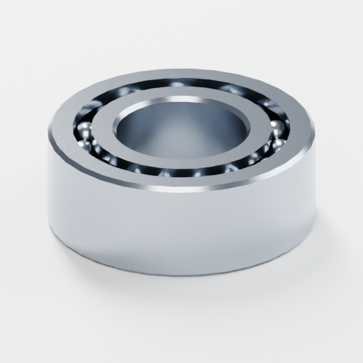
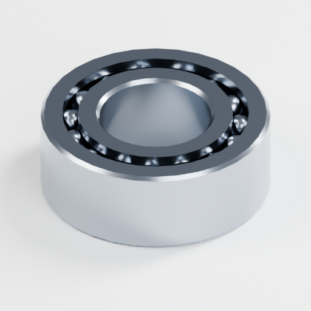
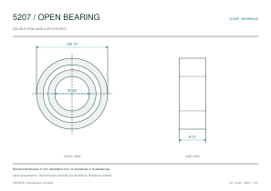

<!-- bearing-catalogue:start -->
# 5207 bearing - 35 x 72 x 27 mm

## Summary

Double row angular contact bearing: 35 mm bore, 72 mm outside diameter and 27 mm width.

| Product view | Isometric view |
| --- | --- |
|  |  |

Generated catalogue illustrations; the open internal geometry is illustrative.

## Details

**OOMP ID:** `hardware_bearing_5200_series_5207_size_35_mm_id_72_mm_od_27_mm_depth`

| Dimension | Nominal value |
| --- | --- |
| Bore / ID | 35 mm |
| Outside diameter / OD | 72 mm |
| Width / B | 27 mm |
| Catalogue contact angle | 25 degrees |

**Dimension evidence:** manufacturer checked (review retained from 2026-10-27).

Nominal presentation model. Raceways, pitch circle, chamfers and retainer geometry are illustrative; ball count/diameter are illustrative unless individually sourced. Not a manufacturer reconstruction, load-rating model or manufacturing/tolerance certification. Unspecified closure is presented open. The mesh shows open races and balls; retainers, seals and exact contact surfaces are omitted.

Contact-angle authority: **manufacturer family**. The mesh does not reconstruct the manufacturer contact surfaces.



[Printable A4 dimension sheet](working_dimension_a4.pdf) · [1:1 outline](working_svg.svg)

### Source evidence

- [https://www.nsk.com/content/dam/nsk/am/en_us/documents/bearings-americas/Bearing-and-Linear-Replacement-Guide.pdf](https://www.nsk.com/content/dam/nsk/am/en_us/documents/bearings-americas/Bearing-and-Linear-Replacement-Guide.pdf)

[Retained research and corrected dimensions](../../source_file/solidcraft/) · [Editable declaration](../../working_oomp_declarations_bearing.py)

## Parts

[Canonical part folder](.) · [Metadata](working.yaml) · [Browse this series](../../navigation/5200/README.md)

### Files

- [Editable OpenSCAD geometry](3dpr.scad)
- [Full model / GLB / metres, Y-up](three_d_model/model_full.glb)
- [Lightweight model / GLB / metres, Y-up](three_d_model/model_display.glb)
- [Editable Blender studio](three_d_model/studio.blend)
- [Product render / 2048 px](three_d_model/render_product_high.png)
- [Isometric render / 2048 px](three_d_model/render_high.png)
- [Populated model and render recipe](three_d_model/parameters.json)
- [Mesh measurements and artifact hashes](three_d_model/manifest.json)
- [Retained native CAD success manifest](solidcraft/latest_success.json)
- [76.2 x 50.8 mm label](label_bearing_3x2.pdf)
- [38.1 x 25.4 mm label](label_bearing_1_5x1.pdf)
- [Retained editable native bearing / SolidCraft](solidcraft/generations/f667e1f860857b4b_20261027T111916Z_5f1acd65/bearing_5207_open.solidcraft)

### Orthographic views

| Quality | Isometric | Front | Back | Left | Right | Top | Bottom |
| --- | --- | --- | --- | --- | --- | --- | --- |
| Full | [Isometric](three_d_model/full/isometric.svg) | [Front](three_d_model/full/front.svg) | [Back](three_d_model/full/back.svg) | [Left](three_d_model/full/left.svg) | [Right](three_d_model/full/right.svg) | [Top](three_d_model/full/top.svg) | [Bottom](three_d_model/full/bottom.svg) |
| Display | [Isometric](three_d_model/display/isometric.svg) | [Front](three_d_model/display/front.svg) | [Back](three_d_model/display/back.svg) | [Left](three_d_model/display/left.svg) | [Right](three_d_model/display/right.svg) | [Top](three_d_model/display/top.svg) | [Bottom](three_d_model/display/bottom.svg) |

## Assembly

No installation procedure is established for this generic size record. Select the required closure, clearance, tolerance and load rating from the actual purchased bearing specification.

<details>
<summary>Complete OOMP metadata</summary>

```yaml
depth: 27.0
id: hardware_bearing_5200_series_5207_size_35_mm_id_72_mm_od_27_mm_depth
od: 72.0
series: '5200'
size: '5207'
svg_details:
  svg_name: bearing_dimension
  title: 5207 / OPEN BEARING
  family: DOUBLE ROW ANGULAR CONTACT
  dimensions_mm:
    bore: 35.0
    outside: 72.0
    width: 27.0
    contact_angle_deg: 25.0
  sheet_width_mm: 297
  sheet_height_mm: 210
  ink: '#183336'
  accent: '#147d83'
  muted: '#61767a'
  paper: '#ffffff'
  race_face_fill: '#edf3f3'
  inner_race_face_outside_mm: 48.478
  outer_race_face_inside_mm: 58.522
  line_width_mm: 0.45
  font_family: Helvetica
  dimension_font_mm: 4
  title_font_mm: 9
  front_centre_mm:
  - 79
  - 103
  side_centre_mm:
  - 211
  - 103
  max_view_width_mm: 78
  max_side_width_mm: 55
  dimension_offset_mm: 12
  arrow_size_mm: 2
  note: Nominal dimensions in mm. Illustration only; no tolerances or fit allowances.
  authority: manufacturer checked
  internal_note: Open presentation; internal races and balls are illustrative. Retainers
    omitted.
  layout:
    left_margin_mm: 14
    right_margin_mm: 283
    title_y_mm: 22
    family_y_mm: 33
    family_font_mm: 3.5
    brand: OOMP / BEARINGS
    brand_font_mm: 3.5
    header_rule_y_mm: 40
    view_caption_y_mm: 173
    view_caption_font_mm: 3
    front_caption: FRONT VIEW
    side_caption: SIDE VIEW
    footer_rule_y_mm: 180
    note_y_mm: 187
    internal_note_y_mm: 194
    note_font_mm: 3.2
    source_y_mm: 202
    source_font_mm: 3
    source_prefix: 'SOURCE: '
    scale_prefix: A4 / scale
  dimension_style:
    line_width_mm: 0.25
    arrow_half_width_ratio: 0.3
    text_gap_mm: 2
    extension_mm: 2
    width_extension_mm: 3
    centre_extension_mm: 5
    dash_pattern_mm:
    - 2
    - 1
    flange_leader_offset_mm:
    - -13
    - 11
    flange_text_offset_mm:
    - -13
    - 16
    flange_font_mm: 3.5
  outline:
    ink: black
    line_width_mm: 0.1
taxonomy_1: hardware
taxonomy_10: ''
taxonomy_11: ''
taxonomy_12: ''
taxonomy_13: ''
taxonomy_14: ''
taxonomy_15: ''
taxonomy_2: bearing
taxonomy_3: 5200_series
taxonomy_4: 5207_size
taxonomy_5: 35_mm_id
taxonomy_6: 72_mm_od
taxonomy_7: 27_mm_depth
taxonomy_8: ''
taxonomy_9: ''
weight: '436'
width: 27.0
dimension_selection:
  policy: standard_metric_open_catalogue
  previous_id: hardware_bearing_5200_series_5207_size_35_mm_id_72_mm_od_26.9_mm_depth
  sources:
  - https://www.nsk.com/content/dam/nsk/am/en_us/documents/bearings-americas/Bearing-and-Linear-Replacement-Guide.pdf
  note: User selected standard catalogue variants on 2026-10-27; no sales ranking
    asserted.
url_chat: https://chatgpt.com/sites
run_action: true
run_oomp: true
run_oomp_populate: true
run_scad: false
generate_stl: false
taxonomy_1_upper: HARDWARE
taxonomy_1_upper_length_1: H
taxonomy_1_upper_length_2: HA
taxonomy_1_upper_length_3: HAR
taxonomy_1_upper_length_4: HARD
taxonomy_1_upper_length_5: HARDW
taxonomy_1_length_1: h
taxonomy_1_length_2: ha
taxonomy_1_length_3: har
taxonomy_1_length_4: hard
taxonomy_1_length_5: hardw
taxonomy_1_capital: Hardware
taxonomy_1_first_letter: h
taxonomy_1_first_letter_upper: H
taxonomy_2_upper: BEARING
taxonomy_2_upper_length_1: B
taxonomy_2_upper_length_2: BE
taxonomy_2_upper_length_3: BEA
taxonomy_2_upper_length_4: BEAR
taxonomy_2_upper_length_5: BEARI
taxonomy_2_length_1: b
taxonomy_2_length_2: be
taxonomy_2_length_3: bea
taxonomy_2_length_4: bear
taxonomy_2_length_5: beari
taxonomy_2_capital: Bearing
taxonomy_2_first_letter: b
taxonomy_2_first_letter_upper: B
taxonomy_3_upper: 5200_SERIES
taxonomy_3_upper_length_1: '5'
taxonomy_3_upper_length_2: '52'
taxonomy_3_upper_length_3: '520'
taxonomy_3_upper_length_4: '5200'
taxonomy_3_upper_length_5: '5200_'
taxonomy_3_length_1: '5'
taxonomy_3_length_2: '52'
taxonomy_3_length_3: '520'
taxonomy_3_length_4: '5200'
taxonomy_3_length_5: '5200_'
taxonomy_3_capital: 5200 Series
taxonomy_3_first_letter: '5'
taxonomy_3_first_letter_upper: '5'
taxonomy_4_upper: 5207_SIZE
taxonomy_4_upper_length_1: '5'
taxonomy_4_upper_length_2: '52'
taxonomy_4_upper_length_3: '520'
taxonomy_4_upper_length_4: '5207'
taxonomy_4_upper_length_5: '5207_'
taxonomy_4_length_1: '5'
taxonomy_4_length_2: '52'
taxonomy_4_length_3: '520'
taxonomy_4_length_4: '5207'
taxonomy_4_length_5: '5207_'
taxonomy_4_capital: 5207 Size
taxonomy_4_first_letter: '5'
taxonomy_4_first_letter_upper: '5'
taxonomy_5_upper: 35_MM_ID
taxonomy_5_upper_length_1: '3'
taxonomy_5_upper_length_2: '35'
taxonomy_5_upper_length_3: '35_'
taxonomy_5_upper_length_4: 35_M
taxonomy_5_upper_length_5: 35_MM
taxonomy_5_length_1: '3'
taxonomy_5_length_2: '35'
taxonomy_5_length_3: '35_'
taxonomy_5_length_4: 35_m
taxonomy_5_length_5: 35_mm
taxonomy_5_capital: 35 mm Id
taxonomy_5_first_letter: '3'
taxonomy_5_first_letter_upper: '3'
taxonomy_6_upper: 72_MM_OD
taxonomy_6_upper_length_1: '7'
taxonomy_6_upper_length_2: '72'
taxonomy_6_upper_length_3: '72_'
taxonomy_6_upper_length_4: 72_M
taxonomy_6_upper_length_5: 72_MM
taxonomy_6_length_1: '7'
taxonomy_6_length_2: '72'
taxonomy_6_length_3: '72_'
taxonomy_6_length_4: 72_m
taxonomy_6_length_5: 72_mm
taxonomy_6_capital: 72 mm Od
taxonomy_6_first_letter: '7'
taxonomy_6_first_letter_upper: '7'
taxonomy_7_upper: 27_MM_DEPTH
taxonomy_7_upper_length_1: '2'
taxonomy_7_upper_length_2: '27'
taxonomy_7_upper_length_3: '27_'
taxonomy_7_upper_length_4: 27_M
taxonomy_7_upper_length_5: 27_MM
taxonomy_7_length_1: '2'
taxonomy_7_length_2: '27'
taxonomy_7_length_3: '27_'
taxonomy_7_length_4: 27_m
taxonomy_7_length_5: 27_mm
taxonomy_7_capital: 27 mm Depth
taxonomy_7_first_letter: '2'
taxonomy_7_first_letter_upper: '2'
id_no_class: hardware_bearing_5200_series_5207_size_35_mm_id_72_mm_od_27_mm_depth
id_no_type: hardware_bearing_5200_series_5207_size_35_mm_id_72_mm_od_27_mm_depth
id_no_size: hardware_bearing_5200_series_size_35_mm_id_72_mm_od_27_mm_depth
oomp_key: oomp_hardware_bearing_5200_series_5207_size_35_mm_id_72_mm_od_27_mm_depth
link_github: https://github.com/oomlout/oomp_bearing_version_5/tree/main/parts/hardware_bearing_5200_series_5207_size_35_mm_id_72_mm_od_27_mm_depth
link_main: https://github.com/oomlout/oomlout_oomp_version_1_messy/tree/main/parts/hardware_bearing_5200_series_5207_size_35_mm_id_72_mm_od_27_mm_depth
link_redirect: https://github.com/oomlout/oomlout_oomp_version_1_messy/tree/main/parts/hardware_bearing_5200_series_5207_size_35_mm_id_72_mm_od_27_mm_depth
directory: parts/hardware_bearing_5200_series_5207_size_35_mm_id_72_mm_od_27_mm_depth
name: 5207 bearing
name_no_class: Hardware Bearing 5200 Series 5207 Size 35 Mm Id 72 Mm Od 27 Mm Depth
name_no_type: Hardware Bearing 5200 Series 5207 Size 35 Mm Id 72 Mm Od 27 Mm Depth
name_no_size: Hardware Bearing 5200 Series Size 35 Mm Id 72 Mm Od 27 Mm Depth
md5: 701117af7319f279106042b83367e61c
md5_5: '70111'
md5_5_upper: '70111'
md5_6: '701117'
md5_6_upper: '701117'
md5_6_alpha: 4dezb
md5_6_alpha_upper: 4DEZB
md5_10: 701117af73
md5_10_upper: 701117AF73
bip_39_full_array:
- hybrid
- master
- type
- tower
- palace
- develop
- dose
- analyst
- return
- open
- wet
- decade
bip_39_full_space: hybrid master type tower palace develop dose analyst return open
  wet decade
bip_39_full_no_space: hybridmastertypetowerpalacedevelopdoseanalystreturnopenwetdecade
bip_39_full_underscore: hybrid_master_type_tower_palace_develop_dose_analyst_return_open_wet_decade
bip_39_2_word_array:
- hybrid
- master
bip_39_2_word_space: hybrid master
bip_39_2_word_no_space: hybridmaster
bip_39_2_word_underscore: hybrid_master
bip_39_3_word_array:
- hybrid
- master
- type
bip_39_3_word_space: hybrid master type
bip_39_3_word_no_space: hybridmastertype
bip_39_3_word_underscore: hybrid_master_type
name_space: hardware bearing 5200 series 5207 size 35 mm id 72 mm od 27 mm depth
name_proper: 5207 bearing
name_upper: HARDWARE BEARING 5200 SERIES 5207 SIZE 35 MM ID 72 MM OD 27 MM DEPTH
oomlout_ai_roboclick_1:
  file_test: ''
  actions:
  - command: text_jinja_template
    description: Bold bearing label 3x2
    file_template: C:\od\OneDrive\docs\oomp_bearing\source_file\template_jinja\label_bearing_bold\3x2.svg.j2
    file_output: label_bearing_bold_3x2.svg
    dict_data_yaml_files:
      label_source: C:\od\OneDrive\docs\oomp_bearing\parts_source\hardware_bearing_5200_series_5207_size_35_mm_id_72_mm_od_27_mm_depth\working.yaml
      label_manual: C:\od\OneDrive\docs\oomp_bearing\parts\hardware_bearing_5200_series_5207_size_35_mm_id_72_mm_od_27_mm_depth\working_manual.yaml
    convert_to_pdf: false
    convert_to_png: false
oomlout_ai_roboclick_2:
  file_test: ''
  actions:
  - command: text_jinja_template
    description: Bold bearing label 1_5x1
    file_template: C:\od\OneDrive\docs\oomp_bearing\source_file\template_jinja\label_bearing_bold\1_5x1.svg.j2
    file_output: label_bearing_bold_1_5x1.svg
    dict_data_yaml_files:
      label_source: C:\od\OneDrive\docs\oomp_bearing\parts_source\hardware_bearing_5200_series_5207_size_35_mm_id_72_mm_od_27_mm_depth\working.yaml
      label_manual: C:\od\OneDrive\docs\oomp_bearing\parts\hardware_bearing_5200_series_5207_size_35_mm_id_72_mm_od_27_mm_depth\working_manual.yaml
    convert_to_pdf: false
    convert_to_png: false
catalogue_schema: oomp_bearing_v5
oomp_id: hardware_bearing_5200_series_5207_size_35_mm_id_72_mm_od_27_mm_depth
family: double_row_angular_contact
dimensions_mm:
  bore: 35.0
  outside: 72.0
  width: 27.0
  contact_angle_deg: 25.0
bore: 35.0
dimension_authority: manufacturer_checked
source_checked: '2026-10-27'
sources:
- https://www.nsk.com/content/dam/nsk/am/en_us/documents/bearings-americas/Bearing-and-Linear-Replacement-Guide.pdf
model_note: Nominal presentation model. Raceways, pitch circle, chamfers and retainer
  geometry are illustrative; ball count/diameter are illustrative unless individually
  sourced. Not a manufacturer reconstruction, load-rating model or manufacturing/tolerance
  certification. Unspecified closure is presented open. The mesh shows open races
  and balls; retainers, seals and exact contact surfaces are omitted.
closure: open
three_d_model_details:
  schema_version: 1
  generator: bearing_open
  output_folder: three_d_model
  parameters:
    bore: 35.0
    outside: 72.0
    width: 27.0
    edge: 1.1099999999999999
    pitch_radius: 26.75
    ball_radius: 4.05
    groove_radius: 4.2525
    inner_shoulder: 24.239
    outer_shoulder: 29.261
    cage_half_width: 2.2275
    cage_low: 3.8474999999999997
    cage_high: 4.6575
    window_radius: 1.944
    contact_angle_deg: 25.0
    contact_offset: 0.10125
    identity: hardware_bearing_5200_series_5207_size_35_mm_id_72_mm_od_27_mm_depth
    specification: 5207 / 35 x 72 x 27 mm
    characteristic_dimension_mm: 72.0
    characteristic_dimension_basis: maximum nominal envelope dimension
    ball_count: 30
    balls_per_row: 15
    row_count: 2
    ball_specification: illustrative
    contact_angle_authority: manufacturer_family
    row_centres_z:
    - 6.75
    - 20.25
    components:
    - name: outer_race
      shape: revolved_profile
      profile_mm:
      - - 34.89
        - 0
      - - 36.0
        - 1.1099999999999999
      - - 36.0
        - 25.89
      - - 34.89
        - 27.0
      - - 29.261
        - 27.0
      - - 29.261
        - 25.89
      - - 29.261
        - 24.502499999999998
      - - 29.261
        - 24.289875000000002
      - - 29.261
        - 24.07725
      - - 29.261
        - 23.864624999999997
      - - 29.3015
        - 23.652
      - - 29.562764362575546
        - 23.439375
      - - 29.78689243923785
        - 23.22675
      - - 29.981620218152962
        - 23.014125
      - - 30.152
        - 22.801499999999997
      - - 30.3015376929402
        - 22.588875
      - - 30.432773029593328
        - 22.37625
      - - 30.547603930029435
        - 22.163625
      - - 30.647480628559943
        - 21.951
      - - 30.73352809822838
        - 21.738374999999998
      - - 30.80662645402556
        - 21.52575
      - - 30.86746541993676
        - 21.313125
      - - 30.916582052474187
        - 21.100499999999997
      - - 30.954387200814764
        - 20.887875
      - - 30.981184076295904
        - 20.67525
      - - 30.997181048575044
        - 20.462625
      - - 31.0025
        - 20.25
      - - 30.997181048575044
        - 20.037374999999997
      - - 30.981184076295904
        - 19.824749999999998
      - - 30.954387200814764
        - 19.612125
      - - 30.916582052474187
        - 19.3995
      - - 30.86746541993676
        - 19.186875
      - - 30.80662645402556
        - 18.974249999999998
      - - 30.733528098228376
        - 18.761625
      - - 30.647480628559943
        - 18.549
      - - 30.547603930029435
        - 18.336375
      - - 30.432773029593324
        - 18.123749999999998
      - - 30.3015376929402
        - 17.911125
      - - 30.152
        - 17.6985
      - - 29.981620218152962
        - 17.485875
      - - 29.786892439237846
        - 17.273249999999997
      - - 29.562764362575543
        - 17.060624999999998
      - - 29.3015
        - 16.848
      - - 29.261
        - 16.635375
      - - 29.261
        - 16.422749999999997
      - - 29.261
        - 16.210124999999998
      - - 29.261
        - 15.997499999999999
      - - 29.261
        - 11.002500000000001
      - - 29.261
        - 10.789875000000002
      - - 29.261
        - 10.57725
      - - 29.261
        - 10.364625
      - - 29.3015
        - 10.152000000000001
      - - 29.562764362575543
        - 9.939375
      - - 29.78689243923785
        - 9.72675
      - - 29.981620218152962
        - 9.514125
      - - 30.152
        - 9.3015
      - - 30.3015376929402
        - 9.088875000000002
      - - 30.432773029593324
        - 8.87625
      - - 30.547603930029435
        - 8.663625
      - - 30.647480628559943
        - 8.451
      - - 30.733528098228376
        - 8.238375000000001
      - - 30.80662645402556
        - 8.02575
      - - 30.86746541993676
        - 7.813125
      - - 30.916582052474187
        - 7.600499999999999
      - - 30.954387200814764
        - 7.387875
      - - 30.981184076295904
        - 7.17525
      - - 30.997181048575044
        - 6.962625
      - - 31.0025
        - 6.75
      - - 30.997181048575044
        - 6.537375
      - - 30.981184076295904
        - 6.32475
      - - 30.954387200814764
        - 6.112125
      - - 30.916582052474187
        - 5.8995
      - - 30.86746541993676
        - 5.686875000000001
      - - 30.80662645402556
        - 5.47425
      - - 30.73352809822838
        - 5.261625
      - - 30.647480628559943
        - 5.0489999999999995
      - - 30.547603930029435
        - 4.836375
      - - 30.432773029593324
        - 4.623749999999999
      - - 30.3015376929402
        - 4.411125
      - - 30.152
        - 4.198499999999999
      - - 29.981620218152962
        - 3.9858749999999996
      - - 29.786892439237846
        - 3.7732499999999995
      - - 29.562764362575543
        - 3.560625
      - - 29.3015
        - 3.348
      - - 29.261
        - 3.135375
      - - 29.261
        - 2.9227499999999997
      - - 29.261
        - 2.7101249999999997
      - - 29.261
        - 2.4974999999999996
      - - 29.261
        - 1.1099999999999999
      - - 29.261
        - 0.0
      - - 34.89
        - 0
    - name: inner_race
      shape: revolved_profile
      profile_mm:
      - - 24.239
        - 0.0
      - - 24.239
        - 1.1099999999999999
      - - 24.239
        - 2.4974999999999996
      - - 24.239
        - 2.7101249999999997
      - - 24.239
        - 2.9227499999999997
      - - 24.239
        - 3.135375
      - - 24.1985
        - 3.348
      - - 23.937235637424457
        - 3.560625
      - - 23.713107560762154
        - 3.7732499999999995
      - - 23.518379781847038
        - 3.9858749999999996
      - - 23.348
        - 4.198499999999999
      - - 23.1984623070598
        - 4.411125
      - - 23.067226970406676
        - 4.623749999999999
      - - 22.952396069970565
        - 4.836375
      - - 22.852519371440057
        - 5.0489999999999995
      - - 22.76647190177162
        - 5.261625
      - - 22.69337354597444
        - 5.47425
      - - 22.63253458006324
        - 5.686875000000001
      - - 22.583417947525813
        - 5.8995
      - - 22.545612799185236
        - 6.112125
      - - 22.518815923704096
        - 6.32475
      - - 22.502818951424956
        - 6.537375
      - - 22.4975
        - 6.75
      - - 22.502818951424956
        - 6.962625
      - - 22.518815923704096
        - 7.17525
      - - 22.545612799185236
        - 7.387875
      - - 22.583417947525813
        - 7.600499999999999
      - - 22.63253458006324
        - 7.813125
      - - 22.69337354597444
        - 8.02575
      - - 22.766471901771624
        - 8.238375000000001
      - - 22.852519371440057
        - 8.451
      - - 22.952396069970565
        - 8.663625
      - - 23.067226970406676
        - 8.87625
      - - 23.1984623070598
        - 9.088875000000002
      - - 23.348
        - 9.3015
      - - 23.518379781847038
        - 9.514125
      - - 23.71310756076215
        - 9.72675
      - - 23.937235637424457
        - 9.939375
      - - 24.1985
        - 10.152000000000001
      - - 24.239
        - 10.364625
      - - 24.239
        - 10.57725
      - - 24.239
        - 10.789875000000002
      - - 24.239
        - 11.002500000000001
      - - 24.239
        - 15.997499999999999
      - - 24.239
        - 16.210124999999998
      - - 24.239
        - 16.422749999999997
      - - 24.239
        - 16.635375
      - - 24.1985
        - 16.848
      - - 23.937235637424457
        - 17.060624999999998
      - - 23.713107560762154
        - 17.273249999999997
      - - 23.518379781847038
        - 17.485875
      - - 23.348
        - 17.6985
      - - 23.1984623070598
        - 17.911125
      - - 23.067226970406676
        - 18.123749999999998
      - - 22.952396069970565
        - 18.336375
      - - 22.852519371440057
        - 18.549
      - - 22.766471901771624
        - 18.761625
      - - 22.69337354597444
        - 18.974249999999998
      - - 22.63253458006324
        - 19.186875
      - - 22.583417947525813
        - 19.3995
      - - 22.545612799185236
        - 19.612125
      - - 22.518815923704096
        - 19.824749999999998
      - - 22.502818951424956
        - 20.037374999999997
      - - 22.4975
        - 20.25
      - - 22.502818951424956
        - 20.462625
      - - 22.518815923704096
        - 20.67525
      - - 22.545612799185236
        - 20.887875
      - - 22.583417947525813
        - 21.100499999999997
      - - 22.63253458006324
        - 21.313125
      - - 22.69337354597444
        - 21.52575
      - - 22.76647190177162
        - 21.738374999999998
      - - 22.852519371440057
        - 21.951
      - - 22.952396069970565
        - 22.163625
      - - 23.067226970406672
        - 22.37625
      - - 23.1984623070598
        - 22.588875
      - - 23.348
        - 22.801499999999997
      - - 23.518379781847038
        - 23.014125
      - - 23.71310756076215
        - 23.22675
      - - 23.937235637424454
        - 23.439375
      - - 24.1985
        - 23.652
      - - 24.239
        - 23.864624999999997
      - - 24.239
        - 24.07725
      - - 24.239
        - 24.289875000000002
      - - 24.239
        - 24.502499999999998
      - - 24.239
        - 25.89
      - - 24.239
        - 27.0
      - - 18.61
        - 27.0
      - - 17.5
        - 25.89
      - - 17.5
        - 1.1099999999999999
      - - 18.61
        - 0
      - - 24.239
        - 0.0
    - name: ball_row_1_1
      shape: sphere
      radius_mm: 4.05
      centre_mm:
      - 26.75
      - 0.0
      - 6.75
    - name: ball_row_1_2
      shape: sphere
      radius_mm: 4.05
      centre_mm:
      - 24.437340991939575
      - 10.880205202277654
      - 6.75
    - name: ball_row_1_3
      shape: sphere
      radius_mm: 4.05
      centre_mm:
      - 17.89924372009946
      - 19.879124081520292
      - 6.75
    - name: ball_row_1_4
      shape: sphere
      radius_mm: 4.05
      centre_mm:
      - 8.266204599529845
      - 25.440761810895356
      - 6.75
    - name: ball_row_1_5
      shape: sphere
      radius_mm: 4.05
      centre_mm:
      - -2.7961363924097267
      - 26.603460701101312
      - 6.75
    - name: ball_row_1_6
      shape: sphere
      radius_mm: 4.05
      centre_mm:
      - -13.374999999999995
      - 23.166179551233736
      - 6.75
    - name: ball_row_1_7
      shape: sphere
      radius_mm: 4.05
      centre_mm:
      - -21.641204599529843
      - 15.72325549882366
      - 6.75
    - name: ball_row_1_8
      shape: sphere
      radius_mm: 4.05
      centre_mm:
      - -26.165448319629302
      - 5.561637729375062
      - 6.75
    - name: ball_row_1_9
      shape: sphere
      radius_mm: 4.05
      centre_mm:
      - -26.165448319629302
      - -5.561637729375055
      - 6.75
    - name: ball_row_1_10
      shape: sphere
      radius_mm: 4.05
      centre_mm:
      - -21.641204599529843
      - -15.723255498823653
      - 6.75
    - name: ball_row_1_11
      shape: sphere
      radius_mm: 4.05
      centre_mm:
      - -13.375000000000012
      - -23.16617955123373
      - 6.75
    - name: ball_row_1_12
      shape: sphere
      radius_mm: 4.05
      centre_mm:
      - -2.7961363924097506
      - -26.603460701101312
      - 6.75
    - name: ball_row_1_13
      shape: sphere
      radius_mm: 4.05
      centre_mm:
      - 8.26620459952984
      - -25.44076181089536
      - 6.75
    - name: ball_row_1_14
      shape: sphere
      radius_mm: 4.05
      centre_mm:
      - 17.899243720099463
      - -19.87912408152029
      - 6.75
    - name: ball_row_1_15
      shape: sphere
      radius_mm: 4.05
      centre_mm:
      - 24.437340991939575
      - -10.880205202277654
      - 6.75
    - name: ball_row_2_1
      shape: sphere
      radius_mm: 4.05
      centre_mm:
      - 26.75
      - 0.0
      - 20.25
    - name: ball_row_2_2
      shape: sphere
      radius_mm: 4.05
      centre_mm:
      - 24.437340991939575
      - 10.880205202277654
      - 20.25
    - name: ball_row_2_3
      shape: sphere
      radius_mm: 4.05
      centre_mm:
      - 17.89924372009946
      - 19.879124081520292
      - 20.25
    - name: ball_row_2_4
      shape: sphere
      radius_mm: 4.05
      centre_mm:
      - 8.266204599529845
      - 25.440761810895356
      - 20.25
    - name: ball_row_2_5
      shape: sphere
      radius_mm: 4.05
      centre_mm:
      - -2.7961363924097267
      - 26.603460701101312
      - 20.25
    - name: ball_row_2_6
      shape: sphere
      radius_mm: 4.05
      centre_mm:
      - -13.374999999999995
      - 23.166179551233736
      - 20.25
    - name: ball_row_2_7
      shape: sphere
      radius_mm: 4.05
      centre_mm:
      - -21.641204599529843
      - 15.72325549882366
      - 20.25
    - name: ball_row_2_8
      shape: sphere
      radius_mm: 4.05
      centre_mm:
      - -26.165448319629302
      - 5.561637729375062
      - 20.25
    - name: ball_row_2_9
      shape: sphere
      radius_mm: 4.05
      centre_mm:
      - -26.165448319629302
      - -5.561637729375055
      - 20.25
    - name: ball_row_2_10
      shape: sphere
      radius_mm: 4.05
      centre_mm:
      - -21.641204599529843
      - -15.723255498823653
      - 20.25
    - name: ball_row_2_11
      shape: sphere
      radius_mm: 4.05
      centre_mm:
      - -13.375000000000012
      - -23.16617955123373
      - 20.25
    - name: ball_row_2_12
      shape: sphere
      radius_mm: 4.05
      centre_mm:
      - -2.7961363924097506
      - -26.603460701101312
      - 20.25
    - name: ball_row_2_13
      shape: sphere
      radius_mm: 4.05
      centre_mm:
      - 8.26620459952984
      - -25.44076181089536
      - 20.25
    - name: ball_row_2_14
      shape: sphere
      radius_mm: 4.05
      centre_mm:
      - 17.899243720099463
      - -19.87912408152029
      - 20.25
    - name: ball_row_2_15
      shape: sphere
      radius_mm: 4.05
      centre_mm:
      - 24.437340991939575
      - -10.880205202277654
      - 20.25
  modelling_note: Nominal presentation model. Raceways, pitch circle, chamfers and
    retainer geometry are illustrative; ball count/diameter are illustrative unless
    individually sourced. Not a manufacturer reconstruction, load-rating model or
    manufacturing/tolerance certification. Unspecified closure is presented open.
    The mesh shows open races and balls; retainers, seals and exact contact surfaces
    are omitted.
  dimension_authority: manufacturer_checked
  model_formats:
  - glb
  variants:
    full:
      angular_segments: 128
      sphere_subdivisions: 3
    display:
      angular_segments: 32
      sphere_subdivisions: 2
  views:
  - isometric
  - front
  - back
  - left
  - right
  - top
  - bottom
  material:
    name: Illustrative polished bearing steel
    base_colour_srgb:
    - 0.62
    - 0.65
    - 0.69
    metallic: 1.0
    roughness: 0.22
    roughness_variation: 0.045
    coat_weight: 0.02
    coat_roughness: 0.28
    microtexture_spacing_mm: 0.025
    microtexture_height_um: 0.8
    note: Illustrative bearing steel; material grade and finish are not specified.
  studio:
    engine: cycles
    device: auto
    seed: 7991
    low_samples: 24
    high_samples: 48
    adaptive_threshold: 0.015
    denoise: true
    view_transform: AgX
    look: AgX - Medium High Contrast
    exposure: 0.0
    world_colour:
    - 0.78
    - 0.82
    - 0.9
    world_strength: 0.35
    floor_colour_srgb:
    - 0.93
    - 0.935
    - 0.94
    floor_roughness: 0.55
    framing_margin: 0.13
    lights:
    - name: Key softbox
      position:
      - -3
      - -4
      - 6
      power: 650.0
      width: 4.0
      height: 5.0
      colour:
      - 1.0
      - 0.96
      - 0.9
    - name: Fill softbox
      position:
      - 4
      - -1
      - 3
      power: 330.0
      width: 3.0
      height: 4.0
      colour:
      - 0.9
      - 0.95
      - 1.0
    - name: Rim strip
      position:
      - 1
      - 4
      - 4
      power: 850.0
      width: 1.2
      height: 5.0
      colour:
      - 1.0
      - 1.0
      - 1.0
    poses:
      isometric:
        camera_eye:
        - 1
        - -1
        - 1
        projection: orthographic
        orientation: principal axis Z up
      product:
        camera_eye:
        - -6
        - -10
        - 6
        projection: orthographic
        orientation: resting on lower face
        yaw_degrees: -12.0
        support: Stable convex-hull support using actual mesh centre of mass.
        resting_axis: face
  renders:
    low:
      file: render_low.png
      variant: display
      pixels: 512
      view: isometric
    high:
      file: render_high.png
      variant: full
      pixels: 2048
      view: isometric
    product_low:
      file: render_product_low.png
      variant: display
      pixels: 512
      view: product
    product_high:
      file: render_product_high.png
      variant: full
      pixels: 2048
      view: product
oobb_type: bearing_open
oobb_details:
  oobb_type: bearing_open
  run_scad: true
  run_solidcraft: false
  angular_segments: 128
  components:
  - name: outer_race
    shape: revolved_profile
    profile_mm:
    - - 34.89
      - 0
    - - 36.0
      - 1.1099999999999999
    - - 36.0
      - 25.89
    - - 34.89
      - 27.0
    - - 29.261
      - 27.0
    - - 29.261
      - 25.89
    - - 29.261
      - 24.502499999999998
    - - 29.261
      - 24.289875000000002
    - - 29.261
      - 24.07725
    - - 29.261
      - 23.864624999999997
    - - 29.3015
      - 23.652
    - - 29.562764362575546
      - 23.439375
    - - 29.78689243923785
      - 23.22675
    - - 29.981620218152962
      - 23.014125
    - - 30.152
      - 22.801499999999997
    - - 30.3015376929402
      - 22.588875
    - - 30.432773029593328
      - 22.37625
    - - 30.547603930029435
      - 22.163625
    - - 30.647480628559943
      - 21.951
    - - 30.73352809822838
      - 21.738374999999998
    - - 30.80662645402556
      - 21.52575
    - - 30.86746541993676
      - 21.313125
    - - 30.916582052474187
      - 21.100499999999997
    - - 30.954387200814764
      - 20.887875
    - - 30.981184076295904
      - 20.67525
    - - 30.997181048575044
      - 20.462625
    - - 31.0025
      - 20.25
    - - 30.997181048575044
      - 20.037374999999997
    - - 30.981184076295904
      - 19.824749999999998
    - - 30.954387200814764
      - 19.612125
    - - 30.916582052474187
      - 19.3995
    - - 30.86746541993676
      - 19.186875
    - - 30.80662645402556
      - 18.974249999999998
    - - 30.733528098228376
      - 18.761625
    - - 30.647480628559943
      - 18.549
    - - 30.547603930029435
      - 18.336375
    - - 30.432773029593324
      - 18.123749999999998
    - - 30.3015376929402
      - 17.911125
    - - 30.152
      - 17.6985
    - - 29.981620218152962
      - 17.485875
    - - 29.786892439237846
      - 17.273249999999997
    - - 29.562764362575543
      - 17.060624999999998
    - - 29.3015
      - 16.848
    - - 29.261
      - 16.635375
    - - 29.261
      - 16.422749999999997
    - - 29.261
      - 16.210124999999998
    - - 29.261
      - 15.997499999999999
    - - 29.261
      - 11.002500000000001
    - - 29.261
      - 10.789875000000002
    - - 29.261
      - 10.57725
    - - 29.261
      - 10.364625
    - - 29.3015
      - 10.152000000000001
    - - 29.562764362575543
      - 9.939375
    - - 29.78689243923785
      - 9.72675
    - - 29.981620218152962
      - 9.514125
    - - 30.152
      - 9.3015
    - - 30.3015376929402
      - 9.088875000000002
    - - 30.432773029593324
      - 8.87625
    - - 30.547603930029435
      - 8.663625
    - - 30.647480628559943
      - 8.451
    - - 30.733528098228376
      - 8.238375000000001
    - - 30.80662645402556
      - 8.02575
    - - 30.86746541993676
      - 7.813125
    - - 30.916582052474187
      - 7.600499999999999
    - - 30.954387200814764
      - 7.387875
    - - 30.981184076295904
      - 7.17525
    - - 30.997181048575044
      - 6.962625
    - - 31.0025
      - 6.75
    - - 30.997181048575044
      - 6.537375
    - - 30.981184076295904
      - 6.32475
    - - 30.954387200814764
      - 6.112125
    - - 30.916582052474187
      - 5.8995
    - - 30.86746541993676
      - 5.686875000000001
    - - 30.80662645402556
      - 5.47425
    - - 30.73352809822838
      - 5.261625
    - - 30.647480628559943
      - 5.0489999999999995
    - - 30.547603930029435
      - 4.836375
    - - 30.432773029593324
      - 4.623749999999999
    - - 30.3015376929402
      - 4.411125
    - - 30.152
      - 4.198499999999999
    - - 29.981620218152962
      - 3.9858749999999996
    - - 29.786892439237846
      - 3.7732499999999995
    - - 29.562764362575543
      - 3.560625
    - - 29.3015
      - 3.348
    - - 29.261
      - 3.135375
    - - 29.261
      - 2.9227499999999997
    - - 29.261
      - 2.7101249999999997
    - - 29.261
      - 2.4974999999999996
    - - 29.261
      - 1.1099999999999999
    - - 29.261
      - 0.0
    - - 34.89
      - 0
  - name: inner_race
    shape: revolved_profile
    profile_mm:
    - - 24.239
      - 0.0
    - - 24.239
      - 1.1099999999999999
    - - 24.239
      - 2.4974999999999996
    - - 24.239
      - 2.7101249999999997
    - - 24.239
      - 2.9227499999999997
    - - 24.239
      - 3.135375
    - - 24.1985
      - 3.348
    - - 23.937235637424457
      - 3.560625
    - - 23.713107560762154
      - 3.7732499999999995
    - - 23.518379781847038
      - 3.9858749999999996
    - - 23.348
      - 4.198499999999999
    - - 23.1984623070598
      - 4.411125
    - - 23.067226970406676
      - 4.623749999999999
    - - 22.952396069970565
      - 4.836375
    - - 22.852519371440057
      - 5.0489999999999995
    - - 22.76647190177162
      - 5.261625
    - - 22.69337354597444
      - 5.47425
    - - 22.63253458006324
      - 5.686875000000001
    - - 22.583417947525813
      - 5.8995
    - - 22.545612799185236
      - 6.112125
    - - 22.518815923704096
      - 6.32475
    - - 22.502818951424956
      - 6.537375
    - - 22.4975
      - 6.75
    - - 22.502818951424956
      - 6.962625
    - - 22.518815923704096
      - 7.17525
    - - 22.545612799185236
      - 7.387875
    - - 22.583417947525813
      - 7.600499999999999
    - - 22.63253458006324
      - 7.813125
    - - 22.69337354597444
      - 8.02575
    - - 22.766471901771624
      - 8.238375000000001
    - - 22.852519371440057
      - 8.451
    - - 22.952396069970565
      - 8.663625
    - - 23.067226970406676
      - 8.87625
    - - 23.1984623070598
      - 9.088875000000002
    - - 23.348
      - 9.3015
    - - 23.518379781847038
      - 9.514125
    - - 23.71310756076215
      - 9.72675
    - - 23.937235637424457
      - 9.939375
    - - 24.1985
      - 10.152000000000001
    - - 24.239
      - 10.364625
    - - 24.239
      - 10.57725
    - - 24.239
      - 10.789875000000002
    - - 24.239
      - 11.002500000000001
    - - 24.239
      - 15.997499999999999
    - - 24.239
      - 16.210124999999998
    - - 24.239
      - 16.422749999999997
    - - 24.239
      - 16.635375
    - - 24.1985
      - 16.848
    - - 23.937235637424457
      - 17.060624999999998
    - - 23.713107560762154
      - 17.273249999999997
    - - 23.518379781847038
      - 17.485875
    - - 23.348
      - 17.6985
    - - 23.1984623070598
      - 17.911125
    - - 23.067226970406676
      - 18.123749999999998
    - - 22.952396069970565
      - 18.336375
    - - 22.852519371440057
      - 18.549
    - - 22.766471901771624
      - 18.761625
    - - 22.69337354597444
      - 18.974249999999998
    - - 22.63253458006324
      - 19.186875
    - - 22.583417947525813
      - 19.3995
    - - 22.545612799185236
      - 19.612125
    - - 22.518815923704096
      - 19.824749999999998
    - - 22.502818951424956
      - 20.037374999999997
    - - 22.4975
      - 20.25
    - - 22.502818951424956
      - 20.462625
    - - 22.518815923704096
      - 20.67525
    - - 22.545612799185236
      - 20.887875
    - - 22.583417947525813
      - 21.100499999999997
    - - 22.63253458006324
      - 21.313125
    - - 22.69337354597444
      - 21.52575
    - - 22.76647190177162
      - 21.738374999999998
    - - 22.852519371440057
      - 21.951
    - - 22.952396069970565
      - 22.163625
    - - 23.067226970406672
      - 22.37625
    - - 23.1984623070598
      - 22.588875
    - - 23.348
      - 22.801499999999997
    - - 23.518379781847038
      - 23.014125
    - - 23.71310756076215
      - 23.22675
    - - 23.937235637424454
      - 23.439375
    - - 24.1985
      - 23.652
    - - 24.239
      - 23.864624999999997
    - - 24.239
      - 24.07725
    - - 24.239
      - 24.289875000000002
    - - 24.239
      - 24.502499999999998
    - - 24.239
      - 25.89
    - - 24.239
      - 27.0
    - - 18.61
      - 27.0
    - - 17.5
      - 25.89
    - - 17.5
      - 1.1099999999999999
    - - 18.61
      - 0
    - - 24.239
      - 0.0
  - name: ball_row_1_1
    shape: sphere
    radius_mm: 4.05
    centre_mm:
    - 26.75
    - 0.0
    - 6.75
  - name: ball_row_1_2
    shape: sphere
    radius_mm: 4.05
    centre_mm:
    - 24.437340991939575
    - 10.880205202277654
    - 6.75
  - name: ball_row_1_3
    shape: sphere
    radius_mm: 4.05
    centre_mm:
    - 17.89924372009946
    - 19.879124081520292
    - 6.75
  - name: ball_row_1_4
    shape: sphere
    radius_mm: 4.05
    centre_mm:
    - 8.266204599529845
    - 25.440761810895356
    - 6.75
  - name: ball_row_1_5
    shape: sphere
    radius_mm: 4.05
    centre_mm:
    - -2.7961363924097267
    - 26.603460701101312
    - 6.75
  - name: ball_row_1_6
    shape: sphere
    radius_mm: 4.05
    centre_mm:
    - -13.374999999999995
    - 23.166179551233736
    - 6.75
  - name: ball_row_1_7
    shape: sphere
    radius_mm: 4.05
    centre_mm:
    - -21.641204599529843
    - 15.72325549882366
    - 6.75
  - name: ball_row_1_8
    shape: sphere
    radius_mm: 4.05
    centre_mm:
    - -26.165448319629302
    - 5.561637729375062
    - 6.75
  - name: ball_row_1_9
    shape: sphere
    radius_mm: 4.05
    centre_mm:
    - -26.165448319629302
    - -5.561637729375055
    - 6.75
  - name: ball_row_1_10
    shape: sphere
    radius_mm: 4.05
    centre_mm:
    - -21.641204599529843
    - -15.723255498823653
    - 6.75
  - name: ball_row_1_11
    shape: sphere
    radius_mm: 4.05
    centre_mm:
    - -13.375000000000012
    - -23.16617955123373
    - 6.75
  - name: ball_row_1_12
    shape: sphere
    radius_mm: 4.05
    centre_mm:
    - -2.7961363924097506
    - -26.603460701101312
    - 6.75
  - name: ball_row_1_13
    shape: sphere
    radius_mm: 4.05
    centre_mm:
    - 8.26620459952984
    - -25.44076181089536
    - 6.75
  - name: ball_row_1_14
    shape: sphere
    radius_mm: 4.05
    centre_mm:
    - 17.899243720099463
    - -19.87912408152029
    - 6.75
  - name: ball_row_1_15
    shape: sphere
    radius_mm: 4.05
    centre_mm:
    - 24.437340991939575
    - -10.880205202277654
    - 6.75
  - name: ball_row_2_1
    shape: sphere
    radius_mm: 4.05
    centre_mm:
    - 26.75
    - 0.0
    - 20.25
  - name: ball_row_2_2
    shape: sphere
    radius_mm: 4.05
    centre_mm:
    - 24.437340991939575
    - 10.880205202277654
    - 20.25
  - name: ball_row_2_3
    shape: sphere
    radius_mm: 4.05
    centre_mm:
    - 17.89924372009946
    - 19.879124081520292
    - 20.25
  - name: ball_row_2_4
    shape: sphere
    radius_mm: 4.05
    centre_mm:
    - 8.266204599529845
    - 25.440761810895356
    - 20.25
  - name: ball_row_2_5
    shape: sphere
    radius_mm: 4.05
    centre_mm:
    - -2.7961363924097267
    - 26.603460701101312
    - 20.25
  - name: ball_row_2_6
    shape: sphere
    radius_mm: 4.05
    centre_mm:
    - -13.374999999999995
    - 23.166179551233736
    - 20.25
  - name: ball_row_2_7
    shape: sphere
    radius_mm: 4.05
    centre_mm:
    - -21.641204599529843
    - 15.72325549882366
    - 20.25
  - name: ball_row_2_8
    shape: sphere
    radius_mm: 4.05
    centre_mm:
    - -26.165448319629302
    - 5.561637729375062
    - 20.25
  - name: ball_row_2_9
    shape: sphere
    radius_mm: 4.05
    centre_mm:
    - -26.165448319629302
    - -5.561637729375055
    - 20.25
  - name: ball_row_2_10
    shape: sphere
    radius_mm: 4.05
    centre_mm:
    - -21.641204599529843
    - -15.723255498823653
    - 20.25
  - name: ball_row_2_11
    shape: sphere
    radius_mm: 4.05
    centre_mm:
    - -13.375000000000012
    - -23.16617955123373
    - 20.25
  - name: ball_row_2_12
    shape: sphere
    radius_mm: 4.05
    centre_mm:
    - -2.7961363924097506
    - -26.603460701101312
    - 20.25
  - name: ball_row_2_13
    shape: sphere
    radius_mm: 4.05
    centre_mm:
    - 8.26620459952984
    - -25.44076181089536
    - 20.25
  - name: ball_row_2_14
    shape: sphere
    radius_mm: 4.05
    centre_mm:
    - 17.899243720099463
    - -19.87912408152029
    - 20.25
  - name: ball_row_2_15
    shape: sphere
    radius_mm: 4.05
    centre_mm:
    - 24.437340991939575
    - -10.880205202277654
    - 20.25
label_details:
  size: '5207'
  dimensions: 35 x 72 x 27 mm
  formats_mm:
  - - 76.2
    - 50.8
  - - 38.1
    - 25.4
  ink: '#183336'
  accent: '#147d83'
  paper: '#ffffff'
  font_family: Helvetica
  view_box_mm:
  - 0
  - 0
  - 76.2
  - 50.8
  file_stems:
  - label_bearing_3x2
  - label_bearing_1_5x1
  brand: OOMP / BEARING
  brand_position_mm:
  - 5
  - 10
  brand_font_mm: 3
  size_position_mm:
  - 5
  - 29
  size_font_mm: 14
  dimensions_position_mm:
  - 5
  - 42
  dimensions_font_mm: 4
readme_details:
  title: 5207 bearing - 35 x 72 x 27 mm
  description: 'Double row angular contact bearing: 35 mm bore, 72 mm outside diameter
    and 27 mm width.'
```

</details>
<!-- bearing-catalogue:end -->
