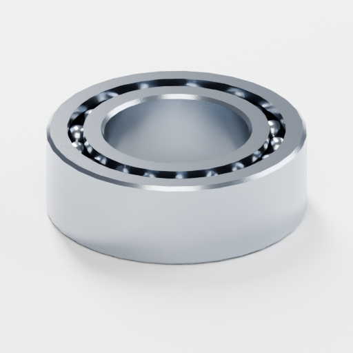
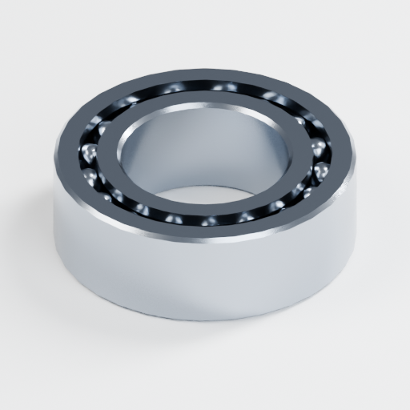
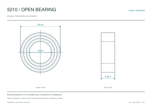

<!-- bearing-catalogue:start -->
# 5210 bearing - 50 x 90 x 30.2 mm

## Summary

Double row angular contact bearing: 50 mm bore, 90 mm outside diameter and 30.2 mm width.

| Product view | Isometric view |
| --- | --- |
|  |  |

Generated catalogue illustrations; the open internal geometry is illustrative.

## Details

**OOMP ID:** `hardware_bearing_5200_series_5210_size_50_mm_id_90_mm_od_30.2_mm_depth`

| Dimension | Nominal value |
| --- | --- |
| Bore / ID | 50 mm |
| Outside diameter / OD | 90 mm |
| Width / B | 30.2 mm |
| Catalogue contact angle | 25 degrees |

**Dimension evidence:** manufacturer checked (review retained from 2026-10-27).

Nominal presentation model. Raceways, pitch circle, chamfers and retainer geometry are illustrative; ball count/diameter are illustrative unless individually sourced. Not a manufacturer reconstruction, load-rating model or manufacturing/tolerance certification. Unspecified closure is presented open. The mesh shows open races and balls; retainers, seals and exact contact surfaces are omitted.

Contact-angle authority: **manufacturer family**. The mesh does not reconstruct the manufacturer contact surfaces.



[Printable A4 dimension sheet](working_dimension_a4.pdf) · [1:1 outline](working_svg.svg)

### Source evidence

- [https://www.nsk.com/content/dam/nsk/am/en_us/documents/bearings-americas/Bearing-and-Linear-Replacement-Guide.pdf](https://www.nsk.com/content/dam/nsk/am/en_us/documents/bearings-americas/Bearing-and-Linear-Replacement-Guide.pdf)

[Retained research and corrected dimensions](../../source_file/solidcraft/) · [Editable declaration](../../working_oomp_declarations_bearing.py)

## Parts

[Canonical part folder](.) · [Metadata](working.yaml) · [Browse this series](../../navigation/5200/README.md)

### Files

- [Editable OpenSCAD geometry](3dpr.scad)
- [Full model / GLB / metres, Y-up](three_d_model/model_full.glb)
- [Lightweight model / GLB / metres, Y-up](three_d_model/model_display.glb)
- [Editable Blender studio](three_d_model/studio.blend)
- [Product render / 2048 px](three_d_model/render_product_high.png)
- [Isometric render / 2048 px](three_d_model/render_high.png)
- [Populated model and render recipe](three_d_model/parameters.json)
- [Mesh measurements and artifact hashes](three_d_model/manifest.json)
- [Retained native CAD success manifest](solidcraft/latest_success.json)
- [76.2 x 50.8 mm label](label_bearing_3x2.pdf)
- [38.1 x 25.4 mm label](label_bearing_1_5x1.pdf)
- [Retained editable native bearing / SolidCraft](solidcraft/generations/d8930a04befa16aa_20261027T112528Z_5378ae51/bearing_5210_open.solidcraft)

### Orthographic views

| Quality | Isometric | Front | Back | Left | Right | Top | Bottom |
| --- | --- | --- | --- | --- | --- | --- | --- |
| Full | [Isometric](three_d_model/full/isometric.svg) | [Front](three_d_model/full/front.svg) | [Back](three_d_model/full/back.svg) | [Left](three_d_model/full/left.svg) | [Right](three_d_model/full/right.svg) | [Top](three_d_model/full/top.svg) | [Bottom](three_d_model/full/bottom.svg) |
| Display | [Isometric](three_d_model/display/isometric.svg) | [Front](three_d_model/display/front.svg) | [Back](three_d_model/display/back.svg) | [Left](three_d_model/display/left.svg) | [Right](three_d_model/display/right.svg) | [Top](three_d_model/display/top.svg) | [Bottom](three_d_model/display/bottom.svg) |

## Assembly

No installation procedure is established for this generic size record. Select the required closure, clearance, tolerance and load rating from the actual purchased bearing specification.

<details>
<summary>Complete OOMP metadata</summary>

```yaml
depth: 30.2
id: hardware_bearing_5200_series_5210_size_50_mm_id_90_mm_od_30.2_mm_depth
od: 90.0
series: '5200'
size: '5210'
svg_details:
  svg_name: bearing_dimension
  title: 5210 / OPEN BEARING
  family: DOUBLE ROW ANGULAR CONTACT
  dimensions_mm:
    bore: 50.0
    outside: 90.0
    width: 30.2
    contact_angle_deg: 25.0
  sheet_width_mm: 297
  sheet_height_mm: 210
  ink: '#183336'
  accent: '#147d83'
  muted: '#61767a'
  paper: '#ffffff'
  race_face_fill: '#edf3f3'
  inner_race_face_outside_mm: 64.3828
  outer_race_face_inside_mm: 75.6172
  line_width_mm: 0.45
  font_family: Helvetica
  dimension_font_mm: 4
  title_font_mm: 9
  front_centre_mm:
  - 79
  - 103
  side_centre_mm:
  - 211
  - 103
  max_view_width_mm: 78
  max_side_width_mm: 55
  dimension_offset_mm: 12
  arrow_size_mm: 2
  note: Nominal dimensions in mm. Illustration only; no tolerances or fit allowances.
  authority: manufacturer checked
  internal_note: Open presentation; internal races and balls are illustrative. Retainers
    omitted.
  layout:
    left_margin_mm: 14
    right_margin_mm: 283
    title_y_mm: 22
    family_y_mm: 33
    family_font_mm: 3.5
    brand: OOMP / BEARINGS
    brand_font_mm: 3.5
    header_rule_y_mm: 40
    view_caption_y_mm: 173
    view_caption_font_mm: 3
    front_caption: FRONT VIEW
    side_caption: SIDE VIEW
    footer_rule_y_mm: 180
    note_y_mm: 187
    internal_note_y_mm: 194
    note_font_mm: 3.2
    source_y_mm: 202
    source_font_mm: 3
    source_prefix: 'SOURCE: '
    scale_prefix: A4 / scale
  dimension_style:
    line_width_mm: 0.25
    arrow_half_width_ratio: 0.3
    text_gap_mm: 2
    extension_mm: 2
    width_extension_mm: 3
    centre_extension_mm: 5
    dash_pattern_mm:
    - 2
    - 1
    flange_leader_offset_mm:
    - -13
    - 11
    flange_text_offset_mm:
    - -13
    - 16
    flange_font_mm: 3.5
  outline:
    ink: black
    line_width_mm: 0.1
taxonomy_1: hardware
taxonomy_10: ''
taxonomy_11: ''
taxonomy_12: ''
taxonomy_13: ''
taxonomy_14: ''
taxonomy_15: ''
taxonomy_2: bearing
taxonomy_3: 5200_series
taxonomy_4: 5210_size
taxonomy_5: 50_mm_id
taxonomy_6: 90_mm_od
taxonomy_7: 30.2_mm_depth
taxonomy_8: ''
taxonomy_9: ''
weight: '690'
width: 30.2
dimension_selection:
  policy: standard_metric_open_catalogue
  previous_id: hardware_bearing_5200_series_5210_size_50_mm_id_90_mm_od_30.1_mm_depth
  sources:
  - https://www.nsk.com/content/dam/nsk/am/en_us/documents/bearings-americas/Bearing-and-Linear-Replacement-Guide.pdf
  note: User selected standard catalogue variants on 2026-10-27; no sales ranking
    asserted.
url_chat: https://chatgpt.com/c/6ab7ac89-5e90-83eb-bbb9-fb00ad5385e9
run_action: true
run_oomp: true
run_oomp_populate: true
run_scad: false
generate_stl: false
taxonomy_1_upper: HARDWARE
taxonomy_1_upper_length_1: H
taxonomy_1_upper_length_2: HA
taxonomy_1_upper_length_3: HAR
taxonomy_1_upper_length_4: HARD
taxonomy_1_upper_length_5: HARDW
taxonomy_1_length_1: h
taxonomy_1_length_2: ha
taxonomy_1_length_3: har
taxonomy_1_length_4: hard
taxonomy_1_length_5: hardw
taxonomy_1_capital: Hardware
taxonomy_1_first_letter: h
taxonomy_1_first_letter_upper: H
taxonomy_2_upper: BEARING
taxonomy_2_upper_length_1: B
taxonomy_2_upper_length_2: BE
taxonomy_2_upper_length_3: BEA
taxonomy_2_upper_length_4: BEAR
taxonomy_2_upper_length_5: BEARI
taxonomy_2_length_1: b
taxonomy_2_length_2: be
taxonomy_2_length_3: bea
taxonomy_2_length_4: bear
taxonomy_2_length_5: beari
taxonomy_2_capital: Bearing
taxonomy_2_first_letter: b
taxonomy_2_first_letter_upper: B
taxonomy_3_upper: 5200_SERIES
taxonomy_3_upper_length_1: '5'
taxonomy_3_upper_length_2: '52'
taxonomy_3_upper_length_3: '520'
taxonomy_3_upper_length_4: '5200'
taxonomy_3_upper_length_5: '5200_'
taxonomy_3_length_1: '5'
taxonomy_3_length_2: '52'
taxonomy_3_length_3: '520'
taxonomy_3_length_4: '5200'
taxonomy_3_length_5: '5200_'
taxonomy_3_capital: 5200 Series
taxonomy_3_first_letter: '5'
taxonomy_3_first_letter_upper: '5'
taxonomy_4_upper: 5210_SIZE
taxonomy_4_upper_length_1: '5'
taxonomy_4_upper_length_2: '52'
taxonomy_4_upper_length_3: '521'
taxonomy_4_upper_length_4: '5210'
taxonomy_4_upper_length_5: '5210_'
taxonomy_4_length_1: '5'
taxonomy_4_length_2: '52'
taxonomy_4_length_3: '521'
taxonomy_4_length_4: '5210'
taxonomy_4_length_5: '5210_'
taxonomy_4_capital: 5210 Size
taxonomy_4_first_letter: '5'
taxonomy_4_first_letter_upper: '5'
taxonomy_5_upper: 50_MM_ID
taxonomy_5_upper_length_1: '5'
taxonomy_5_upper_length_2: '50'
taxonomy_5_upper_length_3: '50_'
taxonomy_5_upper_length_4: 50_M
taxonomy_5_upper_length_5: 50_MM
taxonomy_5_length_1: '5'
taxonomy_5_length_2: '50'
taxonomy_5_length_3: '50_'
taxonomy_5_length_4: 50_m
taxonomy_5_length_5: 50_mm
taxonomy_5_capital: 50 mm Id
taxonomy_5_first_letter: '5'
taxonomy_5_first_letter_upper: '5'
taxonomy_6_upper: 90_MM_OD
taxonomy_6_upper_length_1: '9'
taxonomy_6_upper_length_2: '90'
taxonomy_6_upper_length_3: '90_'
taxonomy_6_upper_length_4: 90_M
taxonomy_6_upper_length_5: 90_MM
taxonomy_6_length_1: '9'
taxonomy_6_length_2: '90'
taxonomy_6_length_3: '90_'
taxonomy_6_length_4: 90_m
taxonomy_6_length_5: 90_mm
taxonomy_6_capital: 90 mm Od
taxonomy_6_first_letter: '9'
taxonomy_6_first_letter_upper: '9'
taxonomy_7_upper: 30.2_MM_DEPTH
taxonomy_7_upper_length_1: '3'
taxonomy_7_upper_length_2: '30'
taxonomy_7_upper_length_3: '30.'
taxonomy_7_upper_length_4: '30.2'
taxonomy_7_upper_length_5: '30.2_'
taxonomy_7_length_1: '3'
taxonomy_7_length_2: '30'
taxonomy_7_length_3: '30.'
taxonomy_7_length_4: '30.2'
taxonomy_7_length_5: '30.2_'
taxonomy_7_capital: 30.2 mm Depth
taxonomy_7_first_letter: '3'
taxonomy_7_first_letter_upper: '3'
id_no_class: hardware_bearing_5200_series_5210_size_50_mm_id_90_mm_od_30.2_mm_depth
id_no_type: hardware_bearing_5200_series_5210_size_50_mm_id_90_mm_od_30.2_mm_depth
id_no_size: hardware_bearing_5200_series_size_50_mm_id_90_mm_od_30.2_mm_depth
oomp_key: oomp_hardware_bearing_5200_series_5210_size_50_mm_id_90_mm_od_30.2_mm_depth
link_github: https://github.com/oomlout/oomp_bearing_version_5/tree/main/parts/hardware_bearing_5200_series_5210_size_50_mm_id_90_mm_od_30.2_mm_depth
link_main: https://github.com/oomlout/oomlout_oomp_version_1_messy/tree/main/parts/hardware_bearing_5200_series_5210_size_50_mm_id_90_mm_od_30.2_mm_depth
link_redirect: https://github.com/oomlout/oomlout_oomp_version_1_messy/tree/main/parts/hardware_bearing_5200_series_5210_size_50_mm_id_90_mm_od_30.2_mm_depth
directory: parts/hardware_bearing_5200_series_5210_size_50_mm_id_90_mm_od_30.2_mm_depth
name: 5210 bearing
name_no_class: Hardware Bearing 5200 Series 5210 Size 50 Mm Id 90 Mm Od 30.2 Mm Depth
name_no_type: Hardware Bearing 5200 Series 5210 Size 50 Mm Id 90 Mm Od 30.2 Mm Depth
name_no_size: Hardware Bearing 5200 Series Size 50 Mm Id 90 Mm Od 30.2 Mm Depth
md5: a0c78f3e73a4f888d79c29b457d24f8c
md5_5: a0c78
md5_5_upper: A0C78
md5_6: a0c78f
md5_6_upper: A0C78F
md5_6_alpha: 69ua7
md5_6_alpha_upper: 69UA7
md5_10: a0c78f3e73
md5_10_upper: A0C78F3E73
bip_39_full_array:
- patch
- detect
- sort
- trap
- exhibit
- dutch
- fury
- lunch
- reform
- salon
- negative
- boat
bip_39_full_space: patch detect sort trap exhibit dutch fury lunch reform salon negative
  boat
bip_39_full_no_space: patchdetectsorttrapexhibitdutchfurylunchreformsalonnegativeboat
bip_39_full_underscore: patch_detect_sort_trap_exhibit_dutch_fury_lunch_reform_salon_negative_boat
bip_39_2_word_array:
- patch
- detect
bip_39_2_word_space: patch detect
bip_39_2_word_no_space: patchdetect
bip_39_2_word_underscore: patch_detect
bip_39_3_word_array:
- patch
- detect
- sort
bip_39_3_word_space: patch detect sort
bip_39_3_word_no_space: patchdetectsort
bip_39_3_word_underscore: patch_detect_sort
name_space: hardware bearing 5200 series 5210 size 50 mm id 90 mm od 30.2 mm depth
name_proper: 5210 bearing
name_upper: HARDWARE BEARING 5200 SERIES 5210 SIZE 50 MM ID 90 MM OD 30.2 MM DEPTH
oomlout_ai_roboclick_1:
  file_test: ''
  actions:
  - command: text_jinja_template
    description: Bold bearing label 3x2
    file_template: C:\od\OneDrive\docs\oomp_bearing\source_file\template_jinja\label_bearing_bold\3x2.svg.j2
    file_output: label_bearing_bold_3x2.svg
    dict_data_yaml_files:
      label_source: C:\od\OneDrive\docs\oomp_bearing\parts_source\hardware_bearing_5200_series_5210_size_50_mm_id_90_mm_od_30_2_mm_depth\working.yaml
      label_manual: C:\od\OneDrive\docs\oomp_bearing\parts\hardware_bearing_5200_series_5210_size_50_mm_id_90_mm_od_30.2_mm_depth\working_manual.yaml
    convert_to_pdf: false
    convert_to_png: false
oomlout_ai_roboclick_2:
  file_test: ''
  actions:
  - command: text_jinja_template
    description: Bold bearing label 1_5x1
    file_template: C:\od\OneDrive\docs\oomp_bearing\source_file\template_jinja\label_bearing_bold\1_5x1.svg.j2
    file_output: label_bearing_bold_1_5x1.svg
    dict_data_yaml_files:
      label_source: C:\od\OneDrive\docs\oomp_bearing\parts_source\hardware_bearing_5200_series_5210_size_50_mm_id_90_mm_od_30_2_mm_depth\working.yaml
      label_manual: C:\od\OneDrive\docs\oomp_bearing\parts\hardware_bearing_5200_series_5210_size_50_mm_id_90_mm_od_30.2_mm_depth\working_manual.yaml
    convert_to_pdf: false
    convert_to_png: false
catalogue_schema: oomp_bearing_v5
oomp_id: hardware_bearing_5200_series_5210_size_50_mm_id_90_mm_od_30.2_mm_depth
family: double_row_angular_contact
dimensions_mm:
  bore: 50.0
  outside: 90.0
  width: 30.2
  contact_angle_deg: 25.0
bore: 50.0
dimension_authority: manufacturer_checked
source_checked: '2026-10-27'
sources:
- https://www.nsk.com/content/dam/nsk/am/en_us/documents/bearings-americas/Bearing-and-Linear-Replacement-Guide.pdf
model_note: Nominal presentation model. Raceways, pitch circle, chamfers and retainer
  geometry are illustrative; ball count/diameter are illustrative unless individually
  sourced. Not a manufacturer reconstruction, load-rating model or manufacturing/tolerance
  certification. Unspecified closure is presented open. The mesh shows open races
  and balls; retainers, seals and exact contact surfaces are omitted.
closure: open
three_d_model_details:
  schema_version: 1
  generator: bearing_open
  output_folder: three_d_model
  parameters:
    bore: 50.0
    outside: 90.0
    width: 30.2
    edge: 1.2
    pitch_radius: 35.0
    ball_radius: 4.529999999999999
    groove_radius: 4.7565
    inner_shoulder: 32.1914
    outer_shoulder: 37.8086
    cage_half_width: 2.4915
    cage_low: 4.303499999999999
    cage_high: 5.2094999999999985
    window_radius: 2.1743999999999994
    contact_angle_deg: 25.0
    contact_offset: 0.11324999999999999
    identity: hardware_bearing_5200_series_5210_size_50_mm_id_90_mm_od_30.2_mm_depth
    specification: 5210 / 50 x 90 x 30.2 mm
    characteristic_dimension_mm: 90.0
    characteristic_dimension_basis: maximum nominal envelope dimension
    ball_count: 34
    balls_per_row: 17
    row_count: 2
    ball_specification: illustrative
    contact_angle_authority: manufacturer_family
    row_centres_z:
    - 7.55
    - 22.65
    components:
    - name: outer_race
      shape: revolved_profile
      profile_mm:
      - - 43.8
        - 0
      - - 45.0
        - 1.2
      - - 45.0
        - 29.0
      - - 43.8
        - 30.2
      - - 37.8086
        - 30.2
      - - 37.8086
        - 29.0
      - - 37.8086
        - 27.4065
      - - 37.8086
        - 27.168675
      - - 37.8086
        - 26.93085
      - - 37.8086
        - 26.693025
      - - 37.8539
        - 26.455199999999998
      - - 38.14612902776968
        - 26.217374999999997
      - - 38.39682043203641
        - 25.97955
      - - 38.61462705882294
        - 25.741725
      - - 38.8052
        - 25.5039
      - - 38.97246067877015
        - 25.266075
      - - 39.11924983310068
        - 25.02825
      - - 39.24769032173663
        - 24.790425
      - - 39.35940425861149
        - 24.552599999999998
      - - 39.4556499469073
        - 24.314774999999997
      - - 39.5374118115397
        - 24.07695
      - - 39.60546132155889
        - 23.839125
      - - 39.66039918461927
        - 23.601300000000002
      - - 39.70268494313355
        - 23.363475
      - - 39.73265774459764
        - 23.12565
      - - 39.75055065433209
        - 22.887825
      - - 39.7565
        - 22.65
      - - 39.75055065433209
        - 22.412174999999998
      - - 39.73265774459764
        - 22.17435
      - - 39.70268494313355
        - 21.936525
      - - 39.66039918461927
        - 21.6987
      - - 39.60546132155889
        - 21.460874999999998
      - - 39.537411811539705
        - 21.22305
      - - 39.4556499469073
        - 20.985225
      - - 39.35940425861149
        - 20.7474
      - - 39.24769032173663
        - 20.509574999999998
      - - 39.11924983310068
        - 20.27175
      - - 38.97246067877015
        - 20.033925
      - - 38.8052
        - 19.7961
      - - 38.61462705882294
        - 19.558275
      - - 38.39682043203641
        - 19.32045
      - - 38.14612902776968
        - 19.082625
      - - 37.8539
        - 18.8448
      - - 37.8086
        - 18.606975
      - - 37.8086
        - 18.36915
      - - 37.8086
        - 18.131325
      - - 37.8086
        - 17.8935
      - - 37.8086
        - 12.3065
      - - 37.8086
        - 12.068675
      - - 37.8086
        - 11.83085
      - - 37.8086
        - 11.593024999999999
      - - 37.8539
        - 11.3552
      - - 38.14612902776968
        - 11.117375
      - - 38.39682043203641
        - 10.87955
      - - 38.61462705882295
        - 10.641725
      - - 38.8052
        - 10.4039
      - - 38.97246067877015
        - 10.166075
      - - 39.11924983310068
        - 9.928249999999998
      - - 39.24769032173663
        - 9.690425000000001
      - - 39.35940425861149
        - 9.4526
      - - 39.4556499469073
        - 9.214775
      - - 39.537411811539705
        - 8.976949999999999
      - - 39.60546132155889
        - 8.739125
      - - 39.66039918461927
        - 8.5013
      - - 39.70268494313355
        - 8.263475
      - - 39.73265774459764
        - 8.025649999999999
      - - 39.75055065433209
        - 7.787825
      - - 39.7565
        - 7.55
      - - 39.75055065433209
        - 7.312175
      - - 39.73265774459764
        - 7.07435
      - - 39.70268494313355
        - 6.836525
      - - 39.66039918461927
        - 6.5987
      - - 39.60546132155889
        - 6.360875
      - - 39.5374118115397
        - 6.123049999999999
      - - 39.4556499469073
        - 5.885225
      - - 39.35940425861149
        - 5.6474
      - - 39.24769032173663
        - 5.409575
      - - 39.11924983310068
        - 5.171749999999999
      - - 38.97246067877015
        - 4.933925
      - - 38.8052
        - 4.6960999999999995
      - - 38.61462705882294
        - 4.4582749999999995
      - - 38.39682043203641
        - 4.22045
      - - 38.14612902776968
        - 3.9826249999999996
      - - 37.8539
        - 3.7447999999999997
      - - 37.8086
        - 3.5069749999999997
      - - 37.8086
        - 3.26915
      - - 37.8086
        - 3.031325
      - - 37.8086
        - 2.7935
      - - 37.8086
        - 1.2
      - - 37.8086
        - 0.0
      - - 43.8
        - 0
    - name: inner_race
      shape: revolved_profile
      profile_mm:
      - - 32.1914
        - 0.0
      - - 32.1914
        - 1.2
      - - 32.1914
        - 2.7935
      - - 32.1914
        - 3.031325
      - - 32.1914
        - 3.26915
      - - 32.1914
        - 3.5069749999999997
      - - 32.1461
        - 3.7447999999999997
      - - 31.853870972230318
        - 3.9826249999999996
      - - 31.603179567963593
        - 4.22045
      - - 31.385372941177057
        - 4.4582749999999995
      - - 31.1948
        - 4.6960999999999995
      - - 31.02753932122985
        - 4.933925
      - - 30.88075016689932
        - 5.171749999999999
      - - 30.752309678263373
        - 5.409575
      - - 30.64059574138851
        - 5.6474
      - - 30.544350053092703
        - 5.885225
      - - 30.4625881884603
        - 6.123049999999999
      - - 30.394538678441105
        - 6.360875
      - - 30.339600815380727
        - 6.5987
      - - 30.297315056866452
        - 6.836525
      - - 30.26734225540236
        - 7.07435
      - - 30.249449345667916
        - 7.312175
      - - 30.2435
        - 7.55
      - - 30.249449345667916
        - 7.787825
      - - 30.26734225540236
        - 8.025649999999999
      - - 30.297315056866452
        - 8.263475
      - - 30.339600815380727
        - 8.5013
      - - 30.394538678441105
        - 8.739125
      - - 30.4625881884603
        - 8.976949999999999
      - - 30.544350053092703
        - 9.214775
      - - 30.64059574138851
        - 9.4526
      - - 30.752309678263373
        - 9.690425000000001
      - - 30.88075016689932
        - 9.928249999999998
      - - 31.02753932122985
        - 10.166075
      - - 31.1948
        - 10.4039
      - - 31.385372941177057
        - 10.641725
      - - 31.603179567963593
        - 10.87955
      - - 31.853870972230318
        - 11.117375
      - - 32.1461
        - 11.3552
      - - 32.1914
        - 11.593024999999999
      - - 32.1914
        - 11.83085
      - - 32.1914
        - 12.068675
      - - 32.1914
        - 12.3065
      - - 32.1914
        - 17.8935
      - - 32.1914
        - 18.131325
      - - 32.1914
        - 18.36915
      - - 32.1914
        - 18.606975
      - - 32.1461
        - 18.8448
      - - 31.853870972230318
        - 19.082625
      - - 31.60317956796359
        - 19.32045
      - - 31.385372941177057
        - 19.558275
      - - 31.1948
        - 19.7961
      - - 31.02753932122985
        - 20.033925
      - - 30.88075016689932
        - 20.27175
      - - 30.752309678263373
        - 20.509574999999998
      - - 30.64059574138851
        - 20.7474
      - - 30.544350053092703
        - 20.985225
      - - 30.4625881884603
        - 21.22305
      - - 30.394538678441105
        - 21.460874999999998
      - - 30.339600815380727
        - 21.6987
      - - 30.297315056866452
        - 21.936525
      - - 30.26734225540236
        - 22.17435
      - - 30.249449345667916
        - 22.412174999999998
      - - 30.2435
        - 22.65
      - - 30.249449345667916
        - 22.887825
      - - 30.26734225540236
        - 23.12565
      - - 30.297315056866452
        - 23.363475
      - - 30.339600815380727
        - 23.601300000000002
      - - 30.394538678441105
        - 23.839125
      - - 30.4625881884603
        - 24.07695
      - - 30.544350053092703
        - 24.314774999999997
      - - 30.64059574138851
        - 24.552599999999998
      - - 30.752309678263373
        - 24.790425
      - - 30.88075016689932
        - 25.02825
      - - 31.027539321229852
        - 25.266075
      - - 31.1948
        - 25.5039
      - - 31.385372941177057
        - 25.741725
      - - 31.603179567963593
        - 25.97955
      - - 31.853870972230318
        - 26.217374999999997
      - - 32.1461
        - 26.455199999999998
      - - 32.1914
        - 26.693025
      - - 32.1914
        - 26.93085
      - - 32.1914
        - 27.168675
      - - 32.1914
        - 27.4065
      - - 32.1914
        - 29.0
      - - 32.1914
        - 30.2
      - - 26.2
        - 30.2
      - - 25.0
        - 29.0
      - - 25.0
        - 1.2
      - - 26.2
        - 0
      - - 32.1914
        - 0.0
    - name: ball_row_1_1
      shape: sphere
      radius_mm: 4.529999999999999
      centre_mm:
      - 35.0
      - 0.0
      - 7.55
    - name: ball_row_1_2
      shape: sphere
      radius_mm: 4.529999999999999
      centre_mm:
      - 32.63652802915245
      - 12.643458316550353
      - 7.55
    - name: ball_row_1_3
      shape: sphere
      radius_mm: 4.529999999999999
      centre_mm:
      - 25.865312102723067
      - 23.5793475276295
      - 7.55
    - name: ball_row_1_4
      shape: sphere
      radius_mm: 4.529999999999999
      centre_mm:
      - 15.60084245217884
      - 31.330715197427182
      - 7.55
    - name: ball_row_1_5
      shape: sphere
      radius_mm: 4.529999999999999
      centre_mm:
      - 3.2293925812155706
      - 34.85069617032621
      - 7.55
    - name: ball_row_1_6
      shape: sphere
      radius_mm: 4.529999999999999
      centre_mm:
      - -9.578204652522901
      - 33.66389751104867
      - 7.55
    - name: ball_row_1_7
      shape: sphere
      radius_mm: 4.529999999999999
      centre_mm:
      - -21.09221227327397
      - 27.930602954808386
      - 7.55
    - name: ball_row_1_8
      shape: sphere
      radius_mm: 4.529999999999999
      centre_mm:
      - -29.75759975053649
      - 18.42512570070746
      - 7.55
    - name: ball_row_1_9
      shape: sphere
      radius_mm: 4.529999999999999
      centre_mm:
      - -34.40405848893656
      - 6.431233123579963
      - 7.55
    - name: ball_row_1_10
      shape: sphere
      radius_mm: 4.529999999999999
      centre_mm:
      - -34.40405848893656
      - -6.431233123579954
      - 7.55
    - name: ball_row_1_11
      shape: sphere
      radius_mm: 4.529999999999999
      centre_mm:
      - -29.757599750536492
      - -18.425125700707454
      - 7.55
    - name: ball_row_1_12
      shape: sphere
      radius_mm: 4.529999999999999
      centre_mm:
      - -21.092212273274
      - -27.930602954808364
      - 7.55
    - name: ball_row_1_13
      shape: sphere
      radius_mm: 4.529999999999999
      centre_mm:
      - -9.578204652522908
      - -33.66389751104867
      - 7.55
    - name: ball_row_1_14
      shape: sphere
      radius_mm: 4.529999999999999
      centre_mm:
      - 3.2293925812155853
      - -34.85069617032621
      - 7.55
    - name: ball_row_1_15
      shape: sphere
      radius_mm: 4.529999999999999
      centre_mm:
      - 15.600842452178819
      - -31.33071519742719
      - 7.55
    - name: ball_row_1_16
      shape: sphere
      radius_mm: 4.529999999999999
      centre_mm:
      - 25.865312102723053
      - -23.579347527629523
      - 7.55
    - name: ball_row_1_17
      shape: sphere
      radius_mm: 4.529999999999999
      centre_mm:
      - 32.63652802915245
      - -12.643458316550356
      - 7.55
    - name: ball_row_2_1
      shape: sphere
      radius_mm: 4.529999999999999
      centre_mm:
      - 35.0
      - 0.0
      - 22.65
    - name: ball_row_2_2
      shape: sphere
      radius_mm: 4.529999999999999
      centre_mm:
      - 32.63652802915245
      - 12.643458316550353
      - 22.65
    - name: ball_row_2_3
      shape: sphere
      radius_mm: 4.529999999999999
      centre_mm:
      - 25.865312102723067
      - 23.5793475276295
      - 22.65
    - name: ball_row_2_4
      shape: sphere
      radius_mm: 4.529999999999999
      centre_mm:
      - 15.60084245217884
      - 31.330715197427182
      - 22.65
    - name: ball_row_2_5
      shape: sphere
      radius_mm: 4.529999999999999
      centre_mm:
      - 3.2293925812155706
      - 34.85069617032621
      - 22.65
    - name: ball_row_2_6
      shape: sphere
      radius_mm: 4.529999999999999
      centre_mm:
      - -9.578204652522901
      - 33.66389751104867
      - 22.65
    - name: ball_row_2_7
      shape: sphere
      radius_mm: 4.529999999999999
      centre_mm:
      - -21.09221227327397
      - 27.930602954808386
      - 22.65
    - name: ball_row_2_8
      shape: sphere
      radius_mm: 4.529999999999999
      centre_mm:
      - -29.75759975053649
      - 18.42512570070746
      - 22.65
    - name: ball_row_2_9
      shape: sphere
      radius_mm: 4.529999999999999
      centre_mm:
      - -34.40405848893656
      - 6.431233123579963
      - 22.65
    - name: ball_row_2_10
      shape: sphere
      radius_mm: 4.529999999999999
      centre_mm:
      - -34.40405848893656
      - -6.431233123579954
      - 22.65
    - name: ball_row_2_11
      shape: sphere
      radius_mm: 4.529999999999999
      centre_mm:
      - -29.757599750536492
      - -18.425125700707454
      - 22.65
    - name: ball_row_2_12
      shape: sphere
      radius_mm: 4.529999999999999
      centre_mm:
      - -21.092212273274
      - -27.930602954808364
      - 22.65
    - name: ball_row_2_13
      shape: sphere
      radius_mm: 4.529999999999999
      centre_mm:
      - -9.578204652522908
      - -33.66389751104867
      - 22.65
    - name: ball_row_2_14
      shape: sphere
      radius_mm: 4.529999999999999
      centre_mm:
      - 3.2293925812155853
      - -34.85069617032621
      - 22.65
    - name: ball_row_2_15
      shape: sphere
      radius_mm: 4.529999999999999
      centre_mm:
      - 15.600842452178819
      - -31.33071519742719
      - 22.65
    - name: ball_row_2_16
      shape: sphere
      radius_mm: 4.529999999999999
      centre_mm:
      - 25.865312102723053
      - -23.579347527629523
      - 22.65
    - name: ball_row_2_17
      shape: sphere
      radius_mm: 4.529999999999999
      centre_mm:
      - 32.63652802915245
      - -12.643458316550356
      - 22.65
  modelling_note: Nominal presentation model. Raceways, pitch circle, chamfers and
    retainer geometry are illustrative; ball count/diameter are illustrative unless
    individually sourced. Not a manufacturer reconstruction, load-rating model or
    manufacturing/tolerance certification. Unspecified closure is presented open.
    The mesh shows open races and balls; retainers, seals and exact contact surfaces
    are omitted.
  dimension_authority: manufacturer_checked
  model_formats:
  - glb
  variants:
    full:
      angular_segments: 128
      sphere_subdivisions: 3
    display:
      angular_segments: 32
      sphere_subdivisions: 2
  views:
  - isometric
  - front
  - back
  - left
  - right
  - top
  - bottom
  material:
    name: Illustrative polished bearing steel
    base_colour_srgb:
    - 0.62
    - 0.65
    - 0.69
    metallic: 1.0
    roughness: 0.22
    roughness_variation: 0.045
    coat_weight: 0.02
    coat_roughness: 0.28
    microtexture_spacing_mm: 0.025
    microtexture_height_um: 0.8
    note: Illustrative bearing steel; material grade and finish are not specified.
  studio:
    engine: cycles
    device: auto
    seed: 7991
    low_samples: 24
    high_samples: 48
    adaptive_threshold: 0.015
    denoise: true
    view_transform: AgX
    look: AgX - Medium High Contrast
    exposure: 0.0
    world_colour:
    - 0.78
    - 0.82
    - 0.9
    world_strength: 0.35
    floor_colour_srgb:
    - 0.93
    - 0.935
    - 0.94
    floor_roughness: 0.55
    framing_margin: 0.13
    lights:
    - name: Key softbox
      position:
      - -3
      - -4
      - 6
      power: 650.0
      width: 4.0
      height: 5.0
      colour:
      - 1.0
      - 0.96
      - 0.9
    - name: Fill softbox
      position:
      - 4
      - -1
      - 3
      power: 330.0
      width: 3.0
      height: 4.0
      colour:
      - 0.9
      - 0.95
      - 1.0
    - name: Rim strip
      position:
      - 1
      - 4
      - 4
      power: 850.0
      width: 1.2
      height: 5.0
      colour:
      - 1.0
      - 1.0
      - 1.0
    poses:
      isometric:
        camera_eye:
        - 1
        - -1
        - 1
        projection: orthographic
        orientation: principal axis Z up
      product:
        camera_eye:
        - -6
        - -10
        - 6
        projection: orthographic
        orientation: resting on lower face
        yaw_degrees: -12.0
        support: Stable convex-hull support using actual mesh centre of mass.
        resting_axis: face
  renders:
    low:
      file: render_low.png
      variant: display
      pixels: 512
      view: isometric
    high:
      file: render_high.png
      variant: full
      pixels: 2048
      view: isometric
    product_low:
      file: render_product_low.png
      variant: display
      pixels: 512
      view: product
    product_high:
      file: render_product_high.png
      variant: full
      pixels: 2048
      view: product
oobb_type: bearing_open
oobb_details:
  oobb_type: bearing_open
  run_scad: true
  run_solidcraft: false
  angular_segments: 128
  components:
  - name: outer_race
    shape: revolved_profile
    profile_mm:
    - - 43.8
      - 0
    - - 45.0
      - 1.2
    - - 45.0
      - 29.0
    - - 43.8
      - 30.2
    - - 37.8086
      - 30.2
    - - 37.8086
      - 29.0
    - - 37.8086
      - 27.4065
    - - 37.8086
      - 27.168675
    - - 37.8086
      - 26.93085
    - - 37.8086
      - 26.693025
    - - 37.8539
      - 26.455199999999998
    - - 38.14612902776968
      - 26.217374999999997
    - - 38.39682043203641
      - 25.97955
    - - 38.61462705882294
      - 25.741725
    - - 38.8052
      - 25.5039
    - - 38.97246067877015
      - 25.266075
    - - 39.11924983310068
      - 25.02825
    - - 39.24769032173663
      - 24.790425
    - - 39.35940425861149
      - 24.552599999999998
    - - 39.4556499469073
      - 24.314774999999997
    - - 39.5374118115397
      - 24.07695
    - - 39.60546132155889
      - 23.839125
    - - 39.66039918461927
      - 23.601300000000002
    - - 39.70268494313355
      - 23.363475
    - - 39.73265774459764
      - 23.12565
    - - 39.75055065433209
      - 22.887825
    - - 39.7565
      - 22.65
    - - 39.75055065433209
      - 22.412174999999998
    - - 39.73265774459764
      - 22.17435
    - - 39.70268494313355
      - 21.936525
    - - 39.66039918461927
      - 21.6987
    - - 39.60546132155889
      - 21.460874999999998
    - - 39.537411811539705
      - 21.22305
    - - 39.4556499469073
      - 20.985225
    - - 39.35940425861149
      - 20.7474
    - - 39.24769032173663
      - 20.509574999999998
    - - 39.11924983310068
      - 20.27175
    - - 38.97246067877015
      - 20.033925
    - - 38.8052
      - 19.7961
    - - 38.61462705882294
      - 19.558275
    - - 38.39682043203641
      - 19.32045
    - - 38.14612902776968
      - 19.082625
    - - 37.8539
      - 18.8448
    - - 37.8086
      - 18.606975
    - - 37.8086
      - 18.36915
    - - 37.8086
      - 18.131325
    - - 37.8086
      - 17.8935
    - - 37.8086
      - 12.3065
    - - 37.8086
      - 12.068675
    - - 37.8086
      - 11.83085
    - - 37.8086
      - 11.593024999999999
    - - 37.8539
      - 11.3552
    - - 38.14612902776968
      - 11.117375
    - - 38.39682043203641
      - 10.87955
    - - 38.61462705882295
      - 10.641725
    - - 38.8052
      - 10.4039
    - - 38.97246067877015
      - 10.166075
    - - 39.11924983310068
      - 9.928249999999998
    - - 39.24769032173663
      - 9.690425000000001
    - - 39.35940425861149
      - 9.4526
    - - 39.4556499469073
      - 9.214775
    - - 39.537411811539705
      - 8.976949999999999
    - - 39.60546132155889
      - 8.739125
    - - 39.66039918461927
      - 8.5013
    - - 39.70268494313355
      - 8.263475
    - - 39.73265774459764
      - 8.025649999999999
    - - 39.75055065433209
      - 7.787825
    - - 39.7565
      - 7.55
    - - 39.75055065433209
      - 7.312175
    - - 39.73265774459764
      - 7.07435
    - - 39.70268494313355
      - 6.836525
    - - 39.66039918461927
      - 6.5987
    - - 39.60546132155889
      - 6.360875
    - - 39.5374118115397
      - 6.123049999999999
    - - 39.4556499469073
      - 5.885225
    - - 39.35940425861149
      - 5.6474
    - - 39.24769032173663
      - 5.409575
    - - 39.11924983310068
      - 5.171749999999999
    - - 38.97246067877015
      - 4.933925
    - - 38.8052
      - 4.6960999999999995
    - - 38.61462705882294
      - 4.4582749999999995
    - - 38.39682043203641
      - 4.22045
    - - 38.14612902776968
      - 3.9826249999999996
    - - 37.8539
      - 3.7447999999999997
    - - 37.8086
      - 3.5069749999999997
    - - 37.8086
      - 3.26915
    - - 37.8086
      - 3.031325
    - - 37.8086
      - 2.7935
    - - 37.8086
      - 1.2
    - - 37.8086
      - 0.0
    - - 43.8
      - 0
  - name: inner_race
    shape: revolved_profile
    profile_mm:
    - - 32.1914
      - 0.0
    - - 32.1914
      - 1.2
    - - 32.1914
      - 2.7935
    - - 32.1914
      - 3.031325
    - - 32.1914
      - 3.26915
    - - 32.1914
      - 3.5069749999999997
    - - 32.1461
      - 3.7447999999999997
    - - 31.853870972230318
      - 3.9826249999999996
    - - 31.603179567963593
      - 4.22045
    - - 31.385372941177057
      - 4.4582749999999995
    - - 31.1948
      - 4.6960999999999995
    - - 31.02753932122985
      - 4.933925
    - - 30.88075016689932
      - 5.171749999999999
    - - 30.752309678263373
      - 5.409575
    - - 30.64059574138851
      - 5.6474
    - - 30.544350053092703
      - 5.885225
    - - 30.4625881884603
      - 6.123049999999999
    - - 30.394538678441105
      - 6.360875
    - - 30.339600815380727
      - 6.5987
    - - 30.297315056866452
      - 6.836525
    - - 30.26734225540236
      - 7.07435
    - - 30.249449345667916
      - 7.312175
    - - 30.2435
      - 7.55
    - - 30.249449345667916
      - 7.787825
    - - 30.26734225540236
      - 8.025649999999999
    - - 30.297315056866452
      - 8.263475
    - - 30.339600815380727
      - 8.5013
    - - 30.394538678441105
      - 8.739125
    - - 30.4625881884603
      - 8.976949999999999
    - - 30.544350053092703
      - 9.214775
    - - 30.64059574138851
      - 9.4526
    - - 30.752309678263373
      - 9.690425000000001
    - - 30.88075016689932
      - 9.928249999999998
    - - 31.02753932122985
      - 10.166075
    - - 31.1948
      - 10.4039
    - - 31.385372941177057
      - 10.641725
    - - 31.603179567963593
      - 10.87955
    - - 31.853870972230318
      - 11.117375
    - - 32.1461
      - 11.3552
    - - 32.1914
      - 11.593024999999999
    - - 32.1914
      - 11.83085
    - - 32.1914
      - 12.068675
    - - 32.1914
      - 12.3065
    - - 32.1914
      - 17.8935
    - - 32.1914
      - 18.131325
    - - 32.1914
      - 18.36915
    - - 32.1914
      - 18.606975
    - - 32.1461
      - 18.8448
    - - 31.853870972230318
      - 19.082625
    - - 31.60317956796359
      - 19.32045
    - - 31.385372941177057
      - 19.558275
    - - 31.1948
      - 19.7961
    - - 31.02753932122985
      - 20.033925
    - - 30.88075016689932
      - 20.27175
    - - 30.752309678263373
      - 20.509574999999998
    - - 30.64059574138851
      - 20.7474
    - - 30.544350053092703
      - 20.985225
    - - 30.4625881884603
      - 21.22305
    - - 30.394538678441105
      - 21.460874999999998
    - - 30.339600815380727
      - 21.6987
    - - 30.297315056866452
      - 21.936525
    - - 30.26734225540236
      - 22.17435
    - - 30.249449345667916
      - 22.412174999999998
    - - 30.2435
      - 22.65
    - - 30.249449345667916
      - 22.887825
    - - 30.26734225540236
      - 23.12565
    - - 30.297315056866452
      - 23.363475
    - - 30.339600815380727
      - 23.601300000000002
    - - 30.394538678441105
      - 23.839125
    - - 30.4625881884603
      - 24.07695
    - - 30.544350053092703
      - 24.314774999999997
    - - 30.64059574138851
      - 24.552599999999998
    - - 30.752309678263373
      - 24.790425
    - - 30.88075016689932
      - 25.02825
    - - 31.027539321229852
      - 25.266075
    - - 31.1948
      - 25.5039
    - - 31.385372941177057
      - 25.741725
    - - 31.603179567963593
      - 25.97955
    - - 31.853870972230318
      - 26.217374999999997
    - - 32.1461
      - 26.455199999999998
    - - 32.1914
      - 26.693025
    - - 32.1914
      - 26.93085
    - - 32.1914
      - 27.168675
    - - 32.1914
      - 27.4065
    - - 32.1914
      - 29.0
    - - 32.1914
      - 30.2
    - - 26.2
      - 30.2
    - - 25.0
      - 29.0
    - - 25.0
      - 1.2
    - - 26.2
      - 0
    - - 32.1914
      - 0.0
  - name: ball_row_1_1
    shape: sphere
    radius_mm: 4.529999999999999
    centre_mm:
    - 35.0
    - 0.0
    - 7.55
  - name: ball_row_1_2
    shape: sphere
    radius_mm: 4.529999999999999
    centre_mm:
    - 32.63652802915245
    - 12.643458316550353
    - 7.55
  - name: ball_row_1_3
    shape: sphere
    radius_mm: 4.529999999999999
    centre_mm:
    - 25.865312102723067
    - 23.5793475276295
    - 7.55
  - name: ball_row_1_4
    shape: sphere
    radius_mm: 4.529999999999999
    centre_mm:
    - 15.60084245217884
    - 31.330715197427182
    - 7.55
  - name: ball_row_1_5
    shape: sphere
    radius_mm: 4.529999999999999
    centre_mm:
    - 3.2293925812155706
    - 34.85069617032621
    - 7.55
  - name: ball_row_1_6
    shape: sphere
    radius_mm: 4.529999999999999
    centre_mm:
    - -9.578204652522901
    - 33.66389751104867
    - 7.55
  - name: ball_row_1_7
    shape: sphere
    radius_mm: 4.529999999999999
    centre_mm:
    - -21.09221227327397
    - 27.930602954808386
    - 7.55
  - name: ball_row_1_8
    shape: sphere
    radius_mm: 4.529999999999999
    centre_mm:
    - -29.75759975053649
    - 18.42512570070746
    - 7.55
  - name: ball_row_1_9
    shape: sphere
    radius_mm: 4.529999999999999
    centre_mm:
    - -34.40405848893656
    - 6.431233123579963
    - 7.55
  - name: ball_row_1_10
    shape: sphere
    radius_mm: 4.529999999999999
    centre_mm:
    - -34.40405848893656
    - -6.431233123579954
    - 7.55
  - name: ball_row_1_11
    shape: sphere
    radius_mm: 4.529999999999999
    centre_mm:
    - -29.757599750536492
    - -18.425125700707454
    - 7.55
  - name: ball_row_1_12
    shape: sphere
    radius_mm: 4.529999999999999
    centre_mm:
    - -21.092212273274
    - -27.930602954808364
    - 7.55
  - name: ball_row_1_13
    shape: sphere
    radius_mm: 4.529999999999999
    centre_mm:
    - -9.578204652522908
    - -33.66389751104867
    - 7.55
  - name: ball_row_1_14
    shape: sphere
    radius_mm: 4.529999999999999
    centre_mm:
    - 3.2293925812155853
    - -34.85069617032621
    - 7.55
  - name: ball_row_1_15
    shape: sphere
    radius_mm: 4.529999999999999
    centre_mm:
    - 15.600842452178819
    - -31.33071519742719
    - 7.55
  - name: ball_row_1_16
    shape: sphere
    radius_mm: 4.529999999999999
    centre_mm:
    - 25.865312102723053
    - -23.579347527629523
    - 7.55
  - name: ball_row_1_17
    shape: sphere
    radius_mm: 4.529999999999999
    centre_mm:
    - 32.63652802915245
    - -12.643458316550356
    - 7.55
  - name: ball_row_2_1
    shape: sphere
    radius_mm: 4.529999999999999
    centre_mm:
    - 35.0
    - 0.0
    - 22.65
  - name: ball_row_2_2
    shape: sphere
    radius_mm: 4.529999999999999
    centre_mm:
    - 32.63652802915245
    - 12.643458316550353
    - 22.65
  - name: ball_row_2_3
    shape: sphere
    radius_mm: 4.529999999999999
    centre_mm:
    - 25.865312102723067
    - 23.5793475276295
    - 22.65
  - name: ball_row_2_4
    shape: sphere
    radius_mm: 4.529999999999999
    centre_mm:
    - 15.60084245217884
    - 31.330715197427182
    - 22.65
  - name: ball_row_2_5
    shape: sphere
    radius_mm: 4.529999999999999
    centre_mm:
    - 3.2293925812155706
    - 34.85069617032621
    - 22.65
  - name: ball_row_2_6
    shape: sphere
    radius_mm: 4.529999999999999
    centre_mm:
    - -9.578204652522901
    - 33.66389751104867
    - 22.65
  - name: ball_row_2_7
    shape: sphere
    radius_mm: 4.529999999999999
    centre_mm:
    - -21.09221227327397
    - 27.930602954808386
    - 22.65
  - name: ball_row_2_8
    shape: sphere
    radius_mm: 4.529999999999999
    centre_mm:
    - -29.75759975053649
    - 18.42512570070746
    - 22.65
  - name: ball_row_2_9
    shape: sphere
    radius_mm: 4.529999999999999
    centre_mm:
    - -34.40405848893656
    - 6.431233123579963
    - 22.65
  - name: ball_row_2_10
    shape: sphere
    radius_mm: 4.529999999999999
    centre_mm:
    - -34.40405848893656
    - -6.431233123579954
    - 22.65
  - name: ball_row_2_11
    shape: sphere
    radius_mm: 4.529999999999999
    centre_mm:
    - -29.757599750536492
    - -18.425125700707454
    - 22.65
  - name: ball_row_2_12
    shape: sphere
    radius_mm: 4.529999999999999
    centre_mm:
    - -21.092212273274
    - -27.930602954808364
    - 22.65
  - name: ball_row_2_13
    shape: sphere
    radius_mm: 4.529999999999999
    centre_mm:
    - -9.578204652522908
    - -33.66389751104867
    - 22.65
  - name: ball_row_2_14
    shape: sphere
    radius_mm: 4.529999999999999
    centre_mm:
    - 3.2293925812155853
    - -34.85069617032621
    - 22.65
  - name: ball_row_2_15
    shape: sphere
    radius_mm: 4.529999999999999
    centre_mm:
    - 15.600842452178819
    - -31.33071519742719
    - 22.65
  - name: ball_row_2_16
    shape: sphere
    radius_mm: 4.529999999999999
    centre_mm:
    - 25.865312102723053
    - -23.579347527629523
    - 22.65
  - name: ball_row_2_17
    shape: sphere
    radius_mm: 4.529999999999999
    centre_mm:
    - 32.63652802915245
    - -12.643458316550356
    - 22.65
label_details:
  size: '5210'
  dimensions: 50 x 90 x 30.2 mm
  formats_mm:
  - - 76.2
    - 50.8
  - - 38.1
    - 25.4
  ink: '#183336'
  accent: '#147d83'
  paper: '#ffffff'
  font_family: Helvetica
  view_box_mm:
  - 0
  - 0
  - 76.2
  - 50.8
  file_stems:
  - label_bearing_3x2
  - label_bearing_1_5x1
  brand: OOMP / BEARING
  brand_position_mm:
  - 5
  - 10
  brand_font_mm: 3
  size_position_mm:
  - 5
  - 29
  size_font_mm: 14
  dimensions_position_mm:
  - 5
  - 42
  dimensions_font_mm: 4
readme_details:
  title: 5210 bearing - 50 x 90 x 30.2 mm
  description: 'Double row angular contact bearing: 50 mm bore, 90 mm outside diameter
    and 30.2 mm width.'
```

</details>
<!-- bearing-catalogue:end -->
