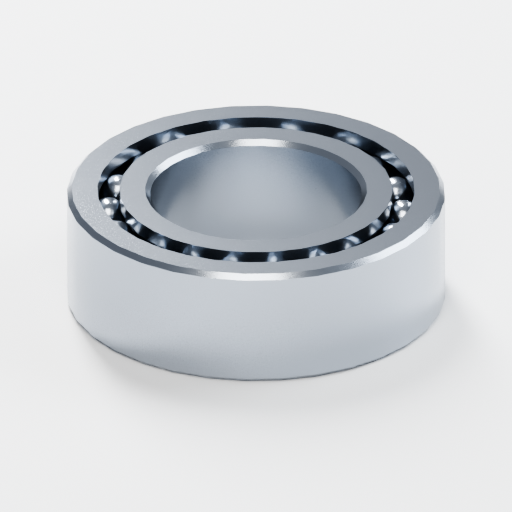
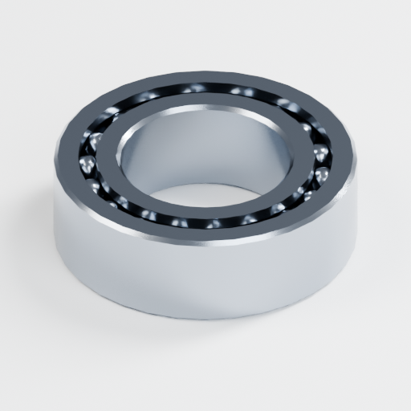
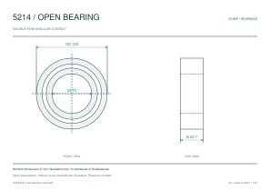

<!-- bearing-catalogue:start -->
# 5214 bearing - 70 x 125 x 39.7 mm

## Summary

Double row angular contact bearing: 70 mm bore, 125 mm outside diameter and 39.7 mm width.

| Product view | Isometric view |
| --- | --- |
|  |  |

Generated catalogue illustrations; the open internal geometry is illustrative.

## Details

**OOMP ID:** `hardware_bearing_5200_series_5214_size_70_mm_id_125_mm_od_39.7_mm_depth`

| Dimension | Nominal value |
| --- | --- |
| Bore / ID | 70 mm |
| Outside diameter / OD | 125 mm |
| Width / B | 39.7 mm |
| Catalogue contact angle | 25 degrees |

**Dimension evidence:** manufacturer checked (review retained from 2026-10-27).

Nominal presentation model. Raceways, pitch circle, chamfers and retainer geometry are illustrative; ball count/diameter are illustrative unless individually sourced. Not a manufacturer reconstruction, load-rating model or manufacturing/tolerance certification. Unspecified closure is presented open. The mesh shows open races and balls; retainers, seals and exact contact surfaces are omitted.

Contact-angle authority: **manufacturer family**. The mesh does not reconstruct the manufacturer contact surfaces.



[Printable A4 dimension sheet](working_dimension_a4.pdf) · [1:1 outline](working_svg.svg)

### Source evidence

- [https://www.nsk.com/content/dam/nsk/am/en_us/documents/bearings-americas/Bearing-and-Linear-Replacement-Guide.pdf](https://www.nsk.com/content/dam/nsk/am/en_us/documents/bearings-americas/Bearing-and-Linear-Replacement-Guide.pdf)

[Retained research and corrected dimensions](../../source_file/solidcraft/) · [Editable declaration](../../working_oomp_declarations_bearing.py)

## Parts

[Canonical part folder](.) · [Metadata](working.yaml) · [Browse this series](../../navigation/5200/README.md)

### Files

- [Editable OpenSCAD geometry](3dpr.scad)
- [Full model / GLB / metres, Y-up](three_d_model/model_full.glb)
- [Lightweight model / GLB / metres, Y-up](three_d_model/model_display.glb)
- [Editable Blender studio](three_d_model/studio.blend)
- [Product render / 2048 px](three_d_model/render_product_high.png)
- [Isometric render / 2048 px](three_d_model/render_high.png)
- [Populated model and render recipe](three_d_model/parameters.json)
- [Mesh measurements and artifact hashes](three_d_model/manifest.json)
- [Retained native CAD success manifest](solidcraft/latest_success.json)
- [76.2 x 50.8 mm label](label_bearing_3x2.pdf)
- [38.1 x 25.4 mm label](label_bearing_1_5x1.pdf)
- [Retained editable native bearing / SolidCraft](solidcraft/generations/1950065a6854b155_20261027T113627Z_19f8433e/bearing_5214_open.solidcraft)

### Orthographic views

| Quality | Isometric | Front | Back | Left | Right | Top | Bottom |
| --- | --- | --- | --- | --- | --- | --- | --- |
| Full | [Isometric](three_d_model/full/isometric.svg) | [Front](three_d_model/full/front.svg) | [Back](three_d_model/full/back.svg) | [Left](three_d_model/full/left.svg) | [Right](three_d_model/full/right.svg) | [Top](three_d_model/full/top.svg) | [Bottom](three_d_model/full/bottom.svg) |
| Display | [Isometric](three_d_model/display/isometric.svg) | [Front](three_d_model/display/front.svg) | [Back](three_d_model/display/back.svg) | [Left](three_d_model/display/left.svg) | [Right](three_d_model/display/right.svg) | [Top](three_d_model/display/top.svg) | [Bottom](three_d_model/display/bottom.svg) |

## Assembly

No installation procedure is established for this generic size record. Select the required closure, clearance, tolerance and load rating from the actual purchased bearing specification.

<details>
<summary>Complete OOMP metadata</summary>

```yaml
depth: 39.7
id: hardware_bearing_5200_series_5214_size_70_mm_id_125_mm_od_39.7_mm_depth
od: 125.0
series: '5200'
size: '5214'
svg_details:
  svg_name: bearing_dimension
  title: 5214 / OPEN BEARING
  family: DOUBLE ROW ANGULAR CONTACT
  dimensions_mm:
    bore: 70.0
    outside: 125.0
    width: 39.7
    contact_angle_deg: 25.0
  sheet_width_mm: 297
  sheet_height_mm: 210
  ink: '#183336'
  accent: '#147d83'
  muted: '#61767a'
  paper: '#ffffff'
  race_face_fill: '#edf3f3'
  inner_race_face_outside_mm: 90.11580000000001
  outer_race_face_inside_mm: 104.88419999999999
  line_width_mm: 0.45
  font_family: Helvetica
  dimension_font_mm: 4
  title_font_mm: 9
  front_centre_mm:
  - 79
  - 103
  side_centre_mm:
  - 211
  - 103
  max_view_width_mm: 78
  max_side_width_mm: 55
  dimension_offset_mm: 12
  arrow_size_mm: 2
  note: Nominal dimensions in mm. Illustration only; no tolerances or fit allowances.
  authority: manufacturer checked
  internal_note: Open presentation; internal races and balls are illustrative. Retainers
    omitted.
  layout:
    left_margin_mm: 14
    right_margin_mm: 283
    title_y_mm: 22
    family_y_mm: 33
    family_font_mm: 3.5
    brand: OOMP / BEARINGS
    brand_font_mm: 3.5
    header_rule_y_mm: 40
    view_caption_y_mm: 173
    view_caption_font_mm: 3
    front_caption: FRONT VIEW
    side_caption: SIDE VIEW
    footer_rule_y_mm: 180
    note_y_mm: 187
    internal_note_y_mm: 194
    note_font_mm: 3.2
    source_y_mm: 202
    source_font_mm: 3
    source_prefix: 'SOURCE: '
    scale_prefix: A4 / scale
  dimension_style:
    line_width_mm: 0.25
    arrow_half_width_ratio: 0.3
    text_gap_mm: 2
    extension_mm: 2
    width_extension_mm: 3
    centre_extension_mm: 5
    dash_pattern_mm:
    - 2
    - 1
    flange_leader_offset_mm:
    - -13
    - 11
    flange_text_offset_mm:
    - -13
    - 16
    flange_font_mm: 3.5
  outline:
    ink: black
    line_width_mm: 0.1
taxonomy_1: hardware
taxonomy_10: ''
taxonomy_11: ''
taxonomy_12: ''
taxonomy_13: ''
taxonomy_14: ''
taxonomy_15: ''
taxonomy_2: bearing
taxonomy_3: 5200_series
taxonomy_4: 5214_size
taxonomy_5: 70_mm_id
taxonomy_6: 125_mm_od
taxonomy_7: 39.7_mm_depth
taxonomy_8: ''
taxonomy_9: ''
weight: 2,061
width: 39.7
dimension_selection:
  policy: standard_metric_open_catalogue
  previous_id: hardware_bearing_5200_series_5214_size_70_mm_id_125_mm_od_39.6_mm_depth
  sources:
  - https://www.nsk.com/content/dam/nsk/am/en_us/documents/bearings-americas/Bearing-and-Linear-Replacement-Guide.pdf
  note: User selected standard catalogue variants on 2026-10-27; no sales ranking
    asserted.
url_chat: https://chatgpt.com/c/6ab83bf5-4224-83eb-9880-2d935d3ff1f7
run_action: true
run_oomp: true
run_oomp_populate: true
run_scad: false
generate_stl: false
taxonomy_1_upper: HARDWARE
taxonomy_1_upper_length_1: H
taxonomy_1_upper_length_2: HA
taxonomy_1_upper_length_3: HAR
taxonomy_1_upper_length_4: HARD
taxonomy_1_upper_length_5: HARDW
taxonomy_1_length_1: h
taxonomy_1_length_2: ha
taxonomy_1_length_3: har
taxonomy_1_length_4: hard
taxonomy_1_length_5: hardw
taxonomy_1_capital: Hardware
taxonomy_1_first_letter: h
taxonomy_1_first_letter_upper: H
taxonomy_2_upper: BEARING
taxonomy_2_upper_length_1: B
taxonomy_2_upper_length_2: BE
taxonomy_2_upper_length_3: BEA
taxonomy_2_upper_length_4: BEAR
taxonomy_2_upper_length_5: BEARI
taxonomy_2_length_1: b
taxonomy_2_length_2: be
taxonomy_2_length_3: bea
taxonomy_2_length_4: bear
taxonomy_2_length_5: beari
taxonomy_2_capital: Bearing
taxonomy_2_first_letter: b
taxonomy_2_first_letter_upper: B
taxonomy_3_upper: 5200_SERIES
taxonomy_3_upper_length_1: '5'
taxonomy_3_upper_length_2: '52'
taxonomy_3_upper_length_3: '520'
taxonomy_3_upper_length_4: '5200'
taxonomy_3_upper_length_5: '5200_'
taxonomy_3_length_1: '5'
taxonomy_3_length_2: '52'
taxonomy_3_length_3: '520'
taxonomy_3_length_4: '5200'
taxonomy_3_length_5: '5200_'
taxonomy_3_capital: 5200 Series
taxonomy_3_first_letter: '5'
taxonomy_3_first_letter_upper: '5'
taxonomy_4_upper: 5214_SIZE
taxonomy_4_upper_length_1: '5'
taxonomy_4_upper_length_2: '52'
taxonomy_4_upper_length_3: '521'
taxonomy_4_upper_length_4: '5214'
taxonomy_4_upper_length_5: '5214_'
taxonomy_4_length_1: '5'
taxonomy_4_length_2: '52'
taxonomy_4_length_3: '521'
taxonomy_4_length_4: '5214'
taxonomy_4_length_5: '5214_'
taxonomy_4_capital: 5214 Size
taxonomy_4_first_letter: '5'
taxonomy_4_first_letter_upper: '5'
taxonomy_5_upper: 70_MM_ID
taxonomy_5_upper_length_1: '7'
taxonomy_5_upper_length_2: '70'
taxonomy_5_upper_length_3: '70_'
taxonomy_5_upper_length_4: 70_M
taxonomy_5_upper_length_5: 70_MM
taxonomy_5_length_1: '7'
taxonomy_5_length_2: '70'
taxonomy_5_length_3: '70_'
taxonomy_5_length_4: 70_m
taxonomy_5_length_5: 70_mm
taxonomy_5_capital: 70 mm Id
taxonomy_5_first_letter: '7'
taxonomy_5_first_letter_upper: '7'
taxonomy_6_upper: 125_MM_OD
taxonomy_6_upper_length_1: '1'
taxonomy_6_upper_length_2: '12'
taxonomy_6_upper_length_3: '125'
taxonomy_6_upper_length_4: '125_'
taxonomy_6_upper_length_5: 125_M
taxonomy_6_length_1: '1'
taxonomy_6_length_2: '12'
taxonomy_6_length_3: '125'
taxonomy_6_length_4: '125_'
taxonomy_6_length_5: 125_m
taxonomy_6_capital: 125 mm Od
taxonomy_6_first_letter: '1'
taxonomy_6_first_letter_upper: '1'
taxonomy_7_upper: 39.7_MM_DEPTH
taxonomy_7_upper_length_1: '3'
taxonomy_7_upper_length_2: '39'
taxonomy_7_upper_length_3: '39.'
taxonomy_7_upper_length_4: '39.7'
taxonomy_7_upper_length_5: '39.7_'
taxonomy_7_length_1: '3'
taxonomy_7_length_2: '39'
taxonomy_7_length_3: '39.'
taxonomy_7_length_4: '39.7'
taxonomy_7_length_5: '39.7_'
taxonomy_7_capital: 39.7 mm Depth
taxonomy_7_first_letter: '3'
taxonomy_7_first_letter_upper: '3'
id_no_class: hardware_bearing_5200_series_5214_size_70_mm_id_125_mm_od_39.7_mm_depth
id_no_type: hardware_bearing_5200_series_5214_size_70_mm_id_125_mm_od_39.7_mm_depth
id_no_size: hardware_bearing_5200_series_size_70_mm_id_125_mm_od_39.7_mm_depth
oomp_key: oomp_hardware_bearing_5200_series_5214_size_70_mm_id_125_mm_od_39.7_mm_depth
link_github: https://github.com/oomlout/oomp_bearing_version_5/tree/main/parts/hardware_bearing_5200_series_5214_size_70_mm_id_125_mm_od_39.7_mm_depth
link_main: https://github.com/oomlout/oomlout_oomp_version_1_messy/tree/main/parts/hardware_bearing_5200_series_5214_size_70_mm_id_125_mm_od_39.7_mm_depth
link_redirect: https://github.com/oomlout/oomlout_oomp_version_1_messy/tree/main/parts/hardware_bearing_5200_series_5214_size_70_mm_id_125_mm_od_39.7_mm_depth
directory: parts/hardware_bearing_5200_series_5214_size_70_mm_id_125_mm_od_39.7_mm_depth
name: 5214 bearing
name_no_class: Hardware Bearing 5200 Series 5214 Size 70 Mm Id 125 Mm Od 39.7 Mm Depth
name_no_type: Hardware Bearing 5200 Series 5214 Size 70 Mm Id 125 Mm Od 39.7 Mm Depth
name_no_size: Hardware Bearing 5200 Series Size 70 Mm Id 125 Mm Od 39.7 Mm Depth
md5: 4137c6b6415188447bdbd562f9ab7dba
md5_5: 4137c
md5_5_upper: 4137C
md5_6: 4137c6
md5_6_upper: 4137C6
md5_6_alpha: 2jlxi
md5_6_alpha_upper: 2JLXI
md5_10: 4137c6b641
md5_10_upper: 4137C6B641
bip_39_full_array:
- donkey
- sail
- pulse
- live
- blush
- captain
- urge
- kingdom
- glass
- snap
- term
- insane
bip_39_full_space: donkey sail pulse live blush captain urge kingdom glass snap term
  insane
bip_39_full_no_space: donkeysailpulseliveblushcaptainurgekingdomglasssnapterminsane
bip_39_full_underscore: donkey_sail_pulse_live_blush_captain_urge_kingdom_glass_snap_term_insane
bip_39_2_word_array:
- donkey
- sail
bip_39_2_word_space: donkey sail
bip_39_2_word_no_space: donkeysail
bip_39_2_word_underscore: donkey_sail
bip_39_3_word_array:
- donkey
- sail
- pulse
bip_39_3_word_space: donkey sail pulse
bip_39_3_word_no_space: donkeysailpulse
bip_39_3_word_underscore: donkey_sail_pulse
name_space: hardware bearing 5200 series 5214 size 70 mm id 125 mm od 39.7 mm depth
name_proper: 5214 bearing
name_upper: HARDWARE BEARING 5200 SERIES 5214 SIZE 70 MM ID 125 MM OD 39.7 MM DEPTH
oomlout_ai_roboclick_1:
  file_test: ''
  actions:
  - command: text_jinja_template
    description: Bold bearing label 3x2
    file_template: C:\od\OneDrive\docs\oomp_bearing\source_file\template_jinja\label_bearing_bold\3x2.svg.j2
    file_output: label_bearing_bold_3x2.svg
    dict_data_yaml_files:
      label_source: C:\od\OneDrive\docs\oomp_bearing\parts_source\hardware_bearing_5200_series_5214_size_70_mm_id_125_mm_od_39_7_mm_depth\working.yaml
      label_manual: C:\od\OneDrive\docs\oomp_bearing\parts\hardware_bearing_5200_series_5214_size_70_mm_id_125_mm_od_39.7_mm_depth\working_manual.yaml
    convert_to_pdf: false
    convert_to_png: false
oomlout_ai_roboclick_2:
  file_test: ''
  actions:
  - command: text_jinja_template
    description: Bold bearing label 1_5x1
    file_template: C:\od\OneDrive\docs\oomp_bearing\source_file\template_jinja\label_bearing_bold\1_5x1.svg.j2
    file_output: label_bearing_bold_1_5x1.svg
    dict_data_yaml_files:
      label_source: C:\od\OneDrive\docs\oomp_bearing\parts_source\hardware_bearing_5200_series_5214_size_70_mm_id_125_mm_od_39_7_mm_depth\working.yaml
      label_manual: C:\od\OneDrive\docs\oomp_bearing\parts\hardware_bearing_5200_series_5214_size_70_mm_id_125_mm_od_39.7_mm_depth\working_manual.yaml
    convert_to_pdf: false
    convert_to_png: false
catalogue_schema: oomp_bearing_v5
oomp_id: hardware_bearing_5200_series_5214_size_70_mm_id_125_mm_od_39.7_mm_depth
family: double_row_angular_contact
dimensions_mm:
  bore: 70.0
  outside: 125.0
  width: 39.7
  contact_angle_deg: 25.0
bore: 70.0
dimension_authority: manufacturer_checked
source_checked: '2026-10-27'
sources:
- https://www.nsk.com/content/dam/nsk/am/en_us/documents/bearings-americas/Bearing-and-Linear-Replacement-Guide.pdf
model_note: Nominal presentation model. Raceways, pitch circle, chamfers and retainer
  geometry are illustrative; ball count/diameter are illustrative unless individually
  sourced. Not a manufacturer reconstruction, load-rating model or manufacturing/tolerance
  certification. Unspecified closure is presented open. The mesh shows open races
  and balls; retainers, seals and exact contact surfaces are omitted.
closure: open
three_d_model_details:
  schema_version: 1
  generator: bearing_open
  output_folder: three_d_model
  parameters:
    bore: 70.0
    outside: 125.0
    width: 39.7
    edge: 1.65
    pitch_radius: 48.75
    ball_radius: 5.955
    groove_radius: 6.252750000000001
    inner_shoulder: 45.057900000000004
    outer_shoulder: 52.442099999999996
    cage_half_width: 3.27525
    cage_low: 5.6572499999999994
    cage_high: 6.848249999999999
    window_radius: 2.8584
    contact_angle_deg: 25.0
    contact_offset: 0.148875
    identity: hardware_bearing_5200_series_5214_size_70_mm_id_125_mm_od_39.7_mm_depth
    specification: 5214 / 70 x 125 x 39.7 mm
    characteristic_dimension_mm: 125.0
    characteristic_dimension_basis: maximum nominal envelope dimension
    ball_count: 36
    balls_per_row: 18
    row_count: 2
    ball_specification: illustrative
    contact_angle_authority: manufacturer_family
    row_centres_z:
    - 9.925
    - 29.775000000000002
    components:
    - name: outer_race
      shape: revolved_profile
      profile_mm:
      - - 60.85
        - 0
      - - 62.5
        - 1.65
      - - 62.5
        - 38.050000000000004
      - - 60.85
        - 39.7
      - - 52.442099999999996
        - 39.7
      - - 52.442099999999996
        - 38.050000000000004
      - - 52.442099999999996
        - 36.02775
      - - 52.442099999999996
        - 35.715112500000004
      - - 52.442099999999996
        - 35.402475
      - - 52.442099999999996
        - 35.0898375
      - - 52.501650000000005
        - 34.7772
      - - 52.885805377564786
        - 34.4645625
      - - 53.21535666065713
        - 34.151925000000006
      - - 53.501678617061955
        - 33.8392875
      - - 53.7522
        - 33.526650000000004
      - - 53.972075792952815
        - 33.2140125
      - - 54.16504034351315
        - 32.901375
      - - 54.33388429711735
        - 32.5887375
      - - 54.48074003532703
        - 32.2761
      - - 54.60726168517284
        - 31.9634625
      - - 54.714743341659805
        - 31.650825
      - - 54.80419915449961
        - 31.3381875
      - - 54.87641879567501
        - 31.025550000000003
      - - 54.93200636564245
        - 30.7129125
      - - 54.97140769736842
        - 30.400275
      - - 54.99492917142331
        - 30.0876375
      - - 55.00275
        - 29.775
      - - 54.9949291714233
        - 29.4623625
      - - 54.97140769736842
        - 29.149725
      - - 54.93200636564245
        - 28.837087500000003
      - - 54.87641879567501
        - 28.52445
      - - 54.80419915449961
        - 28.2118125
      - - 54.714743341659805
        - 27.899175
      - - 54.60726168517284
        - 27.5865375
      - - 54.480740035327024
        - 27.2739
      - - 54.33388429711735
        - 26.9612625
      - - 54.16504034351315
        - 26.648625
      - - 53.972075792952815
        - 26.3359875
      - - 53.7522
        - 26.02335
      - - 53.50167861706195
        - 25.7107125
      - - 53.21535666065713
        - 25.398075
      - - 52.88580537756478
        - 25.0854375
      - - 52.50165
        - 24.7728
      - - 52.442099999999996
        - 24.4601625
      - - 52.442099999999996
        - 24.147524999999998
      - - 52.442099999999996
        - 23.8348875
      - - 52.442099999999996
        - 23.52225
      - - 52.442099999999996
        - 16.177750000000003
      - - 52.442099999999996
        - 15.8651125
      - - 52.442099999999996
        - 15.552475000000001
      - - 52.442099999999996
        - 15.239837500000002
      - - 52.50165
        - 14.927200000000001
      - - 52.88580537756478
        - 14.614562500000002
      - - 53.21535666065713
        - 14.301925000000002
      - - 53.50167861706195
        - 13.989287500000001
      - - 53.7522
        - 13.67665
      - - 53.972075792952815
        - 13.364012500000001
      - - 54.16504034351315
        - 13.051375
      - - 54.33388429711735
        - 12.738737500000001
      - - 54.480740035327024
        - 12.426100000000002
      - - 54.60726168517284
        - 12.1134625
      - - 54.714743341659805
        - 11.800825000000001
      - - 54.80419915449961
        - 11.488187500000002
      - - 54.87641879567501
        - 11.175550000000001
      - - 54.93200636564245
        - 10.8629125
      - - 54.97140769736842
        - 10.550275000000001
      - - 54.9949291714233
        - 10.237637500000002
      - - 55.00275
        - 9.925
      - - 54.9949291714233
        - 9.6123625
      - - 54.97140769736842
        - 9.299725
      - - 54.93200636564245
        - 8.987087500000001
      - - 54.87641879567501
        - 8.67445
      - - 54.80419915449961
        - 8.3618125
      - - 54.714743341659805
        - 8.049175000000002
      - - 54.60726168517284
        - 7.736537500000001
      - - 54.480740035327024
        - 7.423900000000001
      - - 54.33388429711735
        - 7.1112625000000005
      - - 54.16504034351315
        - 6.798625
      - - 53.972075792952815
        - 6.4859875
      - - 53.7522
        - 6.17335
      - - 53.50167861706195
        - 5.8607125
      - - 53.21535666065713
        - 5.548075000000001
      - - 52.88580537756478
        - 5.2354375
      - - 52.50165
        - 4.9228000000000005
      - - 52.442099999999996
        - 4.6101625
      - - 52.442099999999996
        - 4.297525
      - - 52.442099999999996
        - 3.9848875
      - - 52.442099999999996
        - 3.67225
      - - 52.442099999999996
        - 1.65
      - - 52.442099999999996
        - 0.0
      - - 60.85
        - 0
    - name: inner_race
      shape: revolved_profile
      profile_mm:
      - - 45.057900000000004
        - 0.0
      - - 45.057900000000004
        - 1.65
      - - 45.057900000000004
        - 3.67225
      - - 45.057900000000004
        - 3.9848875
      - - 45.057900000000004
        - 4.297525
      - - 45.057900000000004
        - 4.6101625
      - - 44.99835
        - 4.9228000000000005
      - - 44.61419462243522
        - 5.2354375
      - - 44.28464333934287
        - 5.548075000000001
      - - 43.99832138293805
        - 5.8607125
      - - 43.7478
        - 6.17335
      - - 43.527924207047185
        - 6.4859875
      - - 43.33495965648685
        - 6.798625
      - - 43.16611570288265
        - 7.1112625000000005
      - - 43.019259964672976
        - 7.423900000000001
      - - 42.89273831482716
        - 7.736537500000001
      - - 42.785256658340195
        - 8.049175000000002
      - - 42.69580084550039
        - 8.3618125
      - - 42.62358120432499
        - 8.67445
      - - 42.56799363435755
        - 8.987087500000001
      - - 42.52859230263158
        - 9.299725
      - - 42.5050708285767
        - 9.6123625
      - - 42.49725
        - 9.925
      - - 42.5050708285767
        - 10.237637500000002
      - - 42.52859230263158
        - 10.550275000000001
      - - 42.56799363435755
        - 10.8629125
      - - 42.62358120432499
        - 11.175550000000001
      - - 42.69580084550039
        - 11.488187500000002
      - - 42.785256658340195
        - 11.800825000000001
      - - 42.89273831482716
        - 12.1134625
      - - 43.019259964672976
        - 12.426100000000002
      - - 43.16611570288265
        - 12.738737500000001
      - - 43.33495965648685
        - 13.051375
      - - 43.527924207047185
        - 13.364012500000001
      - - 43.7478
        - 13.67665
      - - 43.99832138293805
        - 13.989287500000001
      - - 44.28464333934287
        - 14.301925000000002
      - - 44.61419462243522
        - 14.614562500000002
      - - 44.99835
        - 14.927200000000001
      - - 45.057900000000004
        - 15.239837500000002
      - - 45.057900000000004
        - 15.552475000000001
      - - 45.057900000000004
        - 15.8651125
      - - 45.057900000000004
        - 16.177750000000003
      - - 45.057900000000004
        - 23.52225
      - - 45.057900000000004
        - 23.8348875
      - - 45.057900000000004
        - 24.147524999999998
      - - 45.057900000000004
        - 24.4601625
      - - 44.99835
        - 24.7728
      - - 44.61419462243522
        - 25.0854375
      - - 44.28464333934287
        - 25.398075
      - - 43.99832138293805
        - 25.7107125
      - - 43.7478
        - 26.02335
      - - 43.527924207047185
        - 26.3359875
      - - 43.33495965648685
        - 26.648625
      - - 43.16611570288265
        - 26.9612625
      - - 43.019259964672976
        - 27.2739
      - - 42.89273831482716
        - 27.5865375
      - - 42.785256658340195
        - 27.899175
      - - 42.69580084550039
        - 28.2118125
      - - 42.62358120432499
        - 28.52445
      - - 42.56799363435755
        - 28.837087500000003
      - - 42.52859230263158
        - 29.149725
      - - 42.5050708285767
        - 29.4623625
      - - 42.49725
        - 29.775
      - - 42.50507082857669
        - 30.0876375
      - - 42.52859230263158
        - 30.400275
      - - 42.56799363435755
        - 30.7129125
      - - 42.62358120432499
        - 31.025550000000003
      - - 42.69580084550039
        - 31.3381875
      - - 42.785256658340195
        - 31.650825
      - - 42.89273831482716
        - 31.9634625
      - - 43.01925996467297
        - 32.2761
      - - 43.16611570288265
        - 32.5887375
      - - 43.33495965648685
        - 32.901375
      - - 43.527924207047185
        - 33.2140125
      - - 43.7478
        - 33.526650000000004
      - - 43.998321382938045
        - 33.8392875
      - - 44.28464333934287
        - 34.151925000000006
      - - 44.614194622435214
        - 34.4645625
      - - 44.998349999999995
        - 34.7772
      - - 45.057900000000004
        - 35.0898375
      - - 45.057900000000004
        - 35.402475
      - - 45.057900000000004
        - 35.715112500000004
      - - 45.057900000000004
        - 36.02775
      - - 45.057900000000004
        - 38.050000000000004
      - - 45.057900000000004
        - 39.7
      - - 36.65
        - 39.7
      - - 35.0
        - 38.050000000000004
      - - 35.0
        - 1.65
      - - 36.65
        - 0
      - - 45.057900000000004
        - 0.0
    - name: ball_row_1_1
      shape: sphere
      radius_mm: 5.955
      centre_mm:
      - 48.75
      - 0.0
      - 9.925
    - name: ball_row_1_2
      shape: sphere
      radius_mm: 5.955
      centre_mm:
      - 45.81001526331303
      - 16.67348198712635
      - 9.925
    - name: ball_row_1_3
      shape: sphere
      radius_mm: 5.955
      centre_mm:
      - 37.344666602050175
      - 31.33589597221879
      - 9.925
    - name: ball_row_1_4
      shape: sphere
      radius_mm: 5.955
      centre_mm:
      - 24.375000000000007
      - 42.21873843449138
      - 9.925
    - name: ball_row_1_5
      shape: sphere
      radius_mm: 5.955
      centre_mm:
      - 8.465348661262858
      - 48.009377959345144
      - 9.925
    - name: ball_row_1_6
      shape: sphere
      radius_mm: 5.955
      centre_mm:
      - -8.465348661262853
      - 48.009377959345144
      - 9.925
    - name: ball_row_1_7
      shape: sphere
      radius_mm: 5.955
      centre_mm:
      - -24.37499999999999
      - 42.218738434491385
      - 9.925
    - name: ball_row_1_8
      shape: sphere
      radius_mm: 5.955
      centre_mm:
      - -37.344666602050175
      - 31.3358959722188
      - 9.925
    - name: ball_row_1_9
      shape: sphere
      radius_mm: 5.955
      centre_mm:
      - -45.81001526331303
      - 16.673481987126358
      - 9.925
    - name: ball_row_1_10
      shape: sphere
      radius_mm: 5.955
      centre_mm:
      - -48.75
      - 5.970153145843347e-15
      - 9.925
    - name: ball_row_1_11
      shape: sphere
      radius_mm: 5.955
      centre_mm:
      - -45.81001526331303
      - -16.673481987126348
      - 9.925
    - name: ball_row_1_12
      shape: sphere
      radius_mm: 5.955
      centre_mm:
      - -37.3446666020502
      - -31.335895972218772
      - 9.925
    - name: ball_row_1_13
      shape: sphere
      radius_mm: 5.955
      centre_mm:
      - -24.37500000000002
      - -42.21873843449138
      - 9.925
    - name: ball_row_1_14
      shape: sphere
      radius_mm: 5.955
      centre_mm:
      - -8.465348661262853
      - -48.009377959345144
      - 9.925
    - name: ball_row_1_15
      shape: sphere
      radius_mm: 5.955
      centre_mm:
      - 8.465348661262835
      - -48.009377959345144
      - 9.925
    - name: ball_row_1_16
      shape: sphere
      radius_mm: 5.955
      centre_mm:
      - 24.374999999999968
      - -42.21873843449141
      - 9.925
    - name: ball_row_1_17
      shape: sphere
      radius_mm: 5.955
      centre_mm:
      - 37.34466660205017
      - -31.335895972218804
      - 9.925
    - name: ball_row_1_18
      shape: sphere
      radius_mm: 5.955
      centre_mm:
      - 45.81001526331303
      - -16.673481987126344
      - 9.925
    - name: ball_row_2_1
      shape: sphere
      radius_mm: 5.955
      centre_mm:
      - 48.75
      - 0.0
      - 29.775000000000002
    - name: ball_row_2_2
      shape: sphere
      radius_mm: 5.955
      centre_mm:
      - 45.81001526331303
      - 16.67348198712635
      - 29.775000000000002
    - name: ball_row_2_3
      shape: sphere
      radius_mm: 5.955
      centre_mm:
      - 37.344666602050175
      - 31.33589597221879
      - 29.775000000000002
    - name: ball_row_2_4
      shape: sphere
      radius_mm: 5.955
      centre_mm:
      - 24.375000000000007
      - 42.21873843449138
      - 29.775000000000002
    - name: ball_row_2_5
      shape: sphere
      radius_mm: 5.955
      centre_mm:
      - 8.465348661262858
      - 48.009377959345144
      - 29.775000000000002
    - name: ball_row_2_6
      shape: sphere
      radius_mm: 5.955
      centre_mm:
      - -8.465348661262853
      - 48.009377959345144
      - 29.775000000000002
    - name: ball_row_2_7
      shape: sphere
      radius_mm: 5.955
      centre_mm:
      - -24.37499999999999
      - 42.218738434491385
      - 29.775000000000002
    - name: ball_row_2_8
      shape: sphere
      radius_mm: 5.955
      centre_mm:
      - -37.344666602050175
      - 31.3358959722188
      - 29.775000000000002
    - name: ball_row_2_9
      shape: sphere
      radius_mm: 5.955
      centre_mm:
      - -45.81001526331303
      - 16.673481987126358
      - 29.775000000000002
    - name: ball_row_2_10
      shape: sphere
      radius_mm: 5.955
      centre_mm:
      - -48.75
      - 5.970153145843347e-15
      - 29.775000000000002
    - name: ball_row_2_11
      shape: sphere
      radius_mm: 5.955
      centre_mm:
      - -45.81001526331303
      - -16.673481987126348
      - 29.775000000000002
    - name: ball_row_2_12
      shape: sphere
      radius_mm: 5.955
      centre_mm:
      - -37.3446666020502
      - -31.335895972218772
      - 29.775000000000002
    - name: ball_row_2_13
      shape: sphere
      radius_mm: 5.955
      centre_mm:
      - -24.37500000000002
      - -42.21873843449138
      - 29.775000000000002
    - name: ball_row_2_14
      shape: sphere
      radius_mm: 5.955
      centre_mm:
      - -8.465348661262853
      - -48.009377959345144
      - 29.775000000000002
    - name: ball_row_2_15
      shape: sphere
      radius_mm: 5.955
      centre_mm:
      - 8.465348661262835
      - -48.009377959345144
      - 29.775000000000002
    - name: ball_row_2_16
      shape: sphere
      radius_mm: 5.955
      centre_mm:
      - 24.374999999999968
      - -42.21873843449141
      - 29.775000000000002
    - name: ball_row_2_17
      shape: sphere
      radius_mm: 5.955
      centre_mm:
      - 37.34466660205017
      - -31.335895972218804
      - 29.775000000000002
    - name: ball_row_2_18
      shape: sphere
      radius_mm: 5.955
      centre_mm:
      - 45.81001526331303
      - -16.673481987126344
      - 29.775000000000002
  modelling_note: Nominal presentation model. Raceways, pitch circle, chamfers and
    retainer geometry are illustrative; ball count/diameter are illustrative unless
    individually sourced. Not a manufacturer reconstruction, load-rating model or
    manufacturing/tolerance certification. Unspecified closure is presented open.
    The mesh shows open races and balls; retainers, seals and exact contact surfaces
    are omitted.
  dimension_authority: manufacturer_checked
  model_formats:
  - glb
  variants:
    full:
      angular_segments: 128
      sphere_subdivisions: 3
    display:
      angular_segments: 32
      sphere_subdivisions: 2
  views:
  - isometric
  - front
  - back
  - left
  - right
  - top
  - bottom
  material:
    name: Illustrative polished bearing steel
    base_colour_srgb:
    - 0.62
    - 0.65
    - 0.69
    metallic: 1.0
    roughness: 0.22
    roughness_variation: 0.045
    coat_weight: 0.02
    coat_roughness: 0.28
    microtexture_spacing_mm: 0.025
    microtexture_height_um: 0.8
    note: Illustrative bearing steel; material grade and finish are not specified.
  studio:
    engine: cycles
    device: auto
    seed: 7991
    low_samples: 24
    high_samples: 48
    adaptive_threshold: 0.015
    denoise: true
    view_transform: AgX
    look: AgX - Medium High Contrast
    exposure: 0.0
    world_colour:
    - 0.78
    - 0.82
    - 0.9
    world_strength: 0.35
    floor_colour_srgb:
    - 0.93
    - 0.935
    - 0.94
    floor_roughness: 0.55
    framing_margin: 0.13
    lights:
    - name: Key softbox
      position:
      - -3
      - -4
      - 6
      power: 650.0
      width: 4.0
      height: 5.0
      colour:
      - 1.0
      - 0.96
      - 0.9
    - name: Fill softbox
      position:
      - 4
      - -1
      - 3
      power: 330.0
      width: 3.0
      height: 4.0
      colour:
      - 0.9
      - 0.95
      - 1.0
    - name: Rim strip
      position:
      - 1
      - 4
      - 4
      power: 850.0
      width: 1.2
      height: 5.0
      colour:
      - 1.0
      - 1.0
      - 1.0
    poses:
      isometric:
        camera_eye:
        - 1
        - -1
        - 1
        projection: orthographic
        orientation: principal axis Z up
      product:
        camera_eye:
        - -6
        - -10
        - 6
        projection: orthographic
        orientation: resting on lower face
        yaw_degrees: -12.0
        support: Stable convex-hull support using actual mesh centre of mass.
        resting_axis: face
  renders:
    low:
      file: render_low.png
      variant: display
      pixels: 512
      view: isometric
    high:
      file: render_high.png
      variant: full
      pixels: 2048
      view: isometric
    product_low:
      file: render_product_low.png
      variant: display
      pixels: 512
      view: product
    product_high:
      file: render_product_high.png
      variant: full
      pixels: 2048
      view: product
oobb_type: bearing_open
oobb_details:
  oobb_type: bearing_open
  run_scad: true
  run_solidcraft: false
  angular_segments: 128
  components:
  - name: outer_race
    shape: revolved_profile
    profile_mm:
    - - 60.85
      - 0
    - - 62.5
      - 1.65
    - - 62.5
      - 38.050000000000004
    - - 60.85
      - 39.7
    - - 52.442099999999996
      - 39.7
    - - 52.442099999999996
      - 38.050000000000004
    - - 52.442099999999996
      - 36.02775
    - - 52.442099999999996
      - 35.715112500000004
    - - 52.442099999999996
      - 35.402475
    - - 52.442099999999996
      - 35.0898375
    - - 52.501650000000005
      - 34.7772
    - - 52.885805377564786
      - 34.4645625
    - - 53.21535666065713
      - 34.151925000000006
    - - 53.501678617061955
      - 33.8392875
    - - 53.7522
      - 33.526650000000004
    - - 53.972075792952815
      - 33.2140125
    - - 54.16504034351315
      - 32.901375
    - - 54.33388429711735
      - 32.5887375
    - - 54.48074003532703
      - 32.2761
    - - 54.60726168517284
      - 31.9634625
    - - 54.714743341659805
      - 31.650825
    - - 54.80419915449961
      - 31.3381875
    - - 54.87641879567501
      - 31.025550000000003
    - - 54.93200636564245
      - 30.7129125
    - - 54.97140769736842
      - 30.400275
    - - 54.99492917142331
      - 30.0876375
    - - 55.00275
      - 29.775
    - - 54.9949291714233
      - 29.4623625
    - - 54.97140769736842
      - 29.149725
    - - 54.93200636564245
      - 28.837087500000003
    - - 54.87641879567501
      - 28.52445
    - - 54.80419915449961
      - 28.2118125
    - - 54.714743341659805
      - 27.899175
    - - 54.60726168517284
      - 27.5865375
    - - 54.480740035327024
      - 27.2739
    - - 54.33388429711735
      - 26.9612625
    - - 54.16504034351315
      - 26.648625
    - - 53.972075792952815
      - 26.3359875
    - - 53.7522
      - 26.02335
    - - 53.50167861706195
      - 25.7107125
    - - 53.21535666065713
      - 25.398075
    - - 52.88580537756478
      - 25.0854375
    - - 52.50165
      - 24.7728
    - - 52.442099999999996
      - 24.4601625
    - - 52.442099999999996
      - 24.147524999999998
    - - 52.442099999999996
      - 23.8348875
    - - 52.442099999999996
      - 23.52225
    - - 52.442099999999996
      - 16.177750000000003
    - - 52.442099999999996
      - 15.8651125
    - - 52.442099999999996
      - 15.552475000000001
    - - 52.442099999999996
      - 15.239837500000002
    - - 52.50165
      - 14.927200000000001
    - - 52.88580537756478
      - 14.614562500000002
    - - 53.21535666065713
      - 14.301925000000002
    - - 53.50167861706195
      - 13.989287500000001
    - - 53.7522
      - 13.67665
    - - 53.972075792952815
      - 13.364012500000001
    - - 54.16504034351315
      - 13.051375
    - - 54.33388429711735
      - 12.738737500000001
    - - 54.480740035327024
      - 12.426100000000002
    - - 54.60726168517284
      - 12.1134625
    - - 54.714743341659805
      - 11.800825000000001
    - - 54.80419915449961
      - 11.488187500000002
    - - 54.87641879567501
      - 11.175550000000001
    - - 54.93200636564245
      - 10.8629125
    - - 54.97140769736842
      - 10.550275000000001
    - - 54.9949291714233
      - 10.237637500000002
    - - 55.00275
      - 9.925
    - - 54.9949291714233
      - 9.6123625
    - - 54.97140769736842
      - 9.299725
    - - 54.93200636564245
      - 8.987087500000001
    - - 54.87641879567501
      - 8.67445
    - - 54.80419915449961
      - 8.3618125
    - - 54.714743341659805
      - 8.049175000000002
    - - 54.60726168517284
      - 7.736537500000001
    - - 54.480740035327024
      - 7.423900000000001
    - - 54.33388429711735
      - 7.1112625000000005
    - - 54.16504034351315
      - 6.798625
    - - 53.972075792952815
      - 6.4859875
    - - 53.7522
      - 6.17335
    - - 53.50167861706195
      - 5.8607125
    - - 53.21535666065713
      - 5.548075000000001
    - - 52.88580537756478
      - 5.2354375
    - - 52.50165
      - 4.9228000000000005
    - - 52.442099999999996
      - 4.6101625
    - - 52.442099999999996
      - 4.297525
    - - 52.442099999999996
      - 3.9848875
    - - 52.442099999999996
      - 3.67225
    - - 52.442099999999996
      - 1.65
    - - 52.442099999999996
      - 0.0
    - - 60.85
      - 0
  - name: inner_race
    shape: revolved_profile
    profile_mm:
    - - 45.057900000000004
      - 0.0
    - - 45.057900000000004
      - 1.65
    - - 45.057900000000004
      - 3.67225
    - - 45.057900000000004
      - 3.9848875
    - - 45.057900000000004
      - 4.297525
    - - 45.057900000000004
      - 4.6101625
    - - 44.99835
      - 4.9228000000000005
    - - 44.61419462243522
      - 5.2354375
    - - 44.28464333934287
      - 5.548075000000001
    - - 43.99832138293805
      - 5.8607125
    - - 43.7478
      - 6.17335
    - - 43.527924207047185
      - 6.4859875
    - - 43.33495965648685
      - 6.798625
    - - 43.16611570288265
      - 7.1112625000000005
    - - 43.019259964672976
      - 7.423900000000001
    - - 42.89273831482716
      - 7.736537500000001
    - - 42.785256658340195
      - 8.049175000000002
    - - 42.69580084550039
      - 8.3618125
    - - 42.62358120432499
      - 8.67445
    - - 42.56799363435755
      - 8.987087500000001
    - - 42.52859230263158
      - 9.299725
    - - 42.5050708285767
      - 9.6123625
    - - 42.49725
      - 9.925
    - - 42.5050708285767
      - 10.237637500000002
    - - 42.52859230263158
      - 10.550275000000001
    - - 42.56799363435755
      - 10.8629125
    - - 42.62358120432499
      - 11.175550000000001
    - - 42.69580084550039
      - 11.488187500000002
    - - 42.785256658340195
      - 11.800825000000001
    - - 42.89273831482716
      - 12.1134625
    - - 43.019259964672976
      - 12.426100000000002
    - - 43.16611570288265
      - 12.738737500000001
    - - 43.33495965648685
      - 13.051375
    - - 43.527924207047185
      - 13.364012500000001
    - - 43.7478
      - 13.67665
    - - 43.99832138293805
      - 13.989287500000001
    - - 44.28464333934287
      - 14.301925000000002
    - - 44.61419462243522
      - 14.614562500000002
    - - 44.99835
      - 14.927200000000001
    - - 45.057900000000004
      - 15.239837500000002
    - - 45.057900000000004
      - 15.552475000000001
    - - 45.057900000000004
      - 15.8651125
    - - 45.057900000000004
      - 16.177750000000003
    - - 45.057900000000004
      - 23.52225
    - - 45.057900000000004
      - 23.8348875
    - - 45.057900000000004
      - 24.147524999999998
    - - 45.057900000000004
      - 24.4601625
    - - 44.99835
      - 24.7728
    - - 44.61419462243522
      - 25.0854375
    - - 44.28464333934287
      - 25.398075
    - - 43.99832138293805
      - 25.7107125
    - - 43.7478
      - 26.02335
    - - 43.527924207047185
      - 26.3359875
    - - 43.33495965648685
      - 26.648625
    - - 43.16611570288265
      - 26.9612625
    - - 43.019259964672976
      - 27.2739
    - - 42.89273831482716
      - 27.5865375
    - - 42.785256658340195
      - 27.899175
    - - 42.69580084550039
      - 28.2118125
    - - 42.62358120432499
      - 28.52445
    - - 42.56799363435755
      - 28.837087500000003
    - - 42.52859230263158
      - 29.149725
    - - 42.5050708285767
      - 29.4623625
    - - 42.49725
      - 29.775
    - - 42.50507082857669
      - 30.0876375
    - - 42.52859230263158
      - 30.400275
    - - 42.56799363435755
      - 30.7129125
    - - 42.62358120432499
      - 31.025550000000003
    - - 42.69580084550039
      - 31.3381875
    - - 42.785256658340195
      - 31.650825
    - - 42.89273831482716
      - 31.9634625
    - - 43.01925996467297
      - 32.2761
    - - 43.16611570288265
      - 32.5887375
    - - 43.33495965648685
      - 32.901375
    - - 43.527924207047185
      - 33.2140125
    - - 43.7478
      - 33.526650000000004
    - - 43.998321382938045
      - 33.8392875
    - - 44.28464333934287
      - 34.151925000000006
    - - 44.614194622435214
      - 34.4645625
    - - 44.998349999999995
      - 34.7772
    - - 45.057900000000004
      - 35.0898375
    - - 45.057900000000004
      - 35.402475
    - - 45.057900000000004
      - 35.715112500000004
    - - 45.057900000000004
      - 36.02775
    - - 45.057900000000004
      - 38.050000000000004
    - - 45.057900000000004
      - 39.7
    - - 36.65
      - 39.7
    - - 35.0
      - 38.050000000000004
    - - 35.0
      - 1.65
    - - 36.65
      - 0
    - - 45.057900000000004
      - 0.0
  - name: ball_row_1_1
    shape: sphere
    radius_mm: 5.955
    centre_mm:
    - 48.75
    - 0.0
    - 9.925
  - name: ball_row_1_2
    shape: sphere
    radius_mm: 5.955
    centre_mm:
    - 45.81001526331303
    - 16.67348198712635
    - 9.925
  - name: ball_row_1_3
    shape: sphere
    radius_mm: 5.955
    centre_mm:
    - 37.344666602050175
    - 31.33589597221879
    - 9.925
  - name: ball_row_1_4
    shape: sphere
    radius_mm: 5.955
    centre_mm:
    - 24.375000000000007
    - 42.21873843449138
    - 9.925
  - name: ball_row_1_5
    shape: sphere
    radius_mm: 5.955
    centre_mm:
    - 8.465348661262858
    - 48.009377959345144
    - 9.925
  - name: ball_row_1_6
    shape: sphere
    radius_mm: 5.955
    centre_mm:
    - -8.465348661262853
    - 48.009377959345144
    - 9.925
  - name: ball_row_1_7
    shape: sphere
    radius_mm: 5.955
    centre_mm:
    - -24.37499999999999
    - 42.218738434491385
    - 9.925
  - name: ball_row_1_8
    shape: sphere
    radius_mm: 5.955
    centre_mm:
    - -37.344666602050175
    - 31.3358959722188
    - 9.925
  - name: ball_row_1_9
    shape: sphere
    radius_mm: 5.955
    centre_mm:
    - -45.81001526331303
    - 16.673481987126358
    - 9.925
  - name: ball_row_1_10
    shape: sphere
    radius_mm: 5.955
    centre_mm:
    - -48.75
    - 5.970153145843347e-15
    - 9.925
  - name: ball_row_1_11
    shape: sphere
    radius_mm: 5.955
    centre_mm:
    - -45.81001526331303
    - -16.673481987126348
    - 9.925
  - name: ball_row_1_12
    shape: sphere
    radius_mm: 5.955
    centre_mm:
    - -37.3446666020502
    - -31.335895972218772
    - 9.925
  - name: ball_row_1_13
    shape: sphere
    radius_mm: 5.955
    centre_mm:
    - -24.37500000000002
    - -42.21873843449138
    - 9.925
  - name: ball_row_1_14
    shape: sphere
    radius_mm: 5.955
    centre_mm:
    - -8.465348661262853
    - -48.009377959345144
    - 9.925
  - name: ball_row_1_15
    shape: sphere
    radius_mm: 5.955
    centre_mm:
    - 8.465348661262835
    - -48.009377959345144
    - 9.925
  - name: ball_row_1_16
    shape: sphere
    radius_mm: 5.955
    centre_mm:
    - 24.374999999999968
    - -42.21873843449141
    - 9.925
  - name: ball_row_1_17
    shape: sphere
    radius_mm: 5.955
    centre_mm:
    - 37.34466660205017
    - -31.335895972218804
    - 9.925
  - name: ball_row_1_18
    shape: sphere
    radius_mm: 5.955
    centre_mm:
    - 45.81001526331303
    - -16.673481987126344
    - 9.925
  - name: ball_row_2_1
    shape: sphere
    radius_mm: 5.955
    centre_mm:
    - 48.75
    - 0.0
    - 29.775000000000002
  - name: ball_row_2_2
    shape: sphere
    radius_mm: 5.955
    centre_mm:
    - 45.81001526331303
    - 16.67348198712635
    - 29.775000000000002
  - name: ball_row_2_3
    shape: sphere
    radius_mm: 5.955
    centre_mm:
    - 37.344666602050175
    - 31.33589597221879
    - 29.775000000000002
  - name: ball_row_2_4
    shape: sphere
    radius_mm: 5.955
    centre_mm:
    - 24.375000000000007
    - 42.21873843449138
    - 29.775000000000002
  - name: ball_row_2_5
    shape: sphere
    radius_mm: 5.955
    centre_mm:
    - 8.465348661262858
    - 48.009377959345144
    - 29.775000000000002
  - name: ball_row_2_6
    shape: sphere
    radius_mm: 5.955
    centre_mm:
    - -8.465348661262853
    - 48.009377959345144
    - 29.775000000000002
  - name: ball_row_2_7
    shape: sphere
    radius_mm: 5.955
    centre_mm:
    - -24.37499999999999
    - 42.218738434491385
    - 29.775000000000002
  - name: ball_row_2_8
    shape: sphere
    radius_mm: 5.955
    centre_mm:
    - -37.344666602050175
    - 31.3358959722188
    - 29.775000000000002
  - name: ball_row_2_9
    shape: sphere
    radius_mm: 5.955
    centre_mm:
    - -45.81001526331303
    - 16.673481987126358
    - 29.775000000000002
  - name: ball_row_2_10
    shape: sphere
    radius_mm: 5.955
    centre_mm:
    - -48.75
    - 5.970153145843347e-15
    - 29.775000000000002
  - name: ball_row_2_11
    shape: sphere
    radius_mm: 5.955
    centre_mm:
    - -45.81001526331303
    - -16.673481987126348
    - 29.775000000000002
  - name: ball_row_2_12
    shape: sphere
    radius_mm: 5.955
    centre_mm:
    - -37.3446666020502
    - -31.335895972218772
    - 29.775000000000002
  - name: ball_row_2_13
    shape: sphere
    radius_mm: 5.955
    centre_mm:
    - -24.37500000000002
    - -42.21873843449138
    - 29.775000000000002
  - name: ball_row_2_14
    shape: sphere
    radius_mm: 5.955
    centre_mm:
    - -8.465348661262853
    - -48.009377959345144
    - 29.775000000000002
  - name: ball_row_2_15
    shape: sphere
    radius_mm: 5.955
    centre_mm:
    - 8.465348661262835
    - -48.009377959345144
    - 29.775000000000002
  - name: ball_row_2_16
    shape: sphere
    radius_mm: 5.955
    centre_mm:
    - 24.374999999999968
    - -42.21873843449141
    - 29.775000000000002
  - name: ball_row_2_17
    shape: sphere
    radius_mm: 5.955
    centre_mm:
    - 37.34466660205017
    - -31.335895972218804
    - 29.775000000000002
  - name: ball_row_2_18
    shape: sphere
    radius_mm: 5.955
    centre_mm:
    - 45.81001526331303
    - -16.673481987126344
    - 29.775000000000002
label_details:
  size: '5214'
  dimensions: 70 x 125 x 39.7 mm
  formats_mm:
  - - 76.2
    - 50.8
  - - 38.1
    - 25.4
  ink: '#183336'
  accent: '#147d83'
  paper: '#ffffff'
  font_family: Helvetica
  view_box_mm:
  - 0
  - 0
  - 76.2
  - 50.8
  file_stems:
  - label_bearing_3x2
  - label_bearing_1_5x1
  brand: OOMP / BEARING
  brand_position_mm:
  - 5
  - 10
  brand_font_mm: 3
  size_position_mm:
  - 5
  - 29
  size_font_mm: 14
  dimensions_position_mm:
  - 5
  - 42
  dimensions_font_mm: 4
readme_details:
  title: 5214 bearing - 70 x 125 x 39.7 mm
  description: 'Double row angular contact bearing: 70 mm bore, 125 mm outside diameter
    and 39.7 mm width.'
```

</details>
<!-- bearing-catalogue:end -->
