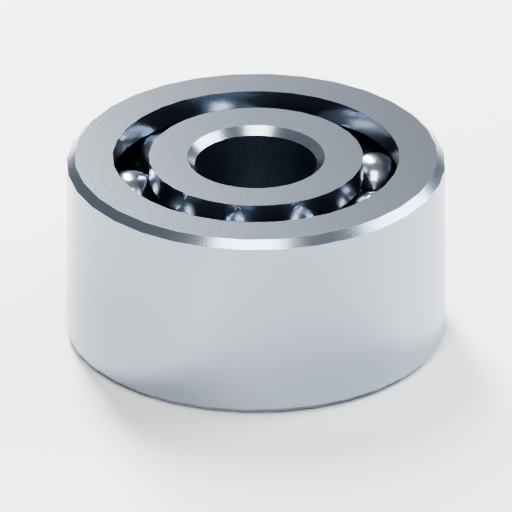
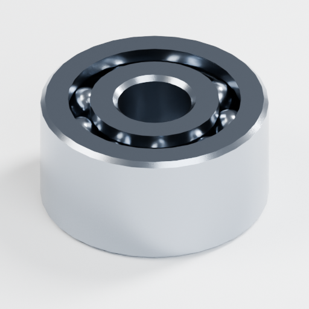
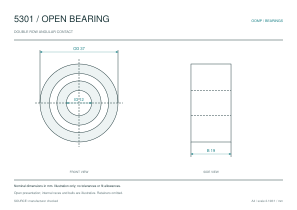

<!-- bearing-catalogue:start -->
# 5301 bearing - 12 x 37 x 19 mm

## Summary

Double row angular contact bearing: 12 mm bore, 37 mm outside diameter and 19 mm width.

| Product view | Isometric view |
| --- | --- |
|  |  |

Generated catalogue illustrations; the open internal geometry is illustrative.

## Details

**OOMP ID:** `hardware_bearing_5300_series_5301_size_12_mm_id_37_mm_od_19_mm_depth`

| Dimension | Nominal value |
| --- | --- |
| Bore / ID | 12 mm |
| Outside diameter / OD | 37 mm |
| Width / B | 19 mm |
| Catalogue contact angle | 25 degrees |

**Dimension evidence:** manufacturer checked (review retained from 2026-10-27).

Nominal presentation model. Raceways, pitch circle, chamfers and retainer geometry are illustrative; ball count/diameter are illustrative unless individually sourced. Not a manufacturer reconstruction, load-rating model or manufacturing/tolerance certification. Unspecified closure is presented open. The mesh shows open races and balls; retainers, seals and exact contact surfaces are omitted.

Contact-angle authority: **selected catalogue convention**. The mesh does not reconstruct the manufacturer contact surfaces.



[Printable A4 dimension sheet](working_dimension_a4.pdf) · [1:1 outline](working_svg.svg)

### Source evidence

- [https://www.rbibearing.com/products/ball-bearings/5300-series/](https://www.rbibearing.com/products/ball-bearings/5300-series/)
- [https://www.nskamericas.com/tools-resources/abc-bearings/angular-contact-ball-bearings/](https://www.nskamericas.com/tools-resources/abc-bearings/angular-contact-ball-bearings/)

[Retained research and corrected dimensions](../../source_file/solidcraft/) · [Editable declaration](../../working_oomp_declarations_bearing.py)

## Parts

[Canonical part folder](.) · [Metadata](working.yaml) · [Browse this series](../../navigation/5300/README.md)

### Files

- [Editable OpenSCAD geometry](3dpr.scad)
- [Full model / GLB / metres, Y-up](three_d_model/model_full.glb)
- [Lightweight model / GLB / metres, Y-up](three_d_model/model_display.glb)
- [Editable Blender studio](three_d_model/studio.blend)
- [Product render / 2048 px](three_d_model/render_product_high.png)
- [Isometric render / 2048 px](three_d_model/render_high.png)
- [Populated model and render recipe](three_d_model/parameters.json)
- [Mesh measurements and artifact hashes](three_d_model/manifest.json)
- [Retained native CAD success manifest](solidcraft/latest_success.json)
- [76.2 x 50.8 mm label](label_bearing_3x2.pdf)
- [38.1 x 25.4 mm label](label_bearing_1_5x1.pdf)
- [Retained editable native bearing / SolidCraft](solidcraft/generations/8aa34589fc3ffa6a_20261027T114631Z_518e46bb/bearing_5301_open.solidcraft)

### Orthographic views

| Quality | Isometric | Front | Back | Left | Right | Top | Bottom |
| --- | --- | --- | --- | --- | --- | --- | --- |
| Full | [Isometric](three_d_model/full/isometric.svg) | [Front](three_d_model/full/front.svg) | [Back](three_d_model/full/back.svg) | [Left](three_d_model/full/left.svg) | [Right](three_d_model/full/right.svg) | [Top](three_d_model/full/top.svg) | [Bottom](three_d_model/full/bottom.svg) |
| Display | [Isometric](three_d_model/display/isometric.svg) | [Front](three_d_model/display/front.svg) | [Back](three_d_model/display/back.svg) | [Left](three_d_model/display/left.svg) | [Right](three_d_model/display/right.svg) | [Top](three_d_model/display/top.svg) | [Bottom](three_d_model/display/bottom.svg) |

## Assembly

No installation procedure is established for this generic size record. Select the required closure, clearance, tolerance and load rating from the actual purchased bearing specification.

<details>
<summary>Complete OOMP metadata</summary>

```yaml
depth: 19.0
id: hardware_bearing_5300_series_5301_size_12_mm_id_37_mm_od_19_mm_depth
od: 37.0
series: '5300'
size: '5301'
svg_details:
  svg_name: bearing_dimension
  title: 5301 / OPEN BEARING
  family: DOUBLE ROW ANGULAR CONTACT
  dimensions_mm:
    bore: 12.0
    outside: 37.0
    width: 19.0
    contact_angle_deg: 25.0
  sheet_width_mm: 297
  sheet_height_mm: 210
  ink: '#183336'
  accent: '#147d83'
  muted: '#61767a'
  paper: '#ffffff'
  race_face_fill: '#edf3f3'
  inner_race_face_outside_mm: 20.966
  outer_race_face_inside_mm: 28.034
  line_width_mm: 0.45
  font_family: Helvetica
  dimension_font_mm: 4
  title_font_mm: 9
  front_centre_mm:
  - 79
  - 103
  side_centre_mm:
  - 211
  - 103
  max_view_width_mm: 78
  max_side_width_mm: 55
  dimension_offset_mm: 12
  arrow_size_mm: 2
  note: Nominal dimensions in mm. Illustration only; no tolerances or fit allowances.
  authority: manufacturer checked
  internal_note: Open presentation; internal races and balls are illustrative. Retainers
    omitted.
  layout:
    left_margin_mm: 14
    right_margin_mm: 283
    title_y_mm: 22
    family_y_mm: 33
    family_font_mm: 3.5
    brand: OOMP / BEARINGS
    brand_font_mm: 3.5
    header_rule_y_mm: 40
    view_caption_y_mm: 173
    view_caption_font_mm: 3
    front_caption: FRONT VIEW
    side_caption: SIDE VIEW
    footer_rule_y_mm: 180
    note_y_mm: 187
    internal_note_y_mm: 194
    note_font_mm: 3.2
    source_y_mm: 202
    source_font_mm: 3
    source_prefix: 'SOURCE: '
    scale_prefix: A4 / scale
  dimension_style:
    line_width_mm: 0.25
    arrow_half_width_ratio: 0.3
    text_gap_mm: 2
    extension_mm: 2
    width_extension_mm: 3
    centre_extension_mm: 5
    dash_pattern_mm:
    - 2
    - 1
    flange_leader_offset_mm:
    - -13
    - 11
    flange_text_offset_mm:
    - -13
    - 16
    flange_font_mm: 3.5
  outline:
    ink: black
    line_width_mm: 0.1
taxonomy_1: hardware
taxonomy_10: ''
taxonomy_11: ''
taxonomy_12: ''
taxonomy_13: ''
taxonomy_14: ''
taxonomy_15: ''
taxonomy_2: bearing
taxonomy_3: 5300_series
taxonomy_4: 5301_size
taxonomy_5: 12_mm_id
taxonomy_6: 37_mm_od
taxonomy_7: 19_mm_depth
taxonomy_8: ''
taxonomy_9: ''
weight: '104'
width: 19.0
dimension_selection:
  policy: standard_metric_open_catalogue
  previous_id: hardware_bearing_5300_series_5301_size_12_mm_id_37_mm_od_19.05_mm_depth
  sources:
  - https://www.rbibearing.com/products/ball-bearings/5300-series/
  - https://www.nskamericas.com/tools-resources/abc-bearings/angular-contact-ball-bearings/
  note: User selected standard catalogue variants on 2026-10-27; no sales ranking
    asserted.
url_chat: https://chatgpt.com/c/6ab849ec-9f54-83eb-aa35-567f60db0349
run_action: true
run_oomp: true
run_oomp_populate: true
run_scad: false
generate_stl: false
taxonomy_1_upper: HARDWARE
taxonomy_1_upper_length_1: H
taxonomy_1_upper_length_2: HA
taxonomy_1_upper_length_3: HAR
taxonomy_1_upper_length_4: HARD
taxonomy_1_upper_length_5: HARDW
taxonomy_1_length_1: h
taxonomy_1_length_2: ha
taxonomy_1_length_3: har
taxonomy_1_length_4: hard
taxonomy_1_length_5: hardw
taxonomy_1_capital: Hardware
taxonomy_1_first_letter: h
taxonomy_1_first_letter_upper: H
taxonomy_2_upper: BEARING
taxonomy_2_upper_length_1: B
taxonomy_2_upper_length_2: BE
taxonomy_2_upper_length_3: BEA
taxonomy_2_upper_length_4: BEAR
taxonomy_2_upper_length_5: BEARI
taxonomy_2_length_1: b
taxonomy_2_length_2: be
taxonomy_2_length_3: bea
taxonomy_2_length_4: bear
taxonomy_2_length_5: beari
taxonomy_2_capital: Bearing
taxonomy_2_first_letter: b
taxonomy_2_first_letter_upper: B
taxonomy_3_upper: 5300_SERIES
taxonomy_3_upper_length_1: '5'
taxonomy_3_upper_length_2: '53'
taxonomy_3_upper_length_3: '530'
taxonomy_3_upper_length_4: '5300'
taxonomy_3_upper_length_5: '5300_'
taxonomy_3_length_1: '5'
taxonomy_3_length_2: '53'
taxonomy_3_length_3: '530'
taxonomy_3_length_4: '5300'
taxonomy_3_length_5: '5300_'
taxonomy_3_capital: 5300 Series
taxonomy_3_first_letter: '5'
taxonomy_3_first_letter_upper: '5'
taxonomy_4_upper: 5301_SIZE
taxonomy_4_upper_length_1: '5'
taxonomy_4_upper_length_2: '53'
taxonomy_4_upper_length_3: '530'
taxonomy_4_upper_length_4: '5301'
taxonomy_4_upper_length_5: '5301_'
taxonomy_4_length_1: '5'
taxonomy_4_length_2: '53'
taxonomy_4_length_3: '530'
taxonomy_4_length_4: '5301'
taxonomy_4_length_5: '5301_'
taxonomy_4_capital: 5301 Size
taxonomy_4_first_letter: '5'
taxonomy_4_first_letter_upper: '5'
taxonomy_5_upper: 12_MM_ID
taxonomy_5_upper_length_1: '1'
taxonomy_5_upper_length_2: '12'
taxonomy_5_upper_length_3: '12_'
taxonomy_5_upper_length_4: 12_M
taxonomy_5_upper_length_5: 12_MM
taxonomy_5_length_1: '1'
taxonomy_5_length_2: '12'
taxonomy_5_length_3: '12_'
taxonomy_5_length_4: 12_m
taxonomy_5_length_5: 12_mm
taxonomy_5_capital: 12 mm Id
taxonomy_5_first_letter: '1'
taxonomy_5_first_letter_upper: '1'
taxonomy_6_upper: 37_MM_OD
taxonomy_6_upper_length_1: '3'
taxonomy_6_upper_length_2: '37'
taxonomy_6_upper_length_3: '37_'
taxonomy_6_upper_length_4: 37_M
taxonomy_6_upper_length_5: 37_MM
taxonomy_6_length_1: '3'
taxonomy_6_length_2: '37'
taxonomy_6_length_3: '37_'
taxonomy_6_length_4: 37_m
taxonomy_6_length_5: 37_mm
taxonomy_6_capital: 37 mm Od
taxonomy_6_first_letter: '3'
taxonomy_6_first_letter_upper: '3'
taxonomy_7_upper: 19_MM_DEPTH
taxonomy_7_upper_length_1: '1'
taxonomy_7_upper_length_2: '19'
taxonomy_7_upper_length_3: '19_'
taxonomy_7_upper_length_4: 19_M
taxonomy_7_upper_length_5: 19_MM
taxonomy_7_length_1: '1'
taxonomy_7_length_2: '19'
taxonomy_7_length_3: '19_'
taxonomy_7_length_4: 19_m
taxonomy_7_length_5: 19_mm
taxonomy_7_capital: 19 mm Depth
taxonomy_7_first_letter: '1'
taxonomy_7_first_letter_upper: '1'
id_no_class: hardware_bearing_5300_series_5301_size_12_mm_id_37_mm_od_19_mm_depth
id_no_type: hardware_bearing_5300_series_5301_size_12_mm_id_37_mm_od_19_mm_depth
id_no_size: hardware_bearing_5300_series_size_12_mm_id_37_mm_od_19_mm_depth
oomp_key: oomp_hardware_bearing_5300_series_5301_size_12_mm_id_37_mm_od_19_mm_depth
link_github: https://github.com/oomlout/oomp_bearing_version_5/tree/main/parts/hardware_bearing_5300_series_5301_size_12_mm_id_37_mm_od_19_mm_depth
link_main: https://github.com/oomlout/oomlout_oomp_version_1_messy/tree/main/parts/hardware_bearing_5300_series_5301_size_12_mm_id_37_mm_od_19_mm_depth
link_redirect: https://github.com/oomlout/oomlout_oomp_version_1_messy/tree/main/parts/hardware_bearing_5300_series_5301_size_12_mm_id_37_mm_od_19_mm_depth
directory: parts/hardware_bearing_5300_series_5301_size_12_mm_id_37_mm_od_19_mm_depth
name: 5301 bearing
name_no_class: Hardware Bearing 5300 Series 5301 Size 12 Mm Id 37 Mm Od 19 Mm Depth
name_no_type: Hardware Bearing 5300 Series 5301 Size 12 Mm Id 37 Mm Od 19 Mm Depth
name_no_size: Hardware Bearing 5300 Series Size 12 Mm Id 37 Mm Od 19 Mm Depth
md5: efee07621bbf46456e3d30d2b2873886
md5_5: efee0
md5_5_upper: EFEE0
md5_6: efee07
md5_6_upper: EFEE07
md5_6_alpha: 9d0qv
md5_6_alpha_upper: 9D0QV
md5_10: efee07621b
md5_10_upper: EFEE07621B
bip_39_full_array:
- useful
- ice
- sudden
- danger
- virtual
- cargo
- rib
- plastic
- sport
- neither
- soda
- artwork
bip_39_full_space: useful ice sudden danger virtual cargo rib plastic sport neither
  soda artwork
bip_39_full_no_space: usefulicesuddendangervirtualcargoribplasticsportneithersodaartwork
bip_39_full_underscore: useful_ice_sudden_danger_virtual_cargo_rib_plastic_sport_neither_soda_artwork
bip_39_2_word_array:
- useful
- ice
bip_39_2_word_space: useful ice
bip_39_2_word_no_space: usefulice
bip_39_2_word_underscore: useful_ice
bip_39_3_word_array:
- useful
- ice
- sudden
bip_39_3_word_space: useful ice sudden
bip_39_3_word_no_space: usefulicesudden
bip_39_3_word_underscore: useful_ice_sudden
name_space: hardware bearing 5300 series 5301 size 12 mm id 37 mm od 19 mm depth
name_proper: 5301 bearing
name_upper: HARDWARE BEARING 5300 SERIES 5301 SIZE 12 MM ID 37 MM OD 19 MM DEPTH
oomlout_ai_roboclick_1:
  file_test: ''
  actions:
  - command: text_jinja_template
    description: Bold bearing label 3x2
    file_template: C:\od\OneDrive\docs\oomp_bearing\source_file\template_jinja\label_bearing_bold\3x2.svg.j2
    file_output: label_bearing_bold_3x2.svg
    dict_data_yaml_files:
      label_source: C:\od\OneDrive\docs\oomp_bearing\parts_source\hardware_bearing_5300_series_5301_size_12_mm_id_37_mm_od_19_mm_depth\working.yaml
      label_manual: C:\od\OneDrive\docs\oomp_bearing\parts\hardware_bearing_5300_series_5301_size_12_mm_id_37_mm_od_19_mm_depth\working_manual.yaml
    convert_to_pdf: false
    convert_to_png: false
oomlout_ai_roboclick_2:
  file_test: ''
  actions:
  - command: text_jinja_template
    description: Bold bearing label 1_5x1
    file_template: C:\od\OneDrive\docs\oomp_bearing\source_file\template_jinja\label_bearing_bold\1_5x1.svg.j2
    file_output: label_bearing_bold_1_5x1.svg
    dict_data_yaml_files:
      label_source: C:\od\OneDrive\docs\oomp_bearing\parts_source\hardware_bearing_5300_series_5301_size_12_mm_id_37_mm_od_19_mm_depth\working.yaml
      label_manual: C:\od\OneDrive\docs\oomp_bearing\parts\hardware_bearing_5300_series_5301_size_12_mm_id_37_mm_od_19_mm_depth\working_manual.yaml
    convert_to_pdf: false
    convert_to_png: false
catalogue_schema: oomp_bearing_v5
oomp_id: hardware_bearing_5300_series_5301_size_12_mm_id_37_mm_od_19_mm_depth
family: double_row_angular_contact
dimensions_mm:
  bore: 12.0
  outside: 37.0
  width: 19.0
  contact_angle_deg: 25.0
bore: 12.0
dimension_authority: manufacturer_checked
source_checked: '2026-10-27'
sources:
- https://www.rbibearing.com/products/ball-bearings/5300-series/
- https://www.nskamericas.com/tools-resources/abc-bearings/angular-contact-ball-bearings/
model_note: Nominal presentation model. Raceways, pitch circle, chamfers and retainer
  geometry are illustrative; ball count/diameter are illustrative unless individually
  sourced. Not a manufacturer reconstruction, load-rating model or manufacturing/tolerance
  certification. Unspecified closure is presented open. The mesh shows open races
  and balls; retainers, seals and exact contact surfaces are omitted.
closure: open
three_d_model_details:
  schema_version: 1
  generator: bearing_open
  output_folder: three_d_model
  parameters:
    bore: 12.0
    outside: 37.0
    width: 19.0
    edge: 0.75
    pitch_radius: 12.25
    ball_radius: 2.85
    groove_radius: 2.9925
    inner_shoulder: 10.483
    outer_shoulder: 14.017
    cage_half_width: 1.5675000000000001
    cage_low: 2.7075
    cage_high: 3.2775
    window_radius: 1.3679999999999999
    contact_angle_deg: 25.0
    contact_offset: 0.07125000000000001
    identity: hardware_bearing_5300_series_5301_size_12_mm_id_37_mm_od_19_mm_depth
    specification: 5301 / 12 x 37 x 19 mm
    characteristic_dimension_mm: 37.0
    characteristic_dimension_basis: maximum nominal envelope dimension
    ball_count: 18
    balls_per_row: 9
    row_count: 2
    ball_specification: illustrative
    contact_angle_authority: selected_catalogue_convention
    row_centres_z:
    - 4.75
    - 14.25
    components:
    - name: outer_race
      shape: revolved_profile
      profile_mm:
      - - 17.75
        - 0
      - - 18.5
        - 0.75
      - - 18.5
        - 18.25
      - - 17.75
        - 19.0
      - - 14.017
        - 19.0
      - - 14.017
        - 18.25
      - - 14.017
        - 17.2425
      - - 14.017
        - 17.092875
      - - 14.017
        - 16.94325
      - - 14.017
        - 16.793625
      - - 14.045500000000002
        - 16.644
      - - 14.229352699590194
        - 16.494375
      - - 14.387072457241446
        - 16.34475
      - - 14.52410311647801
        - 16.195125
      - - 14.644
        - 16.0455
      - - 14.749230228365326
        - 15.895875
      - - 14.841581020824933
        - 15.74625
      - - 14.922387950761454
        - 15.596625
      - - 14.99267155343107
        - 15.447000000000001
      - - 15.05322347653108
        - 15.297375
      - - 15.10466306024021
        - 15.14775
      - - 15.147475665881423
        - 14.998125
      - - 15.182039222111463
        - 14.848500000000001
      - - 15.208642845017796
        - 14.698875000000001
      - - 15.22749990554156
        - 14.54925
      - - 15.238757034182438
        - 14.399625
      - - 15.2425
        - 14.25
      - - 15.238757034182438
        - 14.100375
      - - 15.22749990554156
        - 13.95075
      - - 15.208642845017796
        - 13.801125
      - - 15.182039222111465
        - 13.6515
      - - 15.147475665881423
        - 13.501875
      - - 15.10466306024021
        - 13.352250000000002
      - - 15.05322347653108
        - 13.202625000000001
      - - 14.992671553431071
        - 13.053
      - - 14.922387950761454
        - 12.903375
      - - 14.841581020824933
        - 12.75375
      - - 14.749230228365326
        - 12.604125
      - - 14.644
        - 12.4545
      - - 14.524103116478011
        - 12.304875000000001
      - - 14.387072457241448
        - 12.15525
      - - 14.229352699590198
        - 12.005625
      - - 14.0455
        - 11.856
      - - 14.017
        - 11.706375
      - - 14.017
        - 11.556750000000001
      - - 14.017
        - 11.407125
      - - 14.017
        - 11.2575
      - - 14.017
        - 7.7425
      - - 14.017
        - 7.592875000000001
      - - 14.017
        - 7.443250000000001
      - - 14.017
        - 7.2936250000000005
      - - 14.0455
        - 7.144
      - - 14.229352699590198
        - 6.994375
      - - 14.387072457241448
        - 6.8447499999999994
      - - 14.52410311647801
        - 6.695125000000001
      - - 14.644
        - 6.5455000000000005
      - - 14.749230228365326
        - 6.395875
      - - 14.841581020824933
        - 6.24625
      - - 14.922387950761454
        - 6.0966249999999995
      - - 14.99267155343107
        - 5.947000000000001
      - - 15.05322347653108
        - 5.797375000000001
      - - 15.10466306024021
        - 5.64775
      - - 15.147475665881423
        - 5.498125
      - - 15.182039222111465
        - 5.3485
      - - 15.208642845017796
        - 5.198874999999999
      - - 15.22749990554156
        - 5.049250000000001
      - - 15.238757034182438
        - 4.899625
      - - 15.2425
        - 4.75
      - - 15.238757034182438
        - 4.600375
      - - 15.22749990554156
        - 4.450749999999999
      - - 15.208642845017796
        - 4.301125
      - - 15.182039222111465
        - 4.1515
      - - 15.147475665881423
        - 4.001875
      - - 15.10466306024021
        - 3.85225
      - - 15.05322347653108
        - 3.7026250000000003
      - - 14.99267155343107
        - 3.553
      - - 14.922387950761454
        - 3.403375
      - - 14.841581020824933
        - 3.25375
      - - 14.749230228365326
        - 3.104125
      - - 14.644
        - 2.9545
      - - 14.52410311647801
        - 2.804875
      - - 14.387072457241448
        - 2.6552499999999997
      - - 14.229352699590196
        - 2.5056249999999998
      - - 14.0455
        - 2.356
      - - 14.017
        - 2.206375
      - - 14.017
        - 2.05675
      - - 14.017
        - 1.9071249999999997
      - - 14.017
        - 1.7574999999999998
      - - 14.017
        - 0.75
      - - 14.017
        - 0.0
      - - 17.75
        - 0
    - name: inner_race
      shape: revolved_profile
      profile_mm:
      - - 10.483
        - 0.0
      - - 10.483
        - 0.75
      - - 10.483
        - 1.7574999999999998
      - - 10.483
        - 1.9071249999999997
      - - 10.483
        - 2.05675
      - - 10.483
        - 2.206375
      - - 10.4545
        - 2.356
      - - 10.270647300409804
        - 2.5056249999999998
      - - 10.112927542758552
        - 2.6552499999999997
      - - 9.97589688352199
        - 2.804875
      - - 9.856
        - 2.9545
      - - 9.750769771634674
        - 3.104125
      - - 9.658418979175067
        - 3.25375
      - - 9.577612049238546
        - 3.403375
      - - 9.50732844656893
        - 3.553
      - - 9.44677652346892
        - 3.7026250000000003
      - - 9.39533693975979
        - 3.85225
      - - 9.352524334118577
        - 4.001875
      - - 9.317960777888535
        - 4.1515
      - - 9.291357154982204
        - 4.301125
      - - 9.27250009445844
        - 4.450749999999999
      - - 9.261242965817562
        - 4.600375
      - - 9.2575
        - 4.75
      - - 9.261242965817562
        - 4.899625
      - - 9.27250009445844
        - 5.049250000000001
      - - 9.291357154982204
        - 5.198874999999999
      - - 9.317960777888535
        - 5.3485
      - - 9.352524334118577
        - 5.498125
      - - 9.39533693975979
        - 5.64775
      - - 9.44677652346892
        - 5.797375000000001
      - - 9.50732844656893
        - 5.947000000000001
      - - 9.577612049238546
        - 6.0966249999999995
      - - 9.658418979175067
        - 6.24625
      - - 9.750769771634674
        - 6.395875
      - - 9.856
        - 6.5455000000000005
      - - 9.97589688352199
        - 6.695125000000001
      - - 10.112927542758552
        - 6.8447499999999994
      - - 10.270647300409802
        - 6.994375
      - - 10.4545
        - 7.144
      - - 10.483
        - 7.2936250000000005
      - - 10.483
        - 7.443250000000001
      - - 10.483
        - 7.592875000000001
      - - 10.483
        - 7.7425
      - - 10.483
        - 11.2575
      - - 10.483
        - 11.407125
      - - 10.483
        - 11.556750000000001
      - - 10.483
        - 11.706375
      - - 10.4545
        - 11.856
      - - 10.270647300409802
        - 12.005625
      - - 10.112927542758552
        - 12.15525
      - - 9.975896883521989
        - 12.304875000000001
      - - 9.856
        - 12.4545
      - - 9.750769771634674
        - 12.604125
      - - 9.658418979175067
        - 12.75375
      - - 9.577612049238546
        - 12.903375
      - - 9.507328446568929
        - 13.053
      - - 9.44677652346892
        - 13.202625000000001
      - - 9.39533693975979
        - 13.352250000000002
      - - 9.352524334118577
        - 13.501875
      - - 9.317960777888535
        - 13.6515
      - - 9.291357154982204
        - 13.801125
      - - 9.27250009445844
        - 13.95075
      - - 9.261242965817562
        - 14.100375
      - - 9.2575
        - 14.25
      - - 9.261242965817562
        - 14.399625
      - - 9.27250009445844
        - 14.54925
      - - 9.291357154982204
        - 14.698875000000001
      - - 9.317960777888537
        - 14.848500000000001
      - - 9.352524334118577
        - 14.998125
      - - 9.39533693975979
        - 15.14775
      - - 9.44677652346892
        - 15.297375
      - - 9.50732844656893
        - 15.447000000000001
      - - 9.577612049238546
        - 15.596625
      - - 9.658418979175067
        - 15.74625
      - - 9.750769771634674
        - 15.895875
      - - 9.856
        - 16.0455
      - - 9.97589688352199
        - 16.195125
      - - 10.112927542758554
        - 16.34475
      - - 10.270647300409806
        - 16.494375
      - - 10.454499999999998
        - 16.644
      - - 10.483
        - 16.793625
      - - 10.483
        - 16.94325
      - - 10.483
        - 17.092875
      - - 10.483
        - 17.2425
      - - 10.483
        - 18.25
      - - 10.483
        - 19.0
      - - 6.75
        - 19.0
      - - 6.0
        - 18.25
      - - 6.0
        - 0.75
      - - 6.75
        - 0
      - - 10.483
        - 0.0
    - name: ball_row_1_1
      shape: sphere
      radius_mm: 2.85
      centre_mm:
      - 12.25
      - 0.0
      - 4.75
    - name: ball_row_1_2
      shape: sphere
      radius_mm: 2.85
      centre_mm:
      - 9.384044428207481
      - 7.874148218660106
      - 4.75
    - name: ball_row_1_3
      shape: sphere
      radius_mm: 2.85
      centre_mm:
      - 2.1271901764198975
      - 12.063894974399549
      - 4.75
    - name: ball_row_1_4
      shape: sphere
      radius_mm: 2.85
      centre_mm:
      - -6.124999999999997
      - 10.608811196359374
      - 4.75
    - name: ball_row_1_5
      shape: sphere
      radius_mm: 2.85
      centre_mm:
      - -11.511234604627377
      - 4.189746755739444
      - 4.75
    - name: ball_row_1_6
      shape: sphere
      radius_mm: 2.85
      centre_mm:
      - -11.511234604627377
      - -4.189746755739441
      - 4.75
    - name: ball_row_1_7
      shape: sphere
      radius_mm: 2.85
      centre_mm:
      - -6.125000000000005
      - -10.60881119635937
      - 4.75
    - name: ball_row_1_8
      shape: sphere
      radius_mm: 2.85
      centre_mm:
      - 2.127190176419892
      - -12.063894974399549
      - 4.75
    - name: ball_row_1_9
      shape: sphere
      radius_mm: 2.85
      centre_mm:
      - 9.384044428207478
      - -7.8741482186601095
      - 4.75
    - name: ball_row_2_1
      shape: sphere
      radius_mm: 2.85
      centre_mm:
      - 12.25
      - 0.0
      - 14.25
    - name: ball_row_2_2
      shape: sphere
      radius_mm: 2.85
      centre_mm:
      - 9.384044428207481
      - 7.874148218660106
      - 14.25
    - name: ball_row_2_3
      shape: sphere
      radius_mm: 2.85
      centre_mm:
      - 2.1271901764198975
      - 12.063894974399549
      - 14.25
    - name: ball_row_2_4
      shape: sphere
      radius_mm: 2.85
      centre_mm:
      - -6.124999999999997
      - 10.608811196359374
      - 14.25
    - name: ball_row_2_5
      shape: sphere
      radius_mm: 2.85
      centre_mm:
      - -11.511234604627377
      - 4.189746755739444
      - 14.25
    - name: ball_row_2_6
      shape: sphere
      radius_mm: 2.85
      centre_mm:
      - -11.511234604627377
      - -4.189746755739441
      - 14.25
    - name: ball_row_2_7
      shape: sphere
      radius_mm: 2.85
      centre_mm:
      - -6.125000000000005
      - -10.60881119635937
      - 14.25
    - name: ball_row_2_8
      shape: sphere
      radius_mm: 2.85
      centre_mm:
      - 2.127190176419892
      - -12.063894974399549
      - 14.25
    - name: ball_row_2_9
      shape: sphere
      radius_mm: 2.85
      centre_mm:
      - 9.384044428207478
      - -7.8741482186601095
      - 14.25
  modelling_note: Nominal presentation model. Raceways, pitch circle, chamfers and
    retainer geometry are illustrative; ball count/diameter are illustrative unless
    individually sourced. Not a manufacturer reconstruction, load-rating model or
    manufacturing/tolerance certification. Unspecified closure is presented open.
    The mesh shows open races and balls; retainers, seals and exact contact surfaces
    are omitted.
  dimension_authority: manufacturer_checked
  model_formats:
  - glb
  variants:
    full:
      angular_segments: 128
      sphere_subdivisions: 3
    display:
      angular_segments: 32
      sphere_subdivisions: 2
  views:
  - isometric
  - front
  - back
  - left
  - right
  - top
  - bottom
  material:
    name: Illustrative polished bearing steel
    base_colour_srgb:
    - 0.62
    - 0.65
    - 0.69
    metallic: 1.0
    roughness: 0.22
    roughness_variation: 0.045
    coat_weight: 0.02
    coat_roughness: 0.28
    microtexture_spacing_mm: 0.025
    microtexture_height_um: 0.8
    note: Illustrative bearing steel; material grade and finish are not specified.
  studio:
    engine: cycles
    device: auto
    seed: 7991
    low_samples: 24
    high_samples: 48
    adaptive_threshold: 0.015
    denoise: true
    view_transform: AgX
    look: AgX - Medium High Contrast
    exposure: 0.0
    world_colour:
    - 0.78
    - 0.82
    - 0.9
    world_strength: 0.35
    floor_colour_srgb:
    - 0.93
    - 0.935
    - 0.94
    floor_roughness: 0.55
    framing_margin: 0.13
    lights:
    - name: Key softbox
      position:
      - -3
      - -4
      - 6
      power: 650.0
      width: 4.0
      height: 5.0
      colour:
      - 1.0
      - 0.96
      - 0.9
    - name: Fill softbox
      position:
      - 4
      - -1
      - 3
      power: 330.0
      width: 3.0
      height: 4.0
      colour:
      - 0.9
      - 0.95
      - 1.0
    - name: Rim strip
      position:
      - 1
      - 4
      - 4
      power: 850.0
      width: 1.2
      height: 5.0
      colour:
      - 1.0
      - 1.0
      - 1.0
    poses:
      isometric:
        camera_eye:
        - 1
        - -1
        - 1
        projection: orthographic
        orientation: principal axis Z up
      product:
        camera_eye:
        - -6
        - -10
        - 6
        projection: orthographic
        orientation: resting on lower face
        yaw_degrees: -12.0
        support: Stable convex-hull support using actual mesh centre of mass.
        resting_axis: face
  renders:
    low:
      file: render_low.png
      variant: display
      pixels: 512
      view: isometric
    high:
      file: render_high.png
      variant: full
      pixels: 2048
      view: isometric
    product_low:
      file: render_product_low.png
      variant: display
      pixels: 512
      view: product
    product_high:
      file: render_product_high.png
      variant: full
      pixels: 2048
      view: product
oobb_type: bearing_open
oobb_details:
  oobb_type: bearing_open
  run_scad: true
  run_solidcraft: false
  angular_segments: 128
  components:
  - name: outer_race
    shape: revolved_profile
    profile_mm:
    - - 17.75
      - 0
    - - 18.5
      - 0.75
    - - 18.5
      - 18.25
    - - 17.75
      - 19.0
    - - 14.017
      - 19.0
    - - 14.017
      - 18.25
    - - 14.017
      - 17.2425
    - - 14.017
      - 17.092875
    - - 14.017
      - 16.94325
    - - 14.017
      - 16.793625
    - - 14.045500000000002
      - 16.644
    - - 14.229352699590194
      - 16.494375
    - - 14.387072457241446
      - 16.34475
    - - 14.52410311647801
      - 16.195125
    - - 14.644
      - 16.0455
    - - 14.749230228365326
      - 15.895875
    - - 14.841581020824933
      - 15.74625
    - - 14.922387950761454
      - 15.596625
    - - 14.99267155343107
      - 15.447000000000001
    - - 15.05322347653108
      - 15.297375
    - - 15.10466306024021
      - 15.14775
    - - 15.147475665881423
      - 14.998125
    - - 15.182039222111463
      - 14.848500000000001
    - - 15.208642845017796
      - 14.698875000000001
    - - 15.22749990554156
      - 14.54925
    - - 15.238757034182438
      - 14.399625
    - - 15.2425
      - 14.25
    - - 15.238757034182438
      - 14.100375
    - - 15.22749990554156
      - 13.95075
    - - 15.208642845017796
      - 13.801125
    - - 15.182039222111465
      - 13.6515
    - - 15.147475665881423
      - 13.501875
    - - 15.10466306024021
      - 13.352250000000002
    - - 15.05322347653108
      - 13.202625000000001
    - - 14.992671553431071
      - 13.053
    - - 14.922387950761454
      - 12.903375
    - - 14.841581020824933
      - 12.75375
    - - 14.749230228365326
      - 12.604125
    - - 14.644
      - 12.4545
    - - 14.524103116478011
      - 12.304875000000001
    - - 14.387072457241448
      - 12.15525
    - - 14.229352699590198
      - 12.005625
    - - 14.0455
      - 11.856
    - - 14.017
      - 11.706375
    - - 14.017
      - 11.556750000000001
    - - 14.017
      - 11.407125
    - - 14.017
      - 11.2575
    - - 14.017
      - 7.7425
    - - 14.017
      - 7.592875000000001
    - - 14.017
      - 7.443250000000001
    - - 14.017
      - 7.2936250000000005
    - - 14.0455
      - 7.144
    - - 14.229352699590198
      - 6.994375
    - - 14.387072457241448
      - 6.8447499999999994
    - - 14.52410311647801
      - 6.695125000000001
    - - 14.644
      - 6.5455000000000005
    - - 14.749230228365326
      - 6.395875
    - - 14.841581020824933
      - 6.24625
    - - 14.922387950761454
      - 6.0966249999999995
    - - 14.99267155343107
      - 5.947000000000001
    - - 15.05322347653108
      - 5.797375000000001
    - - 15.10466306024021
      - 5.64775
    - - 15.147475665881423
      - 5.498125
    - - 15.182039222111465
      - 5.3485
    - - 15.208642845017796
      - 5.198874999999999
    - - 15.22749990554156
      - 5.049250000000001
    - - 15.238757034182438
      - 4.899625
    - - 15.2425
      - 4.75
    - - 15.238757034182438
      - 4.600375
    - - 15.22749990554156
      - 4.450749999999999
    - - 15.208642845017796
      - 4.301125
    - - 15.182039222111465
      - 4.1515
    - - 15.147475665881423
      - 4.001875
    - - 15.10466306024021
      - 3.85225
    - - 15.05322347653108
      - 3.7026250000000003
    - - 14.99267155343107
      - 3.553
    - - 14.922387950761454
      - 3.403375
    - - 14.841581020824933
      - 3.25375
    - - 14.749230228365326
      - 3.104125
    - - 14.644
      - 2.9545
    - - 14.52410311647801
      - 2.804875
    - - 14.387072457241448
      - 2.6552499999999997
    - - 14.229352699590196
      - 2.5056249999999998
    - - 14.0455
      - 2.356
    - - 14.017
      - 2.206375
    - - 14.017
      - 2.05675
    - - 14.017
      - 1.9071249999999997
    - - 14.017
      - 1.7574999999999998
    - - 14.017
      - 0.75
    - - 14.017
      - 0.0
    - - 17.75
      - 0
  - name: inner_race
    shape: revolved_profile
    profile_mm:
    - - 10.483
      - 0.0
    - - 10.483
      - 0.75
    - - 10.483
      - 1.7574999999999998
    - - 10.483
      - 1.9071249999999997
    - - 10.483
      - 2.05675
    - - 10.483
      - 2.206375
    - - 10.4545
      - 2.356
    - - 10.270647300409804
      - 2.5056249999999998
    - - 10.112927542758552
      - 2.6552499999999997
    - - 9.97589688352199
      - 2.804875
    - - 9.856
      - 2.9545
    - - 9.750769771634674
      - 3.104125
    - - 9.658418979175067
      - 3.25375
    - - 9.577612049238546
      - 3.403375
    - - 9.50732844656893
      - 3.553
    - - 9.44677652346892
      - 3.7026250000000003
    - - 9.39533693975979
      - 3.85225
    - - 9.352524334118577
      - 4.001875
    - - 9.317960777888535
      - 4.1515
    - - 9.291357154982204
      - 4.301125
    - - 9.27250009445844
      - 4.450749999999999
    - - 9.261242965817562
      - 4.600375
    - - 9.2575
      - 4.75
    - - 9.261242965817562
      - 4.899625
    - - 9.27250009445844
      - 5.049250000000001
    - - 9.291357154982204
      - 5.198874999999999
    - - 9.317960777888535
      - 5.3485
    - - 9.352524334118577
      - 5.498125
    - - 9.39533693975979
      - 5.64775
    - - 9.44677652346892
      - 5.797375000000001
    - - 9.50732844656893
      - 5.947000000000001
    - - 9.577612049238546
      - 6.0966249999999995
    - - 9.658418979175067
      - 6.24625
    - - 9.750769771634674
      - 6.395875
    - - 9.856
      - 6.5455000000000005
    - - 9.97589688352199
      - 6.695125000000001
    - - 10.112927542758552
      - 6.8447499999999994
    - - 10.270647300409802
      - 6.994375
    - - 10.4545
      - 7.144
    - - 10.483
      - 7.2936250000000005
    - - 10.483
      - 7.443250000000001
    - - 10.483
      - 7.592875000000001
    - - 10.483
      - 7.7425
    - - 10.483
      - 11.2575
    - - 10.483
      - 11.407125
    - - 10.483
      - 11.556750000000001
    - - 10.483
      - 11.706375
    - - 10.4545
      - 11.856
    - - 10.270647300409802
      - 12.005625
    - - 10.112927542758552
      - 12.15525
    - - 9.975896883521989
      - 12.304875000000001
    - - 9.856
      - 12.4545
    - - 9.750769771634674
      - 12.604125
    - - 9.658418979175067
      - 12.75375
    - - 9.577612049238546
      - 12.903375
    - - 9.507328446568929
      - 13.053
    - - 9.44677652346892
      - 13.202625000000001
    - - 9.39533693975979
      - 13.352250000000002
    - - 9.352524334118577
      - 13.501875
    - - 9.317960777888535
      - 13.6515
    - - 9.291357154982204
      - 13.801125
    - - 9.27250009445844
      - 13.95075
    - - 9.261242965817562
      - 14.100375
    - - 9.2575
      - 14.25
    - - 9.261242965817562
      - 14.399625
    - - 9.27250009445844
      - 14.54925
    - - 9.291357154982204
      - 14.698875000000001
    - - 9.317960777888537
      - 14.848500000000001
    - - 9.352524334118577
      - 14.998125
    - - 9.39533693975979
      - 15.14775
    - - 9.44677652346892
      - 15.297375
    - - 9.50732844656893
      - 15.447000000000001
    - - 9.577612049238546
      - 15.596625
    - - 9.658418979175067
      - 15.74625
    - - 9.750769771634674
      - 15.895875
    - - 9.856
      - 16.0455
    - - 9.97589688352199
      - 16.195125
    - - 10.112927542758554
      - 16.34475
    - - 10.270647300409806
      - 16.494375
    - - 10.454499999999998
      - 16.644
    - - 10.483
      - 16.793625
    - - 10.483
      - 16.94325
    - - 10.483
      - 17.092875
    - - 10.483
      - 17.2425
    - - 10.483
      - 18.25
    - - 10.483
      - 19.0
    - - 6.75
      - 19.0
    - - 6.0
      - 18.25
    - - 6.0
      - 0.75
    - - 6.75
      - 0
    - - 10.483
      - 0.0
  - name: ball_row_1_1
    shape: sphere
    radius_mm: 2.85
    centre_mm:
    - 12.25
    - 0.0
    - 4.75
  - name: ball_row_1_2
    shape: sphere
    radius_mm: 2.85
    centre_mm:
    - 9.384044428207481
    - 7.874148218660106
    - 4.75
  - name: ball_row_1_3
    shape: sphere
    radius_mm: 2.85
    centre_mm:
    - 2.1271901764198975
    - 12.063894974399549
    - 4.75
  - name: ball_row_1_4
    shape: sphere
    radius_mm: 2.85
    centre_mm:
    - -6.124999999999997
    - 10.608811196359374
    - 4.75
  - name: ball_row_1_5
    shape: sphere
    radius_mm: 2.85
    centre_mm:
    - -11.511234604627377
    - 4.189746755739444
    - 4.75
  - name: ball_row_1_6
    shape: sphere
    radius_mm: 2.85
    centre_mm:
    - -11.511234604627377
    - -4.189746755739441
    - 4.75
  - name: ball_row_1_7
    shape: sphere
    radius_mm: 2.85
    centre_mm:
    - -6.125000000000005
    - -10.60881119635937
    - 4.75
  - name: ball_row_1_8
    shape: sphere
    radius_mm: 2.85
    centre_mm:
    - 2.127190176419892
    - -12.063894974399549
    - 4.75
  - name: ball_row_1_9
    shape: sphere
    radius_mm: 2.85
    centre_mm:
    - 9.384044428207478
    - -7.8741482186601095
    - 4.75
  - name: ball_row_2_1
    shape: sphere
    radius_mm: 2.85
    centre_mm:
    - 12.25
    - 0.0
    - 14.25
  - name: ball_row_2_2
    shape: sphere
    radius_mm: 2.85
    centre_mm:
    - 9.384044428207481
    - 7.874148218660106
    - 14.25
  - name: ball_row_2_3
    shape: sphere
    radius_mm: 2.85
    centre_mm:
    - 2.1271901764198975
    - 12.063894974399549
    - 14.25
  - name: ball_row_2_4
    shape: sphere
    radius_mm: 2.85
    centre_mm:
    - -6.124999999999997
    - 10.608811196359374
    - 14.25
  - name: ball_row_2_5
    shape: sphere
    radius_mm: 2.85
    centre_mm:
    - -11.511234604627377
    - 4.189746755739444
    - 14.25
  - name: ball_row_2_6
    shape: sphere
    radius_mm: 2.85
    centre_mm:
    - -11.511234604627377
    - -4.189746755739441
    - 14.25
  - name: ball_row_2_7
    shape: sphere
    radius_mm: 2.85
    centre_mm:
    - -6.125000000000005
    - -10.60881119635937
    - 14.25
  - name: ball_row_2_8
    shape: sphere
    radius_mm: 2.85
    centre_mm:
    - 2.127190176419892
    - -12.063894974399549
    - 14.25
  - name: ball_row_2_9
    shape: sphere
    radius_mm: 2.85
    centre_mm:
    - 9.384044428207478
    - -7.8741482186601095
    - 14.25
label_details:
  size: '5301'
  dimensions: 12 x 37 x 19 mm
  formats_mm:
  - - 76.2
    - 50.8
  - - 38.1
    - 25.4
  ink: '#183336'
  accent: '#147d83'
  paper: '#ffffff'
  font_family: Helvetica
  view_box_mm:
  - 0
  - 0
  - 76.2
  - 50.8
  file_stems:
  - label_bearing_3x2
  - label_bearing_1_5x1
  brand: OOMP / BEARING
  brand_position_mm:
  - 5
  - 10
  brand_font_mm: 3
  size_position_mm:
  - 5
  - 29
  size_font_mm: 14
  dimensions_position_mm:
  - 5
  - 42
  dimensions_font_mm: 4
readme_details:
  title: 5301 bearing - 12 x 37 x 19 mm
  description: 'Double row angular contact bearing: 12 mm bore, 37 mm outside diameter
    and 19 mm width.'
```

</details>
<!-- bearing-catalogue:end -->
