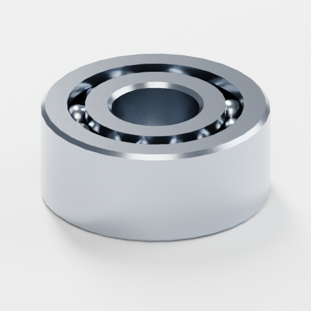
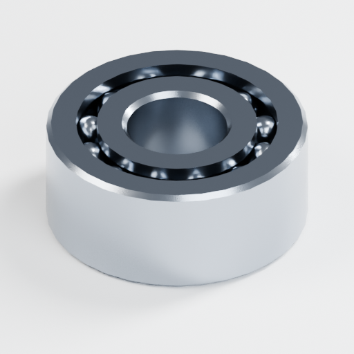
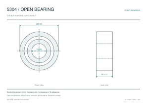

<!-- bearing-catalogue:start -->
# 5304 bearing - 20 x 52 x 22.2 mm

## Summary

Double row angular contact bearing: 20 mm bore, 52 mm outside diameter and 22.2 mm width.

| Product view | Isometric view |
| --- | --- |
|  |  |

Generated catalogue illustrations; the open internal geometry is illustrative.

## Details

**OOMP ID:** `hardware_bearing_5300_series_5304_size_20_mm_id_52_mm_od_22.2_mm_depth`

| Dimension | Nominal value |
| --- | --- |
| Bore / ID | 20 mm |
| Outside diameter / OD | 52 mm |
| Width / B | 22.2 mm |
| Catalogue contact angle | 25 degrees |

**Dimension evidence:** manufacturer checked (review retained from 2026-10-27).

Nominal presentation model. Raceways, pitch circle, chamfers and retainer geometry are illustrative; ball count/diameter are illustrative unless individually sourced. Not a manufacturer reconstruction, load-rating model or manufacturing/tolerance certification. Unspecified closure is presented open. The mesh shows open races and balls; retainers, seals and exact contact surfaces are omitted.

Contact-angle authority: **manufacturer family**. The mesh does not reconstruct the manufacturer contact surfaces.



[Printable A4 dimension sheet](working_dimension_a4.pdf) · [1:1 outline](working_svg.svg)

### Source evidence

- [https://www.nsk.com/content/dam/nsk/am/en_us/documents/bearings-americas/Bearing-and-Linear-Replacement-Guide.pdf](https://www.nsk.com/content/dam/nsk/am/en_us/documents/bearings-americas/Bearing-and-Linear-Replacement-Guide.pdf)

[Retained research and corrected dimensions](../../source_file/solidcraft/) · [Editable declaration](../../working_oomp_declarations_bearing.py)

## Parts

[Canonical part folder](.) · [Metadata](working.yaml) · [Browse this series](../../navigation/5300/README.md)

### Files

- [Editable OpenSCAD geometry](3dpr.scad)
- [Full model / GLB / metres, Y-up](three_d_model/model_full.glb)
- [Lightweight model / GLB / metres, Y-up](three_d_model/model_display.glb)
- [Editable Blender studio](three_d_model/studio.blend)
- [Product render / 2048 px](three_d_model/render_product_high.png)
- [Isometric render / 2048 px](three_d_model/render_high.png)
- [Populated model and render recipe](three_d_model/parameters.json)
- [Mesh measurements and artifact hashes](three_d_model/manifest.json)
- [Retained native CAD success manifest](solidcraft/latest_success.json)
- [76.2 x 50.8 mm label](label_bearing_3x2.pdf)
- [38.1 x 25.4 mm label](label_bearing_1_5x1.pdf)
- [Retained editable native bearing / SolidCraft](solidcraft/generations/66ef96a6e168d0ba_20261027T115158Z_9391a06b/bearing_5304_open.solidcraft)

### Orthographic views

| Quality | Isometric | Front | Back | Left | Right | Top | Bottom |
| --- | --- | --- | --- | --- | --- | --- | --- |
| Full | [Isometric](three_d_model/full/isometric.svg) | [Front](three_d_model/full/front.svg) | [Back](three_d_model/full/back.svg) | [Left](three_d_model/full/left.svg) | [Right](three_d_model/full/right.svg) | [Top](three_d_model/full/top.svg) | [Bottom](three_d_model/full/bottom.svg) |
| Display | [Isometric](three_d_model/display/isometric.svg) | [Front](three_d_model/display/front.svg) | [Back](three_d_model/display/back.svg) | [Left](three_d_model/display/left.svg) | [Right](three_d_model/display/right.svg) | [Top](three_d_model/display/top.svg) | [Bottom](three_d_model/display/bottom.svg) |

## Assembly

No installation procedure is established for this generic size record. Select the required closure, clearance, tolerance and load rating from the actual purchased bearing specification.

<details>
<summary>Complete OOMP metadata</summary>

```yaml
depth: 22.2
id: hardware_bearing_5300_series_5304_size_20_mm_id_52_mm_od_22.2_mm_depth
od: 52.0
series: '5300'
size: '5304'
svg_details:
  svg_name: bearing_dimension
  title: 5304 / OPEN BEARING
  family: DOUBLE ROW ANGULAR CONTACT
  dimensions_mm:
    bore: 20.0
    outside: 52.0
    width: 22.2
    contact_angle_deg: 25.0
  sheet_width_mm: 297
  sheet_height_mm: 210
  ink: '#183336'
  accent: '#147d83'
  muted: '#61767a'
  paper: '#ffffff'
  race_face_fill: '#edf3f3'
  inner_race_face_outside_mm: 31.870800000000003
  outer_race_face_inside_mm: 40.1292
  line_width_mm: 0.45
  font_family: Helvetica
  dimension_font_mm: 4
  title_font_mm: 9
  front_centre_mm:
  - 79
  - 103
  side_centre_mm:
  - 211
  - 103
  max_view_width_mm: 78
  max_side_width_mm: 55
  dimension_offset_mm: 12
  arrow_size_mm: 2
  note: Nominal dimensions in mm. Illustration only; no tolerances or fit allowances.
  authority: manufacturer checked
  internal_note: Open presentation; internal races and balls are illustrative. Retainers
    omitted.
  layout:
    left_margin_mm: 14
    right_margin_mm: 283
    title_y_mm: 22
    family_y_mm: 33
    family_font_mm: 3.5
    brand: OOMP / BEARINGS
    brand_font_mm: 3.5
    header_rule_y_mm: 40
    view_caption_y_mm: 173
    view_caption_font_mm: 3
    front_caption: FRONT VIEW
    side_caption: SIDE VIEW
    footer_rule_y_mm: 180
    note_y_mm: 187
    internal_note_y_mm: 194
    note_font_mm: 3.2
    source_y_mm: 202
    source_font_mm: 3
    source_prefix: 'SOURCE: '
    scale_prefix: A4 / scale
  dimension_style:
    line_width_mm: 0.25
    arrow_half_width_ratio: 0.3
    text_gap_mm: 2
    extension_mm: 2
    width_extension_mm: 3
    centre_extension_mm: 5
    dash_pattern_mm:
    - 2
    - 1
    flange_leader_offset_mm:
    - -13
    - 11
    flange_text_offset_mm:
    - -13
    - 16
    flange_font_mm: 3.5
  outline:
    ink: black
    line_width_mm: 0.1
taxonomy_1: hardware
taxonomy_10: ''
taxonomy_11: ''
taxonomy_12: ''
taxonomy_13: ''
taxonomy_14: ''
taxonomy_15: ''
taxonomy_2: bearing
taxonomy_3: 5300_series
taxonomy_4: 5304_size
taxonomy_5: 20_mm_id
taxonomy_6: 52_mm_od
taxonomy_7: 22.2_mm_depth
taxonomy_8: ''
taxonomy_9: ''
weight: '236'
width: 22.2
dimension_selection:
  policy: standard_metric_open_catalogue
  previous_id: hardware_bearing_5300_series_5304_size_20_mm_id_52_mm_od_22.22_mm_depth
  sources:
  - https://www.nsk.com/content/dam/nsk/am/en_us/documents/bearings-americas/Bearing-and-Linear-Replacement-Guide.pdf
  note: User selected standard catalogue variants on 2026-10-27; no sales ranking
    asserted.
url_chat: https://chatgpt.com/c/6ab8583e-5fac-83ed-9297-91c4316595a0
run_action: true
run_oomp: true
run_oomp_populate: true
run_scad: false
generate_stl: false
taxonomy_1_upper: HARDWARE
taxonomy_1_upper_length_1: H
taxonomy_1_upper_length_2: HA
taxonomy_1_upper_length_3: HAR
taxonomy_1_upper_length_4: HARD
taxonomy_1_upper_length_5: HARDW
taxonomy_1_length_1: h
taxonomy_1_length_2: ha
taxonomy_1_length_3: har
taxonomy_1_length_4: hard
taxonomy_1_length_5: hardw
taxonomy_1_capital: Hardware
taxonomy_1_first_letter: h
taxonomy_1_first_letter_upper: H
taxonomy_2_upper: BEARING
taxonomy_2_upper_length_1: B
taxonomy_2_upper_length_2: BE
taxonomy_2_upper_length_3: BEA
taxonomy_2_upper_length_4: BEAR
taxonomy_2_upper_length_5: BEARI
taxonomy_2_length_1: b
taxonomy_2_length_2: be
taxonomy_2_length_3: bea
taxonomy_2_length_4: bear
taxonomy_2_length_5: beari
taxonomy_2_capital: Bearing
taxonomy_2_first_letter: b
taxonomy_2_first_letter_upper: B
taxonomy_3_upper: 5300_SERIES
taxonomy_3_upper_length_1: '5'
taxonomy_3_upper_length_2: '53'
taxonomy_3_upper_length_3: '530'
taxonomy_3_upper_length_4: '5300'
taxonomy_3_upper_length_5: '5300_'
taxonomy_3_length_1: '5'
taxonomy_3_length_2: '53'
taxonomy_3_length_3: '530'
taxonomy_3_length_4: '5300'
taxonomy_3_length_5: '5300_'
taxonomy_3_capital: 5300 Series
taxonomy_3_first_letter: '5'
taxonomy_3_first_letter_upper: '5'
taxonomy_4_upper: 5304_SIZE
taxonomy_4_upper_length_1: '5'
taxonomy_4_upper_length_2: '53'
taxonomy_4_upper_length_3: '530'
taxonomy_4_upper_length_4: '5304'
taxonomy_4_upper_length_5: '5304_'
taxonomy_4_length_1: '5'
taxonomy_4_length_2: '53'
taxonomy_4_length_3: '530'
taxonomy_4_length_4: '5304'
taxonomy_4_length_5: '5304_'
taxonomy_4_capital: 5304 Size
taxonomy_4_first_letter: '5'
taxonomy_4_first_letter_upper: '5'
taxonomy_5_upper: 20_MM_ID
taxonomy_5_upper_length_1: '2'
taxonomy_5_upper_length_2: '20'
taxonomy_5_upper_length_3: '20_'
taxonomy_5_upper_length_4: 20_M
taxonomy_5_upper_length_5: 20_MM
taxonomy_5_length_1: '2'
taxonomy_5_length_2: '20'
taxonomy_5_length_3: '20_'
taxonomy_5_length_4: 20_m
taxonomy_5_length_5: 20_mm
taxonomy_5_capital: 20 mm Id
taxonomy_5_first_letter: '2'
taxonomy_5_first_letter_upper: '2'
taxonomy_6_upper: 52_MM_OD
taxonomy_6_upper_length_1: '5'
taxonomy_6_upper_length_2: '52'
taxonomy_6_upper_length_3: '52_'
taxonomy_6_upper_length_4: 52_M
taxonomy_6_upper_length_5: 52_MM
taxonomy_6_length_1: '5'
taxonomy_6_length_2: '52'
taxonomy_6_length_3: '52_'
taxonomy_6_length_4: 52_m
taxonomy_6_length_5: 52_mm
taxonomy_6_capital: 52 mm Od
taxonomy_6_first_letter: '5'
taxonomy_6_first_letter_upper: '5'
taxonomy_7_upper: 22.2_MM_DEPTH
taxonomy_7_upper_length_1: '2'
taxonomy_7_upper_length_2: '22'
taxonomy_7_upper_length_3: '22.'
taxonomy_7_upper_length_4: '22.2'
taxonomy_7_upper_length_5: '22.2_'
taxonomy_7_length_1: '2'
taxonomy_7_length_2: '22'
taxonomy_7_length_3: '22.'
taxonomy_7_length_4: '22.2'
taxonomy_7_length_5: '22.2_'
taxonomy_7_capital: 22.2 mm Depth
taxonomy_7_first_letter: '2'
taxonomy_7_first_letter_upper: '2'
id_no_class: hardware_bearing_5300_series_5304_size_20_mm_id_52_mm_od_22.2_mm_depth
id_no_type: hardware_bearing_5300_series_5304_size_20_mm_id_52_mm_od_22.2_mm_depth
id_no_size: hardware_bearing_5300_series_size_20_mm_id_52_mm_od_22.2_mm_depth
oomp_key: oomp_hardware_bearing_5300_series_5304_size_20_mm_id_52_mm_od_22.2_mm_depth
link_github: https://github.com/oomlout/oomp_bearing_version_5/tree/main/parts/hardware_bearing_5300_series_5304_size_20_mm_id_52_mm_od_22.2_mm_depth
link_main: https://github.com/oomlout/oomlout_oomp_version_1_messy/tree/main/parts/hardware_bearing_5300_series_5304_size_20_mm_id_52_mm_od_22.2_mm_depth
link_redirect: https://github.com/oomlout/oomlout_oomp_version_1_messy/tree/main/parts/hardware_bearing_5300_series_5304_size_20_mm_id_52_mm_od_22.2_mm_depth
directory: parts/hardware_bearing_5300_series_5304_size_20_mm_id_52_mm_od_22.2_mm_depth
name: 5304 bearing
name_no_class: Hardware Bearing 5300 Series 5304 Size 20 Mm Id 52 Mm Od 22.2 Mm Depth
name_no_type: Hardware Bearing 5300 Series 5304 Size 20 Mm Id 52 Mm Od 22.2 Mm Depth
name_no_size: Hardware Bearing 5300 Series Size 20 Mm Id 52 Mm Od 22.2 Mm Depth
md5: f80fd07aed395f9d4bff2442b3194c52
md5_5: f80fd
md5_5_upper: F80FD
md5_6: f80fd0
md5_6_upper: F80FD0
md5_6_alpha: 9ofyo
md5_6_alpha_upper: 9OFYO
md5_10: f80fd07aed
md5_10_upper: F80FD07AED
bip_39_full_array:
- way
- leader
- burger
- surprise
- nominee
- solid
- copper
- tonight
- dress
- occur
- fantasy
- pitch
bip_39_full_space: way leader burger surprise nominee solid copper tonight dress occur
  fantasy pitch
bip_39_full_no_space: wayleaderburgersurprisenomineesolidcoppertonightdressoccurfantasypitch
bip_39_full_underscore: way_leader_burger_surprise_nominee_solid_copper_tonight_dress_occur_fantasy_pitch
bip_39_2_word_array:
- way
- leader
bip_39_2_word_space: way leader
bip_39_2_word_no_space: wayleader
bip_39_2_word_underscore: way_leader
bip_39_3_word_array:
- way
- leader
- burger
bip_39_3_word_space: way leader burger
bip_39_3_word_no_space: wayleaderburger
bip_39_3_word_underscore: way_leader_burger
name_space: hardware bearing 5300 series 5304 size 20 mm id 52 mm od 22.2 mm depth
name_proper: 5304 bearing
name_upper: HARDWARE BEARING 5300 SERIES 5304 SIZE 20 MM ID 52 MM OD 22.2 MM DEPTH
oomlout_ai_roboclick_1:
  file_test: ''
  actions:
  - command: text_jinja_template
    description: Bold bearing label 3x2
    file_template: C:\od\OneDrive\docs\oomp_bearing\source_file\template_jinja\label_bearing_bold\3x2.svg.j2
    file_output: label_bearing_bold_3x2.svg
    dict_data_yaml_files:
      label_source: C:\od\OneDrive\docs\oomp_bearing\parts_source\hardware_bearing_5300_series_5304_size_20_mm_id_52_mm_od_22_2_mm_depth\working.yaml
      label_manual: C:\od\OneDrive\docs\oomp_bearing\parts\hardware_bearing_5300_series_5304_size_20_mm_id_52_mm_od_22.2_mm_depth\working_manual.yaml
    convert_to_pdf: false
    convert_to_png: false
oomlout_ai_roboclick_2:
  file_test: ''
  actions:
  - command: text_jinja_template
    description: Bold bearing label 1_5x1
    file_template: C:\od\OneDrive\docs\oomp_bearing\source_file\template_jinja\label_bearing_bold\1_5x1.svg.j2
    file_output: label_bearing_bold_1_5x1.svg
    dict_data_yaml_files:
      label_source: C:\od\OneDrive\docs\oomp_bearing\parts_source\hardware_bearing_5300_series_5304_size_20_mm_id_52_mm_od_22_2_mm_depth\working.yaml
      label_manual: C:\od\OneDrive\docs\oomp_bearing\parts\hardware_bearing_5300_series_5304_size_20_mm_id_52_mm_od_22.2_mm_depth\working_manual.yaml
    convert_to_pdf: false
    convert_to_png: false
catalogue_schema: oomp_bearing_v5
oomp_id: hardware_bearing_5300_series_5304_size_20_mm_id_52_mm_od_22.2_mm_depth
family: double_row_angular_contact
dimensions_mm:
  bore: 20.0
  outside: 52.0
  width: 22.2
  contact_angle_deg: 25.0
bore: 20.0
dimension_authority: manufacturer_checked
source_checked: '2026-10-27'
sources:
- https://www.nsk.com/content/dam/nsk/am/en_us/documents/bearings-americas/Bearing-and-Linear-Replacement-Guide.pdf
model_note: Nominal presentation model. Raceways, pitch circle, chamfers and retainer
  geometry are illustrative; ball count/diameter are illustrative unless individually
  sourced. Not a manufacturer reconstruction, load-rating model or manufacturing/tolerance
  certification. Unspecified closure is presented open. The mesh shows open races
  and balls; retainers, seals and exact contact surfaces are omitted.
closure: open
three_d_model_details:
  schema_version: 1
  generator: bearing_open
  output_folder: three_d_model
  parameters:
    bore: 20.0
    outside: 52.0
    width: 22.2
    edge: 0.96
    pitch_radius: 18.0
    ball_radius: 3.3299999999999996
    groove_radius: 3.4964999999999997
    inner_shoulder: 15.935400000000001
    outer_shoulder: 20.0646
    cage_half_width: 1.8315
    cage_low: 3.1634999999999995
    cage_high: 3.8294999999999995
    window_radius: 1.5983999999999998
    contact_angle_deg: 25.0
    contact_offset: 0.08324999999999999
    identity: hardware_bearing_5300_series_5304_size_20_mm_id_52_mm_od_22.2_mm_depth
    specification: 5304 / 20 x 52 x 22.2 mm
    characteristic_dimension_mm: 52.0
    characteristic_dimension_basis: maximum nominal envelope dimension
    ball_count: 24
    balls_per_row: 12
    row_count: 2
    ball_specification: illustrative
    contact_angle_authority: manufacturer_family
    row_centres_z:
    - 5.55
    - 16.65
    components:
    - name: outer_race
      shape: revolved_profile
      profile_mm:
      - - 25.04
        - 0
      - - 26.0
        - 0.96
      - - 26.0
        - 21.24
      - - 25.04
        - 22.2
      - - 20.0646
        - 22.2
      - - 20.0646
        - 21.24
      - - 20.0646
        - 20.1465
      - - 20.0646
        - 19.971674999999998
      - - 20.0646
        - 19.79685
      - - 20.0646
        - 19.622025
      - - 20.0979
        - 19.4472
      - - 20.312717364784337
        - 19.272374999999997
      - - 20.49700045004001
        - 19.09755
      - - 20.65710995714799
        - 18.922725
      - - 20.7972
        - 18.747899999999998
      - - 20.920153214195274
        - 18.573075
      - - 21.02805782433229
        - 18.398249999999997
      - - 21.122474342468646
        - 18.223425
      - - 21.204595183482617
        - 18.0486
      - - 21.27534532521
        - 17.873775
      - - 21.33544841775435
        - 17.69895
      - - 21.385471567503558
        - 17.524124999999998
      - - 21.425856354256553
        - 17.3493
      - - 21.456940587336582
        - 17.174475
      - - 21.478973573843298
        - 16.99965
      - - 21.492126639939478
        - 16.824824999999997
      - - 21.4965
        - 16.65
      - - 21.492126639939478
        - 16.475175
      - - 21.478973573843298
        - 16.300349999999998
      - - 21.456940587336582
        - 16.125525
      - - 21.425856354256553
        - 15.9507
      - - 21.385471567503558
        - 15.775875
      - - 21.33544841775435
        - 15.601049999999999
      - - 21.27534532521
        - 15.426224999999999
      - - 21.20459518348262
        - 15.2514
      - - 21.122474342468646
        - 15.076574999999998
      - - 21.02805782433229
        - 14.90175
      - - 20.920153214195278
        - 14.726925
      - - 20.7972
        - 14.5521
      - - 20.65710995714799
        - 14.377275
      - - 20.49700045004001
        - 14.202449999999999
      - - 20.312717364784334
        - 14.027624999999999
      - - 20.0979
        - 13.852799999999998
      - - 20.0646
        - 13.677975
      - - 20.0646
        - 13.50315
      - - 20.0646
        - 13.328325
      - - 20.0646
        - 13.1535
      - - 20.0646
        - 9.0465
      - - 20.0646
        - 8.871675
      - - 20.0646
        - 8.69685
      - - 20.0646
        - 8.522025
      - - 20.0979
        - 8.347199999999999
      - - 20.312717364784337
        - 8.172374999999999
      - - 20.49700045004001
        - 7.997549999999999
      - - 20.65710995714799
        - 7.822725
      - - 20.7972
        - 7.6479
      - - 20.920153214195274
        - 7.473075
      - - 21.02805782433229
        - 7.2982499999999995
      - - 21.122474342468646
        - 7.123424999999999
      - - 21.20459518348262
        - 6.948599999999999
      - - 21.27534532521
        - 6.773774999999999
      - - 21.33544841775435
        - 6.59895
      - - 21.385471567503558
        - 6.424125
      - - 21.425856354256553
        - 6.2493
      - - 21.456940587336582
        - 6.074475
      - - 21.478973573843298
        - 5.899649999999999
      - - 21.492126639939478
        - 5.724824999999999
      - - 21.4965
        - 5.55
      - - 21.492126639939478
        - 5.3751750000000005
      - - 21.478973573843298
        - 5.20035
      - - 21.456940587336582
        - 5.025525
      - - 21.425856354256553
        - 4.8507
      - - 21.385471567503558
        - 4.675875
      - - 21.33544841775435
        - 4.501049999999999
      - - 21.27534532521
        - 4.326225
      - - 21.20459518348262
        - 4.151400000000001
      - - 21.122474342468646
        - 3.9765749999999995
      - - 21.02805782433229
        - 3.80175
      - - 20.920153214195274
        - 3.626925
      - - 20.7972
        - 3.4520999999999997
      - - 20.65710995714799
        - 3.277275
      - - 20.49700045004001
        - 3.10245
      - - 20.312717364784334
        - 2.927625
      - - 20.0979
        - 2.7528
      - - 20.0646
        - 2.5779750000000003
      - - 20.0646
        - 2.40315
      - - 20.0646
        - 2.228325
      - - 20.0646
        - 2.0535
      - - 20.0646
        - 0.96
      - - 20.0646
        - 0.0
      - - 25.04
        - 0
    - name: inner_race
      shape: revolved_profile
      profile_mm:
      - - 15.935400000000001
        - 0.0
      - - 15.935400000000001
        - 0.96
      - - 15.935400000000001
        - 2.0535
      - - 15.935400000000001
        - 2.228325
      - - 15.935400000000001
        - 2.40315
      - - 15.935400000000001
        - 2.5779750000000003
      - - 15.9021
        - 2.7528
      - - 15.687282635215665
        - 2.927625
      - - 15.502999549959993
        - 3.10245
      - - 15.342890042852009
        - 3.277275
      - - 15.2028
        - 3.4520999999999997
      - - 15.079846785804724
        - 3.626925
      - - 14.97194217566771
        - 3.80175
      - - 14.877525657531354
        - 3.9765749999999995
      - - 14.795404816517381
        - 4.151400000000001
      - - 14.724654674790001
        - 4.326225
      - - 14.66455158224565
        - 4.501049999999999
      - - 14.614528432496442
        - 4.675875
      - - 14.574143645743447
        - 4.8507
      - - 14.543059412663418
        - 5.025525
      - - 14.521026426156704
        - 5.20035
      - - 14.50787336006052
        - 5.3751750000000005
      - - 14.5035
        - 5.55
      - - 14.50787336006052
        - 5.724824999999999
      - - 14.521026426156704
        - 5.899649999999999
      - - 14.543059412663418
        - 6.074475
      - - 14.574143645743447
        - 6.2493
      - - 14.614528432496442
        - 6.424125
      - - 14.66455158224565
        - 6.59895
      - - 14.72465467479
        - 6.773774999999999
      - - 14.795404816517381
        - 6.948599999999999
      - - 14.877525657531354
        - 7.123424999999999
      - - 14.97194217566771
        - 7.2982499999999995
      - - 15.079846785804724
        - 7.473075
      - - 15.2028
        - 7.6479
      - - 15.342890042852009
        - 7.822725
      - - 15.502999549959991
        - 7.997549999999999
      - - 15.687282635215665
        - 8.172374999999999
      - - 15.902099999999999
        - 8.347199999999999
      - - 15.935400000000001
        - 8.522025
      - - 15.935400000000001
        - 8.69685
      - - 15.935400000000001
        - 8.871675
      - - 15.935400000000001
        - 9.0465
      - - 15.935400000000001
        - 13.1535
      - - 15.935400000000001
        - 13.328325
      - - 15.935400000000001
        - 13.50315
      - - 15.935400000000001
        - 13.677975
      - - 15.9021
        - 13.852799999999998
      - - 15.687282635215665
        - 14.027624999999999
      - - 15.502999549959993
        - 14.202449999999999
      - - 15.342890042852009
        - 14.377275
      - - 15.2028
        - 14.5521
      - - 15.079846785804724
        - 14.726925
      - - 14.97194217566771
        - 14.90175
      - - 14.877525657531354
        - 15.076574999999998
      - - 14.795404816517381
        - 15.2514
      - - 14.724654674790001
        - 15.426224999999999
      - - 14.66455158224565
        - 15.601049999999999
      - - 14.614528432496442
        - 15.775875
      - - 14.574143645743447
        - 15.9507
      - - 14.543059412663418
        - 16.125525
      - - 14.521026426156704
        - 16.300349999999998
      - - 14.50787336006052
        - 16.475175
      - - 14.5035
        - 16.65
      - - 14.50787336006052
        - 16.824824999999997
      - - 14.521026426156704
        - 16.99965
      - - 14.543059412663418
        - 17.174475
      - - 14.574143645743447
        - 17.3493
      - - 14.614528432496442
        - 17.524124999999998
      - - 14.66455158224565
        - 17.69895
      - - 14.724654674790001
        - 17.873775
      - - 14.795404816517383
        - 18.0486
      - - 14.877525657531354
        - 18.223425
      - - 14.97194217566771
        - 18.398249999999997
      - - 15.079846785804726
        - 18.573075
      - - 15.2028
        - 18.747899999999998
      - - 15.34289004285201
        - 18.922725
      - - 15.502999549959993
        - 19.09755
      - - 15.687282635215663
        - 19.272374999999997
      - - 15.9021
        - 19.4472
      - - 15.935400000000001
        - 19.622025
      - - 15.935400000000001
        - 19.79685
      - - 15.935400000000001
        - 19.971674999999998
      - - 15.935400000000001
        - 20.1465
      - - 15.935400000000001
        - 21.24
      - - 15.935400000000001
        - 22.2
      - - 10.96
        - 22.2
      - - 10.0
        - 21.24
      - - 10.0
        - 0.96
      - - 10.96
        - 0
      - - 15.935400000000001
        - 0.0
    - name: ball_row_1_1
      shape: sphere
      radius_mm: 3.3299999999999996
      centre_mm:
      - 18.0
      - 0.0
      - 5.55
    - name: ball_row_1_2
      shape: sphere
      radius_mm: 3.3299999999999996
      centre_mm:
      - 15.588457268119896
      - 8.999999999999998
      - 5.55
    - name: ball_row_1_3
      shape: sphere
      radius_mm: 3.3299999999999996
      centre_mm:
      - 9.000000000000002
      - 15.588457268119894
      - 5.55
    - name: ball_row_1_4
      shape: sphere
      radius_mm: 3.3299999999999996
      centre_mm:
      - 1.102182119232618e-15
      - 18.0
      - 5.55
    - name: ball_row_1_5
      shape: sphere
      radius_mm: 3.3299999999999996
      centre_mm:
      - -8.999999999999996
      - 15.588457268119896
      - 5.55
    - name: ball_row_1_6
      shape: sphere
      radius_mm: 3.3299999999999996
      centre_mm:
      - -15.588457268119896
      - 8.999999999999998
      - 5.55
    - name: ball_row_1_7
      shape: sphere
      radius_mm: 3.3299999999999996
      centre_mm:
      - -18.0
      - 2.204364238465236e-15
      - 5.55
    - name: ball_row_1_8
      shape: sphere
      radius_mm: 3.3299999999999996
      centre_mm:
      - -15.5884572681199
      - -8.999999999999995
      - 5.55
    - name: ball_row_1_9
      shape: sphere
      radius_mm: 3.3299999999999996
      centre_mm:
      - -9.000000000000007
      - -15.588457268119893
      - 5.55
    - name: ball_row_1_10
      shape: sphere
      radius_mm: 3.3299999999999996
      centre_mm:
      - -3.3065463576978533e-15
      - -18.0
      - 5.55
    - name: ball_row_1_11
      shape: sphere
      radius_mm: 3.3299999999999996
      centre_mm:
      - 9.000000000000002
      - -15.588457268119894
      - 5.55
    - name: ball_row_1_12
      shape: sphere
      radius_mm: 3.3299999999999996
      centre_mm:
      - 15.58845726811989
      - -9.000000000000007
      - 5.55
    - name: ball_row_2_1
      shape: sphere
      radius_mm: 3.3299999999999996
      centre_mm:
      - 18.0
      - 0.0
      - 16.65
    - name: ball_row_2_2
      shape: sphere
      radius_mm: 3.3299999999999996
      centre_mm:
      - 15.588457268119896
      - 8.999999999999998
      - 16.65
    - name: ball_row_2_3
      shape: sphere
      radius_mm: 3.3299999999999996
      centre_mm:
      - 9.000000000000002
      - 15.588457268119894
      - 16.65
    - name: ball_row_2_4
      shape: sphere
      radius_mm: 3.3299999999999996
      centre_mm:
      - 1.102182119232618e-15
      - 18.0
      - 16.65
    - name: ball_row_2_5
      shape: sphere
      radius_mm: 3.3299999999999996
      centre_mm:
      - -8.999999999999996
      - 15.588457268119896
      - 16.65
    - name: ball_row_2_6
      shape: sphere
      radius_mm: 3.3299999999999996
      centre_mm:
      - -15.588457268119896
      - 8.999999999999998
      - 16.65
    - name: ball_row_2_7
      shape: sphere
      radius_mm: 3.3299999999999996
      centre_mm:
      - -18.0
      - 2.204364238465236e-15
      - 16.65
    - name: ball_row_2_8
      shape: sphere
      radius_mm: 3.3299999999999996
      centre_mm:
      - -15.5884572681199
      - -8.999999999999995
      - 16.65
    - name: ball_row_2_9
      shape: sphere
      radius_mm: 3.3299999999999996
      centre_mm:
      - -9.000000000000007
      - -15.588457268119893
      - 16.65
    - name: ball_row_2_10
      shape: sphere
      radius_mm: 3.3299999999999996
      centre_mm:
      - -3.3065463576978533e-15
      - -18.0
      - 16.65
    - name: ball_row_2_11
      shape: sphere
      radius_mm: 3.3299999999999996
      centre_mm:
      - 9.000000000000002
      - -15.588457268119894
      - 16.65
    - name: ball_row_2_12
      shape: sphere
      radius_mm: 3.3299999999999996
      centre_mm:
      - 15.58845726811989
      - -9.000000000000007
      - 16.65
  modelling_note: Nominal presentation model. Raceways, pitch circle, chamfers and
    retainer geometry are illustrative; ball count/diameter are illustrative unless
    individually sourced. Not a manufacturer reconstruction, load-rating model or
    manufacturing/tolerance certification. Unspecified closure is presented open.
    The mesh shows open races and balls; retainers, seals and exact contact surfaces
    are omitted.
  dimension_authority: manufacturer_checked
  model_formats:
  - glb
  variants:
    full:
      angular_segments: 128
      sphere_subdivisions: 3
    display:
      angular_segments: 32
      sphere_subdivisions: 2
  views:
  - isometric
  - front
  - back
  - left
  - right
  - top
  - bottom
  material:
    name: Illustrative polished bearing steel
    base_colour_srgb:
    - 0.62
    - 0.65
    - 0.69
    metallic: 1.0
    roughness: 0.22
    roughness_variation: 0.045
    coat_weight: 0.02
    coat_roughness: 0.28
    microtexture_spacing_mm: 0.025
    microtexture_height_um: 0.8
    note: Illustrative bearing steel; material grade and finish are not specified.
  studio:
    engine: cycles
    device: auto
    seed: 7991
    low_samples: 24
    high_samples: 48
    adaptive_threshold: 0.015
    denoise: true
    view_transform: AgX
    look: AgX - Medium High Contrast
    exposure: 0.0
    world_colour:
    - 0.78
    - 0.82
    - 0.9
    world_strength: 0.35
    floor_colour_srgb:
    - 0.93
    - 0.935
    - 0.94
    floor_roughness: 0.55
    framing_margin: 0.13
    lights:
    - name: Key softbox
      position:
      - -3
      - -4
      - 6
      power: 650.0
      width: 4.0
      height: 5.0
      colour:
      - 1.0
      - 0.96
      - 0.9
    - name: Fill softbox
      position:
      - 4
      - -1
      - 3
      power: 330.0
      width: 3.0
      height: 4.0
      colour:
      - 0.9
      - 0.95
      - 1.0
    - name: Rim strip
      position:
      - 1
      - 4
      - 4
      power: 850.0
      width: 1.2
      height: 5.0
      colour:
      - 1.0
      - 1.0
      - 1.0
    poses:
      isometric:
        camera_eye:
        - 1
        - -1
        - 1
        projection: orthographic
        orientation: principal axis Z up
      product:
        camera_eye:
        - -6
        - -10
        - 6
        projection: orthographic
        orientation: resting on lower face
        yaw_degrees: -12.0
        support: Stable convex-hull support using actual mesh centre of mass.
        resting_axis: face
  renders:
    low:
      file: render_low.png
      variant: display
      pixels: 512
      view: isometric
    high:
      file: render_high.png
      variant: full
      pixels: 2048
      view: isometric
    product_low:
      file: render_product_low.png
      variant: display
      pixels: 512
      view: product
    product_high:
      file: render_product_high.png
      variant: full
      pixels: 2048
      view: product
oobb_type: bearing_open
oobb_details:
  oobb_type: bearing_open
  run_scad: true
  run_solidcraft: false
  angular_segments: 128
  components:
  - name: outer_race
    shape: revolved_profile
    profile_mm:
    - - 25.04
      - 0
    - - 26.0
      - 0.96
    - - 26.0
      - 21.24
    - - 25.04
      - 22.2
    - - 20.0646
      - 22.2
    - - 20.0646
      - 21.24
    - - 20.0646
      - 20.1465
    - - 20.0646
      - 19.971674999999998
    - - 20.0646
      - 19.79685
    - - 20.0646
      - 19.622025
    - - 20.0979
      - 19.4472
    - - 20.312717364784337
      - 19.272374999999997
    - - 20.49700045004001
      - 19.09755
    - - 20.65710995714799
      - 18.922725
    - - 20.7972
      - 18.747899999999998
    - - 20.920153214195274
      - 18.573075
    - - 21.02805782433229
      - 18.398249999999997
    - - 21.122474342468646
      - 18.223425
    - - 21.204595183482617
      - 18.0486
    - - 21.27534532521
      - 17.873775
    - - 21.33544841775435
      - 17.69895
    - - 21.385471567503558
      - 17.524124999999998
    - - 21.425856354256553
      - 17.3493
    - - 21.456940587336582
      - 17.174475
    - - 21.478973573843298
      - 16.99965
    - - 21.492126639939478
      - 16.824824999999997
    - - 21.4965
      - 16.65
    - - 21.492126639939478
      - 16.475175
    - - 21.478973573843298
      - 16.300349999999998
    - - 21.456940587336582
      - 16.125525
    - - 21.425856354256553
      - 15.9507
    - - 21.385471567503558
      - 15.775875
    - - 21.33544841775435
      - 15.601049999999999
    - - 21.27534532521
      - 15.426224999999999
    - - 21.20459518348262
      - 15.2514
    - - 21.122474342468646
      - 15.076574999999998
    - - 21.02805782433229
      - 14.90175
    - - 20.920153214195278
      - 14.726925
    - - 20.7972
      - 14.5521
    - - 20.65710995714799
      - 14.377275
    - - 20.49700045004001
      - 14.202449999999999
    - - 20.312717364784334
      - 14.027624999999999
    - - 20.0979
      - 13.852799999999998
    - - 20.0646
      - 13.677975
    - - 20.0646
      - 13.50315
    - - 20.0646
      - 13.328325
    - - 20.0646
      - 13.1535
    - - 20.0646
      - 9.0465
    - - 20.0646
      - 8.871675
    - - 20.0646
      - 8.69685
    - - 20.0646
      - 8.522025
    - - 20.0979
      - 8.347199999999999
    - - 20.312717364784337
      - 8.172374999999999
    - - 20.49700045004001
      - 7.997549999999999
    - - 20.65710995714799
      - 7.822725
    - - 20.7972
      - 7.6479
    - - 20.920153214195274
      - 7.473075
    - - 21.02805782433229
      - 7.2982499999999995
    - - 21.122474342468646
      - 7.123424999999999
    - - 21.20459518348262
      - 6.948599999999999
    - - 21.27534532521
      - 6.773774999999999
    - - 21.33544841775435
      - 6.59895
    - - 21.385471567503558
      - 6.424125
    - - 21.425856354256553
      - 6.2493
    - - 21.456940587336582
      - 6.074475
    - - 21.478973573843298
      - 5.899649999999999
    - - 21.492126639939478
      - 5.724824999999999
    - - 21.4965
      - 5.55
    - - 21.492126639939478
      - 5.3751750000000005
    - - 21.478973573843298
      - 5.20035
    - - 21.456940587336582
      - 5.025525
    - - 21.425856354256553
      - 4.8507
    - - 21.385471567503558
      - 4.675875
    - - 21.33544841775435
      - 4.501049999999999
    - - 21.27534532521
      - 4.326225
    - - 21.20459518348262
      - 4.151400000000001
    - - 21.122474342468646
      - 3.9765749999999995
    - - 21.02805782433229
      - 3.80175
    - - 20.920153214195274
      - 3.626925
    - - 20.7972
      - 3.4520999999999997
    - - 20.65710995714799
      - 3.277275
    - - 20.49700045004001
      - 3.10245
    - - 20.312717364784334
      - 2.927625
    - - 20.0979
      - 2.7528
    - - 20.0646
      - 2.5779750000000003
    - - 20.0646
      - 2.40315
    - - 20.0646
      - 2.228325
    - - 20.0646
      - 2.0535
    - - 20.0646
      - 0.96
    - - 20.0646
      - 0.0
    - - 25.04
      - 0
  - name: inner_race
    shape: revolved_profile
    profile_mm:
    - - 15.935400000000001
      - 0.0
    - - 15.935400000000001
      - 0.96
    - - 15.935400000000001
      - 2.0535
    - - 15.935400000000001
      - 2.228325
    - - 15.935400000000001
      - 2.40315
    - - 15.935400000000001
      - 2.5779750000000003
    - - 15.9021
      - 2.7528
    - - 15.687282635215665
      - 2.927625
    - - 15.502999549959993
      - 3.10245
    - - 15.342890042852009
      - 3.277275
    - - 15.2028
      - 3.4520999999999997
    - - 15.079846785804724
      - 3.626925
    - - 14.97194217566771
      - 3.80175
    - - 14.877525657531354
      - 3.9765749999999995
    - - 14.795404816517381
      - 4.151400000000001
    - - 14.724654674790001
      - 4.326225
    - - 14.66455158224565
      - 4.501049999999999
    - - 14.614528432496442
      - 4.675875
    - - 14.574143645743447
      - 4.8507
    - - 14.543059412663418
      - 5.025525
    - - 14.521026426156704
      - 5.20035
    - - 14.50787336006052
      - 5.3751750000000005
    - - 14.5035
      - 5.55
    - - 14.50787336006052
      - 5.724824999999999
    - - 14.521026426156704
      - 5.899649999999999
    - - 14.543059412663418
      - 6.074475
    - - 14.574143645743447
      - 6.2493
    - - 14.614528432496442
      - 6.424125
    - - 14.66455158224565
      - 6.59895
    - - 14.72465467479
      - 6.773774999999999
    - - 14.795404816517381
      - 6.948599999999999
    - - 14.877525657531354
      - 7.123424999999999
    - - 14.97194217566771
      - 7.2982499999999995
    - - 15.079846785804724
      - 7.473075
    - - 15.2028
      - 7.6479
    - - 15.342890042852009
      - 7.822725
    - - 15.502999549959991
      - 7.997549999999999
    - - 15.687282635215665
      - 8.172374999999999
    - - 15.902099999999999
      - 8.347199999999999
    - - 15.935400000000001
      - 8.522025
    - - 15.935400000000001
      - 8.69685
    - - 15.935400000000001
      - 8.871675
    - - 15.935400000000001
      - 9.0465
    - - 15.935400000000001
      - 13.1535
    - - 15.935400000000001
      - 13.328325
    - - 15.935400000000001
      - 13.50315
    - - 15.935400000000001
      - 13.677975
    - - 15.9021
      - 13.852799999999998
    - - 15.687282635215665
      - 14.027624999999999
    - - 15.502999549959993
      - 14.202449999999999
    - - 15.342890042852009
      - 14.377275
    - - 15.2028
      - 14.5521
    - - 15.079846785804724
      - 14.726925
    - - 14.97194217566771
      - 14.90175
    - - 14.877525657531354
      - 15.076574999999998
    - - 14.795404816517381
      - 15.2514
    - - 14.724654674790001
      - 15.426224999999999
    - - 14.66455158224565
      - 15.601049999999999
    - - 14.614528432496442
      - 15.775875
    - - 14.574143645743447
      - 15.9507
    - - 14.543059412663418
      - 16.125525
    - - 14.521026426156704
      - 16.300349999999998
    - - 14.50787336006052
      - 16.475175
    - - 14.5035
      - 16.65
    - - 14.50787336006052
      - 16.824824999999997
    - - 14.521026426156704
      - 16.99965
    - - 14.543059412663418
      - 17.174475
    - - 14.574143645743447
      - 17.3493
    - - 14.614528432496442
      - 17.524124999999998
    - - 14.66455158224565
      - 17.69895
    - - 14.724654674790001
      - 17.873775
    - - 14.795404816517383
      - 18.0486
    - - 14.877525657531354
      - 18.223425
    - - 14.97194217566771
      - 18.398249999999997
    - - 15.079846785804726
      - 18.573075
    - - 15.2028
      - 18.747899999999998
    - - 15.34289004285201
      - 18.922725
    - - 15.502999549959993
      - 19.09755
    - - 15.687282635215663
      - 19.272374999999997
    - - 15.9021
      - 19.4472
    - - 15.935400000000001
      - 19.622025
    - - 15.935400000000001
      - 19.79685
    - - 15.935400000000001
      - 19.971674999999998
    - - 15.935400000000001
      - 20.1465
    - - 15.935400000000001
      - 21.24
    - - 15.935400000000001
      - 22.2
    - - 10.96
      - 22.2
    - - 10.0
      - 21.24
    - - 10.0
      - 0.96
    - - 10.96
      - 0
    - - 15.935400000000001
      - 0.0
  - name: ball_row_1_1
    shape: sphere
    radius_mm: 3.3299999999999996
    centre_mm:
    - 18.0
    - 0.0
    - 5.55
  - name: ball_row_1_2
    shape: sphere
    radius_mm: 3.3299999999999996
    centre_mm:
    - 15.588457268119896
    - 8.999999999999998
    - 5.55
  - name: ball_row_1_3
    shape: sphere
    radius_mm: 3.3299999999999996
    centre_mm:
    - 9.000000000000002
    - 15.588457268119894
    - 5.55
  - name: ball_row_1_4
    shape: sphere
    radius_mm: 3.3299999999999996
    centre_mm:
    - 1.102182119232618e-15
    - 18.0
    - 5.55
  - name: ball_row_1_5
    shape: sphere
    radius_mm: 3.3299999999999996
    centre_mm:
    - -8.999999999999996
    - 15.588457268119896
    - 5.55
  - name: ball_row_1_6
    shape: sphere
    radius_mm: 3.3299999999999996
    centre_mm:
    - -15.588457268119896
    - 8.999999999999998
    - 5.55
  - name: ball_row_1_7
    shape: sphere
    radius_mm: 3.3299999999999996
    centre_mm:
    - -18.0
    - 2.204364238465236e-15
    - 5.55
  - name: ball_row_1_8
    shape: sphere
    radius_mm: 3.3299999999999996
    centre_mm:
    - -15.5884572681199
    - -8.999999999999995
    - 5.55
  - name: ball_row_1_9
    shape: sphere
    radius_mm: 3.3299999999999996
    centre_mm:
    - -9.000000000000007
    - -15.588457268119893
    - 5.55
  - name: ball_row_1_10
    shape: sphere
    radius_mm: 3.3299999999999996
    centre_mm:
    - -3.3065463576978533e-15
    - -18.0
    - 5.55
  - name: ball_row_1_11
    shape: sphere
    radius_mm: 3.3299999999999996
    centre_mm:
    - 9.000000000000002
    - -15.588457268119894
    - 5.55
  - name: ball_row_1_12
    shape: sphere
    radius_mm: 3.3299999999999996
    centre_mm:
    - 15.58845726811989
    - -9.000000000000007
    - 5.55
  - name: ball_row_2_1
    shape: sphere
    radius_mm: 3.3299999999999996
    centre_mm:
    - 18.0
    - 0.0
    - 16.65
  - name: ball_row_2_2
    shape: sphere
    radius_mm: 3.3299999999999996
    centre_mm:
    - 15.588457268119896
    - 8.999999999999998
    - 16.65
  - name: ball_row_2_3
    shape: sphere
    radius_mm: 3.3299999999999996
    centre_mm:
    - 9.000000000000002
    - 15.588457268119894
    - 16.65
  - name: ball_row_2_4
    shape: sphere
    radius_mm: 3.3299999999999996
    centre_mm:
    - 1.102182119232618e-15
    - 18.0
    - 16.65
  - name: ball_row_2_5
    shape: sphere
    radius_mm: 3.3299999999999996
    centre_mm:
    - -8.999999999999996
    - 15.588457268119896
    - 16.65
  - name: ball_row_2_6
    shape: sphere
    radius_mm: 3.3299999999999996
    centre_mm:
    - -15.588457268119896
    - 8.999999999999998
    - 16.65
  - name: ball_row_2_7
    shape: sphere
    radius_mm: 3.3299999999999996
    centre_mm:
    - -18.0
    - 2.204364238465236e-15
    - 16.65
  - name: ball_row_2_8
    shape: sphere
    radius_mm: 3.3299999999999996
    centre_mm:
    - -15.5884572681199
    - -8.999999999999995
    - 16.65
  - name: ball_row_2_9
    shape: sphere
    radius_mm: 3.3299999999999996
    centre_mm:
    - -9.000000000000007
    - -15.588457268119893
    - 16.65
  - name: ball_row_2_10
    shape: sphere
    radius_mm: 3.3299999999999996
    centre_mm:
    - -3.3065463576978533e-15
    - -18.0
    - 16.65
  - name: ball_row_2_11
    shape: sphere
    radius_mm: 3.3299999999999996
    centre_mm:
    - 9.000000000000002
    - -15.588457268119894
    - 16.65
  - name: ball_row_2_12
    shape: sphere
    radius_mm: 3.3299999999999996
    centre_mm:
    - 15.58845726811989
    - -9.000000000000007
    - 16.65
label_details:
  size: '5304'
  dimensions: 20 x 52 x 22.2 mm
  formats_mm:
  - - 76.2
    - 50.8
  - - 38.1
    - 25.4
  ink: '#183336'
  accent: '#147d83'
  paper: '#ffffff'
  font_family: Helvetica
  view_box_mm:
  - 0
  - 0
  - 76.2
  - 50.8
  file_stems:
  - label_bearing_3x2
  - label_bearing_1_5x1
  brand: OOMP / BEARING
  brand_position_mm:
  - 5
  - 10
  brand_font_mm: 3
  size_position_mm:
  - 5
  - 29
  size_font_mm: 14
  dimensions_position_mm:
  - 5
  - 42
  dimensions_font_mm: 4
readme_details:
  title: 5304 bearing - 20 x 52 x 22.2 mm
  description: 'Double row angular contact bearing: 20 mm bore, 52 mm outside diameter
    and 22.2 mm width.'
```

</details>
<!-- bearing-catalogue:end -->
