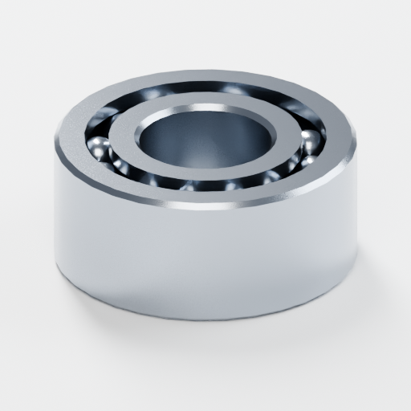
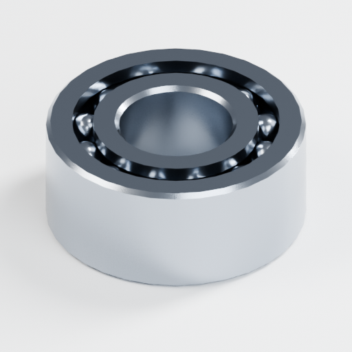
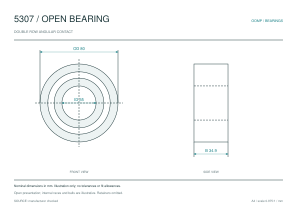

<!-- bearing-catalogue:start -->
# 5307 bearing - 35 x 80 x 34.9 mm

## Summary

Double row angular contact bearing: 35 mm bore, 80 mm outside diameter and 34.9 mm width.

| Product view | Isometric view |
| --- | --- |
|  |  |

Generated catalogue illustrations; the open internal geometry is illustrative.

## Details

**OOMP ID:** `hardware_bearing_5300_series_5307_size_35_mm_id_80_mm_od_34.9_mm_depth`

| Dimension | Nominal value |
| --- | --- |
| Bore / ID | 35 mm |
| Outside diameter / OD | 80 mm |
| Width / B | 34.9 mm |
| Catalogue contact angle | 25 degrees |

**Dimension evidence:** manufacturer checked (review retained from 2026-10-27).

Nominal presentation model. Raceways, pitch circle, chamfers and retainer geometry are illustrative; ball count/diameter are illustrative unless individually sourced. Not a manufacturer reconstruction, load-rating model or manufacturing/tolerance certification. Unspecified closure is presented open. The mesh shows open races and balls; retainers, seals and exact contact surfaces are omitted.

Contact-angle authority: **manufacturer family**. The mesh does not reconstruct the manufacturer contact surfaces.



[Printable A4 dimension sheet](working_dimension_a4.pdf) · [1:1 outline](working_svg.svg)

### Source evidence

- [https://www.nsk.com/content/dam/nsk/am/en_us/documents/bearings-americas/Bearing-and-Linear-Replacement-Guide.pdf](https://www.nsk.com/content/dam/nsk/am/en_us/documents/bearings-americas/Bearing-and-Linear-Replacement-Guide.pdf)

[Retained research and corrected dimensions](../../source_file/solidcraft/) · [Editable declaration](../../working_oomp_declarations_bearing.py)

## Parts

[Canonical part folder](.) · [Metadata](working.yaml) · [Browse this series](../../navigation/5300/README.md)

### Files

- [Editable OpenSCAD geometry](3dpr.scad)
- [Full model / GLB / metres, Y-up](three_d_model/model_full.glb)
- [Lightweight model / GLB / metres, Y-up](three_d_model/model_display.glb)
- [Editable Blender studio](three_d_model/studio.blend)
- [Product render / 2048 px](three_d_model/render_product_high.png)
- [Isometric render / 2048 px](three_d_model/render_high.png)
- [Populated model and render recipe](three_d_model/parameters.json)
- [Mesh measurements and artifact hashes](three_d_model/manifest.json)
- [Retained native CAD success manifest](solidcraft/latest_success.json)
- [76.2 x 50.8 mm label](label_bearing_3x2.pdf)
- [38.1 x 25.4 mm label](label_bearing_1_5x1.pdf)
- [Retained editable native bearing / SolidCraft](solidcraft/generations/9fcc89c0c363b751_20261027T115746Z_2a59a7a8/bearing_5307_open.solidcraft)

### Orthographic views

| Quality | Isometric | Front | Back | Left | Right | Top | Bottom |
| --- | --- | --- | --- | --- | --- | --- | --- |
| Full | [Isometric](three_d_model/full/isometric.svg) | [Front](three_d_model/full/front.svg) | [Back](three_d_model/full/back.svg) | [Left](three_d_model/full/left.svg) | [Right](three_d_model/full/right.svg) | [Top](three_d_model/full/top.svg) | [Bottom](three_d_model/full/bottom.svg) |
| Display | [Isometric](three_d_model/display/isometric.svg) | [Front](three_d_model/display/front.svg) | [Back](three_d_model/display/back.svg) | [Left](three_d_model/display/left.svg) | [Right](three_d_model/display/right.svg) | [Top](three_d_model/display/top.svg) | [Bottom](three_d_model/display/bottom.svg) |

## Assembly

No installation procedure is established for this generic size record. Select the required closure, clearance, tolerance and load rating from the actual purchased bearing specification.

<details>
<summary>Complete OOMP metadata</summary>

```yaml
depth: 34.9
id: hardware_bearing_5300_series_5307_size_35_mm_id_80_mm_od_34.9_mm_depth
od: 80.0
series: '5300'
size: '5307'
svg_details:
  svg_name: bearing_dimension
  title: 5307 / OPEN BEARING
  family: DOUBLE ROW ANGULAR CONTACT
  dimensions_mm:
    bore: 35.0
    outside: 80.0
    width: 34.9
    contact_angle_deg: 25.0
  sheet_width_mm: 297
  sheet_height_mm: 210
  ink: '#183336'
  accent: '#147d83'
  muted: '#61767a'
  paper: '#ffffff'
  race_face_fill: '#edf3f3'
  inner_race_face_outside_mm: 51.0086
  outer_race_face_inside_mm: 63.9914
  line_width_mm: 0.45
  font_family: Helvetica
  dimension_font_mm: 4
  title_font_mm: 9
  front_centre_mm:
  - 79
  - 103
  side_centre_mm:
  - 211
  - 103
  max_view_width_mm: 78
  max_side_width_mm: 55
  dimension_offset_mm: 12
  arrow_size_mm: 2
  note: Nominal dimensions in mm. Illustration only; no tolerances or fit allowances.
  authority: manufacturer checked
  internal_note: Open presentation; internal races and balls are illustrative. Retainers
    omitted.
  layout:
    left_margin_mm: 14
    right_margin_mm: 283
    title_y_mm: 22
    family_y_mm: 33
    family_font_mm: 3.5
    brand: OOMP / BEARINGS
    brand_font_mm: 3.5
    header_rule_y_mm: 40
    view_caption_y_mm: 173
    view_caption_font_mm: 3
    front_caption: FRONT VIEW
    side_caption: SIDE VIEW
    footer_rule_y_mm: 180
    note_y_mm: 187
    internal_note_y_mm: 194
    note_font_mm: 3.2
    source_y_mm: 202
    source_font_mm: 3
    source_prefix: 'SOURCE: '
    scale_prefix: A4 / scale
  dimension_style:
    line_width_mm: 0.25
    arrow_half_width_ratio: 0.3
    text_gap_mm: 2
    extension_mm: 2
    width_extension_mm: 3
    centre_extension_mm: 5
    dash_pattern_mm:
    - 2
    - 1
    flange_leader_offset_mm:
    - -13
    - 11
    flange_text_offset_mm:
    - -13
    - 16
    flange_font_mm: 3.5
  outline:
    ink: black
    line_width_mm: 0.1
taxonomy_1: hardware
taxonomy_10: ''
taxonomy_11: ''
taxonomy_12: ''
taxonomy_13: ''
taxonomy_14: ''
taxonomy_15: ''
taxonomy_2: bearing
taxonomy_3: 5300_series
taxonomy_4: 5307_size
taxonomy_5: 35_mm_id
taxonomy_6: 80_mm_od
taxonomy_7: 34.9_mm_depth
taxonomy_8: ''
taxonomy_9: ''
weight: '795'
width: 34.9
dimension_selection:
  policy: standard_metric_open_catalogue
  previous_id: hardware_bearing_5300_series_5307_size_35_mm_id_80_mm_od_34.92_mm_depth
  sources:
  - https://www.nsk.com/content/dam/nsk/am/en_us/documents/bearings-americas/Bearing-and-Linear-Replacement-Guide.pdf
  note: User selected standard catalogue variants on 2026-10-27; no sales ranking
    asserted.
url_chat: https://chatgpt.com/c/6ab866a3-b620-83ed-9ecb-ec12ac864b85
run_action: true
run_oomp: true
run_oomp_populate: true
run_scad: false
generate_stl: false
taxonomy_1_upper: HARDWARE
taxonomy_1_upper_length_1: H
taxonomy_1_upper_length_2: HA
taxonomy_1_upper_length_3: HAR
taxonomy_1_upper_length_4: HARD
taxonomy_1_upper_length_5: HARDW
taxonomy_1_length_1: h
taxonomy_1_length_2: ha
taxonomy_1_length_3: har
taxonomy_1_length_4: hard
taxonomy_1_length_5: hardw
taxonomy_1_capital: Hardware
taxonomy_1_first_letter: h
taxonomy_1_first_letter_upper: H
taxonomy_2_upper: BEARING
taxonomy_2_upper_length_1: B
taxonomy_2_upper_length_2: BE
taxonomy_2_upper_length_3: BEA
taxonomy_2_upper_length_4: BEAR
taxonomy_2_upper_length_5: BEARI
taxonomy_2_length_1: b
taxonomy_2_length_2: be
taxonomy_2_length_3: bea
taxonomy_2_length_4: bear
taxonomy_2_length_5: beari
taxonomy_2_capital: Bearing
taxonomy_2_first_letter: b
taxonomy_2_first_letter_upper: B
taxonomy_3_upper: 5300_SERIES
taxonomy_3_upper_length_1: '5'
taxonomy_3_upper_length_2: '53'
taxonomy_3_upper_length_3: '530'
taxonomy_3_upper_length_4: '5300'
taxonomy_3_upper_length_5: '5300_'
taxonomy_3_length_1: '5'
taxonomy_3_length_2: '53'
taxonomy_3_length_3: '530'
taxonomy_3_length_4: '5300'
taxonomy_3_length_5: '5300_'
taxonomy_3_capital: 5300 Series
taxonomy_3_first_letter: '5'
taxonomy_3_first_letter_upper: '5'
taxonomy_4_upper: 5307_SIZE
taxonomy_4_upper_length_1: '5'
taxonomy_4_upper_length_2: '53'
taxonomy_4_upper_length_3: '530'
taxonomy_4_upper_length_4: '5307'
taxonomy_4_upper_length_5: '5307_'
taxonomy_4_length_1: '5'
taxonomy_4_length_2: '53'
taxonomy_4_length_3: '530'
taxonomy_4_length_4: '5307'
taxonomy_4_length_5: '5307_'
taxonomy_4_capital: 5307 Size
taxonomy_4_first_letter: '5'
taxonomy_4_first_letter_upper: '5'
taxonomy_5_upper: 35_MM_ID
taxonomy_5_upper_length_1: '3'
taxonomy_5_upper_length_2: '35'
taxonomy_5_upper_length_3: '35_'
taxonomy_5_upper_length_4: 35_M
taxonomy_5_upper_length_5: 35_MM
taxonomy_5_length_1: '3'
taxonomy_5_length_2: '35'
taxonomy_5_length_3: '35_'
taxonomy_5_length_4: 35_m
taxonomy_5_length_5: 35_mm
taxonomy_5_capital: 35 mm Id
taxonomy_5_first_letter: '3'
taxonomy_5_first_letter_upper: '3'
taxonomy_6_upper: 80_MM_OD
taxonomy_6_upper_length_1: '8'
taxonomy_6_upper_length_2: '80'
taxonomy_6_upper_length_3: '80_'
taxonomy_6_upper_length_4: 80_M
taxonomy_6_upper_length_5: 80_MM
taxonomy_6_length_1: '8'
taxonomy_6_length_2: '80'
taxonomy_6_length_3: '80_'
taxonomy_6_length_4: 80_m
taxonomy_6_length_5: 80_mm
taxonomy_6_capital: 80 mm Od
taxonomy_6_first_letter: '8'
taxonomy_6_first_letter_upper: '8'
taxonomy_7_upper: 34.9_MM_DEPTH
taxonomy_7_upper_length_1: '3'
taxonomy_7_upper_length_2: '34'
taxonomy_7_upper_length_3: '34.'
taxonomy_7_upper_length_4: '34.9'
taxonomy_7_upper_length_5: '34.9_'
taxonomy_7_length_1: '3'
taxonomy_7_length_2: '34'
taxonomy_7_length_3: '34.'
taxonomy_7_length_4: '34.9'
taxonomy_7_length_5: '34.9_'
taxonomy_7_capital: 34.9 mm Depth
taxonomy_7_first_letter: '3'
taxonomy_7_first_letter_upper: '3'
id_no_class: hardware_bearing_5300_series_5307_size_35_mm_id_80_mm_od_34.9_mm_depth
id_no_type: hardware_bearing_5300_series_5307_size_35_mm_id_80_mm_od_34.9_mm_depth
id_no_size: hardware_bearing_5300_series_size_35_mm_id_80_mm_od_34.9_mm_depth
oomp_key: oomp_hardware_bearing_5300_series_5307_size_35_mm_id_80_mm_od_34.9_mm_depth
link_github: https://github.com/oomlout/oomp_bearing_version_5/tree/main/parts/hardware_bearing_5300_series_5307_size_35_mm_id_80_mm_od_34.9_mm_depth
link_main: https://github.com/oomlout/oomlout_oomp_version_1_messy/tree/main/parts/hardware_bearing_5300_series_5307_size_35_mm_id_80_mm_od_34.9_mm_depth
link_redirect: https://github.com/oomlout/oomlout_oomp_version_1_messy/tree/main/parts/hardware_bearing_5300_series_5307_size_35_mm_id_80_mm_od_34.9_mm_depth
directory: parts/hardware_bearing_5300_series_5307_size_35_mm_id_80_mm_od_34.9_mm_depth
name: 5307 bearing
name_no_class: Hardware Bearing 5300 Series 5307 Size 35 Mm Id 80 Mm Od 34.9 Mm Depth
name_no_type: Hardware Bearing 5300 Series 5307 Size 35 Mm Id 80 Mm Od 34.9 Mm Depth
name_no_size: Hardware Bearing 5300 Series Size 35 Mm Id 80 Mm Od 34.9 Mm Depth
md5: c12200f87cef9f1a9d7b7187a45b5a46
md5_5: c1220
md5_5_upper: C1220
md5_6: c12200
md5_6_upper: C12200
md5_6_alpha: 7jabk
md5_6_alpha_upper: 7JABK
md5_10: c12200f87c
md5_10_upper: C12200F87C
bip_39_full_array:
- scorpion
- avoid
- dignity
- what
- wheat
- minute
- invest
- hotel
- marble
- carpet
- story
- million
bip_39_full_space: scorpion avoid dignity what wheat minute invest hotel marble carpet
  story million
bip_39_full_no_space: scorpionavoiddignitywhatwheatminuteinvesthotelmarblecarpetstorymillion
bip_39_full_underscore: scorpion_avoid_dignity_what_wheat_minute_invest_hotel_marble_carpet_story_million
bip_39_2_word_array:
- scorpion
- avoid
bip_39_2_word_space: scorpion avoid
bip_39_2_word_no_space: scorpionavoid
bip_39_2_word_underscore: scorpion_avoid
bip_39_3_word_array:
- scorpion
- avoid
- dignity
bip_39_3_word_space: scorpion avoid dignity
bip_39_3_word_no_space: scorpionavoiddignity
bip_39_3_word_underscore: scorpion_avoid_dignity
name_space: hardware bearing 5300 series 5307 size 35 mm id 80 mm od 34.9 mm depth
name_proper: 5307 bearing
name_upper: HARDWARE BEARING 5300 SERIES 5307 SIZE 35 MM ID 80 MM OD 34.9 MM DEPTH
oomlout_ai_roboclick_1:
  file_test: ''
  actions:
  - command: text_jinja_template
    description: Bold bearing label 3x2
    file_template: C:\od\OneDrive\docs\oomp_bearing\source_file\template_jinja\label_bearing_bold\3x2.svg.j2
    file_output: label_bearing_bold_3x2.svg
    dict_data_yaml_files:
      label_source: C:\od\OneDrive\docs\oomp_bearing\parts_source\hardware_bearing_5300_series_5307_size_35_mm_id_80_mm_od_34_9_mm_depth\working.yaml
      label_manual: C:\od\OneDrive\docs\oomp_bearing\parts\hardware_bearing_5300_series_5307_size_35_mm_id_80_mm_od_34.9_mm_depth\working_manual.yaml
    convert_to_pdf: false
    convert_to_png: false
oomlout_ai_roboclick_2:
  file_test: ''
  actions:
  - command: text_jinja_template
    description: Bold bearing label 1_5x1
    file_template: C:\od\OneDrive\docs\oomp_bearing\source_file\template_jinja\label_bearing_bold\1_5x1.svg.j2
    file_output: label_bearing_bold_1_5x1.svg
    dict_data_yaml_files:
      label_source: C:\od\OneDrive\docs\oomp_bearing\parts_source\hardware_bearing_5300_series_5307_size_35_mm_id_80_mm_od_34_9_mm_depth\working.yaml
      label_manual: C:\od\OneDrive\docs\oomp_bearing\parts\hardware_bearing_5300_series_5307_size_35_mm_id_80_mm_od_34.9_mm_depth\working_manual.yaml
    convert_to_pdf: false
    convert_to_png: false
catalogue_schema: oomp_bearing_v5
oomp_id: hardware_bearing_5300_series_5307_size_35_mm_id_80_mm_od_34.9_mm_depth
family: double_row_angular_contact
dimensions_mm:
  bore: 35.0
  outside: 80.0
  width: 34.9
  contact_angle_deg: 25.0
bore: 35.0
dimension_authority: manufacturer_checked
source_checked: '2026-10-27'
sources:
- https://www.nsk.com/content/dam/nsk/am/en_us/documents/bearings-americas/Bearing-and-Linear-Replacement-Guide.pdf
model_note: Nominal presentation model. Raceways, pitch circle, chamfers and retainer
  geometry are illustrative; ball count/diameter are illustrative unless individually
  sourced. Not a manufacturer reconstruction, load-rating model or manufacturing/tolerance
  certification. Unspecified closure is presented open. The mesh shows open races
  and balls; retainers, seals and exact contact surfaces are omitted.
closure: open
three_d_model_details:
  schema_version: 1
  generator: bearing_open
  output_folder: three_d_model
  parameters:
    bore: 35.0
    outside: 80.0
    width: 34.9
    edge: 1.3499999999999999
    pitch_radius: 28.75
    ball_radius: 5.234999999999999
    groove_radius: 5.49675
    inner_shoulder: 25.5043
    outer_shoulder: 31.9957
    cage_half_width: 2.87925
    cage_low: 4.973249999999999
    cage_high: 6.020249999999999
    window_radius: 2.5127999999999995
    contact_angle_deg: 25.0
    contact_offset: 0.130875
    identity: hardware_bearing_5300_series_5307_size_35_mm_id_80_mm_od_34.9_mm_depth
    specification: 5307 / 35 x 80 x 34.9 mm
    characteristic_dimension_mm: 80.0
    characteristic_dimension_basis: maximum nominal envelope dimension
    ball_count: 24
    balls_per_row: 12
    row_count: 2
    ball_specification: illustrative
    contact_angle_authority: manufacturer_family
    row_centres_z:
    - 8.725
    - 26.174999999999997
    components:
    - name: outer_race
      shape: revolved_profile
      profile_mm:
      - - 38.65
        - 0
      - - 40.0
        - 1.3499999999999999
      - - 40.0
        - 33.55
      - - 38.65
        - 34.9
      - - 31.9957
        - 34.9
      - - 31.9957
        - 33.55
      - - 31.9957
        - 31.671749999999996
      - - 31.9957
        - 31.3969125
      - - 31.9957
        - 31.122075
      - - 31.9957
        - 30.8472375
      - - 32.048049999999996
        - 30.5724
      - - 32.38575837977357
        - 30.297562499999998
      - - 32.67546467145929
        - 30.022724999999998
      - - 32.927168356056974
        - 29.747887499999997
      - - 33.1474
        - 29.473049999999997
      - - 33.34069131420789
        - 29.198212499999997
      - - 33.510325138252114
        - 28.923374999999997
      - - 33.65875470955656
        - 28.648537499999996
      - - 33.7878545902497
        - 28.3737
      - - 33.89907891215446
        - 28.0988625
      - - 33.99356530538859
        - 27.824025
      - - 34.07220530206641
        - 27.5491875
      - - 34.13569309745737
        - 27.27435
      - - 34.18455975216427
        - 26.999512499999998
      - - 34.219197194915814
        - 26.724674999999998
      - - 34.23987476278774
        - 26.449837499999997
      - - 34.24675
        - 26.174999999999997
      - - 34.23987476278774
        - 25.9001625
      - - 34.219197194915814
        - 25.625324999999997
      - - 34.18455975216427
        - 25.3504875
      - - 34.13569309745737
        - 25.075649999999996
      - - 34.07220530206641
        - 24.8008125
      - - 33.9935653053886
        - 24.525975
      - - 33.89907891215446
        - 24.2511375
      - - 33.7878545902497
        - 23.9763
      - - 33.65875470955656
        - 23.701462499999998
      - - 33.510325138252114
        - 23.426624999999998
      - - 33.34069131420789
        - 23.151787499999998
      - - 33.1474
        - 22.876949999999997
      - - 32.927168356056974
        - 22.602112499999997
      - - 32.675464671459295
        - 22.327275
      - - 32.38575837977358
        - 22.0524375
      - - 32.04805
        - 21.7776
      - - 31.9957
        - 21.5027625
      - - 31.9957
        - 21.227925
      - - 31.9957
        - 20.9530875
      - - 31.9957
        - 20.67825
      - - 31.9957
        - 14.22175
      - - 31.9957
        - 13.9469125
      - - 31.9957
        - 13.672075
      - - 31.9957
        - 13.3972375
      - - 32.04805
        - 13.122399999999999
      - - 32.38575837977357
        - 12.847562499999999
      - - 32.675464671459295
        - 12.572724999999998
      - - 32.92716835605698
        - 12.297887499999998
      - - 33.147400000000005
        - 12.023049999999998
      - - 33.34069131420789
        - 11.748212500000001
      - - 33.510325138252114
        - 11.473374999999997
      - - 33.65875470955656
        - 11.1985375
      - - 33.7878545902497
        - 10.9237
      - - 33.89907891215446
        - 10.6488625
      - - 33.99356530538859
        - 10.374025
      - - 34.07220530206641
        - 10.0991875
      - - 34.13569309745738
        - 9.824349999999999
      - - 34.18455975216427
        - 9.549512499999999
      - - 34.219197194915814
        - 9.274674999999998
      - - 34.23987476278774
        - 8.9998375
      - - 34.24675
        - 8.725
      - - 34.23987476278774
        - 8.450162500000001
      - - 34.219197194915814
        - 8.175325
      - - 34.18455975216427
        - 7.9004875
      - - 34.13569309745738
        - 7.625649999999999
      - - 34.07220530206641
        - 7.350812499999999
      - - 33.99356530538859
        - 7.075975
      - - 33.89907891215446
        - 6.801137499999999
      - - 33.7878545902497
        - 6.5263
      - - 33.65875470955656
        - 6.2514625
      - - 33.510325138252114
        - 5.976625
      - - 33.34069131420789
        - 5.7017875
      - - 33.1474
        - 5.42695
      - - 32.927168356056974
        - 5.152112499999999
      - - 32.67546467145929
        - 4.877275
      - - 32.38575837977357
        - 4.6024375
      - - 32.04805
        - 4.3276
      - - 31.9957
        - 4.0527625
      - - 31.9957
        - 3.7779249999999998
      - - 31.9957
        - 3.5030875
      - - 31.9957
        - 3.22825
      - - 31.9957
        - 1.3499999999999999
      - - 31.9957
        - 0.0
      - - 38.65
        - 0
    - name: inner_race
      shape: revolved_profile
      profile_mm:
      - - 25.5043
        - 0.0
      - - 25.5043
        - 1.3499999999999999
      - - 25.5043
        - 3.22825
      - - 25.5043
        - 3.5030875
      - - 25.5043
        - 3.7779249999999998
      - - 25.5043
        - 4.0527625
      - - 25.45195
        - 4.3276
      - - 25.11424162022643
        - 4.6024375
      - - 24.82453532854071
        - 4.877275
      - - 24.572831643943022
        - 5.152112499999999
      - - 24.352600000000002
        - 5.42695
      - - 24.159308685792112
        - 5.7017875
      - - 23.989674861747886
        - 5.976625
      - - 23.841245290443435
        - 6.2514625
      - - 23.7121454097503
        - 6.5263
      - - 23.600921087845542
        - 6.801137499999999
      - - 23.506434694611404
        - 7.075975
      - - 23.427794697933596
        - 7.350812499999999
      - - 23.364306902542626
        - 7.625649999999999
      - - 23.31544024783573
        - 7.9004875
      - - 23.280802805084186
        - 8.175325
      - - 23.26012523721226
        - 8.450162500000001
      - - 23.25325
        - 8.725
      - - 23.26012523721226
        - 8.9998375
      - - 23.280802805084186
        - 9.274674999999998
      - - 23.31544024783573
        - 9.549512499999999
      - - 23.364306902542626
        - 9.824349999999999
      - - 23.427794697933596
        - 10.0991875
      - - 23.506434694611404
        - 10.374025
      - - 23.600921087845542
        - 10.6488625
      - - 23.7121454097503
        - 10.9237
      - - 23.84124529044344
        - 11.1985375
      - - 23.989674861747886
        - 11.473374999999997
      - - 24.159308685792112
        - 11.748212500000001
      - - 24.3526
        - 12.023049999999998
      - - 24.572831643943022
        - 12.297887499999998
      - - 24.82453532854071
        - 12.572724999999998
      - - 25.114241620226426
        - 12.847562499999999
      - - 25.45195
        - 13.122399999999999
      - - 25.5043
        - 13.3972375
      - - 25.5043
        - 13.672075
      - - 25.5043
        - 13.9469125
      - - 25.5043
        - 14.22175
      - - 25.5043
        - 20.67825
      - - 25.5043
        - 20.9530875
      - - 25.5043
        - 21.227925
      - - 25.5043
        - 21.5027625
      - - 25.451949999999997
        - 21.7776
      - - 25.114241620226426
        - 22.0524375
      - - 24.824535328540705
        - 22.327275
      - - 24.572831643943022
        - 22.602112499999997
      - - 24.352600000000002
        - 22.876949999999997
      - - 24.159308685792112
        - 23.151787499999998
      - - 23.989674861747886
        - 23.426624999999998
      - - 23.841245290443435
        - 23.701462499999998
      - - 23.7121454097503
        - 23.9763
      - - 23.600921087845542
        - 24.2511375
      - - 23.506434694611404
        - 24.525975
      - - 23.427794697933596
        - 24.8008125
      - - 23.364306902542626
        - 25.075649999999996
      - - 23.31544024783573
        - 25.3504875
      - - 23.280802805084186
        - 25.625324999999997
      - - 23.26012523721226
        - 25.9001625
      - - 23.25325
        - 26.174999999999997
      - - 23.26012523721226
        - 26.449837499999997
      - - 23.280802805084186
        - 26.724674999999998
      - - 23.31544024783573
        - 26.999512499999998
      - - 23.364306902542626
        - 27.27435
      - - 23.427794697933596
        - 27.5491875
      - - 23.506434694611407
        - 27.824025
      - - 23.600921087845542
        - 28.0988625
      - - 23.7121454097503
        - 28.3737
      - - 23.841245290443435
        - 28.648537499999996
      - - 23.989674861747886
        - 28.923374999999997
      - - 24.159308685792112
        - 29.198212499999997
      - - 24.352600000000002
        - 29.473049999999997
      - - 24.572831643943022
        - 29.747887499999997
      - - 24.824535328540712
        - 30.022724999999998
      - - 25.11424162022643
        - 30.297562499999998
      - - 25.451950000000004
        - 30.5724
      - - 25.5043
        - 30.8472375
      - - 25.5043
        - 31.122075
      - - 25.5043
        - 31.3969125
      - - 25.5043
        - 31.671749999999996
      - - 25.5043
        - 33.55
      - - 25.5043
        - 34.9
      - - 18.85
        - 34.9
      - - 17.5
        - 33.55
      - - 17.5
        - 1.3499999999999999
      - - 18.85
        - 0
      - - 25.5043
        - 0.0
    - name: ball_row_1_1
      shape: sphere
      radius_mm: 5.234999999999999
      centre_mm:
      - 28.75
      - 0.0
      - 8.725
    - name: ball_row_1_2
      shape: sphere
      radius_mm: 5.234999999999999
      centre_mm:
      - 24.898230358802614
      - 14.374999999999998
      - 8.725
    - name: ball_row_1_3
      shape: sphere
      radius_mm: 5.234999999999999
      centre_mm:
      - 14.375000000000004
      - 24.89823035880261
      - 8.725
    - name: ball_row_1_4
      shape: sphere
      radius_mm: 5.234999999999999
      centre_mm:
      - 1.7604297737743203e-15
      - 28.75
      - 8.725
    - name: ball_row_1_5
      shape: sphere
      radius_mm: 5.234999999999999
      centre_mm:
      - -14.374999999999993
      - 24.898230358802614
      - 8.725
    - name: ball_row_1_6
      shape: sphere
      radius_mm: 5.234999999999999
      centre_mm:
      - -24.898230358802614
      - 14.374999999999998
      - 8.725
    - name: ball_row_1_7
      shape: sphere
      radius_mm: 5.234999999999999
      centre_mm:
      - -28.75
      - 3.5208595475486406e-15
      - 8.725
    - name: ball_row_1_8
      shape: sphere
      radius_mm: 5.234999999999999
      centre_mm:
      - -24.898230358802618
      - -14.374999999999993
      - 8.725
    - name: ball_row_1_9
      shape: sphere
      radius_mm: 5.234999999999999
      centre_mm:
      - -14.375000000000012
      - -24.898230358802607
      - 8.725
    - name: ball_row_1_10
      shape: sphere
      radius_mm: 5.234999999999999
      centre_mm:
      - -5.28128932132296e-15
      - -28.75
      - 8.725
    - name: ball_row_1_11
      shape: sphere
      radius_mm: 5.234999999999999
      centre_mm:
      - 14.375000000000004
      - -24.89823035880261
      - 8.725
    - name: ball_row_1_12
      shape: sphere
      radius_mm: 5.234999999999999
      centre_mm:
      - 24.898230358802603
      - -14.375000000000012
      - 8.725
    - name: ball_row_2_1
      shape: sphere
      radius_mm: 5.234999999999999
      centre_mm:
      - 28.75
      - 0.0
      - 26.174999999999997
    - name: ball_row_2_2
      shape: sphere
      radius_mm: 5.234999999999999
      centre_mm:
      - 24.898230358802614
      - 14.374999999999998
      - 26.174999999999997
    - name: ball_row_2_3
      shape: sphere
      radius_mm: 5.234999999999999
      centre_mm:
      - 14.375000000000004
      - 24.89823035880261
      - 26.174999999999997
    - name: ball_row_2_4
      shape: sphere
      radius_mm: 5.234999999999999
      centre_mm:
      - 1.7604297737743203e-15
      - 28.75
      - 26.174999999999997
    - name: ball_row_2_5
      shape: sphere
      radius_mm: 5.234999999999999
      centre_mm:
      - -14.374999999999993
      - 24.898230358802614
      - 26.174999999999997
    - name: ball_row_2_6
      shape: sphere
      radius_mm: 5.234999999999999
      centre_mm:
      - -24.898230358802614
      - 14.374999999999998
      - 26.174999999999997
    - name: ball_row_2_7
      shape: sphere
      radius_mm: 5.234999999999999
      centre_mm:
      - -28.75
      - 3.5208595475486406e-15
      - 26.174999999999997
    - name: ball_row_2_8
      shape: sphere
      radius_mm: 5.234999999999999
      centre_mm:
      - -24.898230358802618
      - -14.374999999999993
      - 26.174999999999997
    - name: ball_row_2_9
      shape: sphere
      radius_mm: 5.234999999999999
      centre_mm:
      - -14.375000000000012
      - -24.898230358802607
      - 26.174999999999997
    - name: ball_row_2_10
      shape: sphere
      radius_mm: 5.234999999999999
      centre_mm:
      - -5.28128932132296e-15
      - -28.75
      - 26.174999999999997
    - name: ball_row_2_11
      shape: sphere
      radius_mm: 5.234999999999999
      centre_mm:
      - 14.375000000000004
      - -24.89823035880261
      - 26.174999999999997
    - name: ball_row_2_12
      shape: sphere
      radius_mm: 5.234999999999999
      centre_mm:
      - 24.898230358802603
      - -14.375000000000012
      - 26.174999999999997
  modelling_note: Nominal presentation model. Raceways, pitch circle, chamfers and
    retainer geometry are illustrative; ball count/diameter are illustrative unless
    individually sourced. Not a manufacturer reconstruction, load-rating model or
    manufacturing/tolerance certification. Unspecified closure is presented open.
    The mesh shows open races and balls; retainers, seals and exact contact surfaces
    are omitted.
  dimension_authority: manufacturer_checked
  model_formats:
  - glb
  variants:
    full:
      angular_segments: 128
      sphere_subdivisions: 3
    display:
      angular_segments: 32
      sphere_subdivisions: 2
  views:
  - isometric
  - front
  - back
  - left
  - right
  - top
  - bottom
  material:
    name: Illustrative polished bearing steel
    base_colour_srgb:
    - 0.62
    - 0.65
    - 0.69
    metallic: 1.0
    roughness: 0.22
    roughness_variation: 0.045
    coat_weight: 0.02
    coat_roughness: 0.28
    microtexture_spacing_mm: 0.025
    microtexture_height_um: 0.8
    note: Illustrative bearing steel; material grade and finish are not specified.
  studio:
    engine: cycles
    device: auto
    seed: 7991
    low_samples: 24
    high_samples: 48
    adaptive_threshold: 0.015
    denoise: true
    view_transform: AgX
    look: AgX - Medium High Contrast
    exposure: 0.0
    world_colour:
    - 0.78
    - 0.82
    - 0.9
    world_strength: 0.35
    floor_colour_srgb:
    - 0.93
    - 0.935
    - 0.94
    floor_roughness: 0.55
    framing_margin: 0.13
    lights:
    - name: Key softbox
      position:
      - -3
      - -4
      - 6
      power: 650.0
      width: 4.0
      height: 5.0
      colour:
      - 1.0
      - 0.96
      - 0.9
    - name: Fill softbox
      position:
      - 4
      - -1
      - 3
      power: 330.0
      width: 3.0
      height: 4.0
      colour:
      - 0.9
      - 0.95
      - 1.0
    - name: Rim strip
      position:
      - 1
      - 4
      - 4
      power: 850.0
      width: 1.2
      height: 5.0
      colour:
      - 1.0
      - 1.0
      - 1.0
    poses:
      isometric:
        camera_eye:
        - 1
        - -1
        - 1
        projection: orthographic
        orientation: principal axis Z up
      product:
        camera_eye:
        - -6
        - -10
        - 6
        projection: orthographic
        orientation: resting on lower face
        yaw_degrees: -12.0
        support: Stable convex-hull support using actual mesh centre of mass.
        resting_axis: face
  renders:
    low:
      file: render_low.png
      variant: display
      pixels: 512
      view: isometric
    high:
      file: render_high.png
      variant: full
      pixels: 2048
      view: isometric
    product_low:
      file: render_product_low.png
      variant: display
      pixels: 512
      view: product
    product_high:
      file: render_product_high.png
      variant: full
      pixels: 2048
      view: product
oobb_type: bearing_open
oobb_details:
  oobb_type: bearing_open
  run_scad: true
  run_solidcraft: false
  angular_segments: 128
  components:
  - name: outer_race
    shape: revolved_profile
    profile_mm:
    - - 38.65
      - 0
    - - 40.0
      - 1.3499999999999999
    - - 40.0
      - 33.55
    - - 38.65
      - 34.9
    - - 31.9957
      - 34.9
    - - 31.9957
      - 33.55
    - - 31.9957
      - 31.671749999999996
    - - 31.9957
      - 31.3969125
    - - 31.9957
      - 31.122075
    - - 31.9957
      - 30.8472375
    - - 32.048049999999996
      - 30.5724
    - - 32.38575837977357
      - 30.297562499999998
    - - 32.67546467145929
      - 30.022724999999998
    - - 32.927168356056974
      - 29.747887499999997
    - - 33.1474
      - 29.473049999999997
    - - 33.34069131420789
      - 29.198212499999997
    - - 33.510325138252114
      - 28.923374999999997
    - - 33.65875470955656
      - 28.648537499999996
    - - 33.7878545902497
      - 28.3737
    - - 33.89907891215446
      - 28.0988625
    - - 33.99356530538859
      - 27.824025
    - - 34.07220530206641
      - 27.5491875
    - - 34.13569309745737
      - 27.27435
    - - 34.18455975216427
      - 26.999512499999998
    - - 34.219197194915814
      - 26.724674999999998
    - - 34.23987476278774
      - 26.449837499999997
    - - 34.24675
      - 26.174999999999997
    - - 34.23987476278774
      - 25.9001625
    - - 34.219197194915814
      - 25.625324999999997
    - - 34.18455975216427
      - 25.3504875
    - - 34.13569309745737
      - 25.075649999999996
    - - 34.07220530206641
      - 24.8008125
    - - 33.9935653053886
      - 24.525975
    - - 33.89907891215446
      - 24.2511375
    - - 33.7878545902497
      - 23.9763
    - - 33.65875470955656
      - 23.701462499999998
    - - 33.510325138252114
      - 23.426624999999998
    - - 33.34069131420789
      - 23.151787499999998
    - - 33.1474
      - 22.876949999999997
    - - 32.927168356056974
      - 22.602112499999997
    - - 32.675464671459295
      - 22.327275
    - - 32.38575837977358
      - 22.0524375
    - - 32.04805
      - 21.7776
    - - 31.9957
      - 21.5027625
    - - 31.9957
      - 21.227925
    - - 31.9957
      - 20.9530875
    - - 31.9957
      - 20.67825
    - - 31.9957
      - 14.22175
    - - 31.9957
      - 13.9469125
    - - 31.9957
      - 13.672075
    - - 31.9957
      - 13.3972375
    - - 32.04805
      - 13.122399999999999
    - - 32.38575837977357
      - 12.847562499999999
    - - 32.675464671459295
      - 12.572724999999998
    - - 32.92716835605698
      - 12.297887499999998
    - - 33.147400000000005
      - 12.023049999999998
    - - 33.34069131420789
      - 11.748212500000001
    - - 33.510325138252114
      - 11.473374999999997
    - - 33.65875470955656
      - 11.1985375
    - - 33.7878545902497
      - 10.9237
    - - 33.89907891215446
      - 10.6488625
    - - 33.99356530538859
      - 10.374025
    - - 34.07220530206641
      - 10.0991875
    - - 34.13569309745738
      - 9.824349999999999
    - - 34.18455975216427
      - 9.549512499999999
    - - 34.219197194915814
      - 9.274674999999998
    - - 34.23987476278774
      - 8.9998375
    - - 34.24675
      - 8.725
    - - 34.23987476278774
      - 8.450162500000001
    - - 34.219197194915814
      - 8.175325
    - - 34.18455975216427
      - 7.9004875
    - - 34.13569309745738
      - 7.625649999999999
    - - 34.07220530206641
      - 7.350812499999999
    - - 33.99356530538859
      - 7.075975
    - - 33.89907891215446
      - 6.801137499999999
    - - 33.7878545902497
      - 6.5263
    - - 33.65875470955656
      - 6.2514625
    - - 33.510325138252114
      - 5.976625
    - - 33.34069131420789
      - 5.7017875
    - - 33.1474
      - 5.42695
    - - 32.927168356056974
      - 5.152112499999999
    - - 32.67546467145929
      - 4.877275
    - - 32.38575837977357
      - 4.6024375
    - - 32.04805
      - 4.3276
    - - 31.9957
      - 4.0527625
    - - 31.9957
      - 3.7779249999999998
    - - 31.9957
      - 3.5030875
    - - 31.9957
      - 3.22825
    - - 31.9957
      - 1.3499999999999999
    - - 31.9957
      - 0.0
    - - 38.65
      - 0
  - name: inner_race
    shape: revolved_profile
    profile_mm:
    - - 25.5043
      - 0.0
    - - 25.5043
      - 1.3499999999999999
    - - 25.5043
      - 3.22825
    - - 25.5043
      - 3.5030875
    - - 25.5043
      - 3.7779249999999998
    - - 25.5043
      - 4.0527625
    - - 25.45195
      - 4.3276
    - - 25.11424162022643
      - 4.6024375
    - - 24.82453532854071
      - 4.877275
    - - 24.572831643943022
      - 5.152112499999999
    - - 24.352600000000002
      - 5.42695
    - - 24.159308685792112
      - 5.7017875
    - - 23.989674861747886
      - 5.976625
    - - 23.841245290443435
      - 6.2514625
    - - 23.7121454097503
      - 6.5263
    - - 23.600921087845542
      - 6.801137499999999
    - - 23.506434694611404
      - 7.075975
    - - 23.427794697933596
      - 7.350812499999999
    - - 23.364306902542626
      - 7.625649999999999
    - - 23.31544024783573
      - 7.9004875
    - - 23.280802805084186
      - 8.175325
    - - 23.26012523721226
      - 8.450162500000001
    - - 23.25325
      - 8.725
    - - 23.26012523721226
      - 8.9998375
    - - 23.280802805084186
      - 9.274674999999998
    - - 23.31544024783573
      - 9.549512499999999
    - - 23.364306902542626
      - 9.824349999999999
    - - 23.427794697933596
      - 10.0991875
    - - 23.506434694611404
      - 10.374025
    - - 23.600921087845542
      - 10.6488625
    - - 23.7121454097503
      - 10.9237
    - - 23.84124529044344
      - 11.1985375
    - - 23.989674861747886
      - 11.473374999999997
    - - 24.159308685792112
      - 11.748212500000001
    - - 24.3526
      - 12.023049999999998
    - - 24.572831643943022
      - 12.297887499999998
    - - 24.82453532854071
      - 12.572724999999998
    - - 25.114241620226426
      - 12.847562499999999
    - - 25.45195
      - 13.122399999999999
    - - 25.5043
      - 13.3972375
    - - 25.5043
      - 13.672075
    - - 25.5043
      - 13.9469125
    - - 25.5043
      - 14.22175
    - - 25.5043
      - 20.67825
    - - 25.5043
      - 20.9530875
    - - 25.5043
      - 21.227925
    - - 25.5043
      - 21.5027625
    - - 25.451949999999997
      - 21.7776
    - - 25.114241620226426
      - 22.0524375
    - - 24.824535328540705
      - 22.327275
    - - 24.572831643943022
      - 22.602112499999997
    - - 24.352600000000002
      - 22.876949999999997
    - - 24.159308685792112
      - 23.151787499999998
    - - 23.989674861747886
      - 23.426624999999998
    - - 23.841245290443435
      - 23.701462499999998
    - - 23.7121454097503
      - 23.9763
    - - 23.600921087845542
      - 24.2511375
    - - 23.506434694611404
      - 24.525975
    - - 23.427794697933596
      - 24.8008125
    - - 23.364306902542626
      - 25.075649999999996
    - - 23.31544024783573
      - 25.3504875
    - - 23.280802805084186
      - 25.625324999999997
    - - 23.26012523721226
      - 25.9001625
    - - 23.25325
      - 26.174999999999997
    - - 23.26012523721226
      - 26.449837499999997
    - - 23.280802805084186
      - 26.724674999999998
    - - 23.31544024783573
      - 26.999512499999998
    - - 23.364306902542626
      - 27.27435
    - - 23.427794697933596
      - 27.5491875
    - - 23.506434694611407
      - 27.824025
    - - 23.600921087845542
      - 28.0988625
    - - 23.7121454097503
      - 28.3737
    - - 23.841245290443435
      - 28.648537499999996
    - - 23.989674861747886
      - 28.923374999999997
    - - 24.159308685792112
      - 29.198212499999997
    - - 24.352600000000002
      - 29.473049999999997
    - - 24.572831643943022
      - 29.747887499999997
    - - 24.824535328540712
      - 30.022724999999998
    - - 25.11424162022643
      - 30.297562499999998
    - - 25.451950000000004
      - 30.5724
    - - 25.5043
      - 30.8472375
    - - 25.5043
      - 31.122075
    - - 25.5043
      - 31.3969125
    - - 25.5043
      - 31.671749999999996
    - - 25.5043
      - 33.55
    - - 25.5043
      - 34.9
    - - 18.85
      - 34.9
    - - 17.5
      - 33.55
    - - 17.5
      - 1.3499999999999999
    - - 18.85
      - 0
    - - 25.5043
      - 0.0
  - name: ball_row_1_1
    shape: sphere
    radius_mm: 5.234999999999999
    centre_mm:
    - 28.75
    - 0.0
    - 8.725
  - name: ball_row_1_2
    shape: sphere
    radius_mm: 5.234999999999999
    centre_mm:
    - 24.898230358802614
    - 14.374999999999998
    - 8.725
  - name: ball_row_1_3
    shape: sphere
    radius_mm: 5.234999999999999
    centre_mm:
    - 14.375000000000004
    - 24.89823035880261
    - 8.725
  - name: ball_row_1_4
    shape: sphere
    radius_mm: 5.234999999999999
    centre_mm:
    - 1.7604297737743203e-15
    - 28.75
    - 8.725
  - name: ball_row_1_5
    shape: sphere
    radius_mm: 5.234999999999999
    centre_mm:
    - -14.374999999999993
    - 24.898230358802614
    - 8.725
  - name: ball_row_1_6
    shape: sphere
    radius_mm: 5.234999999999999
    centre_mm:
    - -24.898230358802614
    - 14.374999999999998
    - 8.725
  - name: ball_row_1_7
    shape: sphere
    radius_mm: 5.234999999999999
    centre_mm:
    - -28.75
    - 3.5208595475486406e-15
    - 8.725
  - name: ball_row_1_8
    shape: sphere
    radius_mm: 5.234999999999999
    centre_mm:
    - -24.898230358802618
    - -14.374999999999993
    - 8.725
  - name: ball_row_1_9
    shape: sphere
    radius_mm: 5.234999999999999
    centre_mm:
    - -14.375000000000012
    - -24.898230358802607
    - 8.725
  - name: ball_row_1_10
    shape: sphere
    radius_mm: 5.234999999999999
    centre_mm:
    - -5.28128932132296e-15
    - -28.75
    - 8.725
  - name: ball_row_1_11
    shape: sphere
    radius_mm: 5.234999999999999
    centre_mm:
    - 14.375000000000004
    - -24.89823035880261
    - 8.725
  - name: ball_row_1_12
    shape: sphere
    radius_mm: 5.234999999999999
    centre_mm:
    - 24.898230358802603
    - -14.375000000000012
    - 8.725
  - name: ball_row_2_1
    shape: sphere
    radius_mm: 5.234999999999999
    centre_mm:
    - 28.75
    - 0.0
    - 26.174999999999997
  - name: ball_row_2_2
    shape: sphere
    radius_mm: 5.234999999999999
    centre_mm:
    - 24.898230358802614
    - 14.374999999999998
    - 26.174999999999997
  - name: ball_row_2_3
    shape: sphere
    radius_mm: 5.234999999999999
    centre_mm:
    - 14.375000000000004
    - 24.89823035880261
    - 26.174999999999997
  - name: ball_row_2_4
    shape: sphere
    radius_mm: 5.234999999999999
    centre_mm:
    - 1.7604297737743203e-15
    - 28.75
    - 26.174999999999997
  - name: ball_row_2_5
    shape: sphere
    radius_mm: 5.234999999999999
    centre_mm:
    - -14.374999999999993
    - 24.898230358802614
    - 26.174999999999997
  - name: ball_row_2_6
    shape: sphere
    radius_mm: 5.234999999999999
    centre_mm:
    - -24.898230358802614
    - 14.374999999999998
    - 26.174999999999997
  - name: ball_row_2_7
    shape: sphere
    radius_mm: 5.234999999999999
    centre_mm:
    - -28.75
    - 3.5208595475486406e-15
    - 26.174999999999997
  - name: ball_row_2_8
    shape: sphere
    radius_mm: 5.234999999999999
    centre_mm:
    - -24.898230358802618
    - -14.374999999999993
    - 26.174999999999997
  - name: ball_row_2_9
    shape: sphere
    radius_mm: 5.234999999999999
    centre_mm:
    - -14.375000000000012
    - -24.898230358802607
    - 26.174999999999997
  - name: ball_row_2_10
    shape: sphere
    radius_mm: 5.234999999999999
    centre_mm:
    - -5.28128932132296e-15
    - -28.75
    - 26.174999999999997
  - name: ball_row_2_11
    shape: sphere
    radius_mm: 5.234999999999999
    centre_mm:
    - 14.375000000000004
    - -24.89823035880261
    - 26.174999999999997
  - name: ball_row_2_12
    shape: sphere
    radius_mm: 5.234999999999999
    centre_mm:
    - 24.898230358802603
    - -14.375000000000012
    - 26.174999999999997
label_details:
  size: '5307'
  dimensions: 35 x 80 x 34.9 mm
  formats_mm:
  - - 76.2
    - 50.8
  - - 38.1
    - 25.4
  ink: '#183336'
  accent: '#147d83'
  paper: '#ffffff'
  font_family: Helvetica
  view_box_mm:
  - 0
  - 0
  - 76.2
  - 50.8
  file_stems:
  - label_bearing_3x2
  - label_bearing_1_5x1
  brand: OOMP / BEARING
  brand_position_mm:
  - 5
  - 10
  brand_font_mm: 3
  size_position_mm:
  - 5
  - 29
  size_font_mm: 14
  dimensions_position_mm:
  - 5
  - 42
  dimensions_font_mm: 4
readme_details:
  title: 5307 bearing - 35 x 80 x 34.9 mm
  description: 'Double row angular contact bearing: 35 mm bore, 80 mm outside diameter
    and 34.9 mm width.'
```

</details>
<!-- bearing-catalogue:end -->
