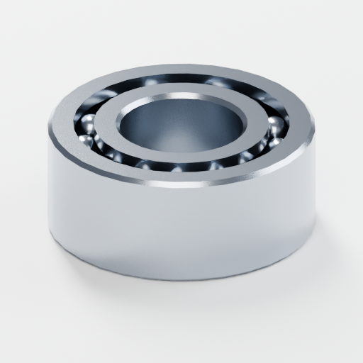
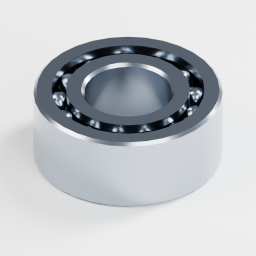
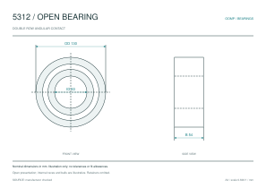

<!-- bearing-catalogue:start -->
# 5312 bearing - 60 x 130 x 54 mm

## Summary

Double row angular contact bearing: 60 mm bore, 130 mm outside diameter and 54 mm width.

| Product view | Isometric view |
| --- | --- |
|  |  |

Generated catalogue illustrations; the open internal geometry is illustrative.

## Details

**OOMP ID:** `hardware_bearing_5300_series_5312_size_60_mm_id_130_mm_od_54_mm_depth`

| Dimension | Nominal value |
| --- | --- |
| Bore / ID | 60 mm |
| Outside diameter / OD | 130 mm |
| Width / B | 54 mm |
| Catalogue contact angle | 25 degrees |

**Dimension evidence:** manufacturer checked (review retained from 2026-10-27).

Nominal presentation model. Raceways, pitch circle, chamfers and retainer geometry are illustrative; ball count/diameter are illustrative unless individually sourced. Not a manufacturer reconstruction, load-rating model or manufacturing/tolerance certification. Unspecified closure is presented open. The mesh shows open races and balls; retainers, seals and exact contact surfaces are omitted.

Contact-angle authority: **manufacturer family**. The mesh does not reconstruct the manufacturer contact surfaces.



[Printable A4 dimension sheet](working_dimension_a4.pdf) · [1:1 outline](working_svg.svg)

### Source evidence

- [https://www.nsk.com/content/dam/nsk/am/en_us/documents/bearings-americas/Bearing-and-Linear-Replacement-Guide.pdf](https://www.nsk.com/content/dam/nsk/am/en_us/documents/bearings-americas/Bearing-and-Linear-Replacement-Guide.pdf)

[Retained research and corrected dimensions](../../source_file/solidcraft/) · [Editable declaration](../../working_oomp_declarations_bearing.py)

## Parts

[Canonical part folder](.) · [Metadata](working.yaml) · [Browse this series](../../navigation/5300/README.md)

### Files

- [Editable OpenSCAD geometry](3dpr.scad)
- [Full model / GLB / metres, Y-up](three_d_model/model_full.glb)
- [Lightweight model / GLB / metres, Y-up](three_d_model/model_display.glb)
- [Editable Blender studio](three_d_model/studio.blend)
- [Product render / 2048 px](three_d_model/render_product_high.png)
- [Isometric render / 2048 px](three_d_model/render_high.png)
- [Populated model and render recipe](three_d_model/parameters.json)
- [Mesh measurements and artifact hashes](three_d_model/manifest.json)
- [Retained native CAD success manifest](solidcraft/latest_success.json)
- [76.2 x 50.8 mm label](label_bearing_3x2.pdf)
- [38.1 x 25.4 mm label](label_bearing_1_5x1.pdf)
- [Retained editable native bearing / SolidCraft](solidcraft/generations/e279eebd087d1453_20261027T120814Z_905ba349/bearing_5312_open.solidcraft)

### Orthographic views

| Quality | Isometric | Front | Back | Left | Right | Top | Bottom |
| --- | --- | --- | --- | --- | --- | --- | --- |
| Full | [Isometric](three_d_model/full/isometric.svg) | [Front](three_d_model/full/front.svg) | [Back](three_d_model/full/back.svg) | [Left](three_d_model/full/left.svg) | [Right](three_d_model/full/right.svg) | [Top](three_d_model/full/top.svg) | [Bottom](three_d_model/full/bottom.svg) |
| Display | [Isometric](three_d_model/display/isometric.svg) | [Front](three_d_model/display/front.svg) | [Back](three_d_model/display/back.svg) | [Left](three_d_model/display/left.svg) | [Right](three_d_model/display/right.svg) | [Top](three_d_model/display/top.svg) | [Bottom](three_d_model/display/bottom.svg) |

## Assembly

No installation procedure is established for this generic size record. Select the required closure, clearance, tolerance and load rating from the actual purchased bearing specification.

<details>
<summary>Complete OOMP metadata</summary>

```yaml
depth: 54.0
id: hardware_bearing_5300_series_5312_size_60_mm_id_130_mm_od_54_mm_depth
od: 130.0
series: '5300'
size: '5312'
svg_details:
  svg_name: bearing_dimension
  title: 5312 / OPEN BEARING
  family: DOUBLE ROW ANGULAR CONTACT
  dimensions_mm:
    bore: 60.0
    outside: 130.0
    width: 54.0
    contact_angle_deg: 25.0
  sheet_width_mm: 297
  sheet_height_mm: 210
  ink: '#183336'
  accent: '#147d83'
  muted: '#61767a'
  paper: '#ffffff'
  race_face_fill: '#edf3f3'
  inner_race_face_outside_mm: 84.956
  outer_race_face_inside_mm: 105.044
  line_width_mm: 0.45
  font_family: Helvetica
  dimension_font_mm: 4
  title_font_mm: 9
  front_centre_mm:
  - 79
  - 103
  side_centre_mm:
  - 211
  - 103
  max_view_width_mm: 78
  max_side_width_mm: 55
  dimension_offset_mm: 12
  arrow_size_mm: 2
  note: Nominal dimensions in mm. Illustration only; no tolerances or fit allowances.
  authority: manufacturer checked
  internal_note: Open presentation; internal races and balls are illustrative. Retainers
    omitted.
  layout:
    left_margin_mm: 14
    right_margin_mm: 283
    title_y_mm: 22
    family_y_mm: 33
    family_font_mm: 3.5
    brand: OOMP / BEARINGS
    brand_font_mm: 3.5
    header_rule_y_mm: 40
    view_caption_y_mm: 173
    view_caption_font_mm: 3
    front_caption: FRONT VIEW
    side_caption: SIDE VIEW
    footer_rule_y_mm: 180
    note_y_mm: 187
    internal_note_y_mm: 194
    note_font_mm: 3.2
    source_y_mm: 202
    source_font_mm: 3
    source_prefix: 'SOURCE: '
    scale_prefix: A4 / scale
  dimension_style:
    line_width_mm: 0.25
    arrow_half_width_ratio: 0.3
    text_gap_mm: 2
    extension_mm: 2
    width_extension_mm: 3
    centre_extension_mm: 5
    dash_pattern_mm:
    - 2
    - 1
    flange_leader_offset_mm:
    - -13
    - 11
    flange_text_offset_mm:
    - -13
    - 16
    flange_font_mm: 3.5
  outline:
    ink: black
    line_width_mm: 0.1
taxonomy_1: hardware
taxonomy_10: ''
taxonomy_11: ''
taxonomy_12: ''
taxonomy_13: ''
taxonomy_14: ''
taxonomy_15: ''
taxonomy_2: bearing
taxonomy_3: 5300_series
taxonomy_4: 5312_size
taxonomy_5: 60_mm_id
taxonomy_6: 130_mm_od
taxonomy_7: 54_mm_depth
taxonomy_8: ''
taxonomy_9: ''
weight: 3,160
width: 54.0
dimension_selection:
  policy: standard_metric_open_catalogue
  previous_id: hardware_bearing_5300_series_5312_size_60_mm_id_130_mm_od_53.97_mm_depth
  sources:
  - https://www.nsk.com/content/dam/nsk/am/en_us/documents/bearings-americas/Bearing-and-Linear-Replacement-Guide.pdf
  note: User selected standard catalogue variants on 2026-10-27; no sales ranking
    asserted.
url_chat: https://chatgpt.com/c/6ab87ea8-d30c-83eb-beb7-0353e762f6dc
run_action: true
run_oomp: true
run_oomp_populate: true
run_scad: false
generate_stl: false
taxonomy_1_upper: HARDWARE
taxonomy_1_upper_length_1: H
taxonomy_1_upper_length_2: HA
taxonomy_1_upper_length_3: HAR
taxonomy_1_upper_length_4: HARD
taxonomy_1_upper_length_5: HARDW
taxonomy_1_length_1: h
taxonomy_1_length_2: ha
taxonomy_1_length_3: har
taxonomy_1_length_4: hard
taxonomy_1_length_5: hardw
taxonomy_1_capital: Hardware
taxonomy_1_first_letter: h
taxonomy_1_first_letter_upper: H
taxonomy_2_upper: BEARING
taxonomy_2_upper_length_1: B
taxonomy_2_upper_length_2: BE
taxonomy_2_upper_length_3: BEA
taxonomy_2_upper_length_4: BEAR
taxonomy_2_upper_length_5: BEARI
taxonomy_2_length_1: b
taxonomy_2_length_2: be
taxonomy_2_length_3: bea
taxonomy_2_length_4: bear
taxonomy_2_length_5: beari
taxonomy_2_capital: Bearing
taxonomy_2_first_letter: b
taxonomy_2_first_letter_upper: B
taxonomy_3_upper: 5300_SERIES
taxonomy_3_upper_length_1: '5'
taxonomy_3_upper_length_2: '53'
taxonomy_3_upper_length_3: '530'
taxonomy_3_upper_length_4: '5300'
taxonomy_3_upper_length_5: '5300_'
taxonomy_3_length_1: '5'
taxonomy_3_length_2: '53'
taxonomy_3_length_3: '530'
taxonomy_3_length_4: '5300'
taxonomy_3_length_5: '5300_'
taxonomy_3_capital: 5300 Series
taxonomy_3_first_letter: '5'
taxonomy_3_first_letter_upper: '5'
taxonomy_4_upper: 5312_SIZE
taxonomy_4_upper_length_1: '5'
taxonomy_4_upper_length_2: '53'
taxonomy_4_upper_length_3: '531'
taxonomy_4_upper_length_4: '5312'
taxonomy_4_upper_length_5: '5312_'
taxonomy_4_length_1: '5'
taxonomy_4_length_2: '53'
taxonomy_4_length_3: '531'
taxonomy_4_length_4: '5312'
taxonomy_4_length_5: '5312_'
taxonomy_4_capital: 5312 Size
taxonomy_4_first_letter: '5'
taxonomy_4_first_letter_upper: '5'
taxonomy_5_upper: 60_MM_ID
taxonomy_5_upper_length_1: '6'
taxonomy_5_upper_length_2: '60'
taxonomy_5_upper_length_3: '60_'
taxonomy_5_upper_length_4: 60_M
taxonomy_5_upper_length_5: 60_MM
taxonomy_5_length_1: '6'
taxonomy_5_length_2: '60'
taxonomy_5_length_3: '60_'
taxonomy_5_length_4: 60_m
taxonomy_5_length_5: 60_mm
taxonomy_5_capital: 60 mm Id
taxonomy_5_first_letter: '6'
taxonomy_5_first_letter_upper: '6'
taxonomy_6_upper: 130_MM_OD
taxonomy_6_upper_length_1: '1'
taxonomy_6_upper_length_2: '13'
taxonomy_6_upper_length_3: '130'
taxonomy_6_upper_length_4: '130_'
taxonomy_6_upper_length_5: 130_M
taxonomy_6_length_1: '1'
taxonomy_6_length_2: '13'
taxonomy_6_length_3: '130'
taxonomy_6_length_4: '130_'
taxonomy_6_length_5: 130_m
taxonomy_6_capital: 130 mm Od
taxonomy_6_first_letter: '1'
taxonomy_6_first_letter_upper: '1'
taxonomy_7_upper: 54_MM_DEPTH
taxonomy_7_upper_length_1: '5'
taxonomy_7_upper_length_2: '54'
taxonomy_7_upper_length_3: '54_'
taxonomy_7_upper_length_4: 54_M
taxonomy_7_upper_length_5: 54_MM
taxonomy_7_length_1: '5'
taxonomy_7_length_2: '54'
taxonomy_7_length_3: '54_'
taxonomy_7_length_4: 54_m
taxonomy_7_length_5: 54_mm
taxonomy_7_capital: 54 mm Depth
taxonomy_7_first_letter: '5'
taxonomy_7_first_letter_upper: '5'
id_no_class: hardware_bearing_5300_series_5312_size_60_mm_id_130_mm_od_54_mm_depth
id_no_type: hardware_bearing_5300_series_5312_size_60_mm_id_130_mm_od_54_mm_depth
id_no_size: hardware_bearing_5300_series_size_60_mm_id_130_mm_od_54_mm_depth
oomp_key: oomp_hardware_bearing_5300_series_5312_size_60_mm_id_130_mm_od_54_mm_depth
link_github: https://github.com/oomlout/oomp_bearing_version_5/tree/main/parts/hardware_bearing_5300_series_5312_size_60_mm_id_130_mm_od_54_mm_depth
link_main: https://github.com/oomlout/oomlout_oomp_version_1_messy/tree/main/parts/hardware_bearing_5300_series_5312_size_60_mm_id_130_mm_od_54_mm_depth
link_redirect: https://github.com/oomlout/oomlout_oomp_version_1_messy/tree/main/parts/hardware_bearing_5300_series_5312_size_60_mm_id_130_mm_od_54_mm_depth
directory: parts/hardware_bearing_5300_series_5312_size_60_mm_id_130_mm_od_54_mm_depth
name: 5312 bearing
name_no_class: Hardware Bearing 5300 Series 5312 Size 60 Mm Id 130 Mm Od 54 Mm Depth
name_no_type: Hardware Bearing 5300 Series 5312 Size 60 Mm Id 130 Mm Od 54 Mm Depth
name_no_size: Hardware Bearing 5300 Series Size 60 Mm Id 130 Mm Od 54 Mm Depth
md5: 7d485472253628e925a5a83070a7cdff
md5_5: 7d485
md5_5_upper: 7D485
md5_6: 7d4854
md5_6_upper: 7D4854
md5_6_alpha: 4vz9w
md5_6_alpha_upper: 4VZ9W
md5_10: 7d48547225
md5_10_upper: 7D48547225
bip_39_full_array:
- later
- dress
- broken
- engine
- glad
- innocent
- notable
- relax
- corn
- lunch
- vibrant
- yellow
bip_39_full_space: later dress broken engine glad innocent notable relax corn lunch
  vibrant yellow
bip_39_full_no_space: laterdressbrokenenginegladinnocentnotablerelaxcornlunchvibrantyellow
bip_39_full_underscore: later_dress_broken_engine_glad_innocent_notable_relax_corn_lunch_vibrant_yellow
bip_39_2_word_array:
- later
- dress
bip_39_2_word_space: later dress
bip_39_2_word_no_space: laterdress
bip_39_2_word_underscore: later_dress
bip_39_3_word_array:
- later
- dress
- broken
bip_39_3_word_space: later dress broken
bip_39_3_word_no_space: laterdressbroken
bip_39_3_word_underscore: later_dress_broken
name_space: hardware bearing 5300 series 5312 size 60 mm id 130 mm od 54 mm depth
name_proper: 5312 bearing
name_upper: HARDWARE BEARING 5300 SERIES 5312 SIZE 60 MM ID 130 MM OD 54 MM DEPTH
oomlout_ai_roboclick_1:
  file_test: ''
  actions:
  - command: text_jinja_template
    description: Bold bearing label 3x2
    file_template: C:\od\OneDrive\docs\oomp_bearing\source_file\template_jinja\label_bearing_bold\3x2.svg.j2
    file_output: label_bearing_bold_3x2.svg
    dict_data_yaml_files:
      label_source: C:\od\OneDrive\docs\oomp_bearing\parts_source\hardware_bearing_5300_series_5312_size_60_mm_id_130_mm_od_54_mm_depth\working.yaml
      label_manual: C:\od\OneDrive\docs\oomp_bearing\parts\hardware_bearing_5300_series_5312_size_60_mm_id_130_mm_od_54_mm_depth\working_manual.yaml
    convert_to_pdf: false
    convert_to_png: false
oomlout_ai_roboclick_2:
  file_test: ''
  actions:
  - command: text_jinja_template
    description: Bold bearing label 1_5x1
    file_template: C:\od\OneDrive\docs\oomp_bearing\source_file\template_jinja\label_bearing_bold\1_5x1.svg.j2
    file_output: label_bearing_bold_1_5x1.svg
    dict_data_yaml_files:
      label_source: C:\od\OneDrive\docs\oomp_bearing\parts_source\hardware_bearing_5300_series_5312_size_60_mm_id_130_mm_od_54_mm_depth\working.yaml
      label_manual: C:\od\OneDrive\docs\oomp_bearing\parts\hardware_bearing_5300_series_5312_size_60_mm_id_130_mm_od_54_mm_depth\working_manual.yaml
    convert_to_pdf: false
    convert_to_png: false
catalogue_schema: oomp_bearing_v5
oomp_id: hardware_bearing_5300_series_5312_size_60_mm_id_130_mm_od_54_mm_depth
family: double_row_angular_contact
dimensions_mm:
  bore: 60.0
  outside: 130.0
  width: 54.0
  contact_angle_deg: 25.0
bore: 60.0
dimension_authority: manufacturer_checked
source_checked: '2026-10-27'
sources:
- https://www.nsk.com/content/dam/nsk/am/en_us/documents/bearings-americas/Bearing-and-Linear-Replacement-Guide.pdf
model_note: Nominal presentation model. Raceways, pitch circle, chamfers and retainer
  geometry are illustrative; ball count/diameter are illustrative unless individually
  sourced. Not a manufacturer reconstruction, load-rating model or manufacturing/tolerance
  certification. Unspecified closure is presented open. The mesh shows open races
  and balls; retainers, seals and exact contact surfaces are omitted.
closure: open
three_d_model_details:
  schema_version: 1
  generator: bearing_open
  output_folder: three_d_model
  parameters:
    bore: 60.0
    outside: 130.0
    width: 54.0
    edge: 2.1
    pitch_radius: 47.5
    ball_radius: 8.1
    groove_radius: 8.505
    inner_shoulder: 42.478
    outer_shoulder: 52.522
    cage_half_width: 4.455
    cage_low: 7.694999999999999
    cage_high: 9.315
    window_radius: 3.888
    contact_angle_deg: 25.0
    contact_offset: 0.2025
    identity: hardware_bearing_5300_series_5312_size_60_mm_id_130_mm_od_54_mm_depth
    specification: 5312 / 60 x 130 x 54 mm
    characteristic_dimension_mm: 130.0
    characteristic_dimension_basis: maximum nominal envelope dimension
    ball_count: 26
    balls_per_row: 13
    row_count: 2
    ball_specification: illustrative
    contact_angle_authority: manufacturer_family
    row_centres_z:
    - 13.5
    - 40.5
    components:
    - name: outer_race
      shape: revolved_profile
      profile_mm:
      - - 62.9
        - 0
      - - 65.0
        - 2.1
      - - 65.0
        - 51.9
      - - 62.9
        - 54.0
      - - 52.522
        - 54.0
      - - 52.522
        - 51.9
      - - 52.522
        - 49.004999999999995
      - - 52.522
        - 48.579750000000004
      - - 52.522
        - 48.1545
      - - 52.522
        - 47.72924999999999
      - - 52.603
        - 47.304
      - - 53.12552872515109
        - 46.87875
      - - 53.5737848784757
        - 46.4535
      - - 53.963240436305924
        - 46.02825
      - - 54.304
        - 45.602999999999994
      - - 54.6030753858804
        - 45.17775
      - - 54.865546059186656
        - 44.7525
      - - 55.09520786005887
        - 44.32725
      - - 55.29496125711989
        - 43.902
      - - 55.46705619645676
        - 43.476749999999996
      - - 55.61325290805112
        - 43.0515
      - - 55.73493083987352
        - 42.62625
      - - 55.833164104948374
        - 42.20099999999999
      - - 55.90877440162953
        - 41.77575
      - - 55.96236815259181
        - 41.3505
      - - 55.99436209715009
        - 40.92525
      - - 56.005
        - 40.5
      - - 55.99436209715009
        - 40.074749999999995
      - - 55.96236815259181
        - 39.649499999999996
      - - 55.90877440162953
        - 39.22425
      - - 55.833164104948374
        - 38.799
      - - 55.73493083987352
        - 38.37375
      - - 55.61325290805112
        - 37.948499999999996
      - - 55.46705619645675
        - 37.52325
      - - 55.29496125711989
        - 37.098
      - - 55.09520786005887
        - 36.67275
      - - 54.86554605918665
        - 36.247499999999995
      - - 54.6030753858804
        - 35.82225
      - - 54.304
        - 35.397
      - - 53.963240436305924
        - 34.97175
      - - 53.57378487847569
        - 34.546499999999995
      - - 53.125528725151085
        - 34.121249999999996
      - - 52.603
        - 33.696
      - - 52.522
        - 33.27075
      - - 52.522
        - 32.845499999999994
      - - 52.522
        - 32.420249999999996
      - - 52.522
        - 31.994999999999997
      - - 52.522
        - 22.005000000000003
      - - 52.522
        - 21.579750000000004
      - - 52.522
        - 21.1545
      - - 52.522
        - 20.72925
      - - 52.603
        - 20.304000000000002
      - - 53.125528725151085
        - 19.87875
      - - 53.5737848784757
        - 19.4535
      - - 53.963240436305924
        - 19.02825
      - - 54.304
        - 18.603
      - - 54.6030753858804
        - 18.177750000000003
      - - 54.86554605918665
        - 17.7525
      - - 55.09520786005887
        - 17.32725
      - - 55.29496125711989
        - 16.902
      - - 55.46705619645675
        - 16.476750000000003
      - - 55.61325290805112
        - 16.0515
      - - 55.73493083987352
        - 15.62625
      - - 55.833164104948374
        - 15.200999999999999
      - - 55.90877440162953
        - 14.77575
      - - 55.96236815259181
        - 14.3505
      - - 55.99436209715009
        - 13.92525
      - - 56.005
        - 13.5
      - - 55.99436209715009
        - 13.07475
      - - 55.96236815259181
        - 12.6495
      - - 55.90877440162953
        - 12.22425
      - - 55.833164104948374
        - 11.799
      - - 55.73493083987352
        - 11.373750000000001
      - - 55.61325290805112
        - 10.9485
      - - 55.46705619645676
        - 10.52325
      - - 55.29496125711989
        - 10.097999999999999
      - - 55.09520786005887
        - 9.67275
      - - 54.86554605918665
        - 9.247499999999999
      - - 54.6030753858804
        - 8.82225
      - - 54.304
        - 8.396999999999998
      - - 53.963240436305924
        - 7.971749999999999
      - - 53.57378487847569
        - 7.546499999999999
      - - 53.125528725151085
        - 7.12125
      - - 52.603
        - 6.696
      - - 52.522
        - 6.27075
      - - 52.522
        - 5.8454999999999995
      - - 52.522
        - 5.420249999999999
      - - 52.522
        - 4.994999999999999
      - - 52.522
        - 2.1
      - - 52.522
        - 0.0
      - - 62.9
        - 0
    - name: inner_race
      shape: revolved_profile
      profile_mm:
      - - 42.478
        - 0.0
      - - 42.478
        - 2.1
      - - 42.478
        - 4.994999999999999
      - - 42.478
        - 5.420249999999999
      - - 42.478
        - 5.8454999999999995
      - - 42.478
        - 6.27075
      - - 42.397
        - 6.696
      - - 41.874471274848915
        - 7.12125
      - - 41.42621512152431
        - 7.546499999999999
      - - 41.036759563694076
        - 7.971749999999999
      - - 40.696
        - 8.396999999999998
      - - 40.3969246141196
        - 8.82225
      - - 40.13445394081335
        - 9.247499999999999
      - - 39.90479213994113
        - 9.67275
      - - 39.70503874288011
        - 10.097999999999999
      - - 39.53294380354324
        - 10.52325
      - - 39.38674709194888
        - 10.9485
      - - 39.26506916012648
        - 11.373750000000001
      - - 39.166835895051626
        - 11.799
      - - 39.09122559837047
        - 12.22425
      - - 39.03763184740819
        - 12.6495
      - - 39.00563790284991
        - 13.07475
      - - 38.995
        - 13.5
      - - 39.00563790284991
        - 13.92525
      - - 39.03763184740819
        - 14.3505
      - - 39.09122559837047
        - 14.77575
      - - 39.166835895051626
        - 15.200999999999999
      - - 39.26506916012648
        - 15.62625
      - - 39.38674709194888
        - 16.0515
      - - 39.53294380354325
        - 16.476750000000003
      - - 39.70503874288011
        - 16.902
      - - 39.90479213994113
        - 17.32725
      - - 40.13445394081335
        - 17.7525
      - - 40.3969246141196
        - 18.177750000000003
      - - 40.696
        - 18.603
      - - 41.036759563694076
        - 19.02825
      - - 41.4262151215243
        - 19.4535
      - - 41.874471274848915
        - 19.87875
      - - 42.397
        - 20.304000000000002
      - - 42.478
        - 20.72925
      - - 42.478
        - 21.1545
      - - 42.478
        - 21.579750000000004
      - - 42.478
        - 22.005000000000003
      - - 42.478
        - 31.994999999999997
      - - 42.478
        - 32.420249999999996
      - - 42.478
        - 32.845499999999994
      - - 42.478
        - 33.27075
      - - 42.397
        - 33.696
      - - 41.874471274848915
        - 34.121249999999996
      - - 41.42621512152431
        - 34.546499999999995
      - - 41.036759563694076
        - 34.97175
      - - 40.696
        - 35.397
      - - 40.3969246141196
        - 35.82225
      - - 40.13445394081335
        - 36.247499999999995
      - - 39.90479213994113
        - 36.67275
      - - 39.70503874288011
        - 37.098
      - - 39.53294380354325
        - 37.52325
      - - 39.38674709194888
        - 37.948499999999996
      - - 39.26506916012648
        - 38.37375
      - - 39.166835895051626
        - 38.799
      - - 39.09122559837047
        - 39.22425
      - - 39.03763184740819
        - 39.649499999999996
      - - 39.00563790284991
        - 40.074749999999995
      - - 38.995
        - 40.5
      - - 39.00563790284991
        - 40.92525
      - - 39.03763184740819
        - 41.3505
      - - 39.09122559837047
        - 41.77575
      - - 39.166835895051626
        - 42.20099999999999
      - - 39.26506916012648
        - 42.62625
      - - 39.38674709194888
        - 43.0515
      - - 39.53294380354324
        - 43.476749999999996
      - - 39.70503874288011
        - 43.902
      - - 39.90479213994113
        - 44.32725
      - - 40.134453940813344
        - 44.7525
      - - 40.3969246141196
        - 45.17775
      - - 40.696
        - 45.602999999999994
      - - 41.036759563694076
        - 46.02825
      - - 41.4262151215243
        - 46.4535
      - - 41.87447127484891
        - 46.87875
      - - 42.397
        - 47.304
      - - 42.478
        - 47.72924999999999
      - - 42.478
        - 48.1545
      - - 42.478
        - 48.579750000000004
      - - 42.478
        - 49.004999999999995
      - - 42.478
        - 51.9
      - - 42.478
        - 54.0
      - - 32.1
        - 54.0
      - - 30.0
        - 51.9
      - - 30.0
        - 2.1
      - - 32.1
        - 0
      - - 42.478
        - 0.0
    - name: ball_row_1_1
      shape: sphere
      radius_mm: 8.1
      centre_mm:
      - 47.5
      - 0.0
      - 13.5
    - name: ball_row_1_2
      shape: sphere
      radius_mm: 8.1
      centre_mm:
      - 42.05916121852747
      - 22.074350672079003
      - 13.5
    - name: ball_row_1_3
      shape: sphere
      radius_mm: 8.1
      centre_mm:
      - 26.983075469729908
      - 39.09173362994868
      - 13.5
    - name: ball_row_1_4
      shape: sphere
      radius_mm: 8.1
      centre_mm:
      - 5.725492312127843
      - 47.153671519657564
      - 13.5
    - name: ball_row_1_5
      shape: sphere
      radius_mm: 8.1
      centre_mm:
      - -16.843732134520433
      - 44.41327152755721
      - 13.5
    - name: ball_row_1_6
      shape: sphere
      radius_mm: 8.1
      centre_mm:
      - -35.55426053812731
      - 31.498326266437772
      - 13.5
    - name: ball_row_1_7
      shape: sphere
      radius_mm: 8.1
      centre_mm:
      - -46.11973632773747
      - 11.36749405365899
      - 13.5
    - name: ball_row_1_8
      shape: sphere
      radius_mm: 8.1
      centre_mm:
      - -46.11973632773748
      - -11.367494053658978
      - 13.5
    - name: ball_row_1_9
      shape: sphere
      radius_mm: 8.1
      centre_mm:
      - -35.55426053812731
      - -31.49832626643776
      - 13.5
    - name: ball_row_1_10
      shape: sphere
      radius_mm: 8.1
      centre_mm:
      - -16.843732134520454
      - -44.4132715275572
      - 13.5
    - name: ball_row_1_11
      shape: sphere
      radius_mm: 8.1
      centre_mm:
      - 5.725492312127852
      - -47.153671519657564
      - 13.5
    - name: ball_row_1_12
      shape: sphere
      radius_mm: 8.1
      centre_mm:
      - 26.983075469729854
      - -39.091733629948706
      - 13.5
    - name: ball_row_1_13
      shape: sphere
      radius_mm: 8.1
      centre_mm:
      - 42.05916121852748
      - -22.074350672079
      - 13.5
    - name: ball_row_2_1
      shape: sphere
      radius_mm: 8.1
      centre_mm:
      - 47.5
      - 0.0
      - 40.5
    - name: ball_row_2_2
      shape: sphere
      radius_mm: 8.1
      centre_mm:
      - 42.05916121852747
      - 22.074350672079003
      - 40.5
    - name: ball_row_2_3
      shape: sphere
      radius_mm: 8.1
      centre_mm:
      - 26.983075469729908
      - 39.09173362994868
      - 40.5
    - name: ball_row_2_4
      shape: sphere
      radius_mm: 8.1
      centre_mm:
      - 5.725492312127843
      - 47.153671519657564
      - 40.5
    - name: ball_row_2_5
      shape: sphere
      radius_mm: 8.1
      centre_mm:
      - -16.843732134520433
      - 44.41327152755721
      - 40.5
    - name: ball_row_2_6
      shape: sphere
      radius_mm: 8.1
      centre_mm:
      - -35.55426053812731
      - 31.498326266437772
      - 40.5
    - name: ball_row_2_7
      shape: sphere
      radius_mm: 8.1
      centre_mm:
      - -46.11973632773747
      - 11.36749405365899
      - 40.5
    - name: ball_row_2_8
      shape: sphere
      radius_mm: 8.1
      centre_mm:
      - -46.11973632773748
      - -11.367494053658978
      - 40.5
    - name: ball_row_2_9
      shape: sphere
      radius_mm: 8.1
      centre_mm:
      - -35.55426053812731
      - -31.49832626643776
      - 40.5
    - name: ball_row_2_10
      shape: sphere
      radius_mm: 8.1
      centre_mm:
      - -16.843732134520454
      - -44.4132715275572
      - 40.5
    - name: ball_row_2_11
      shape: sphere
      radius_mm: 8.1
      centre_mm:
      - 5.725492312127852
      - -47.153671519657564
      - 40.5
    - name: ball_row_2_12
      shape: sphere
      radius_mm: 8.1
      centre_mm:
      - 26.983075469729854
      - -39.091733629948706
      - 40.5
    - name: ball_row_2_13
      shape: sphere
      radius_mm: 8.1
      centre_mm:
      - 42.05916121852748
      - -22.074350672079
      - 40.5
  modelling_note: Nominal presentation model. Raceways, pitch circle, chamfers and
    retainer geometry are illustrative; ball count/diameter are illustrative unless
    individually sourced. Not a manufacturer reconstruction, load-rating model or
    manufacturing/tolerance certification. Unspecified closure is presented open.
    The mesh shows open races and balls; retainers, seals and exact contact surfaces
    are omitted.
  dimension_authority: manufacturer_checked
  model_formats:
  - glb
  variants:
    full:
      angular_segments: 128
      sphere_subdivisions: 3
    display:
      angular_segments: 32
      sphere_subdivisions: 2
  views:
  - isometric
  - front
  - back
  - left
  - right
  - top
  - bottom
  material:
    name: Illustrative polished bearing steel
    base_colour_srgb:
    - 0.62
    - 0.65
    - 0.69
    metallic: 1.0
    roughness: 0.22
    roughness_variation: 0.045
    coat_weight: 0.02
    coat_roughness: 0.28
    microtexture_spacing_mm: 0.025
    microtexture_height_um: 0.8
    note: Illustrative bearing steel; material grade and finish are not specified.
  studio:
    engine: cycles
    device: auto
    seed: 7991
    low_samples: 24
    high_samples: 48
    adaptive_threshold: 0.015
    denoise: true
    view_transform: AgX
    look: AgX - Medium High Contrast
    exposure: 0.0
    world_colour:
    - 0.78
    - 0.82
    - 0.9
    world_strength: 0.35
    floor_colour_srgb:
    - 0.93
    - 0.935
    - 0.94
    floor_roughness: 0.55
    framing_margin: 0.13
    lights:
    - name: Key softbox
      position:
      - -3
      - -4
      - 6
      power: 650.0
      width: 4.0
      height: 5.0
      colour:
      - 1.0
      - 0.96
      - 0.9
    - name: Fill softbox
      position:
      - 4
      - -1
      - 3
      power: 330.0
      width: 3.0
      height: 4.0
      colour:
      - 0.9
      - 0.95
      - 1.0
    - name: Rim strip
      position:
      - 1
      - 4
      - 4
      power: 850.0
      width: 1.2
      height: 5.0
      colour:
      - 1.0
      - 1.0
      - 1.0
    poses:
      isometric:
        camera_eye:
        - 1
        - -1
        - 1
        projection: orthographic
        orientation: principal axis Z up
      product:
        camera_eye:
        - -6
        - -10
        - 6
        projection: orthographic
        orientation: resting on lower face
        yaw_degrees: -12.0
        support: Stable convex-hull support using actual mesh centre of mass.
        resting_axis: face
  renders:
    low:
      file: render_low.png
      variant: display
      pixels: 512
      view: isometric
    high:
      file: render_high.png
      variant: full
      pixels: 2048
      view: isometric
    product_low:
      file: render_product_low.png
      variant: display
      pixels: 512
      view: product
    product_high:
      file: render_product_high.png
      variant: full
      pixels: 2048
      view: product
oobb_type: bearing_open
oobb_details:
  oobb_type: bearing_open
  run_scad: true
  run_solidcraft: false
  angular_segments: 128
  components:
  - name: outer_race
    shape: revolved_profile
    profile_mm:
    - - 62.9
      - 0
    - - 65.0
      - 2.1
    - - 65.0
      - 51.9
    - - 62.9
      - 54.0
    - - 52.522
      - 54.0
    - - 52.522
      - 51.9
    - - 52.522
      - 49.004999999999995
    - - 52.522
      - 48.579750000000004
    - - 52.522
      - 48.1545
    - - 52.522
      - 47.72924999999999
    - - 52.603
      - 47.304
    - - 53.12552872515109
      - 46.87875
    - - 53.5737848784757
      - 46.4535
    - - 53.963240436305924
      - 46.02825
    - - 54.304
      - 45.602999999999994
    - - 54.6030753858804
      - 45.17775
    - - 54.865546059186656
      - 44.7525
    - - 55.09520786005887
      - 44.32725
    - - 55.29496125711989
      - 43.902
    - - 55.46705619645676
      - 43.476749999999996
    - - 55.61325290805112
      - 43.0515
    - - 55.73493083987352
      - 42.62625
    - - 55.833164104948374
      - 42.20099999999999
    - - 55.90877440162953
      - 41.77575
    - - 55.96236815259181
      - 41.3505
    - - 55.99436209715009
      - 40.92525
    - - 56.005
      - 40.5
    - - 55.99436209715009
      - 40.074749999999995
    - - 55.96236815259181
      - 39.649499999999996
    - - 55.90877440162953
      - 39.22425
    - - 55.833164104948374
      - 38.799
    - - 55.73493083987352
      - 38.37375
    - - 55.61325290805112
      - 37.948499999999996
    - - 55.46705619645675
      - 37.52325
    - - 55.29496125711989
      - 37.098
    - - 55.09520786005887
      - 36.67275
    - - 54.86554605918665
      - 36.247499999999995
    - - 54.6030753858804
      - 35.82225
    - - 54.304
      - 35.397
    - - 53.963240436305924
      - 34.97175
    - - 53.57378487847569
      - 34.546499999999995
    - - 53.125528725151085
      - 34.121249999999996
    - - 52.603
      - 33.696
    - - 52.522
      - 33.27075
    - - 52.522
      - 32.845499999999994
    - - 52.522
      - 32.420249999999996
    - - 52.522
      - 31.994999999999997
    - - 52.522
      - 22.005000000000003
    - - 52.522
      - 21.579750000000004
    - - 52.522
      - 21.1545
    - - 52.522
      - 20.72925
    - - 52.603
      - 20.304000000000002
    - - 53.125528725151085
      - 19.87875
    - - 53.5737848784757
      - 19.4535
    - - 53.963240436305924
      - 19.02825
    - - 54.304
      - 18.603
    - - 54.6030753858804
      - 18.177750000000003
    - - 54.86554605918665
      - 17.7525
    - - 55.09520786005887
      - 17.32725
    - - 55.29496125711989
      - 16.902
    - - 55.46705619645675
      - 16.476750000000003
    - - 55.61325290805112
      - 16.0515
    - - 55.73493083987352
      - 15.62625
    - - 55.833164104948374
      - 15.200999999999999
    - - 55.90877440162953
      - 14.77575
    - - 55.96236815259181
      - 14.3505
    - - 55.99436209715009
      - 13.92525
    - - 56.005
      - 13.5
    - - 55.99436209715009
      - 13.07475
    - - 55.96236815259181
      - 12.6495
    - - 55.90877440162953
      - 12.22425
    - - 55.833164104948374
      - 11.799
    - - 55.73493083987352
      - 11.373750000000001
    - - 55.61325290805112
      - 10.9485
    - - 55.46705619645676
      - 10.52325
    - - 55.29496125711989
      - 10.097999999999999
    - - 55.09520786005887
      - 9.67275
    - - 54.86554605918665
      - 9.247499999999999
    - - 54.6030753858804
      - 8.82225
    - - 54.304
      - 8.396999999999998
    - - 53.963240436305924
      - 7.971749999999999
    - - 53.57378487847569
      - 7.546499999999999
    - - 53.125528725151085
      - 7.12125
    - - 52.603
      - 6.696
    - - 52.522
      - 6.27075
    - - 52.522
      - 5.8454999999999995
    - - 52.522
      - 5.420249999999999
    - - 52.522
      - 4.994999999999999
    - - 52.522
      - 2.1
    - - 52.522
      - 0.0
    - - 62.9
      - 0
  - name: inner_race
    shape: revolved_profile
    profile_mm:
    - - 42.478
      - 0.0
    - - 42.478
      - 2.1
    - - 42.478
      - 4.994999999999999
    - - 42.478
      - 5.420249999999999
    - - 42.478
      - 5.8454999999999995
    - - 42.478
      - 6.27075
    - - 42.397
      - 6.696
    - - 41.874471274848915
      - 7.12125
    - - 41.42621512152431
      - 7.546499999999999
    - - 41.036759563694076
      - 7.971749999999999
    - - 40.696
      - 8.396999999999998
    - - 40.3969246141196
      - 8.82225
    - - 40.13445394081335
      - 9.247499999999999
    - - 39.90479213994113
      - 9.67275
    - - 39.70503874288011
      - 10.097999999999999
    - - 39.53294380354324
      - 10.52325
    - - 39.38674709194888
      - 10.9485
    - - 39.26506916012648
      - 11.373750000000001
    - - 39.166835895051626
      - 11.799
    - - 39.09122559837047
      - 12.22425
    - - 39.03763184740819
      - 12.6495
    - - 39.00563790284991
      - 13.07475
    - - 38.995
      - 13.5
    - - 39.00563790284991
      - 13.92525
    - - 39.03763184740819
      - 14.3505
    - - 39.09122559837047
      - 14.77575
    - - 39.166835895051626
      - 15.200999999999999
    - - 39.26506916012648
      - 15.62625
    - - 39.38674709194888
      - 16.0515
    - - 39.53294380354325
      - 16.476750000000003
    - - 39.70503874288011
      - 16.902
    - - 39.90479213994113
      - 17.32725
    - - 40.13445394081335
      - 17.7525
    - - 40.3969246141196
      - 18.177750000000003
    - - 40.696
      - 18.603
    - - 41.036759563694076
      - 19.02825
    - - 41.4262151215243
      - 19.4535
    - - 41.874471274848915
      - 19.87875
    - - 42.397
      - 20.304000000000002
    - - 42.478
      - 20.72925
    - - 42.478
      - 21.1545
    - - 42.478
      - 21.579750000000004
    - - 42.478
      - 22.005000000000003
    - - 42.478
      - 31.994999999999997
    - - 42.478
      - 32.420249999999996
    - - 42.478
      - 32.845499999999994
    - - 42.478
      - 33.27075
    - - 42.397
      - 33.696
    - - 41.874471274848915
      - 34.121249999999996
    - - 41.42621512152431
      - 34.546499999999995
    - - 41.036759563694076
      - 34.97175
    - - 40.696
      - 35.397
    - - 40.3969246141196
      - 35.82225
    - - 40.13445394081335
      - 36.247499999999995
    - - 39.90479213994113
      - 36.67275
    - - 39.70503874288011
      - 37.098
    - - 39.53294380354325
      - 37.52325
    - - 39.38674709194888
      - 37.948499999999996
    - - 39.26506916012648
      - 38.37375
    - - 39.166835895051626
      - 38.799
    - - 39.09122559837047
      - 39.22425
    - - 39.03763184740819
      - 39.649499999999996
    - - 39.00563790284991
      - 40.074749999999995
    - - 38.995
      - 40.5
    - - 39.00563790284991
      - 40.92525
    - - 39.03763184740819
      - 41.3505
    - - 39.09122559837047
      - 41.77575
    - - 39.166835895051626
      - 42.20099999999999
    - - 39.26506916012648
      - 42.62625
    - - 39.38674709194888
      - 43.0515
    - - 39.53294380354324
      - 43.476749999999996
    - - 39.70503874288011
      - 43.902
    - - 39.90479213994113
      - 44.32725
    - - 40.134453940813344
      - 44.7525
    - - 40.3969246141196
      - 45.17775
    - - 40.696
      - 45.602999999999994
    - - 41.036759563694076
      - 46.02825
    - - 41.4262151215243
      - 46.4535
    - - 41.87447127484891
      - 46.87875
    - - 42.397
      - 47.304
    - - 42.478
      - 47.72924999999999
    - - 42.478
      - 48.1545
    - - 42.478
      - 48.579750000000004
    - - 42.478
      - 49.004999999999995
    - - 42.478
      - 51.9
    - - 42.478
      - 54.0
    - - 32.1
      - 54.0
    - - 30.0
      - 51.9
    - - 30.0
      - 2.1
    - - 32.1
      - 0
    - - 42.478
      - 0.0
  - name: ball_row_1_1
    shape: sphere
    radius_mm: 8.1
    centre_mm:
    - 47.5
    - 0.0
    - 13.5
  - name: ball_row_1_2
    shape: sphere
    radius_mm: 8.1
    centre_mm:
    - 42.05916121852747
    - 22.074350672079003
    - 13.5
  - name: ball_row_1_3
    shape: sphere
    radius_mm: 8.1
    centre_mm:
    - 26.983075469729908
    - 39.09173362994868
    - 13.5
  - name: ball_row_1_4
    shape: sphere
    radius_mm: 8.1
    centre_mm:
    - 5.725492312127843
    - 47.153671519657564
    - 13.5
  - name: ball_row_1_5
    shape: sphere
    radius_mm: 8.1
    centre_mm:
    - -16.843732134520433
    - 44.41327152755721
    - 13.5
  - name: ball_row_1_6
    shape: sphere
    radius_mm: 8.1
    centre_mm:
    - -35.55426053812731
    - 31.498326266437772
    - 13.5
  - name: ball_row_1_7
    shape: sphere
    radius_mm: 8.1
    centre_mm:
    - -46.11973632773747
    - 11.36749405365899
    - 13.5
  - name: ball_row_1_8
    shape: sphere
    radius_mm: 8.1
    centre_mm:
    - -46.11973632773748
    - -11.367494053658978
    - 13.5
  - name: ball_row_1_9
    shape: sphere
    radius_mm: 8.1
    centre_mm:
    - -35.55426053812731
    - -31.49832626643776
    - 13.5
  - name: ball_row_1_10
    shape: sphere
    radius_mm: 8.1
    centre_mm:
    - -16.843732134520454
    - -44.4132715275572
    - 13.5
  - name: ball_row_1_11
    shape: sphere
    radius_mm: 8.1
    centre_mm:
    - 5.725492312127852
    - -47.153671519657564
    - 13.5
  - name: ball_row_1_12
    shape: sphere
    radius_mm: 8.1
    centre_mm:
    - 26.983075469729854
    - -39.091733629948706
    - 13.5
  - name: ball_row_1_13
    shape: sphere
    radius_mm: 8.1
    centre_mm:
    - 42.05916121852748
    - -22.074350672079
    - 13.5
  - name: ball_row_2_1
    shape: sphere
    radius_mm: 8.1
    centre_mm:
    - 47.5
    - 0.0
    - 40.5
  - name: ball_row_2_2
    shape: sphere
    radius_mm: 8.1
    centre_mm:
    - 42.05916121852747
    - 22.074350672079003
    - 40.5
  - name: ball_row_2_3
    shape: sphere
    radius_mm: 8.1
    centre_mm:
    - 26.983075469729908
    - 39.09173362994868
    - 40.5
  - name: ball_row_2_4
    shape: sphere
    radius_mm: 8.1
    centre_mm:
    - 5.725492312127843
    - 47.153671519657564
    - 40.5
  - name: ball_row_2_5
    shape: sphere
    radius_mm: 8.1
    centre_mm:
    - -16.843732134520433
    - 44.41327152755721
    - 40.5
  - name: ball_row_2_6
    shape: sphere
    radius_mm: 8.1
    centre_mm:
    - -35.55426053812731
    - 31.498326266437772
    - 40.5
  - name: ball_row_2_7
    shape: sphere
    radius_mm: 8.1
    centre_mm:
    - -46.11973632773747
    - 11.36749405365899
    - 40.5
  - name: ball_row_2_8
    shape: sphere
    radius_mm: 8.1
    centre_mm:
    - -46.11973632773748
    - -11.367494053658978
    - 40.5
  - name: ball_row_2_9
    shape: sphere
    radius_mm: 8.1
    centre_mm:
    - -35.55426053812731
    - -31.49832626643776
    - 40.5
  - name: ball_row_2_10
    shape: sphere
    radius_mm: 8.1
    centre_mm:
    - -16.843732134520454
    - -44.4132715275572
    - 40.5
  - name: ball_row_2_11
    shape: sphere
    radius_mm: 8.1
    centre_mm:
    - 5.725492312127852
    - -47.153671519657564
    - 40.5
  - name: ball_row_2_12
    shape: sphere
    radius_mm: 8.1
    centre_mm:
    - 26.983075469729854
    - -39.091733629948706
    - 40.5
  - name: ball_row_2_13
    shape: sphere
    radius_mm: 8.1
    centre_mm:
    - 42.05916121852748
    - -22.074350672079
    - 40.5
label_details:
  size: '5312'
  dimensions: 60 x 130 x 54 mm
  formats_mm:
  - - 76.2
    - 50.8
  - - 38.1
    - 25.4
  ink: '#183336'
  accent: '#147d83'
  paper: '#ffffff'
  font_family: Helvetica
  view_box_mm:
  - 0
  - 0
  - 76.2
  - 50.8
  file_stems:
  - label_bearing_3x2
  - label_bearing_1_5x1
  brand: OOMP / BEARING
  brand_position_mm:
  - 5
  - 10
  brand_font_mm: 3
  size_position_mm:
  - 5
  - 29
  size_font_mm: 14
  dimensions_position_mm:
  - 5
  - 42
  dimensions_font_mm: 4
readme_details:
  title: 5312 bearing - 60 x 130 x 54 mm
  description: 'Double row angular contact bearing: 60 mm bore, 130 mm outside diameter
    and 54 mm width.'
```

</details>
<!-- bearing-catalogue:end -->
