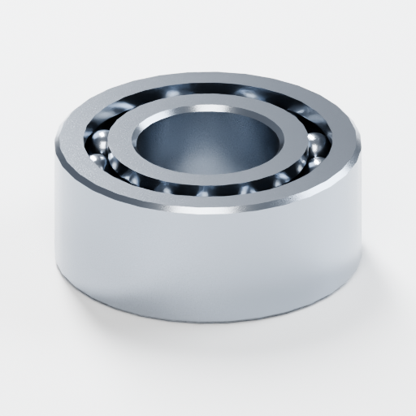
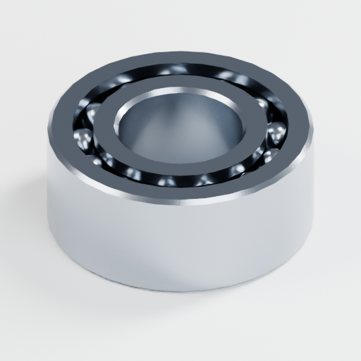
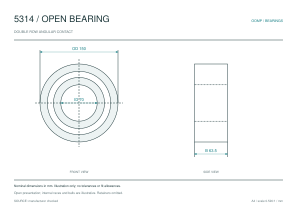

<!-- bearing-catalogue:start -->
# 5314 bearing - 70 x 150 x 63.5 mm

## Summary

Double row angular contact bearing: 70 mm bore, 150 mm outside diameter and 63.5 mm width.

| Product view | Isometric view |
| --- | --- |
|  |  |

Generated catalogue illustrations; the open internal geometry is illustrative.

## Details

**OOMP ID:** `hardware_bearing_5300_series_5314_size_70_mm_id_150_mm_od_63.5_mm_depth`

| Dimension | Nominal value |
| --- | --- |
| Bore / ID | 70 mm |
| Outside diameter / OD | 150 mm |
| Width / B | 63.5 mm |
| Catalogue contact angle | 25 degrees |

**Dimension evidence:** manufacturer checked (review retained from 2026-10-27).

Nominal presentation model. Raceways, pitch circle, chamfers and retainer geometry are illustrative; ball count/diameter are illustrative unless individually sourced. Not a manufacturer reconstruction, load-rating model or manufacturing/tolerance certification. Unspecified closure is presented open. The mesh shows open races and balls; retainers, seals and exact contact surfaces are omitted.

Contact-angle authority: **manufacturer family**. The mesh does not reconstruct the manufacturer contact surfaces.



[Printable A4 dimension sheet](working_dimension_a4.pdf) · [1:1 outline](working_svg.svg)

### Source evidence

- [https://www.nsk.com/content/dam/nsk/am/en_us/documents/bearings-americas/Bearing-and-Linear-Replacement-Guide.pdf](https://www.nsk.com/content/dam/nsk/am/en_us/documents/bearings-americas/Bearing-and-Linear-Replacement-Guide.pdf)

[Retained research and corrected dimensions](../../source_file/solidcraft/) · [Editable declaration](../../working_oomp_declarations_bearing.py)

## Parts

[Canonical part folder](.) · [Metadata](working.yaml) · [Browse this series](../../navigation/5300/README.md)

### Files

- [Editable OpenSCAD geometry](3dpr.scad)
- [Full model / GLB / metres, Y-up](three_d_model/model_full.glb)
- [Lightweight model / GLB / metres, Y-up](three_d_model/model_display.glb)
- [Editable Blender studio](three_d_model/studio.blend)
- [Product render / 2048 px](three_d_model/render_product_high.png)
- [Isometric render / 2048 px](three_d_model/render_high.png)
- [Populated model and render recipe](three_d_model/parameters.json)
- [Mesh measurements and artifact hashes](three_d_model/manifest.json)
- [Retained native CAD success manifest](solidcraft/latest_success.json)
- [76.2 x 50.8 mm label](label_bearing_3x2.pdf)
- [38.1 x 25.4 mm label](label_bearing_1_5x1.pdf)
- [Retained editable native bearing / SolidCraft](solidcraft/generations/979094088a3414cc_20261027T121251Z_8669eee0/bearing_5314_open.solidcraft)

### Orthographic views

| Quality | Isometric | Front | Back | Left | Right | Top | Bottom |
| --- | --- | --- | --- | --- | --- | --- | --- |
| Full | [Isometric](three_d_model/full/isometric.svg) | [Front](three_d_model/full/front.svg) | [Back](three_d_model/full/back.svg) | [Left](three_d_model/full/left.svg) | [Right](three_d_model/full/right.svg) | [Top](three_d_model/full/top.svg) | [Bottom](three_d_model/full/bottom.svg) |
| Display | [Isometric](three_d_model/display/isometric.svg) | [Front](three_d_model/display/front.svg) | [Back](three_d_model/display/back.svg) | [Left](three_d_model/display/left.svg) | [Right](three_d_model/display/right.svg) | [Top](three_d_model/display/top.svg) | [Bottom](three_d_model/display/bottom.svg) |

## Assembly

No installation procedure is established for this generic size record. Select the required closure, clearance, tolerance and load rating from the actual purchased bearing specification.

<details>
<summary>Complete OOMP metadata</summary>

```yaml
bip_39_2_word_array:
- cushion
- brisk
bip_39_2_word_no_space: cushionbrisk
bip_39_2_word_space: cushion brisk
bip_39_2_word_underscore: cushion_brisk
bip_39_3_word_array:
- cushion
- brisk
- code
bip_39_3_word_no_space: cushionbriskcode
bip_39_3_word_space: cushion brisk code
bip_39_3_word_underscore: cushion_brisk_code
bip_39_full_array:
- cushion
- brisk
- code
- penalty
- believe
- bronze
- sheriff
- culture
- guitar
- undo
- egg
- fence
bip_39_full_no_space: cushionbriskcodepenaltybelievebronzesheriffcultureguitarundoeggfence
bip_39_full_space: cushion brisk code penalty believe bronze sheriff culture guitar
  undo egg fence
bip_39_full_underscore: cushion_brisk_code_penalty_believe_bronze_sheriff_culture_guitar_undo_egg_fence
depth: 63.5
directory: parts/hardware_bearing_5300_series_5314_size_70_mm_id_150_mm_od_63.5_mm_depth
generate_stl: false
id: hardware_bearing_5300_series_5314_size_70_mm_id_150_mm_od_63.5_mm_depth
id_no_class: hardware_bearing_5300_series_5314_size_70_mm_id_150_mm_od_63.5_mm_depth
id_no_size: hardware_bearing_5300_series_size_70_mm_id_150_mm_od_63.5_mm_depth
id_no_type: hardware_bearing_5300_series_5314_size_70_mm_id_150_mm_od_63.5_mm_depth
link_github: https://github.com/oomlout/oomp_bearing_version_5/tree/main/parts/hardware_bearing_5300_series_5314_size_70_mm_id_150_mm_od_63.5_mm_depth
link_main: https://github.com/oomlout/oomlout_oomp_version_1_messy/tree/main/parts/hardware_bearing_5300_series_5314_size_70_mm_id_150_mm_od_63.5_mm_depth
link_redirect: https://github.com/oomlout/oomlout_oomp_version_1_messy/tree/main/parts/hardware_bearing_5300_series_5314_size_70_mm_id_150_mm_od_63.5_mm_depth
md5: 366388b451414a397161ac67dd9d1b2a
md5_10: 366388b451
md5_10_upper: 366388B451
md5_5: '36638'
md5_5_upper: '36638'
md5_6: '366388'
md5_6_alpha: 24ebs
md5_6_alpha_upper: 24EBS
md5_6_upper: '366388'
name: 5314 bearing
name_no_class: Hardware Bearing 5300 Series 5314 Size 70 Mm Id 150 Mm Od 63.5 Mm Depth
name_no_size: Hardware Bearing 5300 Series Size 70 Mm Id 150 Mm Od 63.5 Mm Depth
name_no_type: Hardware Bearing 5300 Series 5314 Size 70 Mm Id 150 Mm Od 63.5 Mm Depth
name_proper: 5314 bearing
name_space: hardware bearing 5300 series 5314 size 70 mm id 150 mm od 63 5 mm depth
name_upper: HARDWARE BEARING 5300 SERIES 5314 SIZE 70 MM ID 150 MM OD 63 5 MM DEPTH
od: 150.0
oomlout_ai_roboclick_1:
  actions:
  - command: new_chat
    description: step_1_create_icon
  - command: ai_query
    delay: '240'
    mode_ai_wait: slow
    text: '## READ THIS FIRST — no theme is coming in this message, and that is correct


      This is **step 1 of 2**. It is deliberately theme-free. You are building a reusable
      house style, not designing a specific logo.


      The theme arrives in step 2. Do **not** ask what the theme is. Do **not** ask
      any clarifying questions. Do **not** write a final image-generation prompt yet
      — you cannot, and attempting one is a failure of this step. Do **not** invent
      a placeholder theme and design for it. If you feel information is missing, that
      is expected: the missing information is the theme, it is coming next, and nothing
      in this step requires it.


      Your entire output for this step is a **house style guide** that will be applied
      to whatever theme arrives next.


      ---


      ## The product this style serves


      **Intended use:** a square, single-colour, pure-black-on-pure-white mascot logo,
      generated as a raster image, then **auto-traced to vector and cut/engraved on
      a laser cutter**. The trace step is unforgiving — it is the hardest constraint
      in this brief and should shape most of your recommendations.


      **Target feel:** charming, original, cute, polished, instantly readable at ~20
      mm. A designed branded icon, not a doodle page and not generic kawaii clip art.


      ---


      ## What to produce


      Write these six sections. **Budget: about 900 words total, 1,100 hard ceiling.**
      That is roughly 100–150 words per section, with section 6 allowed the most.
      This is a working reference, not an essay — every line should be a rule someone
      could check a drawing against. Prefer tight bullets over prose paragraphs, and
      cut any sentence that only restates the brief back at me.


      **1. Line language menu**

      Exactly three distinct black-on-white line-art approaches (e.g. uniform monoline,
      weight-varied outline with sparse interior, chunky sticker-outline, geometric
      constructed line). One or two lines each: what it does for charm, how it survives
      auto-tracing, what it costs.


      **2. Cuteness that isn''t generic**

      The handful of levers that make a line mascot lovable — eye shape and spacing,
      head-to-body ratio, pose energy, mouth simplicity, restraint on blush marks
      — each as a one-line rule with a number where a number applies. Then a short
      do-not list of the clichés that make an AI mascot look stock (dead-centre symmetrical
      stare, sparkle confetti, floating hearts, blob bodies), each with its one-line
      replacement.


      **3. Trace-safety rules**

      A flat list of concrete, checkable rules for the auto-trace-to-cut pipeline
      — one line each, no explanatory paragraphs:

      - minimum stroke thickness relative to the square''s width, stated as a fraction
      (so it scales)

      - minimum gap between two adjacent strokes before they blur into one traced
      blob

      - why every shape should read as a closed path, and how to spot one that won''t

      - island/floating-part handling and where to add connective bridges

      - what to do about interior detail that a tracer will turn into noise (crosshatching,
      stippling, tapering hairlines, single stray dots)

      - why large solid black fills are avoided here, and the acceptable exceptions
      (small eyes, pupils, a tiny accent shape)


      **4. Composition and hierarchy**

      Bulleted rules only: square framing, margin as a fraction of the square, centre
      of visual mass, minimum negative space, the mascot-leads / props-support / text-reinforces
      hierarchy, and the shared traits that make it read as one illustrator''s hand
      (same stroke weight, same corner radius, same eye style, same spacing rhythm).


      **5. Text and badge treatments**

      Text is allowed and okay to include. Briefly: when a word helps versus clutters,
      a maximum letter count that stays cuttable, how to specify literal text so it
      renders verbatim (quotes, exact casing), the letterform to ask for, and when
      a badge ring earns its place versus just boxing the mark in. Six bullets is
      plenty.


      **6. Prompt architecture for step 2**

      The most important section, so spend your words here. Specify the exact template
      the step-2 final prompt must follow — and state that the finished prompt should
      land at **180–250 words**, long enough to carry the spec, short enough that
      no single instruction gets diluted. Order it to match how the image model weights
      a prompt:


      1. **Medium and style up front** — the first sentence states it is a square
      black-and-white line-art mascot logo, because opening words set the mode for
      everything after.

      2. **Subject** — the mascot, its identity, expression, pose.

      3. **Key details** — props, supporting motifs, any literal text in quotes.

      4. **Layout** — centring, margins, hierarchy, where each element sits.

      5. **Line and manufacturing spec** — stroke weight, closed paths, interior-detail
      limits.

      6. **Exclusions last** — negatives go at the very end, after every positive
      descriptor, because a model reading them early tends to treat them as things
      to compose rather than things to omit.


      Give the canonical exclusion list to close with (no grey, no shading, no gradients,
      no halftone, no dithering, no texture, no colour, no transparency, no background
      scene, no drop shadow, no outer glow, no frame border unless specified, no watermark,
      no signature, no extra text beyond what is quoted).


      Also state the two facts the prompt must say in plain words no matter what:
      the image is **square**, and it is **pure black on a pure white background**.


      ---


      ## Response style and length


      **About 900 words, 1,100 absolute maximum.** Bullets over prose. Concrete and
      checkable over abstract and aspirational — "stroke no thinner than 1/100 of
      the square''s width" beats "confident lines". No preamble, no restating this
      brief back at me, no summary of what you are about to do. Skip the caveats and
      the reasoning behind each rule; just state the rule.


      Close with a checklist of the rules, 12 lines at most, so step 2 can be graded
      against it.


      Then stop. No final image prompt, no questions, no theme.

      '
  - command: ai_query
    delay: '240'
    mode_ai_wait: slow
    text: '## Step 2 of 2 — the theme


      The theme is: **an image of hardware bearing 5300 series 5314 size 70 mm id
      150 mm od 63 5 mm depth make Hardware Bearing 5300 Series 5314 Size 70 Mm Id
      150 Mm Od 63 5 Mm Depth cute, bearing size 5314 70x150x63.5 mm, code hardware_bearing_5300_series_5314_size_70_mm_id_150_mm_od_63_5_mm_depth,
      text is okay to include**


      Apply the house style you just wrote to this theme. Everything you need is now
      in hand. Generate the image during this step without asking questions or waiting
      for another message.


      ---


      ## Part A — private exploration


      Work through these choices privately before calling the image generation tool.
      Do not send the exploration as a text response. Push past the theme''s first
      obvious reading, but do it briskly.


      - **Angles:** exactly four mascot interpretations, **one or two sentences each**.
      Include at least one that anthropomorphises an object or concept from the theme
      rather than reaching for the obvious animal, and at least one built on a visual
      pun. Then name your pick in a single sentence saying why it beats the other
      three — no full comparison table.

      - **The chosen design:** one short paragraph fixing the pose, expression, props,
      and line strategy. Prefer gesture or a moment of character over a static front-on
      stare. Cut any prop that is decoration rather than signal.

      - **Text:** one line — the exact string in quotes with exact casing, or "no
      text". Text is allowed and okay to include when it improves identification.

      - **Trace and small-size check:** a short bullet list of fixes only — every
      stroke to thicken, gap to widen, island to bridge, detail to delete. Just the
      fixes, not the reasoning, and not a description of what the design looks like
      at size.


      Skip anything not on that list: no tradeoff essays, no runner-up post-mortems,
      no notes on your own process.


      ## Part B — generate the image now


      Write the final image-generation prompt for the chosen direction and pass it
      directly to the image generation tool in this step. Invoke the tool exactly
      once. Do not return a text-only prompt, a fenced code block, or a plan to generate
      later. Finish with the generated image so it can be saved immediately from the
      generation window.


      Follow the six-part architecture from step 1 exactly, in order: medium and style
      → subject → key details → layout → line and manufacturing spec → exclusions
      last.


      **Length: 180–250 words.** Long enough to carry the full spec, short enough
      that no single instruction gets diluted. If you are over, cut adjectives and
      repeated style words before you cut any manufacturing rule.


      Hard requirements for that prompt:


      - It opens by stating it is a **square black-and-white line-art mascot logo**.

      - It says in plain words that the image is **square** and **pure black on a
      pure white background**.

      - It states stroke weight as a fraction of the image width, and requires every
      shape to be a **closed path** with **no floating disconnected islands**.

      - It caps interior detail explicitly and forbids crosshatching, stippling, and
      hairline tapers.

      - Any literal text appears in quotes with exact casing, spelled out character
      by character if it is unusual.

      - The exclusion list comes **last**, after every positive descriptor.

      - It is self-contained: someone pasting it cold, with no memory of this conversation,
      gets the same image. No "as discussed above", no "the mascot from earlier".

      - One image-generation call only. No variants, no alternates, and no extra text
      response after the image.

      '
  - command: save_image_generated
    file_name: initial_generated.png
    mode_ai_wait: slow
  - command: close_tab
  file_test: initial_generated.png
  retries_until_complete: 0
oomlout_ai_roboclick_2:
  actions:
  - command: text_jinja_template
    convert_to_pdf: false
    convert_to_png: false
    dict_data:
      depth: '63.5'
      directory: parts\hardware_bearing_5300_series_5314_size_70_mm_id_150_mm_od_63.5_mm_depth
      id: '70'
      name: hardware_bearing_5300_series_5314_size_70_mm_id_150_mm_od_63_5_mm_depth
      name_proper: Hardware Bearing 5300 Series 5314 Size 70 Mm Id 150 Mm Od 63 5
        Mm Depth
      name_space: hardware bearing 5300 series 5314 size 70 mm id 150 mm od 63 5 mm
        depth
      name_upper: HARDWARE BEARING 5300 SERIES 5314 SIZE 70 MM ID 150 MM OD 63 5 MM
        DEPTH
      od: '150'
      oomlout_ai_roboclick_1:
        actions:
        - command: new_chat
          description: step_1_create_icon
        - command: ai_query
          delay: '240'
          mode_ai_wait: slow
          text: '## READ THIS FIRST — no theme is coming in this message, and that
            is correct


            This is **step 1 of 2**. It is deliberately theme-free. You are building
            a reusable house style, not designing a specific logo.


            The theme arrives in step 2. Do **not** ask what the theme is. Do **not**
            ask any clarifying questions. Do **not** write a final image-generation
            prompt yet — you cannot, and attempting one is a failure of this step.
            Do **not** invent a placeholder theme and design for it. If you feel information
            is missing, that is expected: the missing information is the theme, it
            is coming next, and nothing in this step requires it.


            Your entire output for this step is a **house style guide** that will
            be applied to whatever theme arrives next.


            ---


            ## The product this style serves


            **Intended use:** a square, single-colour, pure-black-on-pure-white mascot
            logo, generated as a raster image, then **auto-traced to vector and cut/engraved
            on a laser cutter**. The trace step is unforgiving — it is the hardest
            constraint in this brief and should shape most of your recommendations.


            **Target feel:** charming, original, cute, polished, instantly readable
            at ~20 mm. A designed branded icon, not a doodle page and not generic
            kawaii clip art.


            ---


            ## What to produce


            Write these six sections. **Budget: about 900 words total, 1,100 hard
            ceiling.** That is roughly 100–150 words per section, with section 6 allowed
            the most. This is a working reference, not an essay — every line should
            be a rule someone could check a drawing against. Prefer tight bullets
            over prose paragraphs, and cut any sentence that only restates the brief
            back at me.


            **1. Line language menu**

            Exactly three distinct black-on-white line-art approaches (e.g. uniform
            monoline, weight-varied outline with sparse interior, chunky sticker-outline,
            geometric constructed line). One or two lines each: what it does for charm,
            how it survives auto-tracing, what it costs.


            **2. Cuteness that isn''t generic**

            The handful of levers that make a line mascot lovable — eye shape and
            spacing, head-to-body ratio, pose energy, mouth simplicity, restraint
            on blush marks — each as a one-line rule with a number where a number
            applies. Then a short do-not list of the clichés that make an AI mascot
            look stock (dead-centre symmetrical stare, sparkle confetti, floating
            hearts, blob bodies), each with its one-line replacement.


            **3. Trace-safety rules**

            A flat list of concrete, checkable rules for the auto-trace-to-cut pipeline
            — one line each, no explanatory paragraphs:

            - minimum stroke thickness relative to the square''s width, stated as
            a fraction (so it scales)

            - minimum gap between two adjacent strokes before they blur into one traced
            blob

            - why every shape should read as a closed path, and how to spot one that
            won''t

            - island/floating-part handling and where to add connective bridges

            - what to do about interior detail that a tracer will turn into noise
            (crosshatching, stippling, tapering hairlines, single stray dots)

            - why large solid black fills are avoided here, and the acceptable exceptions
            (small eyes, pupils, a tiny accent shape)


            **4. Composition and hierarchy**

            Bulleted rules only: square framing, margin as a fraction of the square,
            centre of visual mass, minimum negative space, the mascot-leads / props-support
            / text-reinforces hierarchy, and the shared traits that make it read as
            one illustrator''s hand (same stroke weight, same corner radius, same
            eye style, same spacing rhythm).


            **5. Text and badge treatments**

            Text is allowed and okay to include. Briefly: when a word helps versus
            clutters, a maximum letter count that stays cuttable, how to specify literal
            text so it renders verbatim (quotes, exact casing), the letterform to
            ask for, and when a badge ring earns its place versus just boxing the
            mark in. Six bullets is plenty.


            **6. Prompt architecture for step 2**

            The most important section, so spend your words here. Specify the exact
            template the step-2 final prompt must follow — and state that the finished
            prompt should land at **180–250 words**, long enough to carry the spec,
            short enough that no single instruction gets diluted. Order it to match
            how the image model weights a prompt:


            1. **Medium and style up front** — the first sentence states it is a square
            black-and-white line-art mascot logo, because opening words set the mode
            for everything after.

            2. **Subject** — the mascot, its identity, expression, pose.

            3. **Key details** — props, supporting motifs, any literal text in quotes.

            4. **Layout** — centring, margins, hierarchy, where each element sits.

            5. **Line and manufacturing spec** — stroke weight, closed paths, interior-detail
            limits.

            6. **Exclusions last** — negatives go at the very end, after every positive
            descriptor, because a model reading them early tends to treat them as
            things to compose rather than things to omit.


            Give the canonical exclusion list to close with (no grey, no shading,
            no gradients, no halftone, no dithering, no texture, no colour, no transparency,
            no background scene, no drop shadow, no outer glow, no frame border unless
            specified, no watermark, no signature, no extra text beyond what is quoted).


            Also state the two facts the prompt must say in plain words no matter
            what: the image is **square**, and it is **pure black on a pure white
            background**.


            ---


            ## Response style and length


            **About 900 words, 1,100 absolute maximum.** Bullets over prose. Concrete
            and checkable over abstract and aspirational — "stroke no thinner than
            1/100 of the square''s width" beats "confident lines". No preamble, no
            restating this brief back at me, no summary of what you are about to do.
            Skip the caveats and the reasoning behind each rule; just state the rule.


            Close with a checklist of the rules, 12 lines at most, so step 2 can be
            graded against it.


            Then stop. No final image prompt, no questions, no theme.

            '
        - command: ai_query
          delay: '240'
          mode_ai_wait: slow
          text: '## Step 2 of 2 — the theme


            The theme is: **an image of hardware bearing 5300 series 5314 size 70
            mm id 150 mm od 63 5 mm depth make Hardware Bearing 5300 Series 5314 Size
            70 Mm Id 150 Mm Od 63 5 Mm Depth cute, bearing size 5314 70x150x63.5 mm,
            code hardware_bearing_5300_series_5314_size_70_mm_id_150_mm_od_63_5_mm_depth,
            text is okay to include**


            Apply the house style you just wrote to this theme. Everything you need
            is now in hand. Generate the image during this step without asking questions
            or waiting for another message.


            ---


            ## Part A — private exploration


            Work through these choices privately before calling the image generation
            tool. Do not send the exploration as a text response. Push past the theme''s
            first obvious reading, but do it briskly.


            - **Angles:** exactly four mascot interpretations, **one or two sentences
            each**. Include at least one that anthropomorphises an object or concept
            from the theme rather than reaching for the obvious animal, and at least
            one built on a visual pun. Then name your pick in a single sentence saying
            why it beats the other three — no full comparison table.

            - **The chosen design:** one short paragraph fixing the pose, expression,
            props, and line strategy. Prefer gesture or a moment of character over
            a static front-on stare. Cut any prop that is decoration rather than signal.

            - **Text:** one line — the exact string in quotes with exact casing, or
            "no text". Text is allowed and okay to include when it improves identification.

            - **Trace and small-size check:** a short bullet list of fixes only —
            every stroke to thicken, gap to widen, island to bridge, detail to delete.
            Just the fixes, not the reasoning, and not a description of what the design
            looks like at size.


            Skip anything not on that list: no tradeoff essays, no runner-up post-mortems,
            no notes on your own process.


            ## Part B — generate the image now


            Write the final image-generation prompt for the chosen direction and pass
            it directly to the image generation tool in this step. Invoke the tool
            exactly once. Do not return a text-only prompt, a fenced code block, or
            a plan to generate later. Finish with the generated image so it can be
            saved immediately from the generation window.


            Follow the six-part architecture from step 1 exactly, in order: medium
            and style → subject → key details → layout → line and manufacturing spec
            → exclusions last.


            **Length: 180–250 words.** Long enough to carry the full spec, short enough
            that no single instruction gets diluted. If you are over, cut adjectives
            and repeated style words before you cut any manufacturing rule.


            Hard requirements for that prompt:


            - It opens by stating it is a **square black-and-white line-art mascot
            logo**.

            - It says in plain words that the image is **square** and **pure black
            on a pure white background**.

            - It states stroke weight as a fraction of the image width, and requires
            every shape to be a **closed path** with **no floating disconnected islands**.

            - It caps interior detail explicitly and forbids crosshatching, stippling,
            and hairline tapers.

            - Any literal text appears in quotes with exact casing, spelled out character
            by character if it is unusual.

            - The exclusion list comes **last**, after every positive descriptor.

            - It is self-contained: someone pasting it cold, with no memory of this
            conversation, gets the same image. No "as discussed above", no "the mascot
            from earlier".

            - One image-generation call only. No variants, no alternates, and no extra
            text response after the image.

            '
        - command: save_image_generated
          file_name: initial_generated.png
          mode_ai_wait: slow
        - command: close_tab
        file_test: initial_generated.png
        retries_until_complete: 0
      series: '5300'
      size: '5314'
      svg_details:
        filename: working_mechanical_drawing
        hardware_type: bearing
        id_mm: 70.0
        od_mm: 150.0
        part_category: HARDWARE / BEARING
        part_code: ISO 15 / DIN 625
        part_name: hardware_bearing_5300_series_5314_size_70_mm_id_150_mm_od_63_5_mm_depth
        part_series: 5300 SERIES BALL BEARING
        part_title: '5314'
        svg_name: oomp_mech_drawing_hardware
        width_mm: 63.5
      taxonomy_1: hardware
      taxonomy_10: ''
      taxonomy_11: ''
      taxonomy_12: ''
      taxonomy_13: ''
      taxonomy_14: ''
      taxonomy_15: ''
      taxonomy_2: bearing
      taxonomy_3: 5300_series
      taxonomy_4: 5314_size
      taxonomy_5: 70_mm_id
      taxonomy_6: 150_mm_od
      taxonomy_7: 63.5_mm_depth
      taxonomy_8: ''
      taxonomy_9: ''
      url_chat: https://chatgpt.com/c/6ab888b6-9dfc-83eb-9336-5c4a40232919
      weight: 4,903
      width: '63.5'
    dict_data_files: {}
    dict_data_files_exists: {}
    file_output: label_oomp.svg
    file_template: C:\od\OneDrive\docs\oomp_bearing\source_file\template_jinja\template_jinja_label_oomlout_76_2_mm_50_8_mm\working.svg.j2
    search_and_replace: []
  file_test: label_oomp.pdf
  retries_until_complete: 0
oomlout_ai_roboclick_3:
  actions:
  - command: text_jinja_template
    convert_to_pdf: false
    convert_to_png: false
    description: Bold bearing label 3x2
    dict_data_yaml_files:
      label_manual: C:\od\OneDrive\docs\oomp_bearing\parts\hardware_bearing_5300_series_5314_size_70_mm_id_150_mm_od_63.5_mm_depth\working_manual.yaml
      label_source: C:\od\OneDrive\docs\oomp_bearing\parts_source\hardware_bearing_5300_series_5314_size_70_mm_id_150_mm_od_63_5_mm_depth\working.yaml
    file_output: label_bearing_bold_3x2.svg
    file_template: C:\od\OneDrive\docs\oomp_bearing\source_file\template_jinja\label_bearing_bold\3x2.svg.j2
  file_test: ''
oomlout_ai_roboclick_4:
  actions:
  - command: text_jinja_template
    convert_to_pdf: false
    convert_to_png: false
    description: Bold bearing label 1_5x1
    dict_data_yaml_files:
      label_manual: C:\od\OneDrive\docs\oomp_bearing\parts\hardware_bearing_5300_series_5314_size_70_mm_id_150_mm_od_63.5_mm_depth\working_manual.yaml
      label_source: C:\od\OneDrive\docs\oomp_bearing\parts_source\hardware_bearing_5300_series_5314_size_70_mm_id_150_mm_od_63_5_mm_depth\working.yaml
    file_output: label_bearing_bold_1_5x1.svg
    file_template: C:\od\OneDrive\docs\oomp_bearing\source_file\template_jinja\label_bearing_bold\1_5x1.svg.j2
  file_test: ''
oomp_key: oomp_hardware_bearing_5300_series_5314_size_70_mm_id_150_mm_od_63.5_mm_depth
run_action: true
run_oomp: true
run_oomp_populate: true
run_scad: false
series: '5300'
size: '5314'
svg_details:
  svg_name: bearing_dimension
  title: 5314 / OPEN BEARING
  family: DOUBLE ROW ANGULAR CONTACT
  dimensions_mm:
    bore: 70.0
    outside: 150.0
    width: 63.5
    contact_angle_deg: 25.0
  sheet_width_mm: 297
  sheet_height_mm: 210
  ink: '#183336'
  accent: '#147d83'
  muted: '#61767a'
  paper: '#ffffff'
  race_face_fill: '#edf3f3'
  inner_race_face_outside_mm: 98.189
  outer_race_face_inside_mm: 121.811
  line_width_mm: 0.45
  font_family: Helvetica
  dimension_font_mm: 4
  title_font_mm: 9
  front_centre_mm:
  - 79
  - 103
  side_centre_mm:
  - 211
  - 103
  max_view_width_mm: 78
  max_side_width_mm: 55
  dimension_offset_mm: 12
  arrow_size_mm: 2
  note: Nominal dimensions in mm. Illustration only; no tolerances or fit allowances.
  authority: manufacturer checked
  internal_note: Open presentation; internal races and balls are illustrative. Retainers
    omitted.
  layout:
    left_margin_mm: 14
    right_margin_mm: 283
    title_y_mm: 22
    family_y_mm: 33
    family_font_mm: 3.5
    brand: OOMP / BEARINGS
    brand_font_mm: 3.5
    header_rule_y_mm: 40
    view_caption_y_mm: 173
    view_caption_font_mm: 3
    front_caption: FRONT VIEW
    side_caption: SIDE VIEW
    footer_rule_y_mm: 180
    note_y_mm: 187
    internal_note_y_mm: 194
    note_font_mm: 3.2
    source_y_mm: 202
    source_font_mm: 3
    source_prefix: 'SOURCE: '
    scale_prefix: A4 / scale
  dimension_style:
    line_width_mm: 0.25
    arrow_half_width_ratio: 0.3
    text_gap_mm: 2
    extension_mm: 2
    width_extension_mm: 3
    centre_extension_mm: 5
    dash_pattern_mm:
    - 2
    - 1
    flange_leader_offset_mm:
    - -13
    - 11
    flange_text_offset_mm:
    - -13
    - 16
    flange_font_mm: 3.5
  outline:
    ink: black
    line_width_mm: 0.1
taxonomy_1: hardware
taxonomy_10: ''
taxonomy_11: ''
taxonomy_12: ''
taxonomy_13: ''
taxonomy_14: ''
taxonomy_15: ''
taxonomy_1_capital: Hardware
taxonomy_1_first_letter: h
taxonomy_1_first_letter_upper: H
taxonomy_1_length_1: h
taxonomy_1_length_2: ha
taxonomy_1_length_3: har
taxonomy_1_length_4: hard
taxonomy_1_length_5: hardw
taxonomy_1_upper: HARDWARE
taxonomy_1_upper_length_1: H
taxonomy_1_upper_length_2: HA
taxonomy_1_upper_length_3: HAR
taxonomy_1_upper_length_4: HARD
taxonomy_1_upper_length_5: HARDW
taxonomy_2: bearing
taxonomy_2_capital: Bearing
taxonomy_2_first_letter: b
taxonomy_2_first_letter_upper: B
taxonomy_2_length_1: b
taxonomy_2_length_2: be
taxonomy_2_length_3: bea
taxonomy_2_length_4: bear
taxonomy_2_length_5: beari
taxonomy_2_upper: BEARING
taxonomy_2_upper_length_1: B
taxonomy_2_upper_length_2: BE
taxonomy_2_upper_length_3: BEA
taxonomy_2_upper_length_4: BEAR
taxonomy_2_upper_length_5: BEARI
taxonomy_3: 5300_series
taxonomy_3_capital: 5300 Series
taxonomy_3_first_letter: '5'
taxonomy_3_first_letter_upper: '5'
taxonomy_3_length_1: '5'
taxonomy_3_length_2: '53'
taxonomy_3_length_3: '530'
taxonomy_3_length_4: '5300'
taxonomy_3_length_5: '5300_'
taxonomy_3_upper: 5300_SERIES
taxonomy_3_upper_length_1: '5'
taxonomy_3_upper_length_2: '53'
taxonomy_3_upper_length_3: '530'
taxonomy_3_upper_length_4: '5300'
taxonomy_3_upper_length_5: '5300_'
taxonomy_4: 5314_size
taxonomy_4_capital: 5314 Size
taxonomy_4_first_letter: '5'
taxonomy_4_first_letter_upper: '5'
taxonomy_4_length_1: '5'
taxonomy_4_length_2: '53'
taxonomy_4_length_3: '531'
taxonomy_4_length_4: '5314'
taxonomy_4_length_5: '5314_'
taxonomy_4_upper: 5314_SIZE
taxonomy_4_upper_length_1: '5'
taxonomy_4_upper_length_2: '53'
taxonomy_4_upper_length_3: '531'
taxonomy_4_upper_length_4: '5314'
taxonomy_4_upper_length_5: '5314_'
taxonomy_5: 70_mm_id
taxonomy_5_capital: 70 mm Id
taxonomy_5_first_letter: '7'
taxonomy_5_first_letter_upper: '7'
taxonomy_5_length_1: '7'
taxonomy_5_length_2: '70'
taxonomy_5_length_3: '70_'
taxonomy_5_length_4: 70_m
taxonomy_5_length_5: 70_mm
taxonomy_5_upper: 70_MM_ID
taxonomy_5_upper_length_1: '7'
taxonomy_5_upper_length_2: '70'
taxonomy_5_upper_length_3: '70_'
taxonomy_5_upper_length_4: 70_M
taxonomy_5_upper_length_5: 70_MM
taxonomy_6: 150_mm_od
taxonomy_6_capital: 150 mm Od
taxonomy_6_first_letter: '1'
taxonomy_6_first_letter_upper: '1'
taxonomy_6_length_1: '1'
taxonomy_6_length_2: '15'
taxonomy_6_length_3: '150'
taxonomy_6_length_4: '150_'
taxonomy_6_length_5: 150_m
taxonomy_6_upper: 150_MM_OD
taxonomy_6_upper_length_1: '1'
taxonomy_6_upper_length_2: '15'
taxonomy_6_upper_length_3: '150'
taxonomy_6_upper_length_4: '150_'
taxonomy_6_upper_length_5: 150_M
taxonomy_7: 63.5_mm_depth
taxonomy_7_capital: 63.5 mm Depth
taxonomy_7_first_letter: '6'
taxonomy_7_first_letter_upper: '6'
taxonomy_7_length_1: '6'
taxonomy_7_length_2: '63'
taxonomy_7_length_3: '63.'
taxonomy_7_length_4: '63.5'
taxonomy_7_length_5: '63.5_'
taxonomy_7_upper: 63.5_MM_DEPTH
taxonomy_7_upper_length_1: '6'
taxonomy_7_upper_length_2: '63'
taxonomy_7_upper_length_3: '63.'
taxonomy_7_upper_length_4: '63.5'
taxonomy_7_upper_length_5: '63.5_'
taxonomy_8: ''
taxonomy_9: ''
url_chat: https://chatgpt.com/c/6ab888b6-9dfc-83eb-9336-5c4a40232919
weight: 4,903
width: 63.5
catalogue_schema: oomp_bearing_v5
oomp_id: hardware_bearing_5300_series_5314_size_70_mm_id_150_mm_od_63.5_mm_depth
family: double_row_angular_contact
dimensions_mm:
  bore: 70.0
  outside: 150.0
  width: 63.5
  contact_angle_deg: 25.0
bore: 70.0
dimension_authority: manufacturer_checked
source_checked: '2026-10-27'
sources:
- https://www.nsk.com/content/dam/nsk/am/en_us/documents/bearings-americas/Bearing-and-Linear-Replacement-Guide.pdf
model_note: Nominal presentation model. Raceways, pitch circle, chamfers and retainer
  geometry are illustrative; ball count/diameter are illustrative unless individually
  sourced. Not a manufacturer reconstruction, load-rating model or manufacturing/tolerance
  certification. Unspecified closure is presented open. The mesh shows open races
  and balls; retainers, seals and exact contact surfaces are omitted.
closure: open
three_d_model_details:
  schema_version: 1
  generator: bearing_open
  output_folder: three_d_model
  parameters:
    bore: 70.0
    outside: 150.0
    width: 63.5
    edge: 2.4
    pitch_radius: 55.0
    ball_radius: 9.525
    groove_radius: 10.00125
    inner_shoulder: 49.0945
    outer_shoulder: 60.9055
    cage_half_width: 5.2387500000000005
    cage_low: 9.04875
    cage_high: 10.95375
    window_radius: 4.572
    contact_angle_deg: 25.0
    contact_offset: 0.23812500000000003
    identity: hardware_bearing_5300_series_5314_size_70_mm_id_150_mm_od_63.5_mm_depth
    specification: 5314 / 70 x 150 x 63.5 mm
    characteristic_dimension_mm: 150.0
    characteristic_dimension_basis: maximum nominal envelope dimension
    ball_count: 26
    balls_per_row: 13
    row_count: 2
    ball_specification: illustrative
    contact_angle_authority: manufacturer_family
    row_centres_z:
    - 15.875
    - 47.625
    components:
    - name: outer_race
      shape: revolved_profile
      profile_mm:
      - - 72.6
        - 0
      - - 75.0
        - 2.4
      - - 75.0
        - 61.1
      - - 72.6
        - 63.5
      - - 60.9055
        - 63.5
      - - 60.9055
        - 61.1
      - - 60.9055
        - 57.62625
      - - 60.9055
        - 57.1261875
      - - 60.9055
        - 56.626125
      - - 60.9055
        - 56.1260625
      - - 61.00075
        - 55.626000000000005
      - - 61.615205074946175
        - 55.125937500000006
      - - 62.14232110709642
        - 54.625875
      - - 62.60029199454493
        - 54.1258125
      - - 63.001
        - 53.625750000000004
      - - 63.35269050006306
        - 53.1256875
      - - 63.661336569599115
        - 52.625625
      - - 63.931401835439594
        - 52.1255625
      - - 64.16629703383542
        - 51.6255
      - - 64.3686679347223
        - 51.125437500000004
      - - 64.54058443817122
        - 50.625375000000005
      - - 64.68366867281424
        - 50.12531250000001
      - - 64.79918371600411
        - 49.62525
      - - 64.88809582413842
        - 49.1251875
      - - 64.95111810536258
        - 48.625125
      - - 64.98874061424131
        - 48.1250625
      - - 65.00125
        - 47.625
      - - 64.98874061424131
        - 47.1249375
      - - 64.95111810536258
        - 46.624875
      - - 64.88809582413843
        - 46.124812500000004
      - - 64.79918371600411
        - 45.624750000000006
      - - 64.68366867281424
        - 45.1246875
      - - 64.54058443817122
        - 44.624625
      - - 64.3686679347223
        - 44.1245625
      - - 64.16629703383542
        - 43.624500000000005
      - - 63.931401835439594
        - 43.1244375
      - - 63.661336569599115
        - 42.624375
      - - 63.35269050006306
        - 42.1243125
      - - 63.001000000000005
        - 41.62425
      - - 62.60029199454493
        - 41.124187500000005
      - - 62.14232110709642
        - 40.624125
      - - 61.61520507494619
        - 40.1240625
      - - 61.000750000000004
        - 39.624
      - - 60.9055
        - 39.123937500000004
      - - 60.9055
        - 38.623875
      - - 60.9055
        - 38.1238125
      - - 60.9055
        - 37.62375
      - - 60.9055
        - 25.87625
      - - 60.9055
        - 25.3761875
      - - 60.9055
        - 24.876125000000002
      - - 60.9055
        - 24.376062500000003
      - - 61.000750000000004
        - 23.875999999999998
      - - 61.61520507494619
        - 23.3759375
      - - 62.14232110709642
        - 22.875875
      - - 62.60029199454493
        - 22.375812500000002
      - - 63.001
        - 21.875750000000004
      - - 63.35269050006306
        - 21.375687499999998
      - - 63.661336569599115
        - 20.875625
      - - 63.931401835439594
        - 20.3755625
      - - 64.16629703383542
        - 19.875500000000002
      - - 64.3686679347223
        - 19.375437499999997
      - - 64.54058443817122
        - 18.875375
      - - 64.68366867281424
        - 18.3753125
      - - 64.79918371600411
        - 17.87525
      - - 64.88809582413842
        - 17.3751875
      - - 64.95111810536258
        - 16.875124999999997
      - - 64.98874061424131
        - 16.3750625
      - - 65.00125
        - 15.875
      - - 64.98874061424131
        - 15.3749375
      - - 64.95111810536258
        - 14.874875
      - - 64.88809582413842
        - 14.374812499999999
      - - 64.79918371600411
        - 13.87475
      - - 64.68366867281424
        - 13.3746875
      - - 64.54058443817122
        - 12.874625
      - - 64.3686679347223
        - 12.3745625
      - - 64.16629703383542
        - 11.874500000000001
      - - 63.931401835439594
        - 11.374437499999999
      - - 63.661336569599115
        - 10.874375
      - - 63.35269050006306
        - 10.374312499999998
      - - 63.001000000000005
        - 9.87425
      - - 62.60029199454493
        - 9.3741875
      - - 62.14232110709642
        - 8.874125
      - - 61.61520507494618
        - 8.374062499999999
      - - 61.00075
        - 7.874
      - - 60.9055
        - 7.373937499999999
      - - 60.9055
        - 6.873875
      - - 60.9055
        - 6.3738125
      - - 60.9055
        - 5.873749999999999
      - - 60.9055
        - 2.4
      - - 60.9055
        - 0.0
      - - 72.6
        - 0
    - name: inner_race
      shape: revolved_profile
      profile_mm:
      - - 49.0945
        - 0.0
      - - 49.0945
        - 2.4
      - - 49.0945
        - 5.873749999999999
      - - 49.0945
        - 6.3738125
      - - 49.0945
        - 6.873875
      - - 49.0945
        - 7.373937499999999
      - - 48.99925
        - 7.874
      - - 48.38479492505382
        - 8.374062499999999
      - - 47.85767889290358
        - 8.874125
      - - 47.39970800545507
        - 9.3741875
      - - 46.998999999999995
        - 9.87425
      - - 46.64730949993694
        - 10.374312499999998
      - - 46.338663430400885
        - 10.874375
      - - 46.068598164560406
        - 11.374437499999999
      - - 45.83370296616458
        - 11.874500000000001
      - - 45.631332065277704
        - 12.3745625
      - - 45.45941556182877
        - 12.874625
      - - 45.316331327185765
        - 13.3746875
      - - 45.20081628399589
        - 13.87475
      - - 45.111904175861575
        - 14.374812499999999
      - - 45.04888189463742
        - 14.874875
      - - 45.01125938575869
        - 15.3749375
      - - 44.99875
        - 15.875
      - - 45.01125938575869
        - 16.3750625
      - - 45.04888189463742
        - 16.875124999999997
      - - 45.111904175861575
        - 17.3751875
      - - 45.2008162839959
        - 17.87525
      - - 45.316331327185765
        - 18.3753125
      - - 45.45941556182877
        - 18.875375
      - - 45.631332065277704
        - 19.375437499999997
      - - 45.83370296616458
        - 19.875500000000002
      - - 46.068598164560406
        - 20.3755625
      - - 46.338663430400885
        - 20.875625
      - - 46.64730949993694
        - 21.375687499999998
      - - 46.999
        - 21.875750000000004
      - - 47.39970800545507
        - 22.375812500000002
      - - 47.85767889290358
        - 22.875875
      - - 48.38479492505381
        - 23.3759375
      - - 48.999249999999996
        - 23.875999999999998
      - - 49.0945
        - 24.376062500000003
      - - 49.0945
        - 24.876125000000002
      - - 49.0945
        - 25.3761875
      - - 49.0945
        - 25.87625
      - - 49.0945
        - 37.62375
      - - 49.0945
        - 38.1238125
      - - 49.0945
        - 38.623875
      - - 49.0945
        - 39.123937500000004
      - - 48.999249999999996
        - 39.624
      - - 48.38479492505381
        - 40.1240625
      - - 47.85767889290358
        - 40.624125
      - - 47.39970800545507
        - 41.124187500000005
      - - 46.998999999999995
        - 41.62425
      - - 46.64730949993694
        - 42.1243125
      - - 46.338663430400885
        - 42.624375
      - - 46.068598164560406
        - 43.1244375
      - - 45.83370296616458
        - 43.624500000000005
      - - 45.631332065277704
        - 44.1245625
      - - 45.45941556182877
        - 44.624625
      - - 45.316331327185765
        - 45.1246875
      - - 45.20081628399589
        - 45.624750000000006
      - - 45.111904175861575
        - 46.124812500000004
      - - 45.04888189463742
        - 46.624875
      - - 45.01125938575869
        - 47.1249375
      - - 44.99875
        - 47.625
      - - 45.01125938575869
        - 48.1250625
      - - 45.04888189463742
        - 48.625125
      - - 45.111904175861575
        - 49.1251875
      - - 45.2008162839959
        - 49.62525
      - - 45.31633132718577
        - 50.12531250000001
      - - 45.45941556182878
        - 50.625375000000005
      - - 45.631332065277704
        - 51.125437500000004
      - - 45.83370296616458
        - 51.6255
      - - 46.068598164560406
        - 52.1255625
      - - 46.338663430400885
        - 52.625625
      - - 46.64730949993694
        - 53.1256875
      - - 46.999
        - 53.625750000000004
      - - 47.39970800545507
        - 54.1258125
      - - 47.85767889290358
        - 54.625875
      - - 48.384794925053825
        - 55.125937500000006
      - - 48.99925
        - 55.626000000000005
      - - 49.0945
        - 56.1260625
      - - 49.0945
        - 56.626125
      - - 49.0945
        - 57.1261875
      - - 49.0945
        - 57.62625
      - - 49.0945
        - 61.1
      - - 49.0945
        - 63.5
      - - 37.4
        - 63.5
      - - 35.0
        - 61.1
      - - 35.0
        - 2.4
      - - 37.4
        - 0
      - - 49.0945
        - 0.0
    - name: ball_row_1_1
      shape: sphere
      radius_mm: 9.525
      centre_mm:
      - 55.0
      - 0.0
      - 15.875
    - name: ball_row_1_2
      shape: sphere
      radius_mm: 9.525
      centre_mm:
      - 48.70008141092654
      - 25.55977446240727
      - 15.875
    - name: ball_row_1_3
      shape: sphere
      radius_mm: 9.525
      centre_mm:
      - 31.243561070213577
      - 45.264112624151096
      - 15.875
    - name: ball_row_1_4
      shape: sphere
      radius_mm: 9.525
      centre_mm:
      - 6.629517414042765
      - 54.59898807539297
      - 15.875
    - name: ball_row_1_5
      shape: sphere
      radius_mm: 9.525
      centre_mm:
      - -19.50326878733945
      - 51.425893347697816
      - 15.875
    - name: ball_row_1_6
      shape: sphere
      radius_mm: 9.525
      centre_mm:
      - -41.168091149410564
      - 36.47174620324373
      - 15.875
    - name: ball_row_1_7
      shape: sphere
      radius_mm: 9.525
      centre_mm:
      - -53.40179995843286
      - 13.162361535815673
      - 15.875
    - name: ball_row_1_8
      shape: sphere
      radius_mm: 9.525
      centre_mm:
      - -53.40179995843287
      - -13.16236153581566
      - 15.875
    - name: ball_row_1_9
      shape: sphere
      radius_mm: 9.525
      centre_mm:
      - -41.16809114941057
      - -36.471746203243725
      - 15.875
    - name: ball_row_1_10
      shape: sphere
      radius_mm: 9.525
      centre_mm:
      - -19.503268787339476
      - -51.42589334769781
      - 15.875
    - name: ball_row_1_11
      shape: sphere
      radius_mm: 9.525
      centre_mm:
      - 6.629517414042776
      - -54.59898807539297
      - 15.875
    - name: ball_row_1_12
      shape: sphere
      radius_mm: 9.525
      centre_mm:
      - 31.243561070213516
      - -45.26411262415114
      - 15.875
    - name: ball_row_1_13
      shape: sphere
      radius_mm: 9.525
      centre_mm:
      - 48.70008141092655
      - -25.559774462407262
      - 15.875
    - name: ball_row_2_1
      shape: sphere
      radius_mm: 9.525
      centre_mm:
      - 55.0
      - 0.0
      - 47.625
    - name: ball_row_2_2
      shape: sphere
      radius_mm: 9.525
      centre_mm:
      - 48.70008141092654
      - 25.55977446240727
      - 47.625
    - name: ball_row_2_3
      shape: sphere
      radius_mm: 9.525
      centre_mm:
      - 31.243561070213577
      - 45.264112624151096
      - 47.625
    - name: ball_row_2_4
      shape: sphere
      radius_mm: 9.525
      centre_mm:
      - 6.629517414042765
      - 54.59898807539297
      - 47.625
    - name: ball_row_2_5
      shape: sphere
      radius_mm: 9.525
      centre_mm:
      - -19.50326878733945
      - 51.425893347697816
      - 47.625
    - name: ball_row_2_6
      shape: sphere
      radius_mm: 9.525
      centre_mm:
      - -41.168091149410564
      - 36.47174620324373
      - 47.625
    - name: ball_row_2_7
      shape: sphere
      radius_mm: 9.525
      centre_mm:
      - -53.40179995843286
      - 13.162361535815673
      - 47.625
    - name: ball_row_2_8
      shape: sphere
      radius_mm: 9.525
      centre_mm:
      - -53.40179995843287
      - -13.16236153581566
      - 47.625
    - name: ball_row_2_9
      shape: sphere
      radius_mm: 9.525
      centre_mm:
      - -41.16809114941057
      - -36.471746203243725
      - 47.625
    - name: ball_row_2_10
      shape: sphere
      radius_mm: 9.525
      centre_mm:
      - -19.503268787339476
      - -51.42589334769781
      - 47.625
    - name: ball_row_2_11
      shape: sphere
      radius_mm: 9.525
      centre_mm:
      - 6.629517414042776
      - -54.59898807539297
      - 47.625
    - name: ball_row_2_12
      shape: sphere
      radius_mm: 9.525
      centre_mm:
      - 31.243561070213516
      - -45.26411262415114
      - 47.625
    - name: ball_row_2_13
      shape: sphere
      radius_mm: 9.525
      centre_mm:
      - 48.70008141092655
      - -25.559774462407262
      - 47.625
  modelling_note: Nominal presentation model. Raceways, pitch circle, chamfers and
    retainer geometry are illustrative; ball count/diameter are illustrative unless
    individually sourced. Not a manufacturer reconstruction, load-rating model or
    manufacturing/tolerance certification. Unspecified closure is presented open.
    The mesh shows open races and balls; retainers, seals and exact contact surfaces
    are omitted.
  dimension_authority: manufacturer_checked
  model_formats:
  - glb
  variants:
    full:
      angular_segments: 128
      sphere_subdivisions: 3
    display:
      angular_segments: 32
      sphere_subdivisions: 2
  views:
  - isometric
  - front
  - back
  - left
  - right
  - top
  - bottom
  material:
    name: Illustrative polished bearing steel
    base_colour_srgb:
    - 0.62
    - 0.65
    - 0.69
    metallic: 1.0
    roughness: 0.22
    roughness_variation: 0.045
    coat_weight: 0.02
    coat_roughness: 0.28
    microtexture_spacing_mm: 0.025
    microtexture_height_um: 0.8
    note: Illustrative bearing steel; material grade and finish are not specified.
  studio:
    engine: cycles
    device: auto
    seed: 7991
    low_samples: 24
    high_samples: 48
    adaptive_threshold: 0.015
    denoise: true
    view_transform: AgX
    look: AgX - Medium High Contrast
    exposure: 0.0
    world_colour:
    - 0.78
    - 0.82
    - 0.9
    world_strength: 0.35
    floor_colour_srgb:
    - 0.93
    - 0.935
    - 0.94
    floor_roughness: 0.55
    framing_margin: 0.13
    lights:
    - name: Key softbox
      position:
      - -3
      - -4
      - 6
      power: 650.0
      width: 4.0
      height: 5.0
      colour:
      - 1.0
      - 0.96
      - 0.9
    - name: Fill softbox
      position:
      - 4
      - -1
      - 3
      power: 330.0
      width: 3.0
      height: 4.0
      colour:
      - 0.9
      - 0.95
      - 1.0
    - name: Rim strip
      position:
      - 1
      - 4
      - 4
      power: 850.0
      width: 1.2
      height: 5.0
      colour:
      - 1.0
      - 1.0
      - 1.0
    poses:
      isometric:
        camera_eye:
        - 1
        - -1
        - 1
        projection: orthographic
        orientation: principal axis Z up
      product:
        camera_eye:
        - -6
        - -10
        - 6
        projection: orthographic
        orientation: resting on lower face
        yaw_degrees: -12.0
        support: Stable convex-hull support using actual mesh centre of mass.
        resting_axis: face
  renders:
    low:
      file: render_low.png
      variant: display
      pixels: 512
      view: isometric
    high:
      file: render_high.png
      variant: full
      pixels: 2048
      view: isometric
    product_low:
      file: render_product_low.png
      variant: display
      pixels: 512
      view: product
    product_high:
      file: render_product_high.png
      variant: full
      pixels: 2048
      view: product
oobb_type: bearing_open
oobb_details:
  oobb_type: bearing_open
  run_scad: true
  run_solidcraft: false
  angular_segments: 128
  components:
  - name: outer_race
    shape: revolved_profile
    profile_mm:
    - - 72.6
      - 0
    - - 75.0
      - 2.4
    - - 75.0
      - 61.1
    - - 72.6
      - 63.5
    - - 60.9055
      - 63.5
    - - 60.9055
      - 61.1
    - - 60.9055
      - 57.62625
    - - 60.9055
      - 57.1261875
    - - 60.9055
      - 56.626125
    - - 60.9055
      - 56.1260625
    - - 61.00075
      - 55.626000000000005
    - - 61.615205074946175
      - 55.125937500000006
    - - 62.14232110709642
      - 54.625875
    - - 62.60029199454493
      - 54.1258125
    - - 63.001
      - 53.625750000000004
    - - 63.35269050006306
      - 53.1256875
    - - 63.661336569599115
      - 52.625625
    - - 63.931401835439594
      - 52.1255625
    - - 64.16629703383542
      - 51.6255
    - - 64.3686679347223
      - 51.125437500000004
    - - 64.54058443817122
      - 50.625375000000005
    - - 64.68366867281424
      - 50.12531250000001
    - - 64.79918371600411
      - 49.62525
    - - 64.88809582413842
      - 49.1251875
    - - 64.95111810536258
      - 48.625125
    - - 64.98874061424131
      - 48.1250625
    - - 65.00125
      - 47.625
    - - 64.98874061424131
      - 47.1249375
    - - 64.95111810536258
      - 46.624875
    - - 64.88809582413843
      - 46.124812500000004
    - - 64.79918371600411
      - 45.624750000000006
    - - 64.68366867281424
      - 45.1246875
    - - 64.54058443817122
      - 44.624625
    - - 64.3686679347223
      - 44.1245625
    - - 64.16629703383542
      - 43.624500000000005
    - - 63.931401835439594
      - 43.1244375
    - - 63.661336569599115
      - 42.624375
    - - 63.35269050006306
      - 42.1243125
    - - 63.001000000000005
      - 41.62425
    - - 62.60029199454493
      - 41.124187500000005
    - - 62.14232110709642
      - 40.624125
    - - 61.61520507494619
      - 40.1240625
    - - 61.000750000000004
      - 39.624
    - - 60.9055
      - 39.123937500000004
    - - 60.9055
      - 38.623875
    - - 60.9055
      - 38.1238125
    - - 60.9055
      - 37.62375
    - - 60.9055
      - 25.87625
    - - 60.9055
      - 25.3761875
    - - 60.9055
      - 24.876125000000002
    - - 60.9055
      - 24.376062500000003
    - - 61.000750000000004
      - 23.875999999999998
    - - 61.61520507494619
      - 23.3759375
    - - 62.14232110709642
      - 22.875875
    - - 62.60029199454493
      - 22.375812500000002
    - - 63.001
      - 21.875750000000004
    - - 63.35269050006306
      - 21.375687499999998
    - - 63.661336569599115
      - 20.875625
    - - 63.931401835439594
      - 20.3755625
    - - 64.16629703383542
      - 19.875500000000002
    - - 64.3686679347223
      - 19.375437499999997
    - - 64.54058443817122
      - 18.875375
    - - 64.68366867281424
      - 18.3753125
    - - 64.79918371600411
      - 17.87525
    - - 64.88809582413842
      - 17.3751875
    - - 64.95111810536258
      - 16.875124999999997
    - - 64.98874061424131
      - 16.3750625
    - - 65.00125
      - 15.875
    - - 64.98874061424131
      - 15.3749375
    - - 64.95111810536258
      - 14.874875
    - - 64.88809582413842
      - 14.374812499999999
    - - 64.79918371600411
      - 13.87475
    - - 64.68366867281424
      - 13.3746875
    - - 64.54058443817122
      - 12.874625
    - - 64.3686679347223
      - 12.3745625
    - - 64.16629703383542
      - 11.874500000000001
    - - 63.931401835439594
      - 11.374437499999999
    - - 63.661336569599115
      - 10.874375
    - - 63.35269050006306
      - 10.374312499999998
    - - 63.001000000000005
      - 9.87425
    - - 62.60029199454493
      - 9.3741875
    - - 62.14232110709642
      - 8.874125
    - - 61.61520507494618
      - 8.374062499999999
    - - 61.00075
      - 7.874
    - - 60.9055
      - 7.373937499999999
    - - 60.9055
      - 6.873875
    - - 60.9055
      - 6.3738125
    - - 60.9055
      - 5.873749999999999
    - - 60.9055
      - 2.4
    - - 60.9055
      - 0.0
    - - 72.6
      - 0
  - name: inner_race
    shape: revolved_profile
    profile_mm:
    - - 49.0945
      - 0.0
    - - 49.0945
      - 2.4
    - - 49.0945
      - 5.873749999999999
    - - 49.0945
      - 6.3738125
    - - 49.0945
      - 6.873875
    - - 49.0945
      - 7.373937499999999
    - - 48.99925
      - 7.874
    - - 48.38479492505382
      - 8.374062499999999
    - - 47.85767889290358
      - 8.874125
    - - 47.39970800545507
      - 9.3741875
    - - 46.998999999999995
      - 9.87425
    - - 46.64730949993694
      - 10.374312499999998
    - - 46.338663430400885
      - 10.874375
    - - 46.068598164560406
      - 11.374437499999999
    - - 45.83370296616458
      - 11.874500000000001
    - - 45.631332065277704
      - 12.3745625
    - - 45.45941556182877
      - 12.874625
    - - 45.316331327185765
      - 13.3746875
    - - 45.20081628399589
      - 13.87475
    - - 45.111904175861575
      - 14.374812499999999
    - - 45.04888189463742
      - 14.874875
    - - 45.01125938575869
      - 15.3749375
    - - 44.99875
      - 15.875
    - - 45.01125938575869
      - 16.3750625
    - - 45.04888189463742
      - 16.875124999999997
    - - 45.111904175861575
      - 17.3751875
    - - 45.2008162839959
      - 17.87525
    - - 45.316331327185765
      - 18.3753125
    - - 45.45941556182877
      - 18.875375
    - - 45.631332065277704
      - 19.375437499999997
    - - 45.83370296616458
      - 19.875500000000002
    - - 46.068598164560406
      - 20.3755625
    - - 46.338663430400885
      - 20.875625
    - - 46.64730949993694
      - 21.375687499999998
    - - 46.999
      - 21.875750000000004
    - - 47.39970800545507
      - 22.375812500000002
    - - 47.85767889290358
      - 22.875875
    - - 48.38479492505381
      - 23.3759375
    - - 48.999249999999996
      - 23.875999999999998
    - - 49.0945
      - 24.376062500000003
    - - 49.0945
      - 24.876125000000002
    - - 49.0945
      - 25.3761875
    - - 49.0945
      - 25.87625
    - - 49.0945
      - 37.62375
    - - 49.0945
      - 38.1238125
    - - 49.0945
      - 38.623875
    - - 49.0945
      - 39.123937500000004
    - - 48.999249999999996
      - 39.624
    - - 48.38479492505381
      - 40.1240625
    - - 47.85767889290358
      - 40.624125
    - - 47.39970800545507
      - 41.124187500000005
    - - 46.998999999999995
      - 41.62425
    - - 46.64730949993694
      - 42.1243125
    - - 46.338663430400885
      - 42.624375
    - - 46.068598164560406
      - 43.1244375
    - - 45.83370296616458
      - 43.624500000000005
    - - 45.631332065277704
      - 44.1245625
    - - 45.45941556182877
      - 44.624625
    - - 45.316331327185765
      - 45.1246875
    - - 45.20081628399589
      - 45.624750000000006
    - - 45.111904175861575
      - 46.124812500000004
    - - 45.04888189463742
      - 46.624875
    - - 45.01125938575869
      - 47.1249375
    - - 44.99875
      - 47.625
    - - 45.01125938575869
      - 48.1250625
    - - 45.04888189463742
      - 48.625125
    - - 45.111904175861575
      - 49.1251875
    - - 45.2008162839959
      - 49.62525
    - - 45.31633132718577
      - 50.12531250000001
    - - 45.45941556182878
      - 50.625375000000005
    - - 45.631332065277704
      - 51.125437500000004
    - - 45.83370296616458
      - 51.6255
    - - 46.068598164560406
      - 52.1255625
    - - 46.338663430400885
      - 52.625625
    - - 46.64730949993694
      - 53.1256875
    - - 46.999
      - 53.625750000000004
    - - 47.39970800545507
      - 54.1258125
    - - 47.85767889290358
      - 54.625875
    - - 48.384794925053825
      - 55.125937500000006
    - - 48.99925
      - 55.626000000000005
    - - 49.0945
      - 56.1260625
    - - 49.0945
      - 56.626125
    - - 49.0945
      - 57.1261875
    - - 49.0945
      - 57.62625
    - - 49.0945
      - 61.1
    - - 49.0945
      - 63.5
    - - 37.4
      - 63.5
    - - 35.0
      - 61.1
    - - 35.0
      - 2.4
    - - 37.4
      - 0
    - - 49.0945
      - 0.0
  - name: ball_row_1_1
    shape: sphere
    radius_mm: 9.525
    centre_mm:
    - 55.0
    - 0.0
    - 15.875
  - name: ball_row_1_2
    shape: sphere
    radius_mm: 9.525
    centre_mm:
    - 48.70008141092654
    - 25.55977446240727
    - 15.875
  - name: ball_row_1_3
    shape: sphere
    radius_mm: 9.525
    centre_mm:
    - 31.243561070213577
    - 45.264112624151096
    - 15.875
  - name: ball_row_1_4
    shape: sphere
    radius_mm: 9.525
    centre_mm:
    - 6.629517414042765
    - 54.59898807539297
    - 15.875
  - name: ball_row_1_5
    shape: sphere
    radius_mm: 9.525
    centre_mm:
    - -19.50326878733945
    - 51.425893347697816
    - 15.875
  - name: ball_row_1_6
    shape: sphere
    radius_mm: 9.525
    centre_mm:
    - -41.168091149410564
    - 36.47174620324373
    - 15.875
  - name: ball_row_1_7
    shape: sphere
    radius_mm: 9.525
    centre_mm:
    - -53.40179995843286
    - 13.162361535815673
    - 15.875
  - name: ball_row_1_8
    shape: sphere
    radius_mm: 9.525
    centre_mm:
    - -53.40179995843287
    - -13.16236153581566
    - 15.875
  - name: ball_row_1_9
    shape: sphere
    radius_mm: 9.525
    centre_mm:
    - -41.16809114941057
    - -36.471746203243725
    - 15.875
  - name: ball_row_1_10
    shape: sphere
    radius_mm: 9.525
    centre_mm:
    - -19.503268787339476
    - -51.42589334769781
    - 15.875
  - name: ball_row_1_11
    shape: sphere
    radius_mm: 9.525
    centre_mm:
    - 6.629517414042776
    - -54.59898807539297
    - 15.875
  - name: ball_row_1_12
    shape: sphere
    radius_mm: 9.525
    centre_mm:
    - 31.243561070213516
    - -45.26411262415114
    - 15.875
  - name: ball_row_1_13
    shape: sphere
    radius_mm: 9.525
    centre_mm:
    - 48.70008141092655
    - -25.559774462407262
    - 15.875
  - name: ball_row_2_1
    shape: sphere
    radius_mm: 9.525
    centre_mm:
    - 55.0
    - 0.0
    - 47.625
  - name: ball_row_2_2
    shape: sphere
    radius_mm: 9.525
    centre_mm:
    - 48.70008141092654
    - 25.55977446240727
    - 47.625
  - name: ball_row_2_3
    shape: sphere
    radius_mm: 9.525
    centre_mm:
    - 31.243561070213577
    - 45.264112624151096
    - 47.625
  - name: ball_row_2_4
    shape: sphere
    radius_mm: 9.525
    centre_mm:
    - 6.629517414042765
    - 54.59898807539297
    - 47.625
  - name: ball_row_2_5
    shape: sphere
    radius_mm: 9.525
    centre_mm:
    - -19.50326878733945
    - 51.425893347697816
    - 47.625
  - name: ball_row_2_6
    shape: sphere
    radius_mm: 9.525
    centre_mm:
    - -41.168091149410564
    - 36.47174620324373
    - 47.625
  - name: ball_row_2_7
    shape: sphere
    radius_mm: 9.525
    centre_mm:
    - -53.40179995843286
    - 13.162361535815673
    - 47.625
  - name: ball_row_2_8
    shape: sphere
    radius_mm: 9.525
    centre_mm:
    - -53.40179995843287
    - -13.16236153581566
    - 47.625
  - name: ball_row_2_9
    shape: sphere
    radius_mm: 9.525
    centre_mm:
    - -41.16809114941057
    - -36.471746203243725
    - 47.625
  - name: ball_row_2_10
    shape: sphere
    radius_mm: 9.525
    centre_mm:
    - -19.503268787339476
    - -51.42589334769781
    - 47.625
  - name: ball_row_2_11
    shape: sphere
    radius_mm: 9.525
    centre_mm:
    - 6.629517414042776
    - -54.59898807539297
    - 47.625
  - name: ball_row_2_12
    shape: sphere
    radius_mm: 9.525
    centre_mm:
    - 31.243561070213516
    - -45.26411262415114
    - 47.625
  - name: ball_row_2_13
    shape: sphere
    radius_mm: 9.525
    centre_mm:
    - 48.70008141092655
    - -25.559774462407262
    - 47.625
label_details:
  size: '5314'
  dimensions: 70 x 150 x 63.5 mm
  formats_mm:
  - - 76.2
    - 50.8
  - - 38.1
    - 25.4
  ink: '#183336'
  accent: '#147d83'
  paper: '#ffffff'
  font_family: Helvetica
  view_box_mm:
  - 0
  - 0
  - 76.2
  - 50.8
  file_stems:
  - label_bearing_3x2
  - label_bearing_1_5x1
  brand: OOMP / BEARING
  brand_position_mm:
  - 5
  - 10
  brand_font_mm: 3
  size_position_mm:
  - 5
  - 29
  size_font_mm: 14
  dimensions_position_mm:
  - 5
  - 42
  dimensions_font_mm: 4
readme_details:
  title: 5314 bearing - 70 x 150 x 63.5 mm
  description: 'Double row angular contact bearing: 70 mm bore, 150 mm outside diameter
    and 63.5 mm width.'
```

</details>
<!-- bearing-catalogue:end -->
