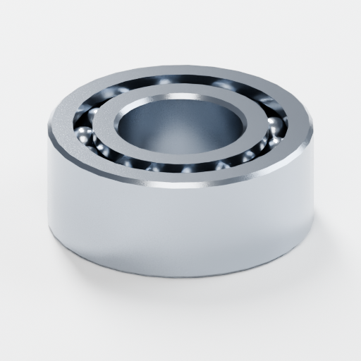
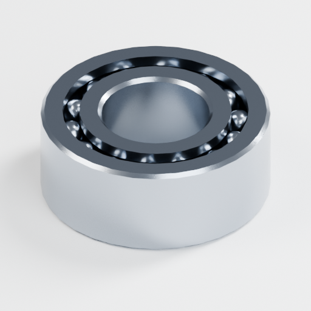
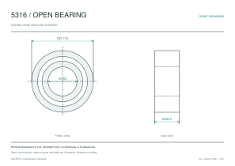

<!-- bearing-catalogue:start -->
# 5316 bearing - 80 x 170 x 68.3 mm

## Summary

Double row angular contact bearing: 80 mm bore, 170 mm outside diameter and 68.3 mm width.

| Product view | Isometric view |
| --- | --- |
|  |  |

Generated catalogue illustrations; the open internal geometry is illustrative.

## Details

**OOMP ID:** `hardware_bearing_5300_series_5316_size_80_mm_id_170_mm_od_68.3_mm_depth`

| Dimension | Nominal value |
| --- | --- |
| Bore / ID | 80 mm |
| Outside diameter / OD | 170 mm |
| Width / B | 68.3 mm |
| Catalogue contact angle | 25 degrees |

**Dimension evidence:** manufacturer checked (review retained from 2026-10-27).

Nominal presentation model. Raceways, pitch circle, chamfers and retainer geometry are illustrative; ball count/diameter are illustrative unless individually sourced. Not a manufacturer reconstruction, load-rating model or manufacturing/tolerance certification. Unspecified closure is presented open. The mesh shows open races and balls; retainers, seals and exact contact surfaces are omitted.

Contact-angle authority: **selected catalogue convention**. The mesh does not reconstruct the manufacturer contact surfaces.



[Printable A4 dimension sheet](working_dimension_a4.pdf) · [1:1 outline](working_svg.svg)

### Source evidence

- [https://www.rbibearing.com/products/ball-bearings/5300-series/](https://www.rbibearing.com/products/ball-bearings/5300-series/)
- [https://www.nskamericas.com/tools-resources/abc-bearings/angular-contact-ball-bearings/](https://www.nskamericas.com/tools-resources/abc-bearings/angular-contact-ball-bearings/)

[Retained research and corrected dimensions](../../source_file/solidcraft/) · [Editable declaration](../../working_oomp_declarations_bearing.py)

## Parts

[Canonical part folder](.) · [Metadata](working.yaml) · [Browse this series](../../navigation/5300/README.md)

### Files

- [Editable OpenSCAD geometry](3dpr.scad)
- [Full model / GLB / metres, Y-up](three_d_model/model_full.glb)
- [Lightweight model / GLB / metres, Y-up](three_d_model/model_display.glb)
- [Editable Blender studio](three_d_model/studio.blend)
- [Product render / 2048 px](three_d_model/render_product_high.png)
- [Isometric render / 2048 px](three_d_model/render_high.png)
- [Populated model and render recipe](three_d_model/parameters.json)
- [Mesh measurements and artifact hashes](three_d_model/manifest.json)
- [Retained native CAD success manifest](solidcraft/latest_success.json)
- [76.2 x 50.8 mm label](label_bearing_3x2.pdf)
- [38.1 x 25.4 mm label](label_bearing_1_5x1.pdf)
- [Retained editable native bearing / SolidCraft](solidcraft/generations/5cc1c8038403083e_20261027T121625Z_e9a6bd62/bearing_5316_open.solidcraft)

### Orthographic views

| Quality | Isometric | Front | Back | Left | Right | Top | Bottom |
| --- | --- | --- | --- | --- | --- | --- | --- |
| Full | [Isometric](three_d_model/full/isometric.svg) | [Front](three_d_model/full/front.svg) | [Back](three_d_model/full/back.svg) | [Left](three_d_model/full/left.svg) | [Right](three_d_model/full/right.svg) | [Top](three_d_model/full/top.svg) | [Bottom](three_d_model/full/bottom.svg) |
| Display | [Isometric](three_d_model/display/isometric.svg) | [Front](three_d_model/display/front.svg) | [Back](three_d_model/display/back.svg) | [Left](three_d_model/display/left.svg) | [Right](three_d_model/display/right.svg) | [Top](three_d_model/display/top.svg) | [Bottom](three_d_model/display/bottom.svg) |

## Assembly

No installation procedure is established for this generic size record. Select the required closure, clearance, tolerance and load rating from the actual purchased bearing specification.

<details>
<summary>Complete OOMP metadata</summary>

```yaml
depth: 68.3
id: hardware_bearing_5300_series_5316_size_80_mm_id_170_mm_od_68.3_mm_depth
od: 170.0
series: '5300'
size: '5316'
svg_details:
  svg_name: bearing_dimension
  title: 5316 / OPEN BEARING
  family: DOUBLE ROW ANGULAR CONTACT
  dimensions_mm:
    bore: 80.0
    outside: 170.0
    width: 68.3
    contact_angle_deg: 25.0
  sheet_width_mm: 297
  sheet_height_mm: 210
  ink: '#183336'
  accent: '#147d83'
  muted: '#61767a'
  paper: '#ffffff'
  race_face_fill: '#edf3f3'
  inner_race_face_outside_mm: 112.2962
  outer_race_face_inside_mm: 137.7038
  line_width_mm: 0.45
  font_family: Helvetica
  dimension_font_mm: 4
  title_font_mm: 9
  front_centre_mm:
  - 79
  - 103
  side_centre_mm:
  - 211
  - 103
  max_view_width_mm: 78
  max_side_width_mm: 55
  dimension_offset_mm: 12
  arrow_size_mm: 2
  note: Nominal dimensions in mm. Illustration only; no tolerances or fit allowances.
  authority: manufacturer checked
  internal_note: Open presentation; internal races and balls are illustrative. Retainers
    omitted.
  layout:
    left_margin_mm: 14
    right_margin_mm: 283
    title_y_mm: 22
    family_y_mm: 33
    family_font_mm: 3.5
    brand: OOMP / BEARINGS
    brand_font_mm: 3.5
    header_rule_y_mm: 40
    view_caption_y_mm: 173
    view_caption_font_mm: 3
    front_caption: FRONT VIEW
    side_caption: SIDE VIEW
    footer_rule_y_mm: 180
    note_y_mm: 187
    internal_note_y_mm: 194
    note_font_mm: 3.2
    source_y_mm: 202
    source_font_mm: 3
    source_prefix: 'SOURCE: '
    scale_prefix: A4 / scale
  dimension_style:
    line_width_mm: 0.25
    arrow_half_width_ratio: 0.3
    text_gap_mm: 2
    extension_mm: 2
    width_extension_mm: 3
    centre_extension_mm: 5
    dash_pattern_mm:
    - 2
    - 1
    flange_leader_offset_mm:
    - -13
    - 11
    flange_text_offset_mm:
    - -13
    - 16
    flange_font_mm: 3.5
  outline:
    ink: black
    line_width_mm: 0.1
taxonomy_1: hardware
taxonomy_10: ''
taxonomy_11: ''
taxonomy_12: ''
taxonomy_13: ''
taxonomy_14: ''
taxonomy_15: ''
taxonomy_2: bearing
taxonomy_3: 5300_series
taxonomy_4: 5316_size
taxonomy_5: 80_mm_id
taxonomy_6: 170_mm_od
taxonomy_7: 68.3_mm_depth
taxonomy_8: ''
taxonomy_9: ''
weight: 6,810
width: 68.3
dimension_selection:
  policy: standard_metric_open_catalogue
  previous_id: hardware_bearing_5300_series_5316_size_80_mm_id_170_mm_od_68.26_mm_depth
  sources:
  - https://www.rbibearing.com/products/ball-bearings/5300-series/
  - https://www.nskamericas.com/tools-resources/abc-bearings/angular-contact-ball-bearings/
  note: User selected standard catalogue variants on 2026-10-27; no sales ranking
    asserted.
url_chat: https://chatgpt.com/c/6ab89288-81fc-83eb-a212-a819c4f628f0
run_action: true
run_oomp: true
run_oomp_populate: true
run_scad: false
generate_stl: false
taxonomy_1_upper: HARDWARE
taxonomy_1_upper_length_1: H
taxonomy_1_upper_length_2: HA
taxonomy_1_upper_length_3: HAR
taxonomy_1_upper_length_4: HARD
taxonomy_1_upper_length_5: HARDW
taxonomy_1_length_1: h
taxonomy_1_length_2: ha
taxonomy_1_length_3: har
taxonomy_1_length_4: hard
taxonomy_1_length_5: hardw
taxonomy_1_capital: Hardware
taxonomy_1_first_letter: h
taxonomy_1_first_letter_upper: H
taxonomy_2_upper: BEARING
taxonomy_2_upper_length_1: B
taxonomy_2_upper_length_2: BE
taxonomy_2_upper_length_3: BEA
taxonomy_2_upper_length_4: BEAR
taxonomy_2_upper_length_5: BEARI
taxonomy_2_length_1: b
taxonomy_2_length_2: be
taxonomy_2_length_3: bea
taxonomy_2_length_4: bear
taxonomy_2_length_5: beari
taxonomy_2_capital: Bearing
taxonomy_2_first_letter: b
taxonomy_2_first_letter_upper: B
taxonomy_3_upper: 5300_SERIES
taxonomy_3_upper_length_1: '5'
taxonomy_3_upper_length_2: '53'
taxonomy_3_upper_length_3: '530'
taxonomy_3_upper_length_4: '5300'
taxonomy_3_upper_length_5: '5300_'
taxonomy_3_length_1: '5'
taxonomy_3_length_2: '53'
taxonomy_3_length_3: '530'
taxonomy_3_length_4: '5300'
taxonomy_3_length_5: '5300_'
taxonomy_3_capital: 5300 Series
taxonomy_3_first_letter: '5'
taxonomy_3_first_letter_upper: '5'
taxonomy_4_upper: 5316_SIZE
taxonomy_4_upper_length_1: '5'
taxonomy_4_upper_length_2: '53'
taxonomy_4_upper_length_3: '531'
taxonomy_4_upper_length_4: '5316'
taxonomy_4_upper_length_5: '5316_'
taxonomy_4_length_1: '5'
taxonomy_4_length_2: '53'
taxonomy_4_length_3: '531'
taxonomy_4_length_4: '5316'
taxonomy_4_length_5: '5316_'
taxonomy_4_capital: 5316 Size
taxonomy_4_first_letter: '5'
taxonomy_4_first_letter_upper: '5'
taxonomy_5_upper: 80_MM_ID
taxonomy_5_upper_length_1: '8'
taxonomy_5_upper_length_2: '80'
taxonomy_5_upper_length_3: '80_'
taxonomy_5_upper_length_4: 80_M
taxonomy_5_upper_length_5: 80_MM
taxonomy_5_length_1: '8'
taxonomy_5_length_2: '80'
taxonomy_5_length_3: '80_'
taxonomy_5_length_4: 80_m
taxonomy_5_length_5: 80_mm
taxonomy_5_capital: 80 mm Id
taxonomy_5_first_letter: '8'
taxonomy_5_first_letter_upper: '8'
taxonomy_6_upper: 170_MM_OD
taxonomy_6_upper_length_1: '1'
taxonomy_6_upper_length_2: '17'
taxonomy_6_upper_length_3: '170'
taxonomy_6_upper_length_4: '170_'
taxonomy_6_upper_length_5: 170_M
taxonomy_6_length_1: '1'
taxonomy_6_length_2: '17'
taxonomy_6_length_3: '170'
taxonomy_6_length_4: '170_'
taxonomy_6_length_5: 170_m
taxonomy_6_capital: 170 mm Od
taxonomy_6_first_letter: '1'
taxonomy_6_first_letter_upper: '1'
taxonomy_7_upper: 68.3_MM_DEPTH
taxonomy_7_upper_length_1: '6'
taxonomy_7_upper_length_2: '68'
taxonomy_7_upper_length_3: '68.'
taxonomy_7_upper_length_4: '68.3'
taxonomy_7_upper_length_5: '68.3_'
taxonomy_7_length_1: '6'
taxonomy_7_length_2: '68'
taxonomy_7_length_3: '68.'
taxonomy_7_length_4: '68.3'
taxonomy_7_length_5: '68.3_'
taxonomy_7_capital: 68.3 mm Depth
taxonomy_7_first_letter: '6'
taxonomy_7_first_letter_upper: '6'
id_no_class: hardware_bearing_5300_series_5316_size_80_mm_id_170_mm_od_68.3_mm_depth
id_no_type: hardware_bearing_5300_series_5316_size_80_mm_id_170_mm_od_68.3_mm_depth
id_no_size: hardware_bearing_5300_series_size_80_mm_id_170_mm_od_68.3_mm_depth
oomp_key: oomp_hardware_bearing_5300_series_5316_size_80_mm_id_170_mm_od_68.3_mm_depth
link_github: https://github.com/oomlout/oomp_bearing_version_5/tree/main/parts/hardware_bearing_5300_series_5316_size_80_mm_id_170_mm_od_68.3_mm_depth
link_main: https://github.com/oomlout/oomlout_oomp_version_1_messy/tree/main/parts/hardware_bearing_5300_series_5316_size_80_mm_id_170_mm_od_68.3_mm_depth
link_redirect: https://github.com/oomlout/oomlout_oomp_version_1_messy/tree/main/parts/hardware_bearing_5300_series_5316_size_80_mm_id_170_mm_od_68.3_mm_depth
directory: parts/hardware_bearing_5300_series_5316_size_80_mm_id_170_mm_od_68.3_mm_depth
name: 5316 bearing
name_no_class: Hardware Bearing 5300 Series 5316 Size 80 Mm Id 170 Mm Od 68.3 Mm Depth
name_no_type: Hardware Bearing 5300 Series 5316 Size 80 Mm Id 170 Mm Od 68.3 Mm Depth
name_no_size: Hardware Bearing 5300 Series Size 80 Mm Id 170 Mm Od 68.3 Mm Depth
md5: 229d72df0f9df9fae16b3518b8bc3a47
md5_5: 229d7
md5_5_upper: 229D7
md5_6: 229d72
md5_6_upper: 229D72
md5_6_alpha: 1cmeq
md5_6_alpha_upper: 1CMEQ
md5_10: 229d72df0f
md5_10_upper: 229D72DF0F
bip_39_full_array:
- card
- twist
- result
- busy
- test
- word
- mad
- grit
- board
- shine
- attend
- monkey
bip_39_full_space: card twist result busy test word mad grit board shine attend monkey
bip_39_full_no_space: cardtwistresultbusytestwordmadgritboardshineattendmonkey
bip_39_full_underscore: card_twist_result_busy_test_word_mad_grit_board_shine_attend_monkey
bip_39_2_word_array:
- card
- twist
bip_39_2_word_space: card twist
bip_39_2_word_no_space: cardtwist
bip_39_2_word_underscore: card_twist
bip_39_3_word_array:
- card
- twist
- result
bip_39_3_word_space: card twist result
bip_39_3_word_no_space: cardtwistresult
bip_39_3_word_underscore: card_twist_result
name_space: hardware bearing 5300 series 5316 size 80 mm id 170 mm od 68.3 mm depth
name_proper: 5316 bearing
name_upper: HARDWARE BEARING 5300 SERIES 5316 SIZE 80 MM ID 170 MM OD 68.3 MM DEPTH
oomlout_ai_roboclick_1:
  file_test: ''
  actions:
  - command: text_jinja_template
    description: Bold bearing label 3x2
    file_template: C:\od\OneDrive\docs\oomp_bearing\source_file\template_jinja\label_bearing_bold\3x2.svg.j2
    file_output: label_bearing_bold_3x2.svg
    dict_data_yaml_files:
      label_source: C:\od\OneDrive\docs\oomp_bearing\parts_source\hardware_bearing_5300_series_5316_size_80_mm_id_170_mm_od_68_3_mm_depth\working.yaml
      label_manual: C:\od\OneDrive\docs\oomp_bearing\parts\hardware_bearing_5300_series_5316_size_80_mm_id_170_mm_od_68.3_mm_depth\working_manual.yaml
    convert_to_pdf: false
    convert_to_png: false
oomlout_ai_roboclick_2:
  file_test: ''
  actions:
  - command: text_jinja_template
    description: Bold bearing label 1_5x1
    file_template: C:\od\OneDrive\docs\oomp_bearing\source_file\template_jinja\label_bearing_bold\1_5x1.svg.j2
    file_output: label_bearing_bold_1_5x1.svg
    dict_data_yaml_files:
      label_source: C:\od\OneDrive\docs\oomp_bearing\parts_source\hardware_bearing_5300_series_5316_size_80_mm_id_170_mm_od_68_3_mm_depth\working.yaml
      label_manual: C:\od\OneDrive\docs\oomp_bearing\parts\hardware_bearing_5300_series_5316_size_80_mm_id_170_mm_od_68.3_mm_depth\working_manual.yaml
    convert_to_pdf: false
    convert_to_png: false
catalogue_schema: oomp_bearing_v5
oomp_id: hardware_bearing_5300_series_5316_size_80_mm_id_170_mm_od_68.3_mm_depth
family: double_row_angular_contact
dimensions_mm:
  bore: 80.0
  outside: 170.0
  width: 68.3
  contact_angle_deg: 25.0
bore: 80.0
dimension_authority: manufacturer_checked
source_checked: '2026-10-27'
sources:
- https://www.rbibearing.com/products/ball-bearings/5300-series/
- https://www.nskamericas.com/tools-resources/abc-bearings/angular-contact-ball-bearings/
model_note: Nominal presentation model. Raceways, pitch circle, chamfers and retainer
  geometry are illustrative; ball count/diameter are illustrative unless individually
  sourced. Not a manufacturer reconstruction, load-rating model or manufacturing/tolerance
  certification. Unspecified closure is presented open. The mesh shows open races
  and balls; retainers, seals and exact contact surfaces are omitted.
closure: open
three_d_model_details:
  schema_version: 1
  generator: bearing_open
  output_folder: three_d_model
  parameters:
    bore: 80.0
    outside: 170.0
    width: 68.3
    edge: 2.6999999999999997
    pitch_radius: 62.5
    ball_radius: 10.245
    groove_radius: 10.757249999999999
    inner_shoulder: 56.1481
    outer_shoulder: 68.8519
    cage_half_width: 5.63475
    cage_low: 9.73275
    cage_high: 11.781749999999999
    window_radius: 4.917599999999999
    contact_angle_deg: 25.0
    contact_offset: 0.256125
    identity: hardware_bearing_5300_series_5316_size_80_mm_id_170_mm_od_68.3_mm_depth
    specification: 5316 / 80 x 170 x 68.3 mm
    characteristic_dimension_mm: 170.0
    characteristic_dimension_basis: maximum nominal envelope dimension
    ball_count: 28
    balls_per_row: 14
    row_count: 2
    ball_specification: illustrative
    contact_angle_authority: selected_catalogue_convention
    row_centres_z:
    - 17.075
    - 51.224999999999994
    components:
    - name: outer_race
      shape: revolved_profile
      profile_mm:
      - - 82.3
        - 0
      - - 85.0
        - 2.6999999999999997
      - - 85.0
        - 65.6
      - - 82.3
        - 68.3
      - - 68.8519
        - 68.3
      - - 68.8519
        - 65.6
      - - 68.8519
        - 61.98224999999999
      - - 68.8519
        - 61.44438749999999
      - - 68.8519
        - 60.906524999999995
      - - 68.8519
        - 60.36866249999999
      - - 68.95434999999999
        - 59.830799999999996
      - - 69.61525207273739
        - 59.292937499999994
      - - 70.18221309629426
        - 58.75507499999999
      - - 70.6748022555499
        - 58.217212499999995
      - - 71.1058
        - 57.67934999999999
      - - 71.48407497880798
        - 57.1414875
      - - 71.81605177486016
        - 56.603624999999994
      - - 72.10653142300038
        - 56.06576249999999
      - - 72.35918247891274
        - 55.527899999999995
      - - 72.57685070774068
        - 54.99003749999999
      - - 72.76176247444243
        - 54.452175
      - - 72.91566252524743
        - 53.914312499999994
      - - 73.03990941422174
        - 53.37644999999999
      - - 73.1355424376166
        - 52.838587499999996
      - - 73.2033286078152
        - 52.30072499999999
      - - 73.24379502287687
        - 51.7628625
      - - 73.25725
        - 51.224999999999994
      - - 73.24379502287687
        - 50.68713749999999
      - - 73.2033286078152
        - 50.149274999999996
      - - 73.1355424376166
        - 49.61141249999999
      - - 73.03990941422174
        - 49.07355
      - - 72.91566252524743
        - 48.535687499999995
      - - 72.76176247444243
        - 47.99782499999999
      - - 72.57685070774068
        - 47.459962499999996
      - - 72.35918247891274
        - 46.92209999999999
      - - 72.10653142300038
        - 46.3842375
      - - 71.81605177486016
        - 45.846374999999995
      - - 71.48407497880798
        - 45.30851249999999
      - - 71.1058
        - 44.770649999999996
      - - 70.6748022555499
        - 44.23278749999999
      - - 70.18221309629426
        - 43.694925
      - - 69.61525207273739
        - 43.157062499999995
      - - 68.95434999999999
        - 42.61919999999999
      - - 68.8519
        - 42.0813375
      - - 68.8519
        - 41.543474999999994
      - - 68.8519
        - 41.0056125
      - - 68.8519
        - 40.467749999999995
      - - 68.8519
        - 27.83225
      - - 68.8519
        - 27.2943875
      - - 68.8519
        - 26.756525
      - - 68.8519
        - 26.218662499999997
      - - 68.95435
        - 25.680799999999998
      - - 69.61525207273739
        - 25.1429375
      - - 70.18221309629426
        - 24.605075
      - - 70.6748022555499
        - 24.0672125
      - - 71.1058
        - 23.529349999999997
      - - 71.48407497880798
        - 22.991487499999998
      - - 71.81605177486016
        - 22.453625
      - - 72.10653142300038
        - 21.9157625
      - - 72.35918247891274
        - 21.377899999999997
      - - 72.57685070774068
        - 20.8400375
      - - 72.76176247444243
        - 20.302175
      - - 72.91566252524743
        - 19.7643125
      - - 73.03990941422174
        - 19.22645
      - - 73.1355424376166
        - 18.688587499999997
      - - 73.2033286078152
        - 18.150725
      - - 73.24379502287687
        - 17.6128625
      - - 73.25725
        - 17.075
      - - 73.24379502287687
        - 16.5371375
      - - 73.2033286078152
        - 15.999274999999999
      - - 73.1355424376166
        - 15.4614125
      - - 73.03990941422174
        - 14.923549999999999
      - - 72.91566252524743
        - 14.3856875
      - - 72.76176247444243
        - 13.847825
      - - 72.57685070774068
        - 13.3099625
      - - 72.35918247891274
        - 12.7721
      - - 72.10653142300038
        - 12.234237499999999
      - - 71.81605177486016
        - 11.696375
      - - 71.48407497880798
        - 11.1585125
      - - 71.1058
        - 10.62065
      - - 70.6748022555499
        - 10.0827875
      - - 70.18221309629426
        - 9.544925
      - - 69.61525207273739
        - 9.0070625
      - - 68.95435
        - 8.4692
      - - 68.8519
        - 7.9313375
      - - 68.8519
        - 7.3934750000000005
      - - 68.8519
        - 6.8556125
      - - 68.8519
        - 6.31775
      - - 68.8519
        - 2.6999999999999997
      - - 68.8519
        - 0.0
      - - 82.3
        - 0
    - name: inner_race
      shape: revolved_profile
      profile_mm:
      - - 56.1481
        - 0.0
      - - 56.1481
        - 2.6999999999999997
      - - 56.1481
        - 6.31775
      - - 56.1481
        - 6.8556125
      - - 56.1481
        - 7.3934750000000005
      - - 56.1481
        - 7.9313375
      - - 56.04565
        - 8.4692
      - - 55.38474792726261
        - 9.0070625
      - - 54.817786903705745
        - 9.544925
      - - 54.3251977444501
        - 10.0827875
      - - 53.8942
        - 10.62065
      - - 53.51592502119201
        - 11.1585125
      - - 53.183948225139844
        - 11.696375
      - - 52.89346857699962
        - 12.234237499999999
      - - 52.64081752108726
        - 12.7721
      - - 52.423149292259325
        - 13.3099625
      - - 52.238237525557565
        - 13.847825
      - - 52.084337474752566
        - 14.3856875
      - - 51.96009058577826
        - 14.923549999999999
      - - 51.86445756238339
        - 15.4614125
      - - 51.79667139218481
        - 15.999274999999999
      - - 51.75620497712313
        - 16.5371375
      - - 51.74275
        - 17.075
      - - 51.75620497712313
        - 17.6128625
      - - 51.79667139218481
        - 18.150725
      - - 51.86445756238339
        - 18.688587499999997
      - - 51.96009058577826
        - 19.22645
      - - 52.084337474752566
        - 19.7643125
      - - 52.238237525557565
        - 20.302175
      - - 52.423149292259325
        - 20.8400375
      - - 52.64081752108726
        - 21.377899999999997
      - - 52.89346857699962
        - 21.9157625
      - - 53.183948225139844
        - 22.453625
      - - 53.51592502119201
        - 22.991487499999998
      - - 53.8942
        - 23.529349999999997
      - - 54.3251977444501
        - 24.0672125
      - - 54.817786903705745
        - 24.605075
      - - 55.38474792726261
        - 25.1429375
      - - 56.04565
        - 25.680799999999998
      - - 56.1481
        - 26.218662499999997
      - - 56.1481
        - 26.756525
      - - 56.1481
        - 27.2943875
      - - 56.1481
        - 27.83225
      - - 56.1481
        - 40.467749999999995
      - - 56.1481
        - 41.0056125
      - - 56.1481
        - 41.543474999999994
      - - 56.1481
        - 42.0813375
      - - 56.04565
        - 42.61919999999999
      - - 55.38474792726261
        - 43.157062499999995
      - - 54.81778690370574
        - 43.694925
      - - 54.3251977444501
        - 44.23278749999999
      - - 53.8942
        - 44.770649999999996
      - - 53.51592502119202
        - 45.30851249999999
      - - 53.183948225139844
        - 45.846374999999995
      - - 52.89346857699962
        - 46.3842375
      - - 52.64081752108726
        - 46.92209999999999
      - - 52.423149292259325
        - 47.459962499999996
      - - 52.238237525557565
        - 47.99782499999999
      - - 52.084337474752566
        - 48.535687499999995
      - - 51.96009058577826
        - 49.07355
      - - 51.86445756238339
        - 49.61141249999999
      - - 51.79667139218481
        - 50.149274999999996
      - - 51.75620497712313
        - 50.68713749999999
      - - 51.74275
        - 51.224999999999994
      - - 51.75620497712313
        - 51.7628625
      - - 51.79667139218481
        - 52.30072499999999
      - - 51.86445756238339
        - 52.838587499999996
      - - 51.96009058577826
        - 53.37644999999999
      - - 52.084337474752566
        - 53.914312499999994
      - - 52.238237525557565
        - 54.452175
      - - 52.423149292259325
        - 54.99003749999999
      - - 52.64081752108726
        - 55.527899999999995
      - - 52.89346857699962
        - 56.06576249999999
      - - 53.183948225139844
        - 56.603624999999994
      - - 53.51592502119202
        - 57.1414875
      - - 53.8942
        - 57.67934999999999
      - - 54.3251977444501
        - 58.217212499999995
      - - 54.81778690370574
        - 58.75507499999999
      - - 55.38474792726261
        - 59.292937499999994
      - - 56.04565
        - 59.830799999999996
      - - 56.1481
        - 60.36866249999999
      - - 56.1481
        - 60.906524999999995
      - - 56.1481
        - 61.44438749999999
      - - 56.1481
        - 61.98224999999999
      - - 56.1481
        - 65.6
      - - 56.1481
        - 68.3
      - - 42.7
        - 68.3
      - - 40.0
        - 65.6
      - - 40.0
        - 2.6999999999999997
      - - 42.7
        - 0
      - - 56.1481
        - 0.0
    - name: ball_row_1_1
      shape: sphere
      radius_mm: 10.245
      centre_mm:
      - 62.5
      - 0.0
      - 17.075
    - name: ball_row_1_2
      shape: sphere
      radius_mm: 10.245
      centre_mm:
      - 56.310554243901194
      - 27.11773369484738
      - 17.075
    - name: ball_row_1_3
      shape: sphere
      radius_mm: 10.245
      centre_mm:
      - 38.96811261617085
      - 48.86446765425186
      - 17.075
    - name: ball_row_1_4
      shape: sphere
      radius_mm: 10.245
      centre_mm:
      - 13.907558372269653
      - 60.93299451136398
      - 17.075
    - name: ball_row_1_5
      shape: sphere
      radius_mm: 10.245
      centre_mm:
      - -13.907558372269646
      - 60.93299451136398
      - 17.075
    - name: ball_row_1_6
      shape: sphere
      radius_mm: 10.245
      centre_mm:
      - -38.96811261617084
      - 48.86446765425187
      - 17.075
    - name: ball_row_1_7
      shape: sphere
      radius_mm: 10.245
      centre_mm:
      - -56.31055424390119
      - 27.117733694847388
      - 17.075
    - name: ball_row_1_8
      shape: sphere
      radius_mm: 10.245
      centre_mm:
      - -62.5
      - 7.654042494670958e-15
      - 17.075
    - name: ball_row_1_9
      shape: sphere
      radius_mm: 10.245
      centre_mm:
      - -56.310554243901194
      - -27.117733694847377
      - 17.075
    - name: ball_row_1_10
      shape: sphere
      radius_mm: 10.245
      centre_mm:
      - -38.968112616170856
      - -48.864467654251854
      - 17.075
    - name: ball_row_1_11
      shape: sphere
      radius_mm: 10.245
      centre_mm:
      - -13.907558372269662
      - -60.93299451136398
      - 17.075
    - name: ball_row_1_12
      shape: sphere
      radius_mm: 10.245
      centre_mm:
      - 13.907558372269584
      - -60.93299451136399
      - 17.075
    - name: ball_row_1_13
      shape: sphere
      radius_mm: 10.245
      centre_mm:
      - 38.968112616170835
      - -48.86446765425187
      - 17.075
    - name: ball_row_1_14
      shape: sphere
      radius_mm: 10.245
      centre_mm:
      - 56.31055424390121
      - -27.117733694847345
      - 17.075
    - name: ball_row_2_1
      shape: sphere
      radius_mm: 10.245
      centre_mm:
      - 62.5
      - 0.0
      - 51.224999999999994
    - name: ball_row_2_2
      shape: sphere
      radius_mm: 10.245
      centre_mm:
      - 56.310554243901194
      - 27.11773369484738
      - 51.224999999999994
    - name: ball_row_2_3
      shape: sphere
      radius_mm: 10.245
      centre_mm:
      - 38.96811261617085
      - 48.86446765425186
      - 51.224999999999994
    - name: ball_row_2_4
      shape: sphere
      radius_mm: 10.245
      centre_mm:
      - 13.907558372269653
      - 60.93299451136398
      - 51.224999999999994
    - name: ball_row_2_5
      shape: sphere
      radius_mm: 10.245
      centre_mm:
      - -13.907558372269646
      - 60.93299451136398
      - 51.224999999999994
    - name: ball_row_2_6
      shape: sphere
      radius_mm: 10.245
      centre_mm:
      - -38.96811261617084
      - 48.86446765425187
      - 51.224999999999994
    - name: ball_row_2_7
      shape: sphere
      radius_mm: 10.245
      centre_mm:
      - -56.31055424390119
      - 27.117733694847388
      - 51.224999999999994
    - name: ball_row_2_8
      shape: sphere
      radius_mm: 10.245
      centre_mm:
      - -62.5
      - 7.654042494670958e-15
      - 51.224999999999994
    - name: ball_row_2_9
      shape: sphere
      radius_mm: 10.245
      centre_mm:
      - -56.310554243901194
      - -27.117733694847377
      - 51.224999999999994
    - name: ball_row_2_10
      shape: sphere
      radius_mm: 10.245
      centre_mm:
      - -38.968112616170856
      - -48.864467654251854
      - 51.224999999999994
    - name: ball_row_2_11
      shape: sphere
      radius_mm: 10.245
      centre_mm:
      - -13.907558372269662
      - -60.93299451136398
      - 51.224999999999994
    - name: ball_row_2_12
      shape: sphere
      radius_mm: 10.245
      centre_mm:
      - 13.907558372269584
      - -60.93299451136399
      - 51.224999999999994
    - name: ball_row_2_13
      shape: sphere
      radius_mm: 10.245
      centre_mm:
      - 38.968112616170835
      - -48.86446765425187
      - 51.224999999999994
    - name: ball_row_2_14
      shape: sphere
      radius_mm: 10.245
      centre_mm:
      - 56.31055424390121
      - -27.117733694847345
      - 51.224999999999994
  modelling_note: Nominal presentation model. Raceways, pitch circle, chamfers and
    retainer geometry are illustrative; ball count/diameter are illustrative unless
    individually sourced. Not a manufacturer reconstruction, load-rating model or
    manufacturing/tolerance certification. Unspecified closure is presented open.
    The mesh shows open races and balls; retainers, seals and exact contact surfaces
    are omitted.
  dimension_authority: manufacturer_checked
  model_formats:
  - glb
  variants:
    full:
      angular_segments: 128
      sphere_subdivisions: 3
    display:
      angular_segments: 32
      sphere_subdivisions: 2
  views:
  - isometric
  - front
  - back
  - left
  - right
  - top
  - bottom
  material:
    name: Illustrative polished bearing steel
    base_colour_srgb:
    - 0.62
    - 0.65
    - 0.69
    metallic: 1.0
    roughness: 0.22
    roughness_variation: 0.045
    coat_weight: 0.02
    coat_roughness: 0.28
    microtexture_spacing_mm: 0.025
    microtexture_height_um: 0.8
    note: Illustrative bearing steel; material grade and finish are not specified.
  studio:
    engine: cycles
    device: auto
    seed: 7991
    low_samples: 24
    high_samples: 48
    adaptive_threshold: 0.015
    denoise: true
    view_transform: AgX
    look: AgX - Medium High Contrast
    exposure: 0.0
    world_colour:
    - 0.78
    - 0.82
    - 0.9
    world_strength: 0.35
    floor_colour_srgb:
    - 0.93
    - 0.935
    - 0.94
    floor_roughness: 0.55
    framing_margin: 0.13
    lights:
    - name: Key softbox
      position:
      - -3
      - -4
      - 6
      power: 650.0
      width: 4.0
      height: 5.0
      colour:
      - 1.0
      - 0.96
      - 0.9
    - name: Fill softbox
      position:
      - 4
      - -1
      - 3
      power: 330.0
      width: 3.0
      height: 4.0
      colour:
      - 0.9
      - 0.95
      - 1.0
    - name: Rim strip
      position:
      - 1
      - 4
      - 4
      power: 850.0
      width: 1.2
      height: 5.0
      colour:
      - 1.0
      - 1.0
      - 1.0
    poses:
      isometric:
        camera_eye:
        - 1
        - -1
        - 1
        projection: orthographic
        orientation: principal axis Z up
      product:
        camera_eye:
        - -6
        - -10
        - 6
        projection: orthographic
        orientation: resting on lower face
        yaw_degrees: -12.0
        support: Stable convex-hull support using actual mesh centre of mass.
        resting_axis: face
  renders:
    low:
      file: render_low.png
      variant: display
      pixels: 512
      view: isometric
    high:
      file: render_high.png
      variant: full
      pixels: 2048
      view: isometric
    product_low:
      file: render_product_low.png
      variant: display
      pixels: 512
      view: product
    product_high:
      file: render_product_high.png
      variant: full
      pixels: 2048
      view: product
oobb_type: bearing_open
oobb_details:
  oobb_type: bearing_open
  run_scad: true
  run_solidcraft: false
  angular_segments: 128
  components:
  - name: outer_race
    shape: revolved_profile
    profile_mm:
    - - 82.3
      - 0
    - - 85.0
      - 2.6999999999999997
    - - 85.0
      - 65.6
    - - 82.3
      - 68.3
    - - 68.8519
      - 68.3
    - - 68.8519
      - 65.6
    - - 68.8519
      - 61.98224999999999
    - - 68.8519
      - 61.44438749999999
    - - 68.8519
      - 60.906524999999995
    - - 68.8519
      - 60.36866249999999
    - - 68.95434999999999
      - 59.830799999999996
    - - 69.61525207273739
      - 59.292937499999994
    - - 70.18221309629426
      - 58.75507499999999
    - - 70.6748022555499
      - 58.217212499999995
    - - 71.1058
      - 57.67934999999999
    - - 71.48407497880798
      - 57.1414875
    - - 71.81605177486016
      - 56.603624999999994
    - - 72.10653142300038
      - 56.06576249999999
    - - 72.35918247891274
      - 55.527899999999995
    - - 72.57685070774068
      - 54.99003749999999
    - - 72.76176247444243
      - 54.452175
    - - 72.91566252524743
      - 53.914312499999994
    - - 73.03990941422174
      - 53.37644999999999
    - - 73.1355424376166
      - 52.838587499999996
    - - 73.2033286078152
      - 52.30072499999999
    - - 73.24379502287687
      - 51.7628625
    - - 73.25725
      - 51.224999999999994
    - - 73.24379502287687
      - 50.68713749999999
    - - 73.2033286078152
      - 50.149274999999996
    - - 73.1355424376166
      - 49.61141249999999
    - - 73.03990941422174
      - 49.07355
    - - 72.91566252524743
      - 48.535687499999995
    - - 72.76176247444243
      - 47.99782499999999
    - - 72.57685070774068
      - 47.459962499999996
    - - 72.35918247891274
      - 46.92209999999999
    - - 72.10653142300038
      - 46.3842375
    - - 71.81605177486016
      - 45.846374999999995
    - - 71.48407497880798
      - 45.30851249999999
    - - 71.1058
      - 44.770649999999996
    - - 70.6748022555499
      - 44.23278749999999
    - - 70.18221309629426
      - 43.694925
    - - 69.61525207273739
      - 43.157062499999995
    - - 68.95434999999999
      - 42.61919999999999
    - - 68.8519
      - 42.0813375
    - - 68.8519
      - 41.543474999999994
    - - 68.8519
      - 41.0056125
    - - 68.8519
      - 40.467749999999995
    - - 68.8519
      - 27.83225
    - - 68.8519
      - 27.2943875
    - - 68.8519
      - 26.756525
    - - 68.8519
      - 26.218662499999997
    - - 68.95435
      - 25.680799999999998
    - - 69.61525207273739
      - 25.1429375
    - - 70.18221309629426
      - 24.605075
    - - 70.6748022555499
      - 24.0672125
    - - 71.1058
      - 23.529349999999997
    - - 71.48407497880798
      - 22.991487499999998
    - - 71.81605177486016
      - 22.453625
    - - 72.10653142300038
      - 21.9157625
    - - 72.35918247891274
      - 21.377899999999997
    - - 72.57685070774068
      - 20.8400375
    - - 72.76176247444243
      - 20.302175
    - - 72.91566252524743
      - 19.7643125
    - - 73.03990941422174
      - 19.22645
    - - 73.1355424376166
      - 18.688587499999997
    - - 73.2033286078152
      - 18.150725
    - - 73.24379502287687
      - 17.6128625
    - - 73.25725
      - 17.075
    - - 73.24379502287687
      - 16.5371375
    - - 73.2033286078152
      - 15.999274999999999
    - - 73.1355424376166
      - 15.4614125
    - - 73.03990941422174
      - 14.923549999999999
    - - 72.91566252524743
      - 14.3856875
    - - 72.76176247444243
      - 13.847825
    - - 72.57685070774068
      - 13.3099625
    - - 72.35918247891274
      - 12.7721
    - - 72.10653142300038
      - 12.234237499999999
    - - 71.81605177486016
      - 11.696375
    - - 71.48407497880798
      - 11.1585125
    - - 71.1058
      - 10.62065
    - - 70.6748022555499
      - 10.0827875
    - - 70.18221309629426
      - 9.544925
    - - 69.61525207273739
      - 9.0070625
    - - 68.95435
      - 8.4692
    - - 68.8519
      - 7.9313375
    - - 68.8519
      - 7.3934750000000005
    - - 68.8519
      - 6.8556125
    - - 68.8519
      - 6.31775
    - - 68.8519
      - 2.6999999999999997
    - - 68.8519
      - 0.0
    - - 82.3
      - 0
  - name: inner_race
    shape: revolved_profile
    profile_mm:
    - - 56.1481
      - 0.0
    - - 56.1481
      - 2.6999999999999997
    - - 56.1481
      - 6.31775
    - - 56.1481
      - 6.8556125
    - - 56.1481
      - 7.3934750000000005
    - - 56.1481
      - 7.9313375
    - - 56.04565
      - 8.4692
    - - 55.38474792726261
      - 9.0070625
    - - 54.817786903705745
      - 9.544925
    - - 54.3251977444501
      - 10.0827875
    - - 53.8942
      - 10.62065
    - - 53.51592502119201
      - 11.1585125
    - - 53.183948225139844
      - 11.696375
    - - 52.89346857699962
      - 12.234237499999999
    - - 52.64081752108726
      - 12.7721
    - - 52.423149292259325
      - 13.3099625
    - - 52.238237525557565
      - 13.847825
    - - 52.084337474752566
      - 14.3856875
    - - 51.96009058577826
      - 14.923549999999999
    - - 51.86445756238339
      - 15.4614125
    - - 51.79667139218481
      - 15.999274999999999
    - - 51.75620497712313
      - 16.5371375
    - - 51.74275
      - 17.075
    - - 51.75620497712313
      - 17.6128625
    - - 51.79667139218481
      - 18.150725
    - - 51.86445756238339
      - 18.688587499999997
    - - 51.96009058577826
      - 19.22645
    - - 52.084337474752566
      - 19.7643125
    - - 52.238237525557565
      - 20.302175
    - - 52.423149292259325
      - 20.8400375
    - - 52.64081752108726
      - 21.377899999999997
    - - 52.89346857699962
      - 21.9157625
    - - 53.183948225139844
      - 22.453625
    - - 53.51592502119201
      - 22.991487499999998
    - - 53.8942
      - 23.529349999999997
    - - 54.3251977444501
      - 24.0672125
    - - 54.817786903705745
      - 24.605075
    - - 55.38474792726261
      - 25.1429375
    - - 56.04565
      - 25.680799999999998
    - - 56.1481
      - 26.218662499999997
    - - 56.1481
      - 26.756525
    - - 56.1481
      - 27.2943875
    - - 56.1481
      - 27.83225
    - - 56.1481
      - 40.467749999999995
    - - 56.1481
      - 41.0056125
    - - 56.1481
      - 41.543474999999994
    - - 56.1481
      - 42.0813375
    - - 56.04565
      - 42.61919999999999
    - - 55.38474792726261
      - 43.157062499999995
    - - 54.81778690370574
      - 43.694925
    - - 54.3251977444501
      - 44.23278749999999
    - - 53.8942
      - 44.770649999999996
    - - 53.51592502119202
      - 45.30851249999999
    - - 53.183948225139844
      - 45.846374999999995
    - - 52.89346857699962
      - 46.3842375
    - - 52.64081752108726
      - 46.92209999999999
    - - 52.423149292259325
      - 47.459962499999996
    - - 52.238237525557565
      - 47.99782499999999
    - - 52.084337474752566
      - 48.535687499999995
    - - 51.96009058577826
      - 49.07355
    - - 51.86445756238339
      - 49.61141249999999
    - - 51.79667139218481
      - 50.149274999999996
    - - 51.75620497712313
      - 50.68713749999999
    - - 51.74275
      - 51.224999999999994
    - - 51.75620497712313
      - 51.7628625
    - - 51.79667139218481
      - 52.30072499999999
    - - 51.86445756238339
      - 52.838587499999996
    - - 51.96009058577826
      - 53.37644999999999
    - - 52.084337474752566
      - 53.914312499999994
    - - 52.238237525557565
      - 54.452175
    - - 52.423149292259325
      - 54.99003749999999
    - - 52.64081752108726
      - 55.527899999999995
    - - 52.89346857699962
      - 56.06576249999999
    - - 53.183948225139844
      - 56.603624999999994
    - - 53.51592502119202
      - 57.1414875
    - - 53.8942
      - 57.67934999999999
    - - 54.3251977444501
      - 58.217212499999995
    - - 54.81778690370574
      - 58.75507499999999
    - - 55.38474792726261
      - 59.292937499999994
    - - 56.04565
      - 59.830799999999996
    - - 56.1481
      - 60.36866249999999
    - - 56.1481
      - 60.906524999999995
    - - 56.1481
      - 61.44438749999999
    - - 56.1481
      - 61.98224999999999
    - - 56.1481
      - 65.6
    - - 56.1481
      - 68.3
    - - 42.7
      - 68.3
    - - 40.0
      - 65.6
    - - 40.0
      - 2.6999999999999997
    - - 42.7
      - 0
    - - 56.1481
      - 0.0
  - name: ball_row_1_1
    shape: sphere
    radius_mm: 10.245
    centre_mm:
    - 62.5
    - 0.0
    - 17.075
  - name: ball_row_1_2
    shape: sphere
    radius_mm: 10.245
    centre_mm:
    - 56.310554243901194
    - 27.11773369484738
    - 17.075
  - name: ball_row_1_3
    shape: sphere
    radius_mm: 10.245
    centre_mm:
    - 38.96811261617085
    - 48.86446765425186
    - 17.075
  - name: ball_row_1_4
    shape: sphere
    radius_mm: 10.245
    centre_mm:
    - 13.907558372269653
    - 60.93299451136398
    - 17.075
  - name: ball_row_1_5
    shape: sphere
    radius_mm: 10.245
    centre_mm:
    - -13.907558372269646
    - 60.93299451136398
    - 17.075
  - name: ball_row_1_6
    shape: sphere
    radius_mm: 10.245
    centre_mm:
    - -38.96811261617084
    - 48.86446765425187
    - 17.075
  - name: ball_row_1_7
    shape: sphere
    radius_mm: 10.245
    centre_mm:
    - -56.31055424390119
    - 27.117733694847388
    - 17.075
  - name: ball_row_1_8
    shape: sphere
    radius_mm: 10.245
    centre_mm:
    - -62.5
    - 7.654042494670958e-15
    - 17.075
  - name: ball_row_1_9
    shape: sphere
    radius_mm: 10.245
    centre_mm:
    - -56.310554243901194
    - -27.117733694847377
    - 17.075
  - name: ball_row_1_10
    shape: sphere
    radius_mm: 10.245
    centre_mm:
    - -38.968112616170856
    - -48.864467654251854
    - 17.075
  - name: ball_row_1_11
    shape: sphere
    radius_mm: 10.245
    centre_mm:
    - -13.907558372269662
    - -60.93299451136398
    - 17.075
  - name: ball_row_1_12
    shape: sphere
    radius_mm: 10.245
    centre_mm:
    - 13.907558372269584
    - -60.93299451136399
    - 17.075
  - name: ball_row_1_13
    shape: sphere
    radius_mm: 10.245
    centre_mm:
    - 38.968112616170835
    - -48.86446765425187
    - 17.075
  - name: ball_row_1_14
    shape: sphere
    radius_mm: 10.245
    centre_mm:
    - 56.31055424390121
    - -27.117733694847345
    - 17.075
  - name: ball_row_2_1
    shape: sphere
    radius_mm: 10.245
    centre_mm:
    - 62.5
    - 0.0
    - 51.224999999999994
  - name: ball_row_2_2
    shape: sphere
    radius_mm: 10.245
    centre_mm:
    - 56.310554243901194
    - 27.11773369484738
    - 51.224999999999994
  - name: ball_row_2_3
    shape: sphere
    radius_mm: 10.245
    centre_mm:
    - 38.96811261617085
    - 48.86446765425186
    - 51.224999999999994
  - name: ball_row_2_4
    shape: sphere
    radius_mm: 10.245
    centre_mm:
    - 13.907558372269653
    - 60.93299451136398
    - 51.224999999999994
  - name: ball_row_2_5
    shape: sphere
    radius_mm: 10.245
    centre_mm:
    - -13.907558372269646
    - 60.93299451136398
    - 51.224999999999994
  - name: ball_row_2_6
    shape: sphere
    radius_mm: 10.245
    centre_mm:
    - -38.96811261617084
    - 48.86446765425187
    - 51.224999999999994
  - name: ball_row_2_7
    shape: sphere
    radius_mm: 10.245
    centre_mm:
    - -56.31055424390119
    - 27.117733694847388
    - 51.224999999999994
  - name: ball_row_2_8
    shape: sphere
    radius_mm: 10.245
    centre_mm:
    - -62.5
    - 7.654042494670958e-15
    - 51.224999999999994
  - name: ball_row_2_9
    shape: sphere
    radius_mm: 10.245
    centre_mm:
    - -56.310554243901194
    - -27.117733694847377
    - 51.224999999999994
  - name: ball_row_2_10
    shape: sphere
    radius_mm: 10.245
    centre_mm:
    - -38.968112616170856
    - -48.864467654251854
    - 51.224999999999994
  - name: ball_row_2_11
    shape: sphere
    radius_mm: 10.245
    centre_mm:
    - -13.907558372269662
    - -60.93299451136398
    - 51.224999999999994
  - name: ball_row_2_12
    shape: sphere
    radius_mm: 10.245
    centre_mm:
    - 13.907558372269584
    - -60.93299451136399
    - 51.224999999999994
  - name: ball_row_2_13
    shape: sphere
    radius_mm: 10.245
    centre_mm:
    - 38.968112616170835
    - -48.86446765425187
    - 51.224999999999994
  - name: ball_row_2_14
    shape: sphere
    radius_mm: 10.245
    centre_mm:
    - 56.31055424390121
    - -27.117733694847345
    - 51.224999999999994
label_details:
  size: '5316'
  dimensions: 80 x 170 x 68.3 mm
  formats_mm:
  - - 76.2
    - 50.8
  - - 38.1
    - 25.4
  ink: '#183336'
  accent: '#147d83'
  paper: '#ffffff'
  font_family: Helvetica
  view_box_mm:
  - 0
  - 0
  - 76.2
  - 50.8
  file_stems:
  - label_bearing_3x2
  - label_bearing_1_5x1
  brand: OOMP / BEARING
  brand_position_mm:
  - 5
  - 10
  brand_font_mm: 3
  size_position_mm:
  - 5
  - 29
  size_font_mm: 14
  dimensions_position_mm:
  - 5
  - 42
  dimensions_font_mm: 4
readme_details:
  title: 5316 bearing - 80 x 170 x 68.3 mm
  description: 'Double row angular contact bearing: 80 mm bore, 170 mm outside diameter
    and 68.3 mm width.'
```

</details>
<!-- bearing-catalogue:end -->
