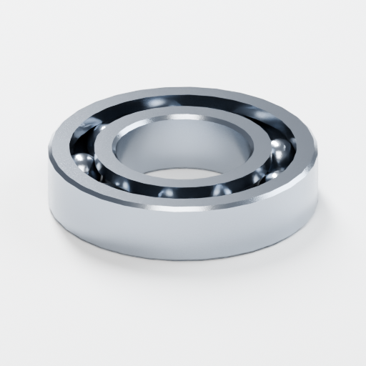
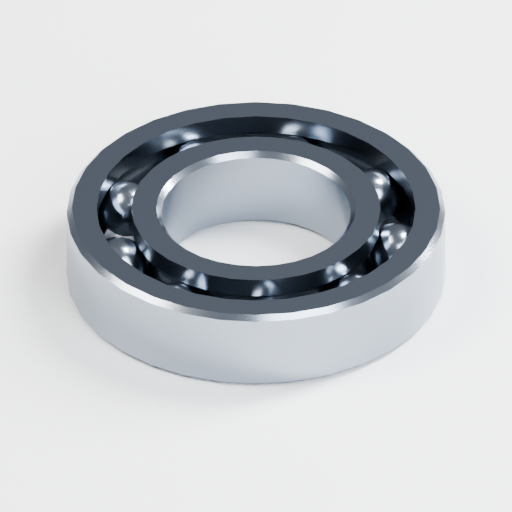
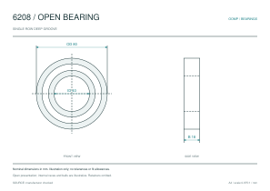

<!-- bearing-catalogue:start -->
# 6208 bearing - 40 x 80 x 18 mm

## Summary

Single row deep groove bearing: 40 mm bore, 80 mm outside diameter and 18 mm width.

| Product view | Isometric view |
| --- | --- |
|  |  |

Generated catalogue illustrations; the open internal geometry is illustrative.

## Details

**OOMP ID:** `hardware_bearing_6200_series_6208_size_40_mm_id_80_mm_od_18_mm_depth`

| Dimension | Nominal value |
| --- | --- |
| Bore / ID | 40 mm |
| Outside diameter / OD | 80 mm |
| Width / B | 18 mm |

**Dimension evidence:** manufacturer checked (review retained from 2026-10-27).

Nominal presentation model. Raceways, pitch circle, chamfers and retainer geometry are illustrative; ball count/diameter are illustrative unless individually sourced. Not a manufacturer reconstruction, load-rating model or manufacturing/tolerance certification. Unspecified closure is presented open. The mesh shows open races and balls; retainers, seals and exact contact surfaces are omitted.



[Printable A4 dimension sheet](working_dimension_a4.pdf) · [1:1 outline](working_svg.svg)

### Source evidence

- [https://www.nsk.com/in-en/engineering/6208-dgbb-sr.html](https://www.nsk.com/in-en/engineering/6208-dgbb-sr.html)

[Retained research and corrected dimensions](../../source_file/solidcraft/) · [Editable declaration](../../working_oomp_declarations_bearing.py)

## Parts

[Canonical part folder](.) · [Metadata](working.yaml) · [Browse this series](../../navigation/6200/README.md)

### Files

- [Editable OpenSCAD geometry](3dpr.scad)
- [Full model / GLB / metres, Y-up](three_d_model/model_full.glb)
- [Lightweight model / GLB / metres, Y-up](three_d_model/model_display.glb)
- [Editable Blender studio](three_d_model/studio.blend)
- [Product render / 2048 px](three_d_model/render_product_high.png)
- [Isometric render / 2048 px](three_d_model/render_high.png)
- [Populated model and render recipe](three_d_model/parameters.json)
- [Mesh measurements and artifact hashes](three_d_model/manifest.json)
- [Retained native CAD success manifest](solidcraft/latest_success.json)
- [76.2 x 50.8 mm label](label_bearing_3x2.pdf)
- [38.1 x 25.4 mm label](label_bearing_1_5x1.pdf)
- [Retained editable native bearing / SolidCraft](solidcraft/generations/7454b20da734f712_20261027T104656Z_fbb52a7d/bearing_6208_open.solidcraft)

### Orthographic views

| Quality | Isometric | Front | Back | Left | Right | Top | Bottom |
| --- | --- | --- | --- | --- | --- | --- | --- |
| Full | [Isometric](three_d_model/full/isometric.svg) | [Front](three_d_model/full/front.svg) | [Back](three_d_model/full/back.svg) | [Left](three_d_model/full/left.svg) | [Right](three_d_model/full/right.svg) | [Top](three_d_model/full/top.svg) | [Bottom](three_d_model/full/bottom.svg) |
| Display | [Isometric](three_d_model/display/isometric.svg) | [Front](three_d_model/display/front.svg) | [Back](three_d_model/display/back.svg) | [Left](three_d_model/display/left.svg) | [Right](three_d_model/display/right.svg) | [Top](three_d_model/display/top.svg) | [Bottom](three_d_model/display/bottom.svg) |

## Assembly

No installation procedure is established for this generic size record. Select the required closure, clearance, tolerance and load rating from the actual purchased bearing specification.

<details>
<summary>Complete OOMP metadata</summary>

```yaml
depth: 18.0
id: hardware_bearing_6200_series_6208_size_40_mm_id_80_mm_od_18_mm_depth
od: 80.0
series: '6200'
size: '6208'
svg_details:
  svg_name: bearing_dimension
  title: 6208 / OPEN BEARING
  family: SINGLE ROW DEEP GROOVE
  dimensions_mm:
    bore: 40.0
    outside: 80.0
    width: 18.0
  sheet_width_mm: 297
  sheet_height_mm: 210
  ink: '#183336'
  accent: '#147d83'
  muted: '#61767a'
  paper: '#ffffff'
  race_face_fill: '#edf3f3'
  inner_race_face_outside_mm: 52.61828
  outer_race_face_inside_mm: 67.38172
  line_width_mm: 0.45
  font_family: Helvetica
  dimension_font_mm: 4
  title_font_mm: 9
  front_centre_mm:
  - 79
  - 103
  side_centre_mm:
  - 211
  - 103
  max_view_width_mm: 78
  max_side_width_mm: 55
  dimension_offset_mm: 12
  arrow_size_mm: 2
  note: Nominal dimensions in mm. Illustration only; no tolerances or fit allowances.
  authority: manufacturer checked
  internal_note: Open presentation; internal races and balls are illustrative. Retainers
    omitted.
  layout:
    left_margin_mm: 14
    right_margin_mm: 283
    title_y_mm: 22
    family_y_mm: 33
    family_font_mm: 3.5
    brand: OOMP / BEARINGS
    brand_font_mm: 3.5
    header_rule_y_mm: 40
    view_caption_y_mm: 173
    view_caption_font_mm: 3
    front_caption: FRONT VIEW
    side_caption: SIDE VIEW
    footer_rule_y_mm: 180
    note_y_mm: 187
    internal_note_y_mm: 194
    note_font_mm: 3.2
    source_y_mm: 202
    source_font_mm: 3
    source_prefix: 'SOURCE: '
    scale_prefix: A4 / scale
  dimension_style:
    line_width_mm: 0.25
    arrow_half_width_ratio: 0.3
    text_gap_mm: 2
    extension_mm: 2
    width_extension_mm: 3
    centre_extension_mm: 5
    dash_pattern_mm:
    - 2
    - 1
    flange_leader_offset_mm:
    - -13
    - 11
    flange_text_offset_mm:
    - -13
    - 16
    flange_font_mm: 3.5
  outline:
    ink: black
    line_width_mm: 0.1
taxonomy_1: hardware
taxonomy_10: ''
taxonomy_11: ''
taxonomy_12: ''
taxonomy_13: ''
taxonomy_14: ''
taxonomy_15: ''
taxonomy_2: bearing
taxonomy_3: 6200_series
taxonomy_4: 6208_size
taxonomy_5: 40_mm_id
taxonomy_6: 80_mm_od
taxonomy_7: 18_mm_depth
taxonomy_8: ''
taxonomy_9: ''
weight: '368'
width: 18.0
dimension_selection:
  policy: standard_metric_open_catalogue
  previous_id: hardware_bearing_6200_series_6208_size_40_mm_id_80_mm_od_15_mm_depth
  sources:
  - https://www.nsk.com/in-en/engineering/6208-dgbb-sr.html
  note: User selected standard catalogue variants on 2026-10-27; no sales ranking
    asserted.
url_chat: https://chatgpt.com/c/6abb4952-8968-83ed-a336-b3618c1246c3
run_action: true
run_oomp: true
run_oomp_populate: true
run_scad: false
generate_stl: false
taxonomy_1_upper: HARDWARE
taxonomy_1_upper_length_1: H
taxonomy_1_upper_length_2: HA
taxonomy_1_upper_length_3: HAR
taxonomy_1_upper_length_4: HARD
taxonomy_1_upper_length_5: HARDW
taxonomy_1_length_1: h
taxonomy_1_length_2: ha
taxonomy_1_length_3: har
taxonomy_1_length_4: hard
taxonomy_1_length_5: hardw
taxonomy_1_capital: Hardware
taxonomy_1_first_letter: h
taxonomy_1_first_letter_upper: H
taxonomy_2_upper: BEARING
taxonomy_2_upper_length_1: B
taxonomy_2_upper_length_2: BE
taxonomy_2_upper_length_3: BEA
taxonomy_2_upper_length_4: BEAR
taxonomy_2_upper_length_5: BEARI
taxonomy_2_length_1: b
taxonomy_2_length_2: be
taxonomy_2_length_3: bea
taxonomy_2_length_4: bear
taxonomy_2_length_5: beari
taxonomy_2_capital: Bearing
taxonomy_2_first_letter: b
taxonomy_2_first_letter_upper: B
taxonomy_3_upper: 6200_SERIES
taxonomy_3_upper_length_1: '6'
taxonomy_3_upper_length_2: '62'
taxonomy_3_upper_length_3: '620'
taxonomy_3_upper_length_4: '6200'
taxonomy_3_upper_length_5: '6200_'
taxonomy_3_length_1: '6'
taxonomy_3_length_2: '62'
taxonomy_3_length_3: '620'
taxonomy_3_length_4: '6200'
taxonomy_3_length_5: '6200_'
taxonomy_3_capital: 6200 Series
taxonomy_3_first_letter: '6'
taxonomy_3_first_letter_upper: '6'
taxonomy_4_upper: 6208_SIZE
taxonomy_4_upper_length_1: '6'
taxonomy_4_upper_length_2: '62'
taxonomy_4_upper_length_3: '620'
taxonomy_4_upper_length_4: '6208'
taxonomy_4_upper_length_5: '6208_'
taxonomy_4_length_1: '6'
taxonomy_4_length_2: '62'
taxonomy_4_length_3: '620'
taxonomy_4_length_4: '6208'
taxonomy_4_length_5: '6208_'
taxonomy_4_capital: 6208 Size
taxonomy_4_first_letter: '6'
taxonomy_4_first_letter_upper: '6'
taxonomy_5_upper: 40_MM_ID
taxonomy_5_upper_length_1: '4'
taxonomy_5_upper_length_2: '40'
taxonomy_5_upper_length_3: '40_'
taxonomy_5_upper_length_4: 40_M
taxonomy_5_upper_length_5: 40_MM
taxonomy_5_length_1: '4'
taxonomy_5_length_2: '40'
taxonomy_5_length_3: '40_'
taxonomy_5_length_4: 40_m
taxonomy_5_length_5: 40_mm
taxonomy_5_capital: 40 mm Id
taxonomy_5_first_letter: '4'
taxonomy_5_first_letter_upper: '4'
taxonomy_6_upper: 80_MM_OD
taxonomy_6_upper_length_1: '8'
taxonomy_6_upper_length_2: '80'
taxonomy_6_upper_length_3: '80_'
taxonomy_6_upper_length_4: 80_M
taxonomy_6_upper_length_5: 80_MM
taxonomy_6_length_1: '8'
taxonomy_6_length_2: '80'
taxonomy_6_length_3: '80_'
taxonomy_6_length_4: 80_m
taxonomy_6_length_5: 80_mm
taxonomy_6_capital: 80 mm Od
taxonomy_6_first_letter: '8'
taxonomy_6_first_letter_upper: '8'
taxonomy_7_upper: 18_MM_DEPTH
taxonomy_7_upper_length_1: '1'
taxonomy_7_upper_length_2: '18'
taxonomy_7_upper_length_3: '18_'
taxonomy_7_upper_length_4: 18_M
taxonomy_7_upper_length_5: 18_MM
taxonomy_7_length_1: '1'
taxonomy_7_length_2: '18'
taxonomy_7_length_3: '18_'
taxonomy_7_length_4: 18_m
taxonomy_7_length_5: 18_mm
taxonomy_7_capital: 18 mm Depth
taxonomy_7_first_letter: '1'
taxonomy_7_first_letter_upper: '1'
id_no_class: hardware_bearing_6200_series_6208_size_40_mm_id_80_mm_od_18_mm_depth
id_no_type: hardware_bearing_6200_series_6208_size_40_mm_id_80_mm_od_18_mm_depth
id_no_size: hardware_bearing_6200_series_size_40_mm_id_80_mm_od_18_mm_depth
oomp_key: oomp_hardware_bearing_6200_series_6208_size_40_mm_id_80_mm_od_18_mm_depth
link_github: https://github.com/oomlout/oomp_bearing_version_5/tree/main/parts/hardware_bearing_6200_series_6208_size_40_mm_id_80_mm_od_18_mm_depth
link_main: https://github.com/oomlout/oomlout_oomp_version_1_messy/tree/main/parts/hardware_bearing_6200_series_6208_size_40_mm_id_80_mm_od_18_mm_depth
link_redirect: https://github.com/oomlout/oomlout_oomp_version_1_messy/tree/main/parts/hardware_bearing_6200_series_6208_size_40_mm_id_80_mm_od_18_mm_depth
directory: parts/hardware_bearing_6200_series_6208_size_40_mm_id_80_mm_od_18_mm_depth
name: 6208 bearing
name_no_class: Hardware Bearing 6200 Series 6208 Size 40 Mm Id 80 Mm Od 18 Mm Depth
name_no_type: Hardware Bearing 6200 Series 6208 Size 40 Mm Id 80 Mm Od 18 Mm Depth
name_no_size: Hardware Bearing 6200 Series Size 40 Mm Id 80 Mm Od 18 Mm Depth
md5: 961a5909ed8f547591e857a6c47b6b7a
md5_5: 961a5
md5_5_upper: 961A5
md5_6: 961a59
md5_6_upper: 961A59
md5_6_alpha: 5uue1
md5_6_alpha_upper: 5UUE1
md5_10: 961a5909ed
md5_10_upper: 961A5909ED
bip_39_full_array:
- noodle
- spot
- draw
- swallow
- vocal
- depart
- element
- april
- plug
- cat
- suspect
- virus
bip_39_full_space: noodle spot draw swallow vocal depart element april plug cat suspect
  virus
bip_39_full_no_space: noodlespotdrawswallowvocaldepartelementaprilplugcatsuspectvirus
bip_39_full_underscore: noodle_spot_draw_swallow_vocal_depart_element_april_plug_cat_suspect_virus
bip_39_2_word_array:
- noodle
- spot
bip_39_2_word_space: noodle spot
bip_39_2_word_no_space: noodlespot
bip_39_2_word_underscore: noodle_spot
bip_39_3_word_array:
- noodle
- spot
- draw
bip_39_3_word_space: noodle spot draw
bip_39_3_word_no_space: noodlespotdraw
bip_39_3_word_underscore: noodle_spot_draw
name_space: hardware bearing 6200 series 6208 size 40 mm id 80 mm od 18 mm depth
name_proper: 6208 bearing
name_upper: HARDWARE BEARING 6200 SERIES 6208 SIZE 40 MM ID 80 MM OD 18 MM DEPTH
oomlout_ai_roboclick_1:
  file_test: ''
  actions:
  - command: text_jinja_template
    description: Bold bearing label 3x2
    file_template: C:\od\OneDrive\docs\oomp_bearing\source_file\template_jinja\label_bearing_bold\3x2.svg.j2
    file_output: label_bearing_bold_3x2.svg
    dict_data_yaml_files:
      label_source: C:\od\OneDrive\docs\oomp_bearing\parts_source\hardware_bearing_6200_series_6208_size_40_mm_id_80_mm_od_18_mm_depth\working.yaml
      label_manual: C:\od\OneDrive\docs\oomp_bearing\parts\hardware_bearing_6200_series_6208_size_40_mm_id_80_mm_od_18_mm_depth\working_manual.yaml
    convert_to_pdf: false
    convert_to_png: false
oomlout_ai_roboclick_2:
  file_test: ''
  actions:
  - command: text_jinja_template
    description: Bold bearing label 1_5x1
    file_template: C:\od\OneDrive\docs\oomp_bearing\source_file\template_jinja\label_bearing_bold\1_5x1.svg.j2
    file_output: label_bearing_bold_1_5x1.svg
    dict_data_yaml_files:
      label_source: C:\od\OneDrive\docs\oomp_bearing\parts_source\hardware_bearing_6200_series_6208_size_40_mm_id_80_mm_od_18_mm_depth\working.yaml
      label_manual: C:\od\OneDrive\docs\oomp_bearing\parts\hardware_bearing_6200_series_6208_size_40_mm_id_80_mm_od_18_mm_depth\working_manual.yaml
    convert_to_pdf: false
    convert_to_png: false
catalogue_schema: oomp_bearing_v5
oomp_id: hardware_bearing_6200_series_6208_size_40_mm_id_80_mm_od_18_mm_depth
family: single_row_deep_groove
dimensions_mm:
  bore: 40.0
  outside: 80.0
  width: 18.0
bore: 40.0
dimension_authority: manufacturer_checked
source_checked: '2026-10-27'
sources:
- https://www.nsk.com/in-en/engineering/6208-dgbb-sr.html
model_note: Nominal presentation model. Raceways, pitch circle, chamfers and retainer
  geometry are illustrative; ball count/diameter are illustrative unless individually
  sourced. Not a manufacturer reconstruction, load-rating model or manufacturing/tolerance
  certification. Unspecified closure is presented open. The mesh shows open races
  and balls; retainers, seals and exact contact surfaces are omitted.
closure: open
three_d_model_details:
  schema_version: 1
  generator: bearing_open
  output_folder: three_d_model
  parameters:
    bore: 40.0
    outside: 80.0
    width: 18.0
    edge: 1.08
    pitch_radius: 30.0
    ball_radius: 5.953
    groove_radius: 6.101825000000001
    inner_shoulder: 26.30914
    outer_shoulder: 33.69086
    cage_half_width: 3.2741500000000006
    cage_low: 5.65535
    cage_high: 6.84595
    window_radius: 2.85744
    identity: hardware_bearing_6200_series_6208_size_40_mm_id_80_mm_od_18_mm_depth
    specification: 6208 / 40 x 80 x 18 mm
    characteristic_dimension_mm: 80.0
    characteristic_dimension_basis: maximum nominal envelope dimension
    ball_count: 9
    balls_per_row: 9
    row_count: 1
    ball_specification: manufacturer_sourced
    contact_angle_authority: not_applicable
    row_centres_z:
    - 9.0
    components:
    - name: outer_race
      shape: revolved_profile
      profile_mm:
      - - 38.92
        - 0
      - - 40.0
        - 1.08
      - - 40.0
        - 16.92
      - - 38.92
        - 18.0
      - - 33.69086
        - 18.0
      - - 33.69086
        - 16.92
      - - 33.69086
        - 15.101825000000002
      - - 33.69086
        - 14.796733750000001
      - - 33.69086
        - 14.491642500000001
      - - 33.69086
        - 14.18655125
      - - 33.69086
        - 13.88146
      - - 34.03597787340917
        - 13.57636875
      - - 34.357574652099345
        - 13.2712775
      - - 34.63698554676807
        - 12.96618625
      - - 34.881460000000004
        - 12.661095
      - - 35.0960285674838
        - 12.35600375
      - - 35.284335459446986
        - 12.050912499999999
      - - 35.44910396245781
        - 11.745821249999999
      - - 35.592414987974784
        - 11.440730000000002
      - - 35.715882736736596
        - 11.135638749999998
      - - 35.820770067685956
        - 10.830547500000002
      - - 35.90806665161802
        - 10.525456250000001
      - - 35.978543099903185
        - 10.220365000000001
      - - 36.032788931595896
        - 9.91527375
      - - 36.0712392184231
        - 9.6101825
      - - 36.09419294573108
        - 9.30509125
      - - 36.101825
        - 9.0
      - - 36.09419294573108
        - 8.69490875
      - - 36.0712392184231
        - 8.3898175
      - - 36.032788931595896
        - 8.08472625
      - - 35.978543099903185
        - 7.779635
      - - 35.90806665161802
        - 7.47454375
      - - 35.820770067685956
        - 7.1694525
      - - 35.715882736736596
        - 6.86436125
      - - 35.592414987974784
        - 6.55927
      - - 35.44910396245781
        - 6.2541787499999995
      - - 35.284335459446986
        - 5.949087499999999
      - - 35.0960285674838
        - 5.643996249999999
      - - 34.881460000000004
        - 5.338905
      - - 34.63698554676807
        - 5.03381375
      - - 34.357574652099345
        - 4.7287225
      - - 34.03597787340917
        - 4.42363125
      - - 33.69086
        - 4.118539999999999
      - - 33.69086
        - 3.813448749999999
      - - 33.69086
        - 3.5083574999999994
      - - 33.69086
        - 3.2032662499999995
      - - 33.69086
        - 2.8981749999999993
      - - 33.69086
        - 1.08
      - - 33.69086
        - 0.0
      - - 38.92
        - 0
    - name: inner_race
      shape: revolved_profile
      profile_mm:
      - - 26.30914
        - 0.0
      - - 26.30914
        - 1.08
      - - 26.30914
        - 2.8981749999999993
      - - 26.30914
        - 3.2032662499999995
      - - 26.30914
        - 3.5083574999999994
      - - 26.30914
        - 3.813448749999999
      - - 26.30914
        - 4.118539999999999
      - - 25.964022126590827
        - 4.42363125
      - - 25.64242534790065
        - 4.7287225
      - - 25.363014453231933
        - 5.03381375
      - - 25.11854
        - 5.338905
      - - 24.903971432516204
        - 5.643996249999999
      - - 24.715664540553018
        - 5.949087499999999
      - - 24.550896037542188
        - 6.2541787499999995
      - - 24.407585012025216
        - 6.55927
      - - 24.284117263263404
        - 6.86436125
      - - 24.179229932314044
        - 7.1694525
      - - 24.091933348381982
        - 7.47454375
      - - 24.021456900096812
        - 7.779635
      - - 23.967211068404104
        - 8.08472625
      - - 23.928760781576898
        - 8.3898175
      - - 23.90580705426892
        - 8.69490875
      - - 23.898175
        - 9.0
      - - 23.90580705426892
        - 9.30509125
      - - 23.928760781576898
        - 9.6101825
      - - 23.967211068404104
        - 9.91527375
      - - 24.021456900096812
        - 10.220365000000001
      - - 24.091933348381982
        - 10.525456250000001
      - - 24.179229932314044
        - 10.830547500000002
      - - 24.284117263263404
        - 11.135638749999998
      - - 24.407585012025216
        - 11.440730000000002
      - - 24.550896037542184
        - 11.745821249999999
      - - 24.715664540553014
        - 12.050912499999999
      - - 24.903971432516204
        - 12.35600375
      - - 25.11854
        - 12.661095
      - - 25.363014453231933
        - 12.96618625
      - - 25.64242534790065
        - 13.2712775
      - - 25.964022126590827
        - 13.57636875
      - - 26.30914
        - 13.88146
      - - 26.30914
        - 14.18655125
      - - 26.30914
        - 14.491642500000001
      - - 26.30914
        - 14.796733750000001
      - - 26.30914
        - 15.101825000000002
      - - 26.30914
        - 16.92
      - - 26.30914
        - 18.0
      - - 21.08
        - 18.0
      - - 20.0
        - 16.92
      - - 20.0
        - 1.08
      - - 21.08
        - 0
      - - 26.30914
        - 0.0
    - name: ball_row_1_1
      shape: sphere
      radius_mm: 5.953
      centre_mm:
      - 30.0
      - 0.0
      - 9.0
    - name: ball_row_1_2
      shape: sphere
      radius_mm: 5.953
      centre_mm:
      - 22.98133329356934
      - 19.283628290596177
      - 9.0
    - name: ball_row_1_3
      shape: sphere
      radius_mm: 5.953
      centre_mm:
      - 5.209445330007912
      - 29.544232590366242
      - 9.0
    - name: ball_row_1_4
      shape: sphere
      radius_mm: 5.953
      centre_mm:
      - -14.999999999999993
      - 25.98076211353316
      - 9.0
    - name: ball_row_1_5
      shape: sphere
      radius_mm: 5.953
      centre_mm:
      - -28.19077862357725
      - 10.260604299770065
      - 9.0
    - name: ball_row_1_6
      shape: sphere
      radius_mm: 5.953
      centre_mm:
      - -28.190778623577252
      - -10.26060429977006
      - 9.0
    - name: ball_row_1_7
      shape: sphere
      radius_mm: 5.953
      centre_mm:
      - -15.000000000000014
      - -25.980762113533153
      - 9.0
    - name: ball_row_1_8
      shape: sphere
      radius_mm: 5.953
      centre_mm:
      - 5.209445330007899
      - -29.544232590366242
      - 9.0
    - name: ball_row_1_9
      shape: sphere
      radius_mm: 5.953
      centre_mm:
      - 22.981333293569335
      - -19.283628290596187
      - 9.0
  modelling_note: Nominal presentation model. Raceways, pitch circle, chamfers and
    retainer geometry are illustrative; ball count/diameter are illustrative unless
    individually sourced. Not a manufacturer reconstruction, load-rating model or
    manufacturing/tolerance certification. Unspecified closure is presented open.
    The mesh shows open races and balls; retainers, seals and exact contact surfaces
    are omitted.
  dimension_authority: manufacturer_checked
  model_formats:
  - glb
  variants:
    full:
      angular_segments: 128
      sphere_subdivisions: 3
    display:
      angular_segments: 32
      sphere_subdivisions: 2
  views:
  - isometric
  - front
  - back
  - left
  - right
  - top
  - bottom
  material:
    name: Illustrative polished bearing steel
    base_colour_srgb:
    - 0.62
    - 0.65
    - 0.69
    metallic: 1.0
    roughness: 0.22
    roughness_variation: 0.045
    coat_weight: 0.02
    coat_roughness: 0.28
    microtexture_spacing_mm: 0.025
    microtexture_height_um: 0.8
    note: Illustrative bearing steel; material grade and finish are not specified.
  studio:
    engine: cycles
    device: auto
    seed: 7991
    low_samples: 24
    high_samples: 48
    adaptive_threshold: 0.015
    denoise: true
    view_transform: AgX
    look: AgX - Medium High Contrast
    exposure: 0.0
    world_colour:
    - 0.78
    - 0.82
    - 0.9
    world_strength: 0.35
    floor_colour_srgb:
    - 0.93
    - 0.935
    - 0.94
    floor_roughness: 0.55
    framing_margin: 0.13
    lights:
    - name: Key softbox
      position:
      - -3
      - -4
      - 6
      power: 650.0
      width: 4.0
      height: 5.0
      colour:
      - 1.0
      - 0.96
      - 0.9
    - name: Fill softbox
      position:
      - 4
      - -1
      - 3
      power: 330.0
      width: 3.0
      height: 4.0
      colour:
      - 0.9
      - 0.95
      - 1.0
    - name: Rim strip
      position:
      - 1
      - 4
      - 4
      power: 850.0
      width: 1.2
      height: 5.0
      colour:
      - 1.0
      - 1.0
      - 1.0
    poses:
      isometric:
        camera_eye:
        - 1
        - -1
        - 1
        projection: orthographic
        orientation: principal axis Z up
      product:
        camera_eye:
        - -6
        - -10
        - 6
        projection: orthographic
        orientation: resting on lower face
        yaw_degrees: -12.0
        support: Stable convex-hull support using actual mesh centre of mass.
        resting_axis: face
  renders:
    low:
      file: render_low.png
      variant: display
      pixels: 512
      view: isometric
    high:
      file: render_high.png
      variant: full
      pixels: 2048
      view: isometric
    product_low:
      file: render_product_low.png
      variant: display
      pixels: 512
      view: product
    product_high:
      file: render_product_high.png
      variant: full
      pixels: 2048
      view: product
oobb_type: bearing_open
oobb_details:
  oobb_type: bearing_open
  run_scad: true
  run_solidcraft: false
  angular_segments: 128
  components:
  - name: outer_race
    shape: revolved_profile
    profile_mm:
    - - 38.92
      - 0
    - - 40.0
      - 1.08
    - - 40.0
      - 16.92
    - - 38.92
      - 18.0
    - - 33.69086
      - 18.0
    - - 33.69086
      - 16.92
    - - 33.69086
      - 15.101825000000002
    - - 33.69086
      - 14.796733750000001
    - - 33.69086
      - 14.491642500000001
    - - 33.69086
      - 14.18655125
    - - 33.69086
      - 13.88146
    - - 34.03597787340917
      - 13.57636875
    - - 34.357574652099345
      - 13.2712775
    - - 34.63698554676807
      - 12.96618625
    - - 34.881460000000004
      - 12.661095
    - - 35.0960285674838
      - 12.35600375
    - - 35.284335459446986
      - 12.050912499999999
    - - 35.44910396245781
      - 11.745821249999999
    - - 35.592414987974784
      - 11.440730000000002
    - - 35.715882736736596
      - 11.135638749999998
    - - 35.820770067685956
      - 10.830547500000002
    - - 35.90806665161802
      - 10.525456250000001
    - - 35.978543099903185
      - 10.220365000000001
    - - 36.032788931595896
      - 9.91527375
    - - 36.0712392184231
      - 9.6101825
    - - 36.09419294573108
      - 9.30509125
    - - 36.101825
      - 9.0
    - - 36.09419294573108
      - 8.69490875
    - - 36.0712392184231
      - 8.3898175
    - - 36.032788931595896
      - 8.08472625
    - - 35.978543099903185
      - 7.779635
    - - 35.90806665161802
      - 7.47454375
    - - 35.820770067685956
      - 7.1694525
    - - 35.715882736736596
      - 6.86436125
    - - 35.592414987974784
      - 6.55927
    - - 35.44910396245781
      - 6.2541787499999995
    - - 35.284335459446986
      - 5.949087499999999
    - - 35.0960285674838
      - 5.643996249999999
    - - 34.881460000000004
      - 5.338905
    - - 34.63698554676807
      - 5.03381375
    - - 34.357574652099345
      - 4.7287225
    - - 34.03597787340917
      - 4.42363125
    - - 33.69086
      - 4.118539999999999
    - - 33.69086
      - 3.813448749999999
    - - 33.69086
      - 3.5083574999999994
    - - 33.69086
      - 3.2032662499999995
    - - 33.69086
      - 2.8981749999999993
    - - 33.69086
      - 1.08
    - - 33.69086
      - 0.0
    - - 38.92
      - 0
  - name: inner_race
    shape: revolved_profile
    profile_mm:
    - - 26.30914
      - 0.0
    - - 26.30914
      - 1.08
    - - 26.30914
      - 2.8981749999999993
    - - 26.30914
      - 3.2032662499999995
    - - 26.30914
      - 3.5083574999999994
    - - 26.30914
      - 3.813448749999999
    - - 26.30914
      - 4.118539999999999
    - - 25.964022126590827
      - 4.42363125
    - - 25.64242534790065
      - 4.7287225
    - - 25.363014453231933
      - 5.03381375
    - - 25.11854
      - 5.338905
    - - 24.903971432516204
      - 5.643996249999999
    - - 24.715664540553018
      - 5.949087499999999
    - - 24.550896037542188
      - 6.2541787499999995
    - - 24.407585012025216
      - 6.55927
    - - 24.284117263263404
      - 6.86436125
    - - 24.179229932314044
      - 7.1694525
    - - 24.091933348381982
      - 7.47454375
    - - 24.021456900096812
      - 7.779635
    - - 23.967211068404104
      - 8.08472625
    - - 23.928760781576898
      - 8.3898175
    - - 23.90580705426892
      - 8.69490875
    - - 23.898175
      - 9.0
    - - 23.90580705426892
      - 9.30509125
    - - 23.928760781576898
      - 9.6101825
    - - 23.967211068404104
      - 9.91527375
    - - 24.021456900096812
      - 10.220365000000001
    - - 24.091933348381982
      - 10.525456250000001
    - - 24.179229932314044
      - 10.830547500000002
    - - 24.284117263263404
      - 11.135638749999998
    - - 24.407585012025216
      - 11.440730000000002
    - - 24.550896037542184
      - 11.745821249999999
    - - 24.715664540553014
      - 12.050912499999999
    - - 24.903971432516204
      - 12.35600375
    - - 25.11854
      - 12.661095
    - - 25.363014453231933
      - 12.96618625
    - - 25.64242534790065
      - 13.2712775
    - - 25.964022126590827
      - 13.57636875
    - - 26.30914
      - 13.88146
    - - 26.30914
      - 14.18655125
    - - 26.30914
      - 14.491642500000001
    - - 26.30914
      - 14.796733750000001
    - - 26.30914
      - 15.101825000000002
    - - 26.30914
      - 16.92
    - - 26.30914
      - 18.0
    - - 21.08
      - 18.0
    - - 20.0
      - 16.92
    - - 20.0
      - 1.08
    - - 21.08
      - 0
    - - 26.30914
      - 0.0
  - name: ball_row_1_1
    shape: sphere
    radius_mm: 5.953
    centre_mm:
    - 30.0
    - 0.0
    - 9.0
  - name: ball_row_1_2
    shape: sphere
    radius_mm: 5.953
    centre_mm:
    - 22.98133329356934
    - 19.283628290596177
    - 9.0
  - name: ball_row_1_3
    shape: sphere
    radius_mm: 5.953
    centre_mm:
    - 5.209445330007912
    - 29.544232590366242
    - 9.0
  - name: ball_row_1_4
    shape: sphere
    radius_mm: 5.953
    centre_mm:
    - -14.999999999999993
    - 25.98076211353316
    - 9.0
  - name: ball_row_1_5
    shape: sphere
    radius_mm: 5.953
    centre_mm:
    - -28.19077862357725
    - 10.260604299770065
    - 9.0
  - name: ball_row_1_6
    shape: sphere
    radius_mm: 5.953
    centre_mm:
    - -28.190778623577252
    - -10.26060429977006
    - 9.0
  - name: ball_row_1_7
    shape: sphere
    radius_mm: 5.953
    centre_mm:
    - -15.000000000000014
    - -25.980762113533153
    - 9.0
  - name: ball_row_1_8
    shape: sphere
    radius_mm: 5.953
    centre_mm:
    - 5.209445330007899
    - -29.544232590366242
    - 9.0
  - name: ball_row_1_9
    shape: sphere
    radius_mm: 5.953
    centre_mm:
    - 22.981333293569335
    - -19.283628290596187
    - 9.0
label_details:
  size: '6208'
  dimensions: 40 x 80 x 18 mm
  formats_mm:
  - - 76.2
    - 50.8
  - - 38.1
    - 25.4
  ink: '#183336'
  accent: '#147d83'
  paper: '#ffffff'
  font_family: Helvetica
  view_box_mm:
  - 0
  - 0
  - 76.2
  - 50.8
  file_stems:
  - label_bearing_3x2
  - label_bearing_1_5x1
  brand: OOMP / BEARING
  brand_position_mm:
  - 5
  - 10
  brand_font_mm: 3
  size_position_mm:
  - 5
  - 29
  size_font_mm: 14
  dimensions_position_mm:
  - 5
  - 42
  dimensions_font_mm: 4
readme_details:
  title: 6208 bearing - 40 x 80 x 18 mm
  description: 'Single row deep groove bearing: 40 mm bore, 80 mm outside diameter
    and 18 mm width.'
```

</details>
<!-- bearing-catalogue:end -->
