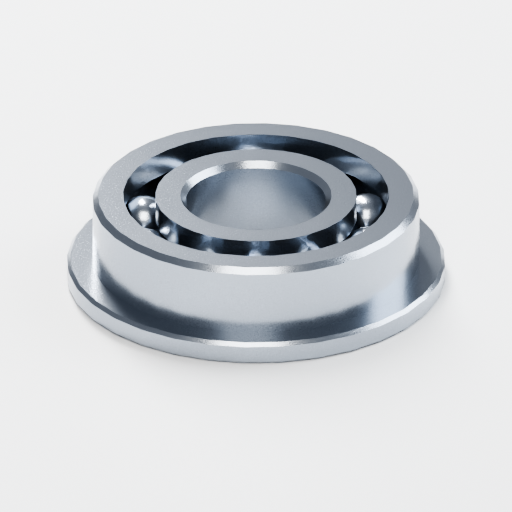
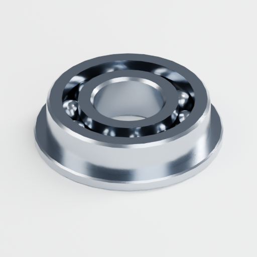
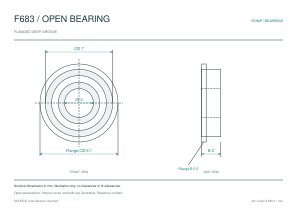

<!-- bearing-catalogue:start -->
# F683 bearing - 3 x 7 x 2 mm

## Summary

Flanged deep groove bearing: 3 mm bore, 7 mm outside diameter and 2 mm width.

| Product view | Isometric view |
| --- | --- |
|  |  |

Generated catalogue illustrations; the open internal geometry is illustrative.

## Details

**OOMP ID:** `hardware_bearing_f600_series_f683_size_3_mm_id_7_mm_od_2_mm_depth`

| Dimension | Nominal value |
| --- | --- |
| Bore / ID | 3 mm |
| Outside diameter / OD | 7 mm |
| Width / B | 2 mm |
| Flange outside diameter | 8.1 mm |
| Flange thickness | 0.5 mm |

**Dimension evidence:** manufacturer checked (review retained from 2026-10-27).

Nominal presentation model. Raceways, pitch circle, chamfers and retainer geometry are illustrative; ball count/diameter are illustrative unless individually sourced. Not a manufacturer reconstruction, load-rating model or manufacturing/tolerance certification. Unspecified closure is presented open. The mesh shows open races and balls; retainers, seals and exact contact surfaces are omitted.



[Printable A4 dimension sheet](working_dimension_a4.pdf) · [1:1 outline](working_svg.svg)

### Source evidence

- [https://koyo.jtekt.co.jp/en/products/detail/print.php?pno=F683](https://koyo.jtekt.co.jp/en/products/detail/print.php?pno=F683)

[Retained research and corrected dimensions](../../source_file/solidcraft/) · [Editable declaration](../../working_oomp_declarations_bearing.py)

## Parts

[Canonical part folder](.) · [Metadata](working.yaml) · [Browse this series](../../navigation/F600/README.md)

### Files

- [Editable OpenSCAD geometry](3dpr.scad)
- [Full model / GLB / metres, Y-up](three_d_model/model_full.glb)
- [Lightweight model / GLB / metres, Y-up](three_d_model/model_display.glb)
- [Editable Blender studio](three_d_model/studio.blend)
- [Product render / 2048 px](three_d_model/render_product_high.png)
- [Isometric render / 2048 px](three_d_model/render_high.png)
- [Populated model and render recipe](three_d_model/parameters.json)
- [Mesh measurements and artifact hashes](three_d_model/manifest.json)
- [Retained native CAD success manifest](solidcraft/latest_success.json)
- [76.2 x 50.8 mm label](label_bearing_3x2.pdf)
- [38.1 x 25.4 mm label](label_bearing_1_5x1.pdf)
- [Retained editable native bearing / SolidCraft](solidcraft/generations/ae8632c8b8c30152_20261027T104727Z_3b7fd143/bearing_f683_open.solidcraft)

### Orthographic views

| Quality | Isometric | Front | Back | Left | Right | Top | Bottom |
| --- | --- | --- | --- | --- | --- | --- | --- |
| Full | [Isometric](three_d_model/full/isometric.svg) | [Front](three_d_model/full/front.svg) | [Back](three_d_model/full/back.svg) | [Left](three_d_model/full/left.svg) | [Right](three_d_model/full/right.svg) | [Top](three_d_model/full/top.svg) | [Bottom](three_d_model/full/bottom.svg) |
| Display | [Isometric](three_d_model/display/isometric.svg) | [Front](three_d_model/display/front.svg) | [Back](three_d_model/display/back.svg) | [Left](three_d_model/display/left.svg) | [Right](three_d_model/display/right.svg) | [Top](three_d_model/display/top.svg) | [Bottom](three_d_model/display/bottom.svg) |

## Assembly

No installation procedure is established for this generic size record. Select the required closure, clearance, tolerance and load rating from the actual purchased bearing specification.

<details>
<summary>Complete OOMP metadata</summary>

```yaml
depth: 2.0
id: hardware_bearing_f600_series_f683_size_3_mm_id_7_mm_od_2_mm_depth
od: 7.0
series: F600
size: F683
svg_details:
  svg_name: bearing_dimension
  title: F683 / OPEN BEARING
  family: FLANGED DEEP GROOVE
  dimensions_mm:
    bore: 3.0
    outside: 7.0
    width: 2.0
    flange_diameter: 8.1
    flange_thickness: 0.5
  sheet_width_mm: 297
  sheet_height_mm: 210
  ink: '#183336'
  accent: '#147d83'
  muted: '#61767a'
  paper: '#ffffff'
  race_face_fill: '#edf3f3'
  inner_race_face_outside_mm: 4.3056
  outer_race_face_inside_mm: 5.6944
  line_width_mm: 0.45
  font_family: Helvetica
  dimension_font_mm: 4
  title_font_mm: 9
  front_centre_mm:
  - 79
  - 103
  side_centre_mm:
  - 211
  - 103
  max_view_width_mm: 78
  max_side_width_mm: 55
  dimension_offset_mm: 12
  arrow_size_mm: 2
  note: Nominal dimensions in mm. Illustration only; no tolerances or fit allowances.
  authority: manufacturer checked
  internal_note: Open presentation; internal races and balls are illustrative. Retainers
    omitted.
  layout:
    left_margin_mm: 14
    right_margin_mm: 283
    title_y_mm: 22
    family_y_mm: 33
    family_font_mm: 3.5
    brand: OOMP / BEARINGS
    brand_font_mm: 3.5
    header_rule_y_mm: 40
    view_caption_y_mm: 173
    view_caption_font_mm: 3
    front_caption: FRONT VIEW
    side_caption: SIDE VIEW
    footer_rule_y_mm: 180
    note_y_mm: 187
    internal_note_y_mm: 194
    note_font_mm: 3.2
    source_y_mm: 202
    source_font_mm: 3
    source_prefix: 'SOURCE: '
    scale_prefix: A4 / scale
  dimension_style:
    line_width_mm: 0.25
    arrow_half_width_ratio: 0.3
    text_gap_mm: 2
    extension_mm: 2
    width_extension_mm: 3
    centre_extension_mm: 5
    dash_pattern_mm:
    - 2
    - 1
    flange_leader_offset_mm:
    - -13
    - 11
    flange_text_offset_mm:
    - -13
    - 16
    flange_font_mm: 3.5
  outline:
    ink: black
    line_width_mm: 0.1
taxonomy_1: hardware
taxonomy_10: ''
taxonomy_11: ''
taxonomy_12: ''
taxonomy_13: ''
taxonomy_14: ''
taxonomy_15: ''
taxonomy_2: bearing
taxonomy_3: F600_series
taxonomy_4: F683_size
taxonomy_5: 3_mm_id
taxonomy_6: 7_mm_od
taxonomy_7: 2_mm_depth
taxonomy_8: ''
taxonomy_9: ''
weight: '0'
width: 2.0
dimension_selection:
  policy: standard_metric_open_catalogue
  previous_id: hardware_bearing_f600_series_f683_size_3_mm_id_7_mm_od_3_mm_depth
  sources:
  - https://koyo.jtekt.co.jp/en/products/detail/print.php?pno=F683
  note: User selected standard catalogue variants on 2026-10-27; no sales ranking
    asserted.
url_chat: https://chatgpt.com/c/6abe3487-a860-83ed-978f-b471bf9cb137
run_action: true
run_oomp: true
run_oomp_populate: true
run_scad: false
generate_stl: false
taxonomy_1_upper: HARDWARE
taxonomy_1_upper_length_1: H
taxonomy_1_upper_length_2: HA
taxonomy_1_upper_length_3: HAR
taxonomy_1_upper_length_4: HARD
taxonomy_1_upper_length_5: HARDW
taxonomy_1_length_1: h
taxonomy_1_length_2: ha
taxonomy_1_length_3: har
taxonomy_1_length_4: hard
taxonomy_1_length_5: hardw
taxonomy_1_capital: Hardware
taxonomy_1_first_letter: h
taxonomy_1_first_letter_upper: H
taxonomy_2_upper: BEARING
taxonomy_2_upper_length_1: B
taxonomy_2_upper_length_2: BE
taxonomy_2_upper_length_3: BEA
taxonomy_2_upper_length_4: BEAR
taxonomy_2_upper_length_5: BEARI
taxonomy_2_length_1: b
taxonomy_2_length_2: be
taxonomy_2_length_3: bea
taxonomy_2_length_4: bear
taxonomy_2_length_5: beari
taxonomy_2_capital: Bearing
taxonomy_2_first_letter: b
taxonomy_2_first_letter_upper: B
taxonomy_3_upper: F600_SERIES
taxonomy_3_upper_length_1: F
taxonomy_3_upper_length_2: F6
taxonomy_3_upper_length_3: F60
taxonomy_3_upper_length_4: F600
taxonomy_3_upper_length_5: F600_
taxonomy_3_length_1: F
taxonomy_3_length_2: F6
taxonomy_3_length_3: F60
taxonomy_3_length_4: F600
taxonomy_3_length_5: F600_
taxonomy_3_capital: F600 Series
taxonomy_3_first_letter: F
taxonomy_3_first_letter_upper: F
taxonomy_4_upper: F683_SIZE
taxonomy_4_upper_length_1: F
taxonomy_4_upper_length_2: F6
taxonomy_4_upper_length_3: F68
taxonomy_4_upper_length_4: F683
taxonomy_4_upper_length_5: F683_
taxonomy_4_length_1: F
taxonomy_4_length_2: F6
taxonomy_4_length_3: F68
taxonomy_4_length_4: F683
taxonomy_4_length_5: F683_
taxonomy_4_capital: F683 Size
taxonomy_4_first_letter: F
taxonomy_4_first_letter_upper: F
taxonomy_5_upper: 3_MM_ID
taxonomy_5_upper_length_1: '3'
taxonomy_5_upper_length_2: '3_'
taxonomy_5_upper_length_3: 3_M
taxonomy_5_upper_length_4: 3_MM
taxonomy_5_upper_length_5: 3_MM_
taxonomy_5_length_1: '3'
taxonomy_5_length_2: '3_'
taxonomy_5_length_3: 3_m
taxonomy_5_length_4: 3_mm
taxonomy_5_length_5: 3_mm_
taxonomy_5_capital: 3 mm Id
taxonomy_5_first_letter: '3'
taxonomy_5_first_letter_upper: '3'
taxonomy_6_upper: 7_MM_OD
taxonomy_6_upper_length_1: '7'
taxonomy_6_upper_length_2: '7_'
taxonomy_6_upper_length_3: 7_M
taxonomy_6_upper_length_4: 7_MM
taxonomy_6_upper_length_5: 7_MM_
taxonomy_6_length_1: '7'
taxonomy_6_length_2: '7_'
taxonomy_6_length_3: 7_m
taxonomy_6_length_4: 7_mm
taxonomy_6_length_5: 7_mm_
taxonomy_6_capital: 7 mm Od
taxonomy_6_first_letter: '7'
taxonomy_6_first_letter_upper: '7'
taxonomy_7_upper: 2_MM_DEPTH
taxonomy_7_upper_length_1: '2'
taxonomy_7_upper_length_2: '2_'
taxonomy_7_upper_length_3: 2_M
taxonomy_7_upper_length_4: 2_MM
taxonomy_7_upper_length_5: 2_MM_
taxonomy_7_length_1: '2'
taxonomy_7_length_2: '2_'
taxonomy_7_length_3: 2_m
taxonomy_7_length_4: 2_mm
taxonomy_7_length_5: 2_mm_
taxonomy_7_capital: 2 mm Depth
taxonomy_7_first_letter: '2'
taxonomy_7_first_letter_upper: '2'
id_no_class: hardware_bearing_F600_series_F683_size_3_mm_id_7_mm_od_2_mm_depth
id_no_type: hardware_bearing_F600_series_F683_size_3_mm_id_7_mm_od_2_mm_depth
id_no_size: hardware_bearing_F600_series_size_3_mm_id_7_mm_od_2_mm_depth
oomp_key: oomp_hardware_bearing_F600_series_F683_size_3_mm_id_7_mm_od_2_mm_depth
link_github: https://github.com/oomlout/oomp_bearing_version_5/tree/main/parts/hardware_bearing_f600_series_f683_size_3_mm_id_7_mm_od_2_mm_depth
link_main: https://github.com/oomlout/oomlout_oomp_version_1_messy/tree/main/parts/hardware_bearing_F600_series_F683_size_3_mm_id_7_mm_od_2_mm_depth
link_redirect: https://github.com/oomlout/oomlout_oomp_version_1_messy/tree/main/parts/hardware_bearing_F600_series_F683_size_3_mm_id_7_mm_od_2_mm_depth
directory: parts/hardware_bearing_f600_series_f683_size_3_mm_id_7_mm_od_2_mm_depth
name: F683 bearing
name_no_class: Hardware Bearing F600 Series F683 Size 3 Mm Id 7 Mm Od 2 Mm Depth
name_no_type: Hardware Bearing F600 Series F683 Size 3 Mm Id 7 Mm Od 2 Mm Depth
name_no_size: Hardware Bearing F600 Series Size 3 Mm Id 7 Mm Od 2 Mm Depth
md5: 9f7618dff51ebf6f684a6e3c9cf84635
md5_5: 9f761
md5_5_upper: 9F761
md5_6: 9f7618
md5_6_upper: 9F7618
md5_6_alpha: 67zmg
md5_6_alpha_upper: 67ZMG
md5_10: 9f7618dff5
md5_10_upper: 9F7618DFF5
bip_39_full_array:
- panda
- radio
- dawn
- tuition
- typical
- response
- patrol
- evidence
- develop
- treat
- bag
- hidden
bip_39_full_space: panda radio dawn tuition typical response patrol evidence develop
  treat bag hidden
bip_39_full_no_space: pandaradiodawntuitiontypicalresponsepatrolevidencedeveloptreatbaghidden
bip_39_full_underscore: panda_radio_dawn_tuition_typical_response_patrol_evidence_develop_treat_bag_hidden
bip_39_2_word_array:
- panda
- radio
bip_39_2_word_space: panda radio
bip_39_2_word_no_space: pandaradio
bip_39_2_word_underscore: panda_radio
bip_39_3_word_array:
- panda
- radio
- dawn
bip_39_3_word_space: panda radio dawn
bip_39_3_word_no_space: pandaradiodawn
bip_39_3_word_underscore: panda_radio_dawn
name_space: hardware bearing F600 series F683 size 3 mm id 7 mm od 2 mm depth
name_proper: F683 bearing
name_upper: HARDWARE BEARING F600 SERIES F683 SIZE 3 MM ID 7 MM OD 2 MM DEPTH
oomlout_ai_roboclick_1:
  file_test: ''
  actions:
  - command: text_jinja_template
    description: Bold bearing label 3x2
    file_template: C:\od\OneDrive\docs\oomp_bearing\source_file\template_jinja\label_bearing_bold\3x2.svg.j2
    file_output: label_bearing_bold_3x2.svg
    dict_data_yaml_files:
      label_source: C:\od\OneDrive\docs\oomp_bearing\parts_source\hardware_bearing_f600_series_f683_size_3_mm_id_7_mm_od_2_mm_depth\working.yaml
      label_manual: C:\od\OneDrive\docs\oomp_bearing\parts\hardware_bearing_f600_series_f683_size_3_mm_id_7_mm_od_2_mm_depth\working_manual.yaml
    convert_to_pdf: false
    convert_to_png: false
oomlout_ai_roboclick_2:
  file_test: ''
  actions:
  - command: text_jinja_template
    description: Bold bearing label 1_5x1
    file_template: C:\od\OneDrive\docs\oomp_bearing\source_file\template_jinja\label_bearing_bold\1_5x1.svg.j2
    file_output: label_bearing_bold_1_5x1.svg
    dict_data_yaml_files:
      label_source: C:\od\OneDrive\docs\oomp_bearing\parts_source\hardware_bearing_f600_series_f683_size_3_mm_id_7_mm_od_2_mm_depth\working.yaml
      label_manual: C:\od\OneDrive\docs\oomp_bearing\parts\hardware_bearing_f600_series_f683_size_3_mm_id_7_mm_od_2_mm_depth\working_manual.yaml
    convert_to_pdf: false
    convert_to_png: false
catalogue_schema: oomp_bearing_v5
oomp_id: hardware_bearing_f600_series_f683_size_3_mm_id_7_mm_od_2_mm_depth
family: flanged_deep_groove
dimensions_mm:
  bore: 3.0
  outside: 7.0
  width: 2.0
  flange_diameter: 8.1
  flange_thickness: 0.5
bore: 3.0
dimension_authority: manufacturer_checked
source_checked: '2026-10-27'
sources:
- https://koyo.jtekt.co.jp/en/products/detail/print.php?pno=F683
model_note: Nominal presentation model. Raceways, pitch circle, chamfers and retainer
  geometry are illustrative; ball count/diameter are illustrative unless individually
  sourced. Not a manufacturer reconstruction, load-rating model or manufacturing/tolerance
  certification. Unspecified closure is presented open. The mesh shows open races
  and balls; retainers, seals and exact contact surfaces are omitted.
closure: open
three_d_model_details:
  schema_version: 1
  generator: bearing_open
  output_folder: three_d_model
  parameters:
    bore: 3.0
    outside: 7.0
    width: 2.0
    edge: 0.12
    pitch_radius: 2.5
    ball_radius: 0.56
    groove_radius: 0.5740000000000001
    inner_shoulder: 2.1528
    outer_shoulder: 2.8472
    cage_half_width: 0.30800000000000005
    cage_low: 0.532
    cage_high: 0.644
    window_radius: 0.26880000000000004
    flange_diameter: 8.1
    flange_thickness: 0.5
    flange_edge: 0.075
    identity: hardware_bearing_f600_series_f683_size_3_mm_id_7_mm_od_2_mm_depth
    specification: F683 / 3 x 7 x 2 mm
    characteristic_dimension_mm: 8.1
    characteristic_dimension_basis: maximum nominal envelope dimension
    ball_count: 10
    balls_per_row: 10
    row_count: 1
    ball_specification: illustrative
    contact_angle_authority: not_applicable
    row_centres_z:
    - 1.0
    components:
    - name: outer_race
      shape: revolved_profile
      profile_mm:
      - - 3.9749999999999996
        - 0
      - - 4.05
        - 0.075
      - - 4.05
        - 0.425
      - - 3.9749999999999996
        - 0.5
      - - 3.5
        - 0.5
      - - 3.5
        - 1.88
      - - 3.38
        - 2.0
      - - 2.8472
        - 2.0
      - - 2.8472
        - 1.88
      - - 2.8472
        - 1.574
      - - 2.8472
        - 1.5453000000000001
      - - 2.8472
        - 1.5166
      - - 2.8472
        - 1.4879
      - - 2.8472
        - 1.4592
      - - 2.8796653131377687
        - 1.4305
      - - 2.9099179917983595
        - 1.4018000000000002
      - - 2.936202235207478
        - 1.3731
      - - 2.9592
        - 1.3444
      - - 2.979384511639665
        - 1.3157
      - - 2.997098581772268
        - 1.287
      - - 3.0125983905554135
        - 1.2583
      - - 3.0260796897809303
        - 1.2296
      - - 3.037694327662102
        - 1.2008999999999999
      - - 3.0475611016133266
        - 1.1722000000000001
      - - 3.0557731101807644
        - 1.1435
      - - 3.062402844943018
        - 1.1148
      - - 3.0675057620852852
        - 1.0861
      - - 3.0711227888992
        - 1.0574
      - - 3.073282051001076
        - 1.0287000000000002
      - - 3.074
        - 1.0
      - - 3.073282051001076
        - 0.9712999999999999
      - - 3.0711227888992
        - 0.9426
      - - 3.0675057620852852
        - 0.9138999999999999
      - - 3.062402844943018
        - 0.8852
      - - 3.0557731101807644
        - 0.8565
      - - 3.0475611016133266
        - 0.8278
      - - 3.037694327662102
        - 0.7990999999999999
      - - 3.0260796897809303
        - 0.7704
      - - 3.0125983905554135
        - 0.7417
      - - 2.997098581772268
        - 0.713
      - - 2.979384511639665
        - 0.6842999999999999
      - - 2.9592
        - 0.6556
      - - 2.936202235207478
        - 0.6269
      - - 2.9099179917983595
        - 0.5982
      - - 2.8796653131377687
        - 0.5694999999999999
      - - 2.8472
        - 0.5408
      - - 2.8472
        - 0.5121
      - - 2.8472
        - 0.48339999999999994
      - - 2.8472
        - 0.45469999999999994
      - - 2.8472
        - 0.42599999999999993
      - - 2.8472
        - 0.12
      - - 2.8472
        - 0.0
      - - 3.9749999999999996
        - 0
    - name: inner_race
      shape: revolved_profile
      profile_mm:
      - - 2.1528
        - 0.0
      - - 2.1528
        - 0.12
      - - 2.1528
        - 0.42599999999999993
      - - 2.1528
        - 0.45469999999999994
      - - 2.1528
        - 0.48339999999999994
      - - 2.1528
        - 0.5121
      - - 2.1528
        - 0.5408
      - - 2.1203346868622313
        - 0.5694999999999999
      - - 2.0900820082016405
        - 0.5982
      - - 2.063797764792522
        - 0.6269
      - - 2.0408
        - 0.6556
      - - 2.020615488360335
        - 0.6842999999999999
      - - 2.002901418227732
        - 0.713
      - - 1.9874016094445865
        - 0.7417
      - - 1.9739203102190694
        - 0.7704
      - - 1.962305672337898
        - 0.7990999999999999
      - - 1.9524388983866732
        - 0.8278
      - - 1.9442268898192356
        - 0.8565
      - - 1.9375971550569822
        - 0.8852
      - - 1.932494237914715
        - 0.9138999999999999
      - - 1.9288772111008
        - 0.9426
      - - 1.9267179489989241
        - 0.9712999999999999
      - - 1.926
        - 1.0
      - - 1.9267179489989241
        - 1.0287000000000002
      - - 1.9288772111008
        - 1.0574
      - - 1.932494237914715
        - 1.0861
      - - 1.9375971550569822
        - 1.1148
      - - 1.9442268898192356
        - 1.1435
      - - 1.9524388983866732
        - 1.1722000000000001
      - - 1.9623056723378978
        - 1.2008999999999999
      - - 1.9739203102190694
        - 1.2296
      - - 1.9874016094445865
        - 1.2583
      - - 2.002901418227732
        - 1.287
      - - 2.020615488360335
        - 1.3157
      - - 2.0408
        - 1.3444
      - - 2.063797764792522
        - 1.3731
      - - 2.0900820082016405
        - 1.4018000000000002
      - - 2.1203346868622313
        - 1.4305
      - - 2.1528
        - 1.4592
      - - 2.1528
        - 1.4879
      - - 2.1528
        - 1.5166
      - - 2.1528
        - 1.5453000000000001
      - - 2.1528
        - 1.574
      - - 2.1528
        - 1.88
      - - 2.1528
        - 2.0
      - - 1.62
        - 2.0
      - - 1.5
        - 1.88
      - - 1.5
        - 0.12
      - - 1.62
        - 0
      - - 2.1528
        - 0.0
    - name: ball_row_1_1
      shape: sphere
      radius_mm: 0.56
      centre_mm:
      - 2.5
      - 0.0
      - 1.0
    - name: ball_row_1_2
      shape: sphere
      radius_mm: 0.56
      centre_mm:
      - 2.0225424859373686
      - 1.469463130731183
      - 1.0
    - name: ball_row_1_3
      shape: sphere
      radius_mm: 0.56
      centre_mm:
      - 0.7725424859373686
      - 2.3776412907378837
      - 1.0
    - name: ball_row_1_4
      shape: sphere
      radius_mm: 0.56
      centre_mm:
      - -0.7725424859373684
      - 2.377641290737884
      - 1.0
    - name: ball_row_1_5
      shape: sphere
      radius_mm: 0.56
      centre_mm:
      - -2.022542485937368
      - 1.4694631307311832
      - 1.0
    - name: ball_row_1_6
      shape: sphere
      radius_mm: 0.56
      centre_mm:
      - -2.5
      - 3.061616997868383e-16
      - 1.0
    - name: ball_row_1_7
      shape: sphere
      radius_mm: 0.56
      centre_mm:
      - -2.0225424859373686
      - -1.4694631307311825
      - 1.0
    - name: ball_row_1_8
      shape: sphere
      radius_mm: 0.56
      centre_mm:
      - -0.7725424859373689
      - -2.3776412907378837
      - 1.0
    - name: ball_row_1_9
      shape: sphere
      radius_mm: 0.56
      centre_mm:
      - 0.7725424859373681
      - -2.377641290737884
      - 1.0
    - name: ball_row_1_10
      shape: sphere
      radius_mm: 0.56
      centre_mm:
      - 2.022542485937368
      - -1.4694631307311834
      - 1.0
  modelling_note: Nominal presentation model. Raceways, pitch circle, chamfers and
    retainer geometry are illustrative; ball count/diameter are illustrative unless
    individually sourced. Not a manufacturer reconstruction, load-rating model or
    manufacturing/tolerance certification. Unspecified closure is presented open.
    The mesh shows open races and balls; retainers, seals and exact contact surfaces
    are omitted.
  dimension_authority: manufacturer_checked
  model_formats:
  - glb
  variants:
    full:
      angular_segments: 128
      sphere_subdivisions: 3
    display:
      angular_segments: 32
      sphere_subdivisions: 2
  views:
  - isometric
  - front
  - back
  - left
  - right
  - top
  - bottom
  material:
    name: Illustrative polished bearing steel
    base_colour_srgb:
    - 0.62
    - 0.65
    - 0.69
    metallic: 1.0
    roughness: 0.22
    roughness_variation: 0.045
    coat_weight: 0.02
    coat_roughness: 0.28
    microtexture_spacing_mm: 0.025
    microtexture_height_um: 0.8
    note: Illustrative bearing steel; material grade and finish are not specified.
  studio:
    engine: cycles
    device: auto
    seed: 7991
    low_samples: 24
    high_samples: 48
    adaptive_threshold: 0.015
    denoise: true
    view_transform: AgX
    look: AgX - Medium High Contrast
    exposure: 0.0
    world_colour:
    - 0.78
    - 0.82
    - 0.9
    world_strength: 0.35
    floor_colour_srgb:
    - 0.93
    - 0.935
    - 0.94
    floor_roughness: 0.55
    framing_margin: 0.13
    lights:
    - name: Key softbox
      position:
      - -3
      - -4
      - 6
      power: 650.0
      width: 4.0
      height: 5.0
      colour:
      - 1.0
      - 0.96
      - 0.9
    - name: Fill softbox
      position:
      - 4
      - -1
      - 3
      power: 330.0
      width: 3.0
      height: 4.0
      colour:
      - 0.9
      - 0.95
      - 1.0
    - name: Rim strip
      position:
      - 1
      - 4
      - 4
      power: 850.0
      width: 1.2
      height: 5.0
      colour:
      - 1.0
      - 1.0
      - 1.0
    poses:
      isometric:
        camera_eye:
        - 1
        - -1
        - 1
        projection: orthographic
        orientation: principal axis Z up
      product:
        camera_eye:
        - -6
        - -10
        - 6
        projection: orthographic
        orientation: resting on lower face
        yaw_degrees: -12.0
        support: Stable convex-hull support using actual mesh centre of mass.
        resting_axis: face
  renders:
    low:
      file: render_low.png
      variant: display
      pixels: 512
      view: isometric
    high:
      file: render_high.png
      variant: full
      pixels: 2048
      view: isometric
    product_low:
      file: render_product_low.png
      variant: display
      pixels: 512
      view: product
    product_high:
      file: render_product_high.png
      variant: full
      pixels: 2048
      view: product
oobb_type: bearing_open
oobb_details:
  oobb_type: bearing_open
  run_scad: true
  run_solidcraft: false
  angular_segments: 128
  components:
  - name: outer_race
    shape: revolved_profile
    profile_mm:
    - - 3.9749999999999996
      - 0
    - - 4.05
      - 0.075
    - - 4.05
      - 0.425
    - - 3.9749999999999996
      - 0.5
    - - 3.5
      - 0.5
    - - 3.5
      - 1.88
    - - 3.38
      - 2.0
    - - 2.8472
      - 2.0
    - - 2.8472
      - 1.88
    - - 2.8472
      - 1.574
    - - 2.8472
      - 1.5453000000000001
    - - 2.8472
      - 1.5166
    - - 2.8472
      - 1.4879
    - - 2.8472
      - 1.4592
    - - 2.8796653131377687
      - 1.4305
    - - 2.9099179917983595
      - 1.4018000000000002
    - - 2.936202235207478
      - 1.3731
    - - 2.9592
      - 1.3444
    - - 2.979384511639665
      - 1.3157
    - - 2.997098581772268
      - 1.287
    - - 3.0125983905554135
      - 1.2583
    - - 3.0260796897809303
      - 1.2296
    - - 3.037694327662102
      - 1.2008999999999999
    - - 3.0475611016133266
      - 1.1722000000000001
    - - 3.0557731101807644
      - 1.1435
    - - 3.062402844943018
      - 1.1148
    - - 3.0675057620852852
      - 1.0861
    - - 3.0711227888992
      - 1.0574
    - - 3.073282051001076
      - 1.0287000000000002
    - - 3.074
      - 1.0
    - - 3.073282051001076
      - 0.9712999999999999
    - - 3.0711227888992
      - 0.9426
    - - 3.0675057620852852
      - 0.9138999999999999
    - - 3.062402844943018
      - 0.8852
    - - 3.0557731101807644
      - 0.8565
    - - 3.0475611016133266
      - 0.8278
    - - 3.037694327662102
      - 0.7990999999999999
    - - 3.0260796897809303
      - 0.7704
    - - 3.0125983905554135
      - 0.7417
    - - 2.997098581772268
      - 0.713
    - - 2.979384511639665
      - 0.6842999999999999
    - - 2.9592
      - 0.6556
    - - 2.936202235207478
      - 0.6269
    - - 2.9099179917983595
      - 0.5982
    - - 2.8796653131377687
      - 0.5694999999999999
    - - 2.8472
      - 0.5408
    - - 2.8472
      - 0.5121
    - - 2.8472
      - 0.48339999999999994
    - - 2.8472
      - 0.45469999999999994
    - - 2.8472
      - 0.42599999999999993
    - - 2.8472
      - 0.12
    - - 2.8472
      - 0.0
    - - 3.9749999999999996
      - 0
  - name: inner_race
    shape: revolved_profile
    profile_mm:
    - - 2.1528
      - 0.0
    - - 2.1528
      - 0.12
    - - 2.1528
      - 0.42599999999999993
    - - 2.1528
      - 0.45469999999999994
    - - 2.1528
      - 0.48339999999999994
    - - 2.1528
      - 0.5121
    - - 2.1528
      - 0.5408
    - - 2.1203346868622313
      - 0.5694999999999999
    - - 2.0900820082016405
      - 0.5982
    - - 2.063797764792522
      - 0.6269
    - - 2.0408
      - 0.6556
    - - 2.020615488360335
      - 0.6842999999999999
    - - 2.002901418227732
      - 0.713
    - - 1.9874016094445865
      - 0.7417
    - - 1.9739203102190694
      - 0.7704
    - - 1.962305672337898
      - 0.7990999999999999
    - - 1.9524388983866732
      - 0.8278
    - - 1.9442268898192356
      - 0.8565
    - - 1.9375971550569822
      - 0.8852
    - - 1.932494237914715
      - 0.9138999999999999
    - - 1.9288772111008
      - 0.9426
    - - 1.9267179489989241
      - 0.9712999999999999
    - - 1.926
      - 1.0
    - - 1.9267179489989241
      - 1.0287000000000002
    - - 1.9288772111008
      - 1.0574
    - - 1.932494237914715
      - 1.0861
    - - 1.9375971550569822
      - 1.1148
    - - 1.9442268898192356
      - 1.1435
    - - 1.9524388983866732
      - 1.1722000000000001
    - - 1.9623056723378978
      - 1.2008999999999999
    - - 1.9739203102190694
      - 1.2296
    - - 1.9874016094445865
      - 1.2583
    - - 2.002901418227732
      - 1.287
    - - 2.020615488360335
      - 1.3157
    - - 2.0408
      - 1.3444
    - - 2.063797764792522
      - 1.3731
    - - 2.0900820082016405
      - 1.4018000000000002
    - - 2.1203346868622313
      - 1.4305
    - - 2.1528
      - 1.4592
    - - 2.1528
      - 1.4879
    - - 2.1528
      - 1.5166
    - - 2.1528
      - 1.5453000000000001
    - - 2.1528
      - 1.574
    - - 2.1528
      - 1.88
    - - 2.1528
      - 2.0
    - - 1.62
      - 2.0
    - - 1.5
      - 1.88
    - - 1.5
      - 0.12
    - - 1.62
      - 0
    - - 2.1528
      - 0.0
  - name: ball_row_1_1
    shape: sphere
    radius_mm: 0.56
    centre_mm:
    - 2.5
    - 0.0
    - 1.0
  - name: ball_row_1_2
    shape: sphere
    radius_mm: 0.56
    centre_mm:
    - 2.0225424859373686
    - 1.469463130731183
    - 1.0
  - name: ball_row_1_3
    shape: sphere
    radius_mm: 0.56
    centre_mm:
    - 0.7725424859373686
    - 2.3776412907378837
    - 1.0
  - name: ball_row_1_4
    shape: sphere
    radius_mm: 0.56
    centre_mm:
    - -0.7725424859373684
    - 2.377641290737884
    - 1.0
  - name: ball_row_1_5
    shape: sphere
    radius_mm: 0.56
    centre_mm:
    - -2.022542485937368
    - 1.4694631307311832
    - 1.0
  - name: ball_row_1_6
    shape: sphere
    radius_mm: 0.56
    centre_mm:
    - -2.5
    - 3.061616997868383e-16
    - 1.0
  - name: ball_row_1_7
    shape: sphere
    radius_mm: 0.56
    centre_mm:
    - -2.0225424859373686
    - -1.4694631307311825
    - 1.0
  - name: ball_row_1_8
    shape: sphere
    radius_mm: 0.56
    centre_mm:
    - -0.7725424859373689
    - -2.3776412907378837
    - 1.0
  - name: ball_row_1_9
    shape: sphere
    radius_mm: 0.56
    centre_mm:
    - 0.7725424859373681
    - -2.377641290737884
    - 1.0
  - name: ball_row_1_10
    shape: sphere
    radius_mm: 0.56
    centre_mm:
    - 2.022542485937368
    - -1.4694631307311834
    - 1.0
label_details:
  size: F683
  dimensions: 3 x 7 x 2 mm
  formats_mm:
  - - 76.2
    - 50.8
  - - 38.1
    - 25.4
  ink: '#183336'
  accent: '#147d83'
  paper: '#ffffff'
  font_family: Helvetica
  view_box_mm:
  - 0
  - 0
  - 76.2
  - 50.8
  file_stems:
  - label_bearing_3x2
  - label_bearing_1_5x1
  brand: OOMP / BEARING
  brand_position_mm:
  - 5
  - 10
  brand_font_mm: 3
  size_position_mm:
  - 5
  - 29
  size_font_mm: 14
  dimensions_position_mm:
  - 5
  - 42
  dimensions_font_mm: 4
readme_details:
  title: F683 bearing - 3 x 7 x 2 mm
  description: 'Flanged deep groove bearing: 3 mm bore, 7 mm outside diameter and
    2 mm width.'
```

</details>
<!-- bearing-catalogue:end -->
