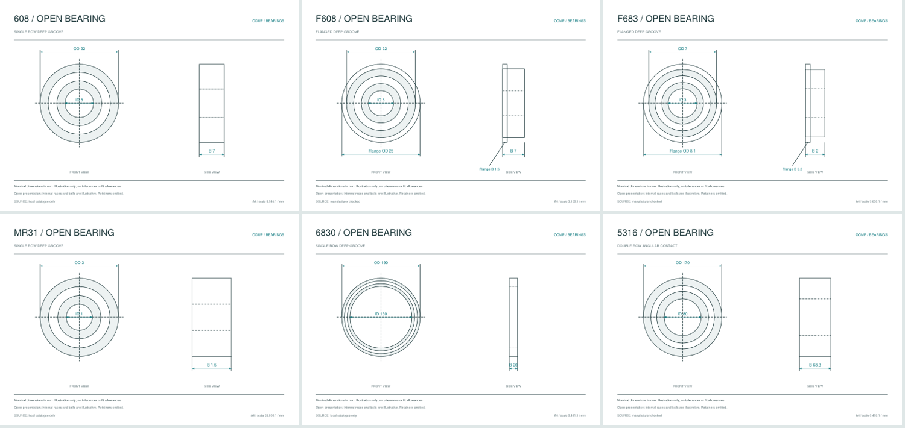
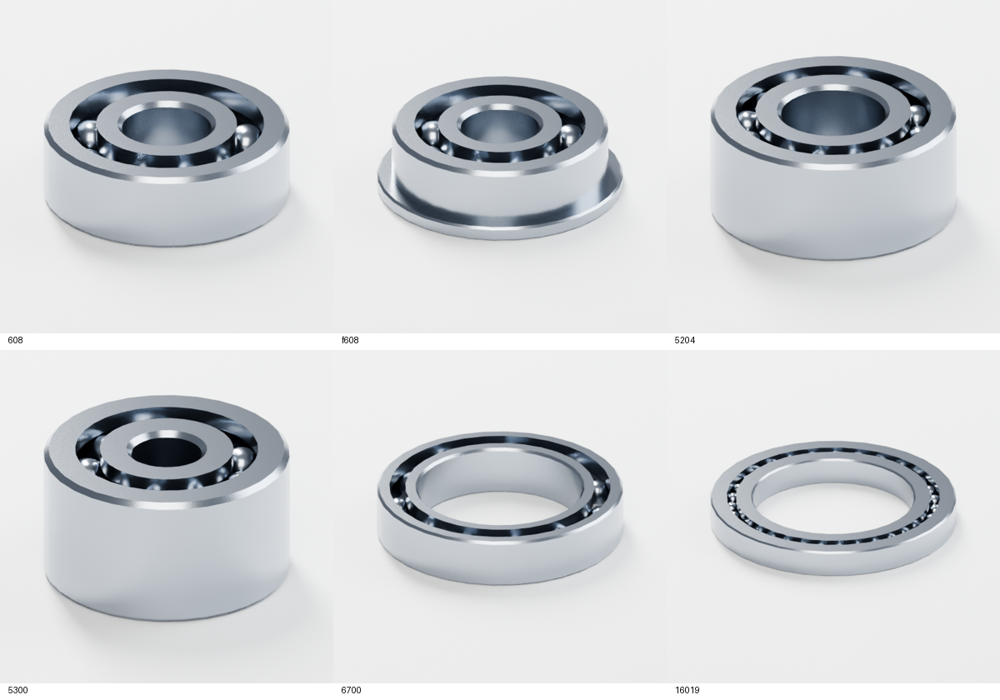

# Catalogue visual checks

These contact sheets show representative generated assets inspected during the
migration. The source SVG, PDF and PNG files remain in their respective part
folders; the contact sheets are review aids.

## Dimension sheets

The selection covers small, large, flanged and double-row bearings. A4 sheets and
both label sizes were also checked for correct physical page dimensions and
readable bearing designations. Moving the final layout settings into population
left the checked PDF previews pixel-identical.

## Studio renders

The open-bearing render selection covers ordinary, flanged, double-row and thin
bearings. Internal geometry is illustrative. The saved 608 Blender studio was
reopened successfully with its mesh, camera and materials intact.

For complete per-part checks rather than visual samples, see
[catalogue validation](../build_validation.json) and
[retained native history integrity](../native_history_validation.json).
